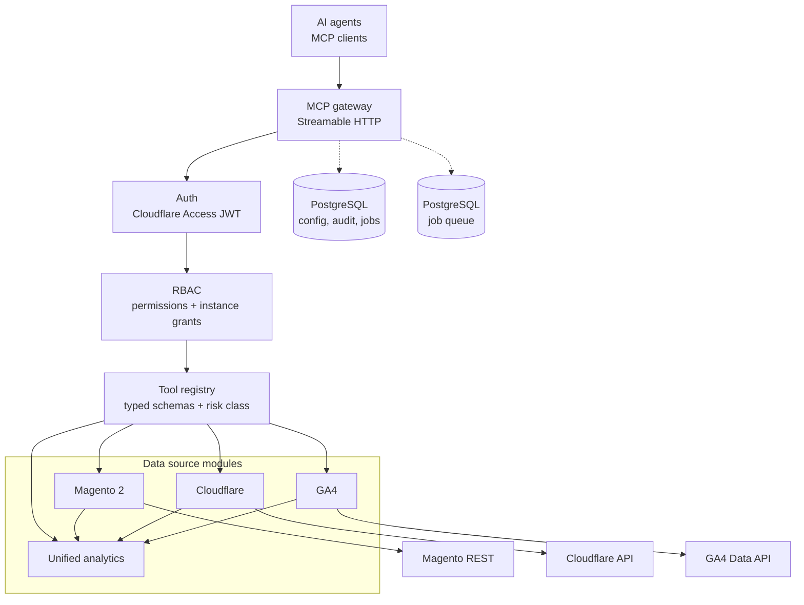

# mage2mcp

[](https://github.com/shuaiZend/mage2mcp/actions/workflows/ci.yml)
[](https://github.com/shuaiZend/mage2mcp/releases)
[](https://github.com/shuaiZend/mage2mcp/releases/tag/v0.11.9)
[](LICENSE)
[](go.mod)
[](docs/mcp-conformance.md)

**Open-source MCP gateway for Magento 2, Cloudflare, and Google Analytics 4.**
One endpoint, one auth model, one audit trail — with typed, documented tools that AI
agents can actually use safely. Writes are two-step human-approved; reads are
read-only by default and PII-safe.

> [!TIP]
> **New here?** The [tutorial](docs/tutorial.md) takes you from an empty machine to an agent
> that reads a real store, changes a price, places an order and refunds it — with the approval
> gate exercised along the way, not described from a distance. Translated:
> [中文](docs/i18n/zh/tutorial.md) · [Español](docs/i18n/es/tutorial.md) ·
> [Nederlands](docs/i18n/nl/tutorial.md).

In a hurry? [Quickstart](#quickstart-development) · [Docker](#docker) ·
[all documentation](docs/index.md).

> **Status: v0.11.9 (pre-1.0).** Interfaces may still change with an ADR before 1.0.
> What is tested and what is not is in [verification status](#verification-status); what is
> known to be missing is in [known limitations](docs/audit/known-limitations.md).

## Why mage2mcp

- **Typed contracts, not prompt glue.** Every tool has a stable name, JSON Schema,
  permission scope, timeout, and annotations. A contract test pins the Magento
  tool names; a docs test fails if the Magento catalog drifts.
- **Safe writes.** Writes require an opaque confirmation approved by a *different*
  identity, bound to the canonical argument hash, the tool, and the instance.
  Every write is gated by a durable operation ledger with fencing and idempotency
  keys; an ambiguous outcome becomes `unknown` and is reconciled, never retried.
- **PII is bounded and disclosed.** Customer reads return country/region/default
  flags only. A single-order read returns the shipping and billing addresses
  (recipient, street, phone, address email) because support cannot confirm a
  delivery without them, and it never returns payment data; order search omits
  addresses.
- **Built for operations.** PostgreSQL job queue (no Redis), advisory-locked
  migrations, an operation ledger with a reconciler, async imports with
  idempotency, live progress, resumable failed rows, and 30-day batch retention.
- **Multi-instance.** Several Magento stores, Cloudflare zones, and GA4 properties
  behind one gateway with per-instance authorization and audit. Unified analytics
  bindings currently require exactly one Cloudflare zone and one GA4 property.

## Tool surface (up to 115 tools)

The count is a function of configuration: the read-only default registers 56 tools
(45 Magento); `tools.writes: true` adds 53 Magento write tools, `database.url` adds the
asynchronous import tools, and a `bindings` block adds the unified tool. The table below is
the maximal surface; [implemented-tools.md](docs/implemented-tools.md) is generated from the
registry and is the authoritative count.

| Module | Tools at full configuration | Examples |
|---|---:|---|
| Magento 2 | 104 | products, configurable variants, categories, MSI inventory, orders, invoices/shipments/credit memos, customers, media, imports, business analysis |
| Cloudflare | 3 | zone traffic, security events, security summary |
| Google Analytics 4 | 6 | traffic reports, realtime, ecommerce, property metadata/capabilities |
| Unified analytics | 1 | Magento vs GA4 traffic comparison |
| Platform | 1 | `platform.info` (versions, instances, write flag) |

Highlights of the Magento surface:

- **Catalog**: create/update/delete, batch reads, bulk update, SEO audit, media
  (upload/list/get/update/delete/types), tier prices, custom options, attribute
  options (create/bulk/delete).
- **Configurable**: parent create/update, variant pre-checks, option declaration,
  explicit variation creation, child linking.
- **Inventory (MSI)**: sources, stocks, source items, assign/unassign/transfer,
  source create, stock-source link/unlink.
- **Orders & documents**: create (cart flow), search/get, status history, comments,
  hold/unhold, email, cancel; invoice/shipment/credit-memo read, create, capture,
  email.
- **Customers**: PII-safe reads, create/update, address create/update/delete.
- **Imports**: validate, execute, async start/status/cancel, batch history, resume.
- **Analytics**: `magento.sales.analysis` and `magento.orders.geography` return
  PII-free aggregates (KPIs, repeat/new customers, coupons, shipping methods,
  AOV bands, timezone buckets, refunds by SKU, shipment latency).

## What exists today

| Item | State |
|---|---|
| Source code | Go gateway: MCP server, auth, RBAC, audit, metrics, PostgreSQL queue and operation ledger, Docker |
| Tests and CI | Unit, race, contract, PostgreSQL-backed and fake-Magento e2e tests; GitHub CI is a manual pre-release workflow, `scripts/local-ci.sh` is the day-to-day gate |
| Releases | [v0.11.9](https://github.com/shuaiZend/mage2mcp/releases/tag/v0.11.9) with signed artifacts, checksums, SBOM, multi-arch GHCR image |
| Verification | Read-only acceptance against a live Magento store (23 checks, 924-order business report); write verification on a disposable demo; **no live Magento integration test** |
| Documentation | Architecture, ADRs (22), tool catalog, field reference, configuration, compatibility, operations, release notes |
| License and community | [Apache-2.0](LICENSE), [NOTICE](NOTICE), [CONTRIBUTING.md](CONTRIBUTING.md), [CODE_OF_CONDUCT.md](CODE_OF_CONDUCT.md), [SECURITY.md](SECURITY.md), [SUPPORT.md](SUPPORT.md) |

## Verification status

| Claim | Status | Evidence |
|---|---|---|
| Read-only acceptance against a live Magento production store | TESTED (manual, read-only; no automated test) | [production acceptance](docs/operations/production-acceptance.md) |
| 30-day business drill-down (924 orders) | TESTED (manual, read-only) | [business analysis report](docs/reports/business-analysis-2026-11-20.html) |
| Write verification | TESTED (manual, disposable demo; v0.8.1 build) | [Magento write verification](docs/development/magento-write-verification.md) |
| Automated Magento integration test | PLANNED | none exists (MAG-23); all Magento coverage is CONTRACT |
| Cloudflare / GA4 live API behaviour | PLANNED (unverified) | no live instance was available |
| Unit, contract, PostgreSQL and fake-Magento e2e tests | TESTED | `scripts/local-ci.sh`, `test/e2e/` |

## Releases

The latest release is [**v0.11.9**](https://github.com/shuaiZend/mage2mcp/releases/tag/v0.11.9)
(2026-11-22), the persona pass: seven agents with different jobs tested the gateway the way
their work actually uses it, produced 101 findings, and the deduplicated 85 were repaired. It
closes a silent repricing bug where a weight edit rewrote the selling price, makes partial
refunds stop refunding all shipping, repairs tier prices in both directions, and gives
`operation_unknown` query and disposition tools so an ambiguous write has an exit instead of
sitting forever. Read the [v0.11.9 release notes](docs/releases/v0.11.9.md).

Recent releases: [v0.11.6](docs/releases/v0.11.6.md) (semantic-layer pass: partial refunds and
shipments were applied to the whole order) · [v0.11.5](docs/releases/v0.11.5.md) ·
[v0.11.4](docs/releases/v0.11.4.md) · [all releases](https://github.com/shuaiZend/mage2mcp/releases).

Every tagged release publishes:

- static binaries for linux/amd64, linux/arm64, darwin/amd64, darwin/arm64, and
  windows/amd64 (`mage2mcp-{server,worker,admin}_<os>_<arch>`);
- `checksums.txt` (SHA-256) and an SPDX JSON SBOM plus a third-party notices bundle;
- keyless cosign signatures (`.bundle`) for every artifact and for the multi-arch
  image at `ghcr.io/shuaizend/mage2mcp`;
- SLSA build provenance attestations for the release artifacts.

```bash
# Verify a downloaded artifact against its published signature and checksum.
cosign verify-blob \
  --bundle mage2mcp-server_linux_amd64.bundle \
  --certificate-identity-regexp 'https://github.com/shuaiZend/mage2mcp/' \
  --certificate-oidc-issuer https://token.actions.githubusercontent.com \
  mage2mcp-server_linux_amd64
sha256sum --check checksums.txt
```

| Release | Notes | Highlights |
|---|---|---|
| [v0.11.9](https://github.com/shuaiZend/mage2mcp/releases/tag/v0.11.9) | [release notes](docs/releases/v0.11.9.md) | Persona pass: 85 findings repaired. Silent repricing from a weight edit; partial refunds stopped refunding all shipping; tier prices usable in both directions; `operation_unknown` gained query and disposition tools |
| [v0.11.6](https://github.com/shuaiZend/mage2mcp/releases/tag/v0.11.6) | [release notes](docs/releases/v0.11.6.md) | Semantic-layer pass: partial refunds and shipments were applied to the whole order; approval audit rows rejected by a CHECK constraint; instance binding on the default RBAC policy |
| [v0.11.5](https://github.com/shuaiZend/mage2mcp/releases/tag/v0.11.5) | [release notes](docs/releases/v0.11.5.md) | Import status fix that would have turned a bulk delisting into a bulk listing; product-copy instructions |
| [v0.11.4](https://github.com/shuaiZend/mage2mcp/releases/tag/v0.11.4) | [release notes](docs/releases/v0.11.4.md) | Money path fixes: invoice, shipment and credit memo document creation |
| [v0.11.3](https://github.com/shuaiZend/mage2mcp/releases/tag/v0.11.3) | [release notes](docs/releases/v0.11.3.md) | Live-store defects and the route/schema corrections they exposed |
| [v0.11.2](https://github.com/shuaiZend/mage2mcp/releases/tag/v0.11.2) | [release notes](docs/releases/v0.11.2.md) | Defects found by the live Magento run |
| [v0.11.1](https://github.com/shuaiZend/mage2mcp/releases/tag/v0.11.1) | [release notes](docs/releases/v0.11.1.md) | Operation ledger and reconciler; RBAC scope ladder enforced; confirmation bound to tool and instance; job fencing; per-instance limits; generated tool inventory |
| [v0.11.0](https://github.com/shuaiZend/mage2mcp/releases/tag/v0.11.0) | [release notes](docs/releases/v0.11.0.md) | Write-safety prompt; product-copy fixes D1–D3, D5, D6, D8–D11; admin credential form |
| [v0.10.0](https://github.com/shuaiZend/mage2mcp/releases/tag/v0.10.0) | [release notes](docs/releases/v0.10.0.md) | Admin-credential auto-token; CI speed-ups; Actions refresh; katex advisory |
| [v0.9.0](https://github.com/shuaiZend/mage2mcp/releases/tag/v0.9.0) | [release notes](docs/releases/v0.9.0.md) | Write-verification fixes W1–W6, W9, W11, W12; upstream error messages |
| [v0.8.1](https://github.com/shuaiZend/mage2mcp/releases/tag/v0.8.1) | [release notes](docs/releases/v0.8.1.md) | Structured tool errors (G12) |
| [v0.8.0](https://github.com/shuaiZend/mage2mcp/releases/tag/v0.8.0) | [release notes](docs/releases/v0.8.0.md) | Business analysis fixes; `store.configs` and `categories.flat` |

The complete list, including pre-releases, is on the
[Releases page](https://github.com/shuaiZend/mage2mcp/releases); every version is
also recorded in [CHANGELOG.md](CHANGELOG.md).

## Documentation map

| Start here | For |
|---|---|
| [docs/tutorial.md](docs/tutorial.md) | **Tutorial: from zero to a working agent** — [中文](docs/i18n/zh/tutorial.md) · [Español](docs/i18n/es/tutorial.md) · [Nederlands](docs/i18n/nl/tutorial.md) |
| [docs/guidance.md](docs/guidance.md) | **How the guidance reaches an agent** — instructions, MCP prompts, and the skill; what needs installing and what does not |
| [docs/index.md](docs/index.md) | Documentation entry point |
| [docs/mcp-tools.md](docs/mcp-tools.md) | Design catalog with implementation status |
| [docs/implemented-tools.md](docs/implemented-tools.md) | The 105 tools registered today |
| [docs/magento-fields.md](docs/magento-fields.md) | Field requirements and SEO guidance |
| [docs/configuration.md](docs/configuration.md) | Every configuration key, default, and environment override |
| [docs/compatibility.md](docs/compatibility.md) | Supported components and stability promises |
| [docs/operations/production-acceptance.md](docs/operations/production-acceptance.md) | Live read-only acceptance and fixes |
| [docs/write-safety.md](docs/write-safety.md) | Catalog/URL warnings and the `write_safety` prompt |
| [docs/development/mcp-gaps.md](docs/development/mcp-gaps.md) | Known gaps and their status |

## Quickstart (development)

```bash
# 1. Build
go build -o bin/mage2mcp ./cmd/server

# 2. Configure: the development example is loopback-only, authentication off,
#    and enables no data source, so it starts as shipped.
cp configs/config.example.yaml config.yaml

# 3. Run
./bin/mage2mcp -config config.yaml

# 4. Check liveness and readiness
curl -s localhost:8080/healthz
curl -s localhost:8080/readyz
```

`/readyz` reports the number of registry tools. `platform.info` is itself a
registry tool, so a fresh development start reports `"tools":1` (that one tool);
enable a data source in `config.yaml` (see
[docs/configuration.md](docs/configuration.md)) to expose its tools. It disables authentication and refuses to start on a non-loopback
listener. For production, copy
[`configs/config.production.template.yaml`](configs/config.production.template.yaml),
set the `MAGE2MCP_AUTH_*` and `MAGE2MCP_DATABASE_URL` values, and run behind a
Cloudflare Tunnel. The MCP endpoint is `POST /mcp` (Streamable HTTP).

### Docker

The image bakes a container configuration and probes its own `/healthz` (the
distroless image has no shell):

```bash
# Local stack (development defaults: auth disabled, loopback port, fixed dev passwords)
docker compose up --build

# Or a single container
docker build -t mage2mcp .
docker run --rm -p 127.0.0.1:8080:8080 \
  -e MAGE2MCP_AUTH_ENABLED=false -e MAGE2MCP_DEV_INSECURE=true mage2mcp

curl -s localhost:8080/healthz
curl -s localhost:8080/readyz
```

For a production-shaped stack every secret and Access value is required:

```bash
docker compose -f docker-compose.yml -f docker-compose.prod.yml up -d
```

The baked container configuration enables no data source, so either stack
exposes only `platform.info` until you mount a real configuration over
`/etc/mage2mcp/config.yaml` (see
[docs/configuration.md](docs/configuration.md)). Never expose the development
stack to a network: it runs with authentication disabled and fixed placeholder
passwords.

### High-risk operations

Write tools stay disabled until `tools.writes: true`. When enabled, every write
requires approval by a **different human identity** through the admin surface:

```bash
# List pending confirmations
./bin/mage2mcp-admin -config config.yaml -as you@example.com pending

# Approve one (the agent's requester identity cannot approve its own request)
./bin/mage2mcp-admin -config config.yaml -as you@example.com approve <confirmation-id>
```

Approval requires `database.url`: the admin CLI and the gateway share the
PostgreSQL confirmation store. Approvals are bound to a canonical hash of the
tool arguments, expire after 5 minutes (15 maximum), and are single use.

## Why this exists

AI agents need reliable, auditable access to commerce and analytics systems. Today that
access usually comes in one of two shapes, and both are unsatisfactory.

**Vendor-hosted black boxes.** A SaaS connector sits between the agent and the upstream
API. It sees every request and response, but the operator cannot inspect how tools are
mapped, which credentials are used, what is logged, or how permissions are enforced.
Data leaves the operator's boundary, the integration surface is limited to whatever the
vendor chose to build, and leaving the vendor means rebuilding the integration.

**One-off scripts and ad-hoc endpoints.** A script wraps a few API calls and hands them
to an agent. It has no typed schemas, no authentication model, no authorization model,
no audit trail, and no confirmation step before destructive operations. Credentials
sprawl across laptops and CI. The script bypasses the business logic and permissions of
the systems it touches, and it is invisible to the team that owns those systems.

mage2mcp takes a third position: a **standalone gateway** that the operator deploys,
configures, and audits.

- The gateway runs as its own service, inside the operator's infrastructure. Magento is
  not modified, and no plugin is installed in it.
- It talks only to official upstream APIs — Magento REST (no GraphQL client; ADR-0022), the Cloudflare
  API, and the GA4 Data API. It never connects to the Magento database.
- Each upstream is a separate **instance** with its own credentials and grants, so a
  single gateway can serve several stores, zones, and properties without sharing tokens.
- Every tool will have a typed input schema, a declared risk class, and an audit record.
  There will be no generic "call any endpoint" tool.
- The source, the threat model, and the decision records are public, so operators can
  evaluate the gateway before trusting it with production credentials.

## Architecture diagram



The gateway uses the official
[MCP Go SDK](https://github.com/modelcontextprotocol/go-sdk) and the Streamable HTTP
transport. SDK v1.8.0 negotiates its full supported list, currently `2026-07-28`
through `2024-11-05` (five versions); `platform.info` reports that list verbatim.

In the intended design, a tool call follows one path:

1. **Authenticate** — the caller presents a Cloudflare Access JWT, validated against the
   configured Access application.
2. **Authorize** — RBAC decides whether the caller may use this tool against this
   instance, and whether write operations are enabled for that instance.
3. **Validate** — the input is checked against the tool's JSON Schema before any upstream
   call is made.
4. **Classify and confirm** — high-risk tools require an explicit confirmation bound to a
   hash of the canonicalized parameters; changing any parameter invalidates the
   confirmation.
5. **Execute** — the data source module calls the upstream API with its own
   least-privilege credential.
6. **Audit** — actor, tool, instance, parameter hash, outcome, and duration are recorded,
   with secrets redacted.
7. **Return** — the result is validated against the declared output schema and returned
   to the agent.

Runtime components:

| Component | Role |
|---|---|
| Go service | MCP endpoint, auth, RBAC, tool registry, module orchestration |
| PostgreSQL | Instance configuration metadata, audit log, job state |
| PostgreSQL job queue | Background queues for bulk operations, import polling, and log ingestion (ADR-0019) |
| R2 + ClickHouse (optional) | Raw Cloudflare request logs when Logpush analysis is enabled |
| Prometheus | Metrics endpoint for tool latency, errors, and upstream rate limits |
| `slog` | Structured JSON logs with redaction |
| YAML + environment | Configuration, with secrets supplied only through the environment |

## Architecture at a glance

- **`cmd/server`** — Streamable HTTP MCP endpoint (`/mcp`), `/healthz`, `/readyz`, `/metrics`, auth/RBAC/audit middleware.
- **`internal/magento`, `cloudflare`, `ga4`, `unified`** — module-owned tools and clients; no module imports another.
- **`internal/mcp`** — tool registry, contract validation, confirmation gate, structured error envelope.
- **`internal/storage`** — PostgreSQL for audit, confirmations, the job queue, and import batches (no Redis).
- **`cmd/worker`** — asynchronous import executor with leases, progress, retries, and failed-row resume.
- **Deployment** — distroless multi-arch image; Compose stack for local and test deployments; signed releases.

Request flow: client → auth → RBAC → schema validation → confirmation gate (writes only) → module client → audit → structured result.

## Security posture

The shipped posture, with status labels (the full control matrix is in
[`docs/security/security-review.md`](docs/security/security-review.md)). Labels
are IMPLEMENTED, TESTED, PLANNED, and DEPRECATED; a parenthetical qualifies the
label (CONTRACT, PostgreSQL, PARTIAL, deployment control, operator-configured):

| Property | Status | Notes |
|---|---|---|
| Read-only by default | IMPLEMENTED, TESTED | Write tools are registered only when `tools.writes: true`; the default exposes no write capability. |
| Confirmation for writes | IMPLEMENTED, TESTED | Bound to the tool, the instance, and the canonical argument hash; approved by a different identity; single use; 300 s default / 900 s cap. |
| Operation ledger and replay control | IMPLEMENTED, TESTED (PostgreSQL) | Fencing, idempotency keys, `UNKNOWN` on ambiguity, a reconciler, and recorded-result replay for every write. |
| Audit | IMPLEMENTED (partial) | Intent and outcome rows; denials recorded as denials; secrets redacted. No hash chain yet, and the five self-ledgered money tools have an audit-outcome gap (REL-16-R). |
| No plugin in Magento, no direct database access | IMPLEMENTED | All access is through the official APIs. |
| Least-privilege tokens | IMPLEMENTED (operator-configured) | Use an ACL-scoped Magento integration or API-only admin, a read-only Cloudflare token, and a GA4 Viewer service account. |
| Secrets outside configuration | IMPLEMENTED (partial) | Credentials are `${VAR}` references by convention; the loader does not reject a literal secret. Never commit one. |
| No escape hatches | IMPLEMENTED | No generic API passthrough and no SQL execution tool. |
| Gateway rate limiting | PLANNED | Limit concurrency at the agent or edge; see the [known limitations](docs/audit/known-limitations.md). |
| Session identity binding | PLANNED | A stolen session id is usable for its lifetime (SEC-15). |
| Tamper-evident audit chain | PLANNED | Restrict database grants and export to an immutable sink if you need non-repudiation. |
| Origin lockdown / metrics isolation | DEPLOYMENT CONTROL | The gateway does not enforce Cloudflare-only origin access and serves `/metrics` on the same listener. |

The full threat model, trust boundaries, and mitigations live in
[`docs/security/threat-model.md`](docs/security/threat-model.md); the control
matrix and residual risks are in
[`docs/security/security-review.md`](docs/security/security-review.md) and
[`docs/audit/known-limitations.md`](docs/audit/known-limitations.md).

## Design principles

1. **Modular boundaries.** Each data source is an independent module that implements the
   shared data source contract and declares its capabilities. Modules do not import each
   other's internals, and the core does not know vendor-specific details.
2. **Official APIs only.** Magento REST (no GraphQL client), the Cloudflare API, and the GA4 Data
   API. No scraping, no database access, no plugin, no undocumented endpoints.
3. **Typed tools, no escape hatches.** Every tool has a fixed name, a JSON Schema input
   and output, a risk class, and required permissions. A generic `execute_api` or `execute_sql`
   tool would defeat authorization, validation, and confirmation, so it will not exist.
4. **Explicit metric semantics.** A metric is only comparable when its definition,
   denominator, attribution window, and time zone are declared. Unified analytics
   reports name the semantics they use and refuse to blend incompatible metrics.
5. **Read-only default and least privilege.** The safe state is the default state.
   Enabling a write is a deliberate operator decision, never a default.
6. **Instances are the unit of configuration and authorization.** Credentials, grants,
   and rate limits belong to an instance, not to the process, so one gateway can serve
   multiple upstreams without leaking access between them.
7. **Everything is auditable.** If an action cannot be attributed and reviewed, it is not
   exposed as a tool.
8. **Pre-1.0 interface discipline.** Public interfaces may change, but only through a
   recorded architecture decision. See [`docs/adr/`](docs/adr/).

## Compatibility matrix

These are target combinations for v0.x, not tested configurations. The vendor
documentation behind each constraint is cited in the corresponding integration document.

| Component | Target support | Status | Notes |
|---|---|---|---|
| Magento Open Source and Adobe Commerce | 2.4.x; 2.4.9 is the primary target | IMPLEMENTED, TESTED (CONTRACT) | REST with a bearer, OAuth 1.0a, or admin auto-token credential. No Magento GraphQL client; storefront verification is not implemented (ADR-0022). No live 2.4.9 instance was available, so compatibility is unverified. |
| Adobe Commerce as a Cloud Service | Not supported in v0.x | UNSUPPORTED | Uses Adobe IMS OAuth and does not support traditional token generation. |
| Cloudflare plans | Free, Pro, Business, Enterprise | IMPLEMENTED | Dataset and field availability differs by plan. |
| Cloudflare GraphQL Analytics | Implemented | IMPLEMENTED, TESTED (CONTRACT) | Documented limit is 300 queries per 5-minute window; the gateway does not enforce it (PLANNED quota accounting). |
| Cloudflare Security Events | Implemented | IMPLEMENTED, TESTED (CONTRACT) | Backed by `firewallEventsAdaptive`; retention up to 31 days; results may be sampled. |
| Cloudflare Logpush | Job inventory and log analysis | PLANNED | No log tools ship; `internal/logs/` is empty. |
| Cloudflare raw logs | R2 + ClickHouse | PLANNED | Not implemented; PostgreSQL never stores raw logs. |
| Cloudflare bot signals | Only where entitled | IMPLEMENTED | Bot score, bot tags, and verified-bot fields require Bot Management. |
| GA4 | Data API v1 | IMPLEMENTED, TESTED (CONTRACT) | Aggregate-only; raw events require a BigQuery export. |
| GA4 quotas | Documented per property | PLANNED (not enforced) | A reference property reported 200,000 tokens/day, 40,000 tokens/hour, and 10 concurrent requests. The gateway does not account for them. |
| MCP protocol | `2026-07-28` through `2024-11-05` (five SDK-supported versions) | IMPLEMENTED, TESTED (CONTRACT) | Provided by MCP Go SDK v1.8.0; `platform.info` reports the list. |
| Go | 1.26 or newer | IMPLEMENTED | SDK v1.8.0 requires `go 1.25.0`; current direct dependencies require 1.26; 1.27.x is the current toolchain. |
| PostgreSQL | 16 or newer | IMPLEMENTED, TESTED (PostgreSQL) | Configuration metadata, audit log, confirmations, operation ledger, job state. |
| Container runtime | Docker with Compose | IMPLEMENTED | Local stack and deployment. |

## Full documentation index

The documentation is written in public and kept in sync with the code; a
contract test fails when the Magento tool catalog and the docs drift.

| Document | Contents |
|---|---|
| [`docs/index.md`](docs/index.md) | Entry point for all design, integration, and development documents |
| [`docs/architecture.md`](docs/architecture.md) | System architecture, components, request lifecycle, deployment topology |
| [`docs/module-boundaries.md`](docs/module-boundaries.md) | Data source contract, capability declaration, dependency rules |
| [`docs/database-design.md`](docs/database-design.md) | PostgreSQL schema for configuration, audit, and job state |
| [`docs/mcp-tools.md`](docs/mcp-tools.md) | Tool naming, input and output schemas, risk classes, confirmation model |
| [`docs/mcp-conformance.md`](docs/mcp-conformance.md) | MCP conformance matrix: tools, transport, authorization, and the tests that prove them |
| [`docs/implemented-tools.md`](docs/implemented-tools.md) | The tools registered in code today |
| [`docs/unified-analytics.md`](docs/unified-analytics.md) | Metric semantics, join keys, cross-source report definitions |
| [`docs/development-plan.md`](docs/development-plan.md) | Phase plan, deliverables, exit criteria |
| [`docs/security/threat-model.md`](docs/security/threat-model.md) | Assets, trust boundaries, threats, mitigations |
| [`docs/security/security-review.md`](docs/security/security-review.md) | As-built control matrix and residual risk |
| [`docs/integrations/magento.md`](docs/integrations/magento.md) | Magento endpoints, authentication, product and inventory flows |
| [`docs/integrations/cloudflare.md`](docs/integrations/cloudflare.md) | Cloudflare datasets, Security Events, Logpush constraints |
| [`docs/integrations/ga4.md`](docs/integrations/ga4.md) | GA4 dimensions, metrics, compatibility rules, quotas |
| [`docs/development/research-baseline.md`](docs/development/research-baseline.md) | Verified facts and evidence tags behind the design |
| [`docs/adr/`](docs/adr/) | Architecture Decision Records |

## Roadmap

The phases are ordered, not dated. Each phase ends only when its exit criteria are met
and the design documents for the next phase are consistent with the research baseline.

| Phase | Focus | Exit criteria |
|---|---|---|
| 0 | Design | Architecture, boundaries, tool catalog, threat model, ADRs, and governance reviewed; documentation CI green |
| 1 | Foundation | Server skeleton on Streamable HTTP, Cloudflare Access JWT auth, RBAC, tool registry, config validation, audit, PostgreSQL (including the job queue), Docker, CI gates |
| 2 | Magento 2 | Read and write tools for products, EAV, MSI, media, categories, orders, and bulk import; REST admin verification |
| 3 | Cloudflare | GraphQL Analytics, Security Events, Logpush inventory and analysis, all read-only |
| 4 | GA4 | Metadata discovery, core, ecommerce, and realtime reports, quota handling, and the documented BigQuery boundary |
| 5 | Unified analytics | Metric catalog, entity mapping, cross-source reports with declared semantics |
| 6 | Hardening | Security review, failure injection, load testing, SBOM, operator documentation |
| 7 | Release | v0.1.0 with signed artifacts, checksums, and a documented upgrade path |

## Contributing

Design review comments, threat-model feedback, bug reports, and documentation
corrections are welcome through GitHub issues. Code contributions follow the
Developer Certificate of Origin and the review/CI gates described in
[CONTRIBUTING.md](CONTRIBUTING.md).

All contributions require a Developer Certificate of Origin sign-off (`git commit -s`);
there is no CLA. Read [CONTRIBUTING.md](CONTRIBUTING.md) for the development environment,
branch and commit conventions, testing expectations, and the module ownership rules, and
[CODE_OF_CONDUCT.md](CODE_OF_CONDUCT.md) for community expectations.

Questions, usage help, and commercial-support boundaries are covered in
[SUPPORT.md](SUPPORT.md); bug reports and feature proposals have templates in
[`.github/ISSUE_TEMPLATE/`](.github/ISSUE_TEMPLATE/), and pull requests follow
[`.github/PULL_REQUEST_TEMPLATE.md`](.github/PULL_REQUEST_TEMPLATE.md).

## Security

Do not open a public issue for a vulnerability. Report it privately through GitHub
Security Advisories as described in [SECURITY.md](SECURITY.md). Security fixes target the
latest v0.x minor release only while the project is pre-1.0.

## License

Licensed under the Apache License, Version 2.0. See [LICENSE](LICENSE) and
[NOTICE](NOTICE). Third-party components and their licenses are recorded in the
dependency manifest and in the SBOM published with each release.

mage2mcp is an independent open-source project. It is not affiliated with, endorsed
by, or sponsored by Adobe, Magento, Cloudflare, or Google. Product names are used
descriptively only.
