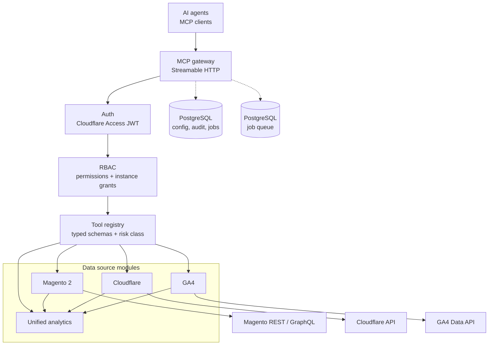

# mage2mcp

[](https://github.com/shuaiZend/mage2mcp/actions/workflows/ci.yml)
[](https://github.com/shuaiZend/mage2mcp/releases)
[](LICENSE)
[](go.mod)
[](docs/mcp-conformance.md)

**Open-source MCP gateway for Magento 2, Cloudflare, and Google Analytics 4.**
One endpoint, one auth model, one audit trail — with typed, documented tools that AI
agents can actually use safely. Writes are two-step human-approved; reads are
read-only by default and PII-safe.

> **Status: v0.9.0 (pre-1.0).** 112 tools (101 Magento). Validated against a live
> Magento production store: 23 read-only checks plus a 30-day business drill-down
> (924 orders) with no writes. Releases ship signed artifacts, SBOM, and a
> multi-arch image. Interfaces may still change with an ADR before 1.0.

## Why mage2mcp

- **Typed contracts, not prompt glue.** Every tool has a stable name, JSON Schema,
  permission scope, timeout, and annotations. A contract test pins the Magento
  tool names; a docs test fails if the catalog drifts.
- **Safe writes.** Writes require an opaque confirmation approved by a *different*
  identity. Arguments are validated against the tool schema **before** the approval
  is created, and the approval is bound to the canonical argument hash.
- **PII stays inside Magento.** Customer and address reads return country/region/
  default flags only; order reads omit email, addresses, and payment data.
- **Built for operations.** PostgreSQL job queue (no Redis), advisory-locked
  migrations, async imports with idempotency, live progress, resumable failed rows,
  and 30-day batch retention.
- **Multi-instance.** Several Magento stores, Cloudflare zones, and GA4 properties
  behind one gateway with per-instance authorization and audit.

## Tool surface (112 tools)

| Module | Tools | Examples |
|---|---:|---|
| Magento 2 | 101 | products, configurable variants, categories, MSI inventory, orders, invoices/shipments/credit memos, customers, media, imports, business analysis |
| Cloudflare | 3 | zone traffic, security events, security summary |
| Google Analytics 4 | 6 | traffic reports, realtime, ecommerce, property metadata/capabilities |
| Unified analytics | 1 | Magento vs GA4 traffic comparison |
| Platform | 1 | `platform.info` (versions, instances, write flag) |

Highlights of the Magento surface:

- **Catalog**: create/update/delete, batch reads, bulk update, SEO audit, media
  (upload/list/get/update/delete/types), tier prices, custom options, attribute
  options (create/bulk/delete).
- **Configurable**: parent create/update, variant pre-checks, option declaration,
  explicit variation creation, child linking.
- **Inventory (MSI)**: sources, stocks, source items, assign/unassign/transfer,
  source create, stock-source link/unlink.
- **Orders & documents**: create (cart flow), search/get, status history, comments,
  hold/unhold, email, cancel; invoice/shipment/credit-memo read, create, capture,
  email.
- **Customers**: PII-safe reads, create/update, address create/update/delete.
- **Imports**: validate, execute, async start/status/cancel, batch history, resume.
- **Analytics**: `magento.sales.analysis` and `magento.orders.geography` return
  PII-free aggregates (KPIs, repeat/new customers, coupons, shipping methods,
  AOV bands, timezone buckets, refunds by SKU, shipment latency).

## What exists today

| Item | State |
|---|---|
| Source code | Production-grade Go gateway: MCP server, auth, RBAC, audit, metrics, PostgreSQL queue, Docker |
| Tests and CI | Unit, integration (PostgreSQL), race, lint, security, supply-chain, and a full end-to-end job on every PR |
| Releases | v0.8.0 pre-release with signed artifacts, checksums, SBOM, multi-arch GHCR image |
| Production validation | Read-only acceptance and a 30-day business report against a live Magento store |
| Documentation | Architecture, ADRs (22), tool catalog, field reference, compatibility, operations, release notes |
| License and community | [Apache-2.0](LICENSE), [NOTICE](NOTICE), [CONTRIBUTING.md](CONTRIBUTING.md), [CODE_OF_CONDUCT.md](CODE_OF_CONDUCT.md), [SECURITY.md](SECURITY.md), [SUPPORT.md](SUPPORT.md) |

## Documentation map

| Start here | For |
|---|---|
| [docs/index.md](docs/index.md) | Documentation entry point |
| [docs/mcp-tools.md](docs/mcp-tools.md) | Design catalog with implementation status |
| [docs/implemented-tools.md](docs/implemented-tools.md) | The 112 tools registered today |
| [docs/magento-fields.md](docs/magento-fields.md) | Field requirements and SEO guidance |
| [docs/compatibility.md](docs/compatibility.md) | Supported components and stability promises |
| [docs/operations/production-acceptance.md](docs/operations/production-acceptance.md) | Live read-only acceptance and fixes |
| [docs/development/mcp-gaps.md](docs/development/mcp-gaps.md) | Known gaps and their status |

## Quickstart (development)

```bash
# 1. Build
go build -o bin/mage2mcp ./cmd/server

# 2. Configure: copy the example, then for a loopback-only development run set
#    `auth.enabled: false`. The gateway refuses to start with auth disabled on a
#    non-loopback listener.
cp configs/config.example.yaml config.yaml

# 3. Run
./bin/mage2mcp -config config.yaml

# 4. Check liveness and readiness
curl -s localhost:8080/healthz
curl -s localhost:8080/readyz
```

The MCP endpoint is `POST /mcp` (Streamable HTTP). In production, run behind a
Cloudflare Tunnel and keep authentication enabled with the `MAGE2MCP_AUTH_*`
environment variables.

### Docker

The image bakes a container configuration and probes its own `/healthz` (the
distroless image has no shell):

```bash
# Local stack (development defaults: auth disabled, loopback port, fixed dev passwords)
docker compose up --build

# Or a single container
docker build -t mage2mcp .
docker run --rm -p 127.0.0.1:8080:8080 \
  -e MAGE2MCP_AUTH_ENABLED=false -e MAGE2MCP_DEV_INSECURE=true mage2mcp

curl -s localhost:8080/healthz
curl -s localhost:8080/readyz
```

For a production-shaped stack every secret and Access value is required:

```bash
docker compose -f docker-compose.yml -f docker-compose.prod.yml up -d
```

Never expose the development stack to a network: it runs with authentication
disabled and fixed placeholder passwords.

### High-risk operations

Write tools stay disabled until `tools.writes: true`. When enabled, every write
requires approval by a **different human identity** through the admin surface:

```bash
# List pending confirmations
./bin/mage2mcp-admin -config config.yaml -as you@example.com pending

# Approve one (the agent's requester identity cannot approve its own request)
./bin/mage2mcp-admin -config config.yaml -as you@example.com approve <confirmation-id>
```

Approval requires `database.url`: the admin CLI and the gateway share the
PostgreSQL confirmation store. Approvals are bound to a canonical hash of the
tool arguments, expire after 5 minutes (15 maximum), and are single use.

## Why this exists

AI agents need reliable, auditable access to commerce and analytics systems. Today that
access usually comes in one of two shapes, and both are unsatisfactory.

**Vendor-hosted black boxes.** A SaaS connector sits between the agent and the upstream
API. It sees every request and response, but the operator cannot inspect how tools are
mapped, which credentials are used, what is logged, or how permissions are enforced.
Data leaves the operator's boundary, the integration surface is limited to whatever the
vendor chose to build, and leaving the vendor means rebuilding the integration.

**One-off scripts and ad-hoc endpoints.** A script wraps a few API calls and hands them
to an agent. It has no typed schemas, no authentication model, no authorization model,
no audit trail, and no confirmation step before destructive operations. Credentials
sprawl across laptops and CI. The script bypasses the business logic and permissions of
the systems it touches, and it is invisible to the team that owns those systems.

mage2mcp takes a third position: a **standalone gateway** that the operator deploys,
configures, and audits.

- The gateway runs as its own service, inside the operator's infrastructure. Magento is
  not modified, and no plugin is installed in it.
- It talks only to official upstream APIs — Magento REST and GraphQL, the Cloudflare
  API, and the GA4 Data API. It never connects to the Magento database.
- Each upstream is a separate **instance** with its own credentials and grants, so a
  single gateway can serve several stores, zones, and properties without sharing tokens.
- Every tool will have a typed input schema, a declared risk class, and an audit record.
  There will be no generic "call any endpoint" tool.
- The source, the threat model, and the decision records are public, so operators can
  evaluate the gateway before trusting it with production credentials.

## Architecture diagram



The gateway will use the official
[MCP Go SDK](https://github.com/modelcontextprotocol/go-sdk) and the Streamable HTTP
transport. SDK v1.8.0 supports MCP protocol version `2026-07-28` and negotiates down to
`2025-11-25`.

In the intended design, a tool call follows one path:

1. **Authenticate** — the caller presents a Cloudflare Access JWT, validated against the
   configured Access application.
2. **Authorize** — RBAC decides whether the caller may use this tool against this
   instance, and whether write operations are enabled for that instance.
3. **Validate** — the input is checked against the tool's JSON Schema before any upstream
   call is made.
4. **Classify and confirm** — high-risk tools require an explicit confirmation bound to a
   hash of the canonicalized parameters; changing any parameter invalidates the
   confirmation.
5. **Execute** — the data source module calls the upstream API with its own
   least-privilege credential.
6. **Audit** — actor, tool, instance, parameter hash, outcome, and duration are recorded,
   with secrets redacted.
7. **Return** — the result is validated against the declared output schema and returned
   to the agent.

Runtime components:

| Component | Role |
|---|---|
| Go service | MCP endpoint, auth, RBAC, tool registry, module orchestration |
| PostgreSQL | Instance configuration metadata, audit log, job state |
| PostgreSQL job queue | Background queues for bulk operations, import polling, and log ingestion (ADR-0019) |
| R2 + ClickHouse (optional) | Raw Cloudflare request logs when Logpush analysis is enabled |
| Prometheus | Metrics endpoint for tool latency, errors, and upstream rate limits |
| `slog` | Structured JSON logs with redaction |
| YAML + environment | Configuration, with secrets supplied only through the environment |

## Architecture at a glance

- **`cmd/server`** — Streamable HTTP MCP endpoint (`/mcp`), `/healthz`, `/readyz`, `/metrics`, auth/RBAC/audit middleware.
- **`internal/magento`, `cloudflare`, `ga4`, `unified`** — module-owned tools and clients; no module imports another.
- **`internal/mcp`** — tool registry, contract validation, confirmation gate, structured error envelope.
- **`internal/storage`** — PostgreSQL for audit, confirmations, the job queue, and import batches (no Redis).
- **`cmd/worker`** — asynchronous import executor with leases, progress, retries, and failed-row resume.
- **Deployment** — distroless multi-arch image; Compose stack for local and test deployments; signed releases.

Request flow: client → auth → RBAC → schema validation → confirmation gate (writes only) → module client → audit → structured result.

## Security posture

The design specifies the following properties, none of which is implemented yet:

- **Read-only by default.** Write tools are disabled unless an operator explicitly
  enables a write profile; the default configuration exposes no write capability.
- **Confirmation for writes.** High-risk operations require a confirmation token bound to
  a hash of the canonicalized parameters. The confirmation is invalid if any parameter
  changes, so what the operator approves is what executes.
- **Audit.** Every tool call is recorded with actor, tool, instance, parameter hash,
  outcome, and duration. Secrets and sensitive values are redacted before storage.
- **No plugin in Magento.** The gateway cannot alter Magento code, and Magento upgrades
  do not depend on it.
- **No direct database access.** All reads and writes go through official APIs, so
  business logic, validation, and permissions are preserved.
- **Least-privilege tokens.** Magento integration credentials scoped to the required
  resources; Cloudflare API tokens scoped to read-only analytics and zone access by
  default; and GA4 service accounts with Viewer access. The opt-in Logpush inspection
  profile carries `Logs Write` only because Cloudflare requires it for read calls; the
  code has no mutation path.
- **Secrets stay outside configuration files.** Credentials are supplied through the
  environment or a secret manager and are never logged or returned in tool output.
- **No escape hatches.** There is no generic API passthrough and no SQL execution tool.

The full threat model, trust boundaries, and mitigations live in
[`docs/security/threat-model.md`](docs/security/threat-model.md). The security review
process is described in
[`docs/security/security-review.md`](docs/security/security-review.md).

## Design principles

1. **Modular boundaries.** Each data source is an independent module that implements the
   shared data source contract and declares its capabilities. Modules do not import each
   other's internals, and the core does not know vendor-specific details.
2. **Official APIs only.** Magento REST and GraphQL, the Cloudflare API, and the GA4 Data
   API. No scraping, no database access, no plugin, no undocumented endpoints.
3. **Typed tools, no escape hatches.** Every tool has a fixed name, a JSON Schema input
   and output, a risk class, and required permissions. A generic `execute_api` or `execute_sql`
   tool would defeat authorization, validation, and confirmation, so it will not exist.
4. **Explicit metric semantics.** A metric is only comparable when its definition,
   denominator, attribution window, and time zone are declared. Unified analytics
   reports name the semantics they use and refuse to blend incompatible metrics.
5. **Read-only default and least privilege.** The safe state is the default state.
   Enabling a write is a deliberate operator decision, never a default.
6. **Instances are the unit of configuration and authorization.** Credentials, grants,
   and rate limits belong to an instance, not to the process, so one gateway can serve
   multiple upstreams without leaking access between them.
7. **Everything is auditable.** If an action cannot be attributed and reviewed, it is not
   exposed as a tool.
8. **Pre-1.0 interface discipline.** Public interfaces may change, but only through a
   recorded architecture decision. See [`docs/adr/`](docs/adr/).

## Compatibility matrix

These are target combinations for v0.x, not tested configurations. The vendor
documentation behind each constraint is cited in the corresponding integration document.

| Component | Target support | Notes |
|---|---|---|
| Magento Open Source and Adobe Commerce | 2.4.x; 2.4.9 is the primary target | REST with integration OAuth 1.0a credentials (bearer tokens only when explicitly enabled). GraphQL is used for read-only storefront verification |
| Adobe Commerce as a Cloud Service | Not supported in v0.x | Uses Adobe IMS OAuth and does not support traditional token generation |
| Cloudflare plans | Free, Pro, Business, Enterprise | Dataset and field availability differs by plan |
| Cloudflare GraphQL Analytics | Planned | Default limit is 300 queries per 5-minute window; a zone-scoped query may cover up to 10 zones, an account-scoped query exactly one account |
| Cloudflare Security Events | Planned | Backed by `firewallEventsAdaptive`; retention up to 31 days; results may be sampled |
| Cloudflare Logpush | Opt-in job inventory and log analysis, read-only | Usage-billed with 25 GB/month included; no backfill; logs are lost if a job fails |
| Cloudflare raw logs | Optional: R2 + ClickHouse | Only for request-level Logpush analysis; PostgreSQL never stores raw logs |
| Cloudflare bot signals | Only where entitled | Bot score, bot tags, and verified-bot fields require Bot Management |
| GA4 | Data API v1 | Aggregate-only; raw events require a BigQuery export |
| GA4 quotas | Read and respected per property | A reference property reported 200,000 tokens/day, 40,000 tokens/hour, and 10 concurrent requests |
| MCP protocol | Planned: `2026-07-28`, negotiating down to `2025-11-25` | Provided by MCP Go SDK v1.8.0 |
| Go | 1.26 or newer | SDK v1.8.0 requires `go 1.25.0`; current direct dependencies require 1.26; 1.27.x is the current toolchain |
| PostgreSQL | 16 or newer | Configuration metadata, audit log, job state |
| Container runtime | Docker with Compose | Local stack and deployment |

## Full documentation index

The documentation is written in public and kept in sync with the code; contract
tests fail when the tool catalog and the docs drift.

| Document | Contents |
|---|---|
| [`docs/index.md`](docs/index.md) | Entry point for all design, integration, and development documents |
| [`docs/architecture.md`](docs/architecture.md) | System architecture, components, request lifecycle, deployment topology |
| [`docs/module-boundaries.md`](docs/module-boundaries.md) | Data source contract, capability declaration, dependency rules |
| [`docs/database-design.md`](docs/database-design.md) | PostgreSQL schema for configuration, audit, and job state |
| [`docs/mcp-tools.md`](docs/mcp-tools.md) | Tool naming, input and output schemas, risk classes, confirmation model |
| [`docs/mcp-conformance.md`](docs/mcp-conformance.md) | MCP conformance matrix: tools, transport, authorization, and the tests that prove them |
| [`docs/implemented-tools.md`](docs/implemented-tools.md) | The tools registered in code today |
| [`docs/unified-analytics.md`](docs/unified-analytics.md) | Metric semantics, join keys, cross-source report definitions |
| [`docs/development-plan.md`](docs/development-plan.md) | Phase plan, deliverables, exit criteria |
| [`docs/security/threat-model.md`](docs/security/threat-model.md) | Assets, trust boundaries, threats, mitigations |
| [`docs/security/security-review.md`](docs/security/security-review.md) | Security review process and gates |
| [`docs/integrations/magento.md`](docs/integrations/magento.md) | Magento endpoints, authentication, product and inventory flows |
| [`docs/integrations/cloudflare.md`](docs/integrations/cloudflare.md) | Cloudflare datasets, Security Events, Logpush constraints |
| [`docs/integrations/ga4.md`](docs/integrations/ga4.md) | GA4 dimensions, metrics, compatibility rules, quotas |
| [`docs/development/research-baseline.md`](docs/development/research-baseline.md) | Verified facts and evidence tags behind the design |
| [`docs/adr/`](docs/adr/) | Architecture Decision Records |

## Roadmap

The phases are ordered, not dated. Each phase ends only when its exit criteria are met
and the design documents for the next phase are consistent with the research baseline.

| Phase | Focus | Exit criteria |
|---|---|---|
| 0 | Design | Architecture, boundaries, tool catalog, threat model, ADRs, and governance reviewed; documentation CI green |
| 1 | Foundation | Server skeleton on Streamable HTTP, Cloudflare Access JWT auth, RBAC, tool registry, config validation, audit, PostgreSQL (including the job queue), Docker, CI gates |
| 2 | Magento 2 | Read and write tools for products, EAV, MSI, media, categories, orders, bulk import, and GraphQL verification |
| 3 | Cloudflare | GraphQL Analytics, Security Events, Logpush inventory and analysis, all read-only |
| 4 | GA4 | Metadata discovery, core, ecommerce, and realtime reports, quota handling, and the documented BigQuery boundary |
| 5 | Unified analytics | Metric catalog, entity mapping, cross-source reports with declared semantics |
| 6 | Hardening | Security review, failure injection, load testing, SBOM, operator documentation |
| 7 | Release | v0.1.0 with signed artifacts, checksums, and a documented upgrade path |

## Contributing

Design review comments, threat-model feedback, bug reports, and documentation
corrections are welcome through GitHub issues. Code contributions follow the
Developer Certificate of Origin and the review/CI gates described in
[CONTRIBUTING.md](CONTRIBUTING.md).

All contributions require a Developer Certificate of Origin sign-off (`git commit -s`);
there is no CLA. Read [CONTRIBUTING.md](CONTRIBUTING.md) for the development environment,
branch and commit conventions, testing expectations, and the module ownership rules, and
[CODE_OF_CONDUCT.md](CODE_OF_CONDUCT.md) for community expectations.

## Security

Do not open a public issue for a vulnerability. Report it privately through GitHub
Security Advisories as described in [SECURITY.md](SECURITY.md). Security fixes target the
latest v0.x minor release only while the project is pre-1.0.

## License

Licensed under the Apache License, Version 2.0. See [LICENSE](LICENSE) and
[NOTICE](NOTICE). Third-party components and their licenses are recorded in the
dependency manifest and in the SBOM published with each release.

mage2mcp is an independent open-source project. It is not affiliated with, endorsed
by, or sponsored by Adobe, Magento, Cloudflare, or Google. Product names are used
descriptively only.
