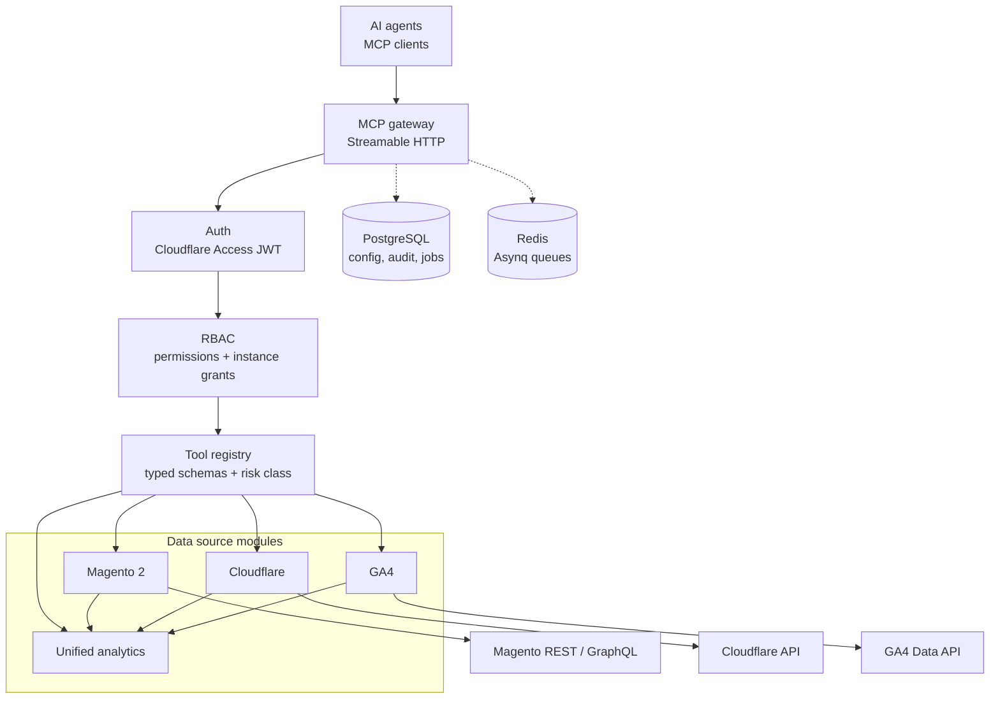

# mage2mcp

mage2mcp is a standalone [Model Context Protocol](https://modelcontextprotocol.io) (MCP)
gateway that exposes Magento 2, Cloudflare, and Google Analytics 4 to AI agents through
typed, audited, read-only-by-default tools.

> **Status: Phase 1 — foundation.**
> A runnable MCP server exists: Streamable HTTP, Cloudflare Access JWT
> authentication, RBAC, audit, Prometheus metrics, read-only tools for Magento
> products, Cloudflare analytics/security, and GA4 traffic/metadata, plus optional
> PostgreSQL-backed audit and a Redis job worker. Write tools and unified analytics
> are in progress. There is no release yet, and interfaces may change with an ADR
> before 1.0.

## What exists today

| Item | State |
|---|---|
| Design documents | Complete Phase 0 baseline in [`docs/`](docs/) |
| Research baseline | [`docs/development/research-baseline.md`](docs/development/research-baseline.md) |
| Source code | Phase 1 foundation: MCP server, auth, RBAC, audit, metrics, config, Docker |
| Tests and CI | Unit, integration (PostgreSQL service), race, lint, security, and supply-chain gates on every PR |
| Write tools | Implemented behind `tools.writes` (disabled by default until confirmation ships) |
| Releases and container images | Not published yet; the release workflow is in place |
| License and community documents | [Apache-2.0](LICENSE), [NOTICE](NOTICE), [CONTRIBUTING.md](CONTRIBUTING.md), [CODE_OF_CONDUCT.md](CODE_OF_CONDUCT.md), [SECURITY.md](SECURITY.md), [SUPPORT.md](SUPPORT.md) |

## Quickstart (development)

```bash
# 1. Build
go build -o bin/mage2mcp ./cmd/server

# 2. Configure: copy the example, then for a loopback-only development run set
#    `auth.enabled: false`. The gateway refuses to start with auth disabled on a
#    non-loopback listener.
cp configs/config.example.yaml config.yaml

# 3. Run
./bin/mage2mcp -config config.yaml

# 4. Check liveness and readiness
curl -s localhost:8080/healthz
curl -s localhost:8080/readyz
```

The MCP endpoint is `POST /mcp` (Streamable HTTP). In production, run behind a
Cloudflare Tunnel and keep authentication enabled with the `MAGE2MCP_AUTH_*`
environment variables. Docker users can run `docker compose up` after setting the
required variables in `.env`.

### High-risk operations

Write tools stay disabled until `tools.writes: true`. When enabled, every write
requires approval by a **different human identity** through the admin surface:

```bash
# List pending confirmations
./bin/mage2mcp-admin -config config.yaml -as you@example.com pending

# Approve one (the agent's requester identity cannot approve its own request)
./bin/mage2mcp-admin -config config.yaml -as you@example.com approve <confirmation-id>
```

Approval requires `database.url`: the admin CLI and the gateway share the
PostgreSQL confirmation store. Approvals are bound to a canonical hash of the
tool arguments, expire after 5 minutes (15 maximum), and are single use.

## Why this exists

AI agents need reliable, auditable access to commerce and analytics systems. Today that
access usually comes in one of two shapes, and both are unsatisfactory.

**Vendor-hosted black boxes.** A SaaS connector sits between the agent and the upstream
API. It sees every request and response, but the operator cannot inspect how tools are
mapped, which credentials are used, what is logged, or how permissions are enforced.
Data leaves the operator's boundary, the integration surface is limited to whatever the
vendor chose to build, and leaving the vendor means rebuilding the integration.

**One-off scripts and ad-hoc endpoints.** A script wraps a few API calls and hands them
to an agent. It has no typed schemas, no authentication model, no authorization model,
no audit trail, and no confirmation step before destructive operations. Credentials
sprawl across laptops and CI. The script bypasses the business logic and permissions of
the systems it touches, and it is invisible to the team that owns those systems.

mage2mcp takes a third position: a **standalone gateway** that the operator deploys,
configures, and audits.

- The gateway runs as its own service, inside the operator's infrastructure. Magento is
  not modified, and no plugin is installed in it.
- It talks only to official upstream APIs — Magento REST and GraphQL, the Cloudflare
  API, and the GA4 Data API. It never connects to the Magento database.
- Each upstream is a separate **instance** with its own credentials and grants, so a
  single gateway can serve several stores, zones, and properties without sharing tokens.
- Every tool will have a typed input schema, a declared risk class, and an audit record.
  There will be no generic "call any endpoint" tool.
- The source, the threat model, and the decision records are public, so operators can
  evaluate the gateway before trusting it with production credentials.

## Architecture at a glance



The gateway will use the official
[MCP Go SDK](https://github.com/modelcontextprotocol/go-sdk) and the Streamable HTTP
transport. SDK v1.8.0 supports MCP protocol version `2026-07-28` and negotiates down to
`2025-11-25`.

In the intended design, a tool call follows one path:

1. **Authenticate** — the caller presents a Cloudflare Access JWT, validated against the
   configured Access application.
2. **Authorize** — RBAC decides whether the caller may use this tool against this
   instance, and whether write operations are enabled for that instance.
3. **Validate** — the input is checked against the tool's JSON Schema before any upstream
   call is made.
4. **Classify and confirm** — high-risk tools require an explicit confirmation bound to a
   hash of the canonicalized parameters; changing any parameter invalidates the
   confirmation.
5. **Execute** — the data source module calls the upstream API with its own
   least-privilege credential.
6. **Audit** — actor, tool, instance, parameter hash, outcome, and duration are recorded,
   with secrets redacted.
7. **Return** — the result is validated against the declared output schema and returned
   to the agent.

Runtime components:

| Component | Role |
|---|---|
| Go service | MCP endpoint, auth, RBAC, tool registry, module orchestration |
| PostgreSQL | Instance configuration metadata, audit log, job state |
| Redis + Asynq | Background queues for bulk operations, import polling, and log ingestion |
| R2 + ClickHouse (optional) | Raw Cloudflare request logs when Logpush analysis is enabled |
| Prometheus | Metrics endpoint for tool latency, errors, and upstream rate limits |
| `slog` | Structured JSON logs with redaction |
| YAML + environment | Configuration, with secrets supplied only through the environment |

## What the gateway will do

The status column records the current state only; nothing in this table is available
today. No capability is design-complete or implemented yet.

| Status | Meaning |
|---|---|
| Planned | In scope, not yet designed in detail |
| Design in progress | Design document being written or reviewed in Phase 0 |
| Design complete | Design reviewed and approved (none yet) |
| Implemented | Working code merged (none yet) |

### Support matrix

| Module | Capability | Status |
|---|---|---|
| Platform | Streamable HTTP MCP endpoint on the official Go SDK | Design in progress |
| Platform | Cloudflare Access JWT authentication | Design in progress |
| Platform | RBAC permissions and per-instance grants | Planned |
| Platform | Tool registry with typed schemas and risk classification | Design in progress |
| Platform | Confirmation bound to a canonicalized parameter hash | Design in progress |
| Platform | Audit log, Prometheus metrics, health endpoints | Planned |
| Platform | YAML + environment configuration with validation | Planned |
| Platform | Container image and Compose stack | Planned |
| Magento 2 | Product read for simple, configurable, virtual, downloadable, and bundle products | Implemented (read-only) |
| Magento 2 | Product writes via REST, including configurable options and child products | Planned |
| Magento 2 | EAV attribute and attribute-set discovery | Planned |
| Magento 2 | MSI inventory read and bulk source operations | Planned |
| Magento 2 | Media gallery read and upload | Planned |
| Magento 2 | Category read and product-category assignment | Planned |
| Magento 2 | Order read | Planned |
| Magento 2 | Bulk import (CSV/JSON) with an explicit validation strategy | Planned |
| Magento 2 | Bulk and asynchronous operation status polling | Planned |
| Magento 2 | GraphQL read-only storefront verification | Planned |
| Cloudflare | Zone, plan, and dataset inventory (read-only) | Planned |
| Cloudflare | GraphQL Analytics queries | Implemented (traffic) |
| Cloudflare | Security Events queries | Implemented (summary) |
| Cloudflare | Logpush job inventory and field discovery (opt-in, read-only) | Planned |
| Cloudflare | Logpush log analysis from a customer-configured destination | Planned |
| Cloudflare | WAF and bot event inspection (read-only) | Planned |
| GA4 | Property metadata and dimension/metric compatibility discovery | Design in progress |
| GA4 | Traffic, acquisition, and engagement reports | Implemented (traffic) |
| GA4 | Ecommerce reports with an explicit data-presence probe | Planned |
| GA4 | Realtime reports | Planned |
| GA4 | Quota-aware execution and backoff | Planned |
| Unified | Cross-source metric catalog with declared semantics | Design in progress |
| Unified | Entity and time-base mapping across sources | Planned |
| Unified | Cross-source reports on declared join keys | Planned |

### Magento 2

The Magento module will manage catalog and inventory data through the REST API and use
GraphQL only to verify what a storefront actually renders. Product writes must use REST:
Magento GraphQL has no product write mutations. The module will cover:

- Products of every standard type, including configurable options and child products.
- EAV attribute sets and attributes, so tool inputs can be validated against the store's
  real schema rather than a hardcoded list.
- MSI sources and source items, including bulk assign, unassign, and transfer operations.
- Media gallery assets, categories, and order reads.
- Bulk import through `POST /V1/import/csv` and `POST /V1/import/json`, with the
  validation strategy and allowed error count stated explicitly in the tool input.
- Polling of bulk and asynchronous operation status.

There will be no Magento plugin, no `app/code` package, and no database connection.
Anything the module cannot do through an official API is out of scope.

### Cloudflare

The Cloudflare module is read-only in v0.x. It will expose:

- Zone, plan, and dataset inventory.
- GraphQL Analytics queries across the datasets available to the account.
- Security Events from the `firewallEventsAdaptive` dataset.
- Logpush job inventory and field discovery, plus analysis of logs delivered to a
  customer-configured destination.

Logpush is available on Free, Pro, and Business plans, not only Enterprise, but it is
usage-billed: 25 GB per month are included per account, then $0.03/GB to internal
destinations and $0.10/GB to external destinations. Logpush has no historical backfill,
and logs are lost if a job fails. Bot score and verified-bot fields require Bot
Management, which is an Enterprise add-on. The module will state these constraints in
tool output instead of silently returning partial data.

Raw request logs are opt-in per zone. When enabled, Cloudflare pushes records to R2 and a
ClickHouse query layer serves request-level queries; PostgreSQL never stores raw logs.
Operators who only need aggregate analytics can leave Logpush disabled.

Logpush job and field inspection is also opt-in. Cloudflare requires the `Logs Write`
permission for every Logpush API call, including reads, so the gateway uses a separate
token profile for this and never issues a mutation. Operators who do not accept that
permission can manage jobs out of band and infer job health from R2 file arrival.

### Google Analytics 4

The GA4 module is scoped as read-only and will use the Data API v1. It will expose traffic,
acquisition, engagement, ecommerce, and realtime reports, plus metadata discovery so the
agent can check which dimensions and metrics can be combined before querying.

The Data API returns aggregate data only. Dimension and metric compatibility is
pair-wise and must be validated per property: some item-level dimensions are rejected
with session-scoped metrics, while other combinations are accepted. The gateway will
validate each request rather than infer a rule from scope. Raw event data requires a
BigQuery export that the customer owns and configures. The gateway does not query
BigQuery; it documents the boundary. Because a property can serve traffic without
ecommerce tracking, ecommerce tools will probe for data and report its absence rather
than returning zeros as if they were revenue.

### Unified analytics

The unified module will compose the other modules through the shared data source
contract. It will provide a metric catalog in which every metric carries a definition, a
denominator, an attribution window, and a time zone, and cross-source reports built only
on declared join keys. It will not invent a blended "revenue" or "conversion" number by adding
metrics that mean different things in different systems.

### Explicitly out of scope for v0.x

| Not planned | Reason |
|---|---|
| A Magento plugin or `app/code` package | The gateway uses official APIs only; nothing is installed in Magento |
| Direct Magento database access | Bypasses business logic and breaks across upgrades |
| Adobe Commerce as a Cloud Service (IMS OAuth) | Different authentication model; deferred until after v0.x |
| Cloudflare writes (DNS, WAF rules, Logpush jobs) | The Cloudflare module is read-only in v0.x |
| GA4 Admin API and property configuration changes | The GA4 module is read-only |
| Universal `execute_api` or `execute_sql` tools | Untyped, unauditable, and incompatible with RBAC and confirmation |
| Cross-device identity stitching | Requires identity data the gateway does not have |
| Raw GA4 event export inside the gateway | The Data API is aggregate-only; raw events stay in the customer's BigQuery export |

## Security posture

The design specifies the following properties, none of which is implemented yet:

- **Read-only by default.** Write tools are disabled unless an operator explicitly
  enables a write profile; the default configuration exposes no write capability.
- **Confirmation for writes.** High-risk operations require a confirmation token bound to
  a hash of the canonicalized parameters. The confirmation is invalid if any parameter
  changes, so what the operator approves is what executes.
- **Audit.** Every tool call is recorded with actor, tool, instance, parameter hash,
  outcome, and duration. Secrets and sensitive values are redacted before storage.
- **No plugin in Magento.** The gateway cannot alter Magento code, and Magento upgrades
  do not depend on it.
- **No direct database access.** All reads and writes go through official APIs, so
  business logic, validation, and permissions are preserved.
- **Least-privilege tokens.** Magento integration credentials scoped to the required
  resources; Cloudflare API tokens scoped to read-only analytics and zone access by
  default; and GA4 service accounts with Viewer access. The opt-in Logpush inspection
  profile carries `Logs Write` only because Cloudflare requires it for read calls; the
  code has no mutation path.
- **Secrets stay outside configuration files.** Credentials are supplied through the
  environment or a secret manager and are never logged or returned in tool output.
- **No escape hatches.** There is no generic API passthrough and no SQL execution tool.

The full threat model, trust boundaries, and mitigations live in
[`docs/security/threat-model.md`](docs/security/threat-model.md). The security review
process is described in
[`docs/security/security-review.md`](docs/security/security-review.md).

## Design principles

1. **Modular boundaries.** Each data source is an independent module that implements the
   shared data source contract and declares its capabilities. Modules do not import each
   other's internals, and the core does not know vendor-specific details.
2. **Official APIs only.** Magento REST and GraphQL, the Cloudflare API, and the GA4 Data
   API. No scraping, no database access, no plugin, no undocumented endpoints.
3. **Typed tools, no escape hatches.** Every tool has a fixed name, a JSON Schema input
   and output, a risk class, and required permissions. A generic `execute_api` or `execute_sql`
   tool would defeat authorization, validation, and confirmation, so it will not exist.
4. **Explicit metric semantics.** A metric is only comparable when its definition,
   denominator, attribution window, and time zone are declared. Unified analytics
   reports name the semantics they use and refuse to blend incompatible metrics.
5. **Read-only default and least privilege.** The safe state is the default state.
   Enabling a write is a deliberate operator decision, never a default.
6. **Instances are the unit of configuration and authorization.** Credentials, grants,
   and rate limits belong to an instance, not to the process, so one gateway can serve
   multiple upstreams without leaking access between them.
7. **Everything is auditable.** If an action cannot be attributed and reviewed, it is not
   exposed as a tool.
8. **Pre-1.0 interface discipline.** Public interfaces may change, but only through a
   recorded architecture decision. See [`docs/adr/`](docs/adr/).

## Compatibility matrix

These are target combinations for v0.x, not tested configurations. The vendor
documentation behind each constraint is cited in the corresponding integration document.

| Component | Target support | Notes |
|---|---|---|
| Magento Open Source and Adobe Commerce | 2.4.x; 2.4.9 is the primary target | REST with integration OAuth 1.0a credentials (bearer tokens only when explicitly enabled). GraphQL is used for read-only storefront verification |
| Adobe Commerce as a Cloud Service | Not supported in v0.x | Uses Adobe IMS OAuth and does not support traditional token generation |
| Cloudflare plans | Free, Pro, Business, Enterprise | Dataset and field availability differs by plan |
| Cloudflare GraphQL Analytics | Planned | Default limit is 300 queries per 5-minute window; a zone-scoped query may cover up to 10 zones, an account-scoped query exactly one account |
| Cloudflare Security Events | Planned | Backed by `firewallEventsAdaptive`; retention up to 31 days; results may be sampled |
| Cloudflare Logpush | Opt-in job inventory and log analysis, read-only | Usage-billed with 25 GB/month included; no backfill; logs are lost if a job fails |
| Cloudflare raw logs | Optional: R2 + ClickHouse | Only for request-level Logpush analysis; PostgreSQL never stores raw logs |
| Cloudflare bot signals | Only where entitled | Bot score, bot tags, and verified-bot fields require Bot Management |
| GA4 | Data API v1 | Aggregate-only; raw events require a BigQuery export |
| GA4 quotas | Read and respected per property | A reference property reported 200,000 tokens/day, 40,000 tokens/hour, and 10 concurrent requests |
| MCP protocol | Planned: `2026-07-28`, negotiating down to `2025-11-25` | Provided by MCP Go SDK v1.8.0 |
| Go | 1.26 or newer | SDK v1.8.0 requires `go 1.25.0`; current direct dependencies require 1.26; 1.27.x is the current toolchain |
| PostgreSQL | 16 or newer | Configuration metadata, audit log, job state |
| Redis | 7 or newer | Asynq queues |
| Container runtime | Docker with Compose | Local stack and deployment |

## Documentation map

Design documents are written in public during Phase 0. Links point to files that are
being created in parallel and will exist before this README is merged.

| Document | Contents |
|---|---|
| [`docs/index.md`](docs/index.md) | Entry point for all design, integration, and development documents |
| [`docs/architecture.md`](docs/architecture.md) | System architecture, components, request lifecycle, deployment topology |
| [`docs/module-boundaries.md`](docs/module-boundaries.md) | Data source contract, capability declaration, dependency rules |
| [`docs/database-design.md`](docs/database-design.md) | PostgreSQL schema for configuration, audit, and job state |
| [`docs/mcp-tools.md`](docs/mcp-tools.md) | Tool naming, input and output schemas, risk classes, confirmation model |
| [`docs/mcp-conformance.md`](docs/mcp-conformance.md) | MCP conformance matrix: tools, transport, authorization, and the tests that prove them |
| [`docs/unified-analytics.md`](docs/unified-analytics.md) | Metric semantics, join keys, cross-source report definitions |
| [`docs/development-plan.md`](docs/development-plan.md) | Phase plan, deliverables, exit criteria |
| [`docs/security/threat-model.md`](docs/security/threat-model.md) | Assets, trust boundaries, threats, mitigations |
| [`docs/security/security-review.md`](docs/security/security-review.md) | Security review process and gates |
| [`docs/integrations/magento.md`](docs/integrations/magento.md) | Magento endpoints, authentication, product and inventory flows |
| [`docs/integrations/cloudflare.md`](docs/integrations/cloudflare.md) | Cloudflare datasets, Security Events, Logpush constraints |
| [`docs/integrations/ga4.md`](docs/integrations/ga4.md) | GA4 dimensions, metrics, compatibility rules, quotas |
| [`docs/development/research-baseline.md`](docs/development/research-baseline.md) | Verified facts and evidence tags behind the design |
| [`docs/adr/`](docs/adr/) | Architecture Decision Records |

## Roadmap

The phases are ordered, not dated. Each phase ends only when its exit criteria are met
and the design documents for the next phase are consistent with the research baseline.

| Phase | Focus | Exit criteria |
|---|---|---|
| 0 | Design | Architecture, boundaries, tool catalog, threat model, ADRs, and governance reviewed; documentation CI green |
| 1 | Foundation | Server skeleton on Streamable HTTP, Cloudflare Access JWT auth, RBAC, tool registry, config validation, audit, PostgreSQL and Redis, Docker, CI gates |
| 2 | Magento 2 | Read and write tools for products, EAV, MSI, media, categories, orders, bulk import, and GraphQL verification |
| 3 | Cloudflare | GraphQL Analytics, Security Events, Logpush inventory and analysis, all read-only |
| 4 | GA4 | Metadata discovery, core, ecommerce, and realtime reports, quota handling, and the documented BigQuery boundary |
| 5 | Unified analytics | Metric catalog, entity mapping, cross-source reports with declared semantics |
| 6 | Hardening | Security review, failure injection, load testing, SBOM, operator documentation |
| 7 | Release | v0.1.0 with signed artifacts, checksums, and a documented upgrade path |

## Contributing

The project is in Phase 0. Design review comments, threat-model feedback, and
documentation corrections are welcome now through GitHub issues. Code contributions open
up in Phase 1.

All contributions require a Developer Certificate of Origin sign-off (`git commit -s`);
there is no CLA. Read [CONTRIBUTING.md](CONTRIBUTING.md) for the development environment,
branch and commit conventions, testing expectations, and the module ownership rules, and
[CODE_OF_CONDUCT.md](CODE_OF_CONDUCT.md) for community expectations.

## Security

Do not open a public issue for a vulnerability. Report it privately through GitHub
Security Advisories as described in [SECURITY.md](SECURITY.md). Security fixes target the
latest v0.x minor release only while the project is pre-1.0.

## License

Licensed under the Apache License, Version 2.0. See [LICENSE](LICENSE) and
[NOTICE](NOTICE). Third-party components and their licenses are recorded in the
dependency manifest and in the SBOM published with each release.

mage2mcp is an independent open-source project. It is not affiliated with, endorsed
by, or sponsored by Adobe, Magento, Cloudflare, or Google. Product names are used
descriptively only.
