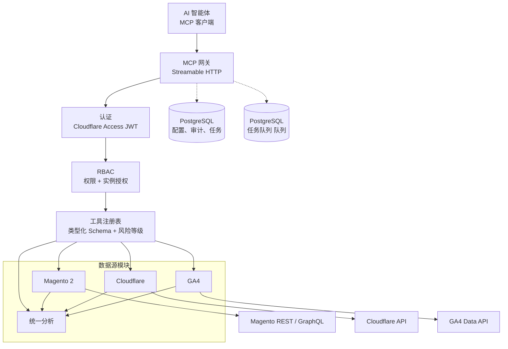

# mage2mcp

[](https://github.com/shuaiZend/mage2mcp/actions/workflows/ci.yml)
[](https://github.com/shuaiZend/mage2mcp/releases)
[](https://github.com/shuaiZend/mage2mcp/releases/tag/v0.10.0)
[](LICENSE)
[](go.mod)

**面向 Magento 2、Cloudflare 与 Google Analytics 4 的开源 MCP 网关。**
一个端点、一套认证、一条审计链，提供类型化、有文档、可安全使用的 AI 工具。
写操作默认关闭并需要两步人工审批；读操作默认只读且 PII 安全。

> **状态：v0.10.0（1.0 之前）。** 112 个工具（Magento 101 个）。已在真实 Magento
> 生产店铺完成只读验收（23 项检查）与 30 天经营下钻（924 单），全程无写入。
> 发布包含签名产物、SBOM 与多架构镜像；1.0 之前接口仍可能通过 ADR 变更。

## 为什么用 mage2mcp

- **类型化契约**：每个工具都有稳定名称、JSON Schema、权限、超时与注解；契约测试
  固定 Magento 工具名，文档与实现不一致会让 CI 失败。
- **安全写入**：写操作需要由**不同身份**审批的一次性确认；参数在创建审批**之前**
  按 schema 校验，审批与参数哈希绑定，避免“批准后被篡改”。
- **PII 不出 Magento**：客户/地址读取只返回国家/地区/默认标记；订单读取不含邮箱、
  地址与支付信息。
- **为运维而生**：PostgreSQL 队列（无需 Redis）、advisory lock 迁移、异步导入
  （幂等、进度、失败行恢复、30 天保留）。
- **多实例**：多个 Magento 店铺、Cloudflare zone、GA4 属性共用一个网关，按实例
  授权与审计。

## 工具面（112 个）

| 模块 | 数量 | 示例 |
|---|---:|---|
| Magento 2 | 101 | 商品、可配置变体、分类、MSI 库存、订单、发票/发货/贷记单、客户、媒体、导入、经营分析 |
| Cloudflare | 3 | 流量、安全事件、安全汇总 |
| Google Analytics 4 | 6 | 流量报告、实时、电商、属性元数据/能力 |
| 统一分析 | 1 | Magento 与 GA4 流量对比 |
| 平台 | 1 | `platform.info` |

Magento 重点能力：商品与 SEO、可配置商品全链路、MSI 库存、订单与单据、客户与地址、
媒体、异步导入（含恢复）、经营分析（复购/券/运费方式/AOV 分布/时区/退款/履约时效）。

## 当前状态

| 项目 | 状态 |
|---|---|
| 源代码 | 生产级 Go 网关：MCP、认证、RBAC、审计、指标、PostgreSQL 队列、Docker |
| 测试与 CI | 单元、集成（PostgreSQL）、竞态、静态、安全、供应链与端到端任务 |
| 发布 | [v0.10.0](https://github.com/shuaiZend/mage2mcp/releases/tag/v0.10.0)：签名产物、校验和、SBOM、多架构 GHCR 镜像 |
| 生产验证 | 真实 Magento 店铺只读验收 + 30 天经营报告 |
| 文档 | 架构、22 份 ADR、工具目录、字段参考、兼容性、运维、发布说明 |
| 许可证与社区 | [Apache-2.0](LICENSE)、[NOTICE](NOTICE)、[CONTRIBUTING.md](CONTRIBUTING.md)、[CODE_OF_CONDUCT.md](CODE_OF_CONDUCT.md)、[SECURITY.md](SECURITY.md)、[SUPPORT.md](SUPPORT.md) |

## 发布

最新版本是 [**v0.9.0**](https://github.com/shuaiZend/mage2mcp/releases/tag/v0.10.0)
（2026-11-20），写入验证版本：修复了在真实 Magento 演示环境验证中发现的
W1–W6、W9、W11、W12，暴露上游 400/422 错误信息，并把
`magento.category.tree` 的输出键从 `roots` 改名为 `categories`。

每个正式版本都包含：

- 静态二进制：linux/amd64、linux/arm64、darwin/amd64、darwin/arm64、windows/amd64
  （`mage2mcp-{server,worker,admin}_<os>_<arch>`）；
- `checksums.txt`（SHA-256）、SPDX JSON SBOM 与第三方许可证清单；
- 所有产物与多架构镜像 `ghcr.io/shuaizend/mage2mcp` 的 keyless cosign 签名（`.bundle`）；
- 发布产物的 SLSA 构建来源证明（provenance）。

```bash
# 用已发布的签名与校验和验证下载的产物
cosign verify-blob \
  --bundle mage2mcp-server_linux_amd64.bundle \
  --certificate-identity-regexp 'https://github.com/shuaiZend/mage2mcp/' \
  --certificate-oidc-issuer https://token.actions.githubusercontent.com \
  mage2mcp-server_linux_amd64
sha256sum --check checksums.txt
```

| 版本 | 说明 | 要点 |
|---|---|---|
| [v0.10.0](https://github.com/shuaiZend/mage2mcp/releases/tag/v0.10.0) | [发布说明](docs/releases/v0.9.0.md) | 写入验证修复 W1–W6、W9、W11、W12；上游错误信息 |
| [v0.8.1](https://github.com/shuaiZend/mage2mcp/releases/tag/v0.8.1) | [发布说明](docs/releases/v0.8.1.md) | 结构化工具错误（G12） |
| [v0.8.0](https://github.com/shuaiZend/mage2mcp/releases/tag/v0.8.0) | [发布说明](docs/releases/v0.8.0.md) | 经营分析修复；`store.configs` 与 `categories.flat` |

完整列表（含预发布）见 [Releases 页面](https://github.com/shuaiZend/mage2mcp/releases)；
每个版本也记录在 [CHANGELOG.md](CHANGELOG.md) 中。

## 文档入口

| 文档 | 用途 |
|---|---|
| [docs/index.md](docs/index.md) | 文档总入口 |
| [docs/mcp-tools.md](docs/mcp-tools.md) | 设计目录与实现状态 |
| [docs/implemented-tools.md](docs/implemented-tools.md) | 当前注册的 112 个工具 |
| [docs/magento-fields.md](docs/magento-fields.md) | 字段要求与 SEO 指南 |
| [docs/compatibility.md](docs/compatibility.md) | 兼容性与稳定性承诺 |
| [docs/operations/production-acceptance.md](docs/operations/production-acceptance.md) | 生产只读验收与修复记录 |
| [docs/development/mcp-gaps.md](docs/development/mcp-gaps.md) | 已知缺口与状态 |

## 快速开始（开发）

```bash
# 1. 构建
go build -o bin/mage2mcp ./cmd/server

# 2. 配置：复制示例配置；仅限本机回环开发时，将 `auth.enabled` 设为 false。
#    网关拒绝在非回环监听地址上以关闭认证的方式启动。
cp configs/config.example.yaml config.yaml

# 3. 运行
./bin/mage2mcp -config config.yaml

# 4. 检查存活与就绪
curl -s localhost:8080/healthz
curl -s localhost:8080/readyz
```

MCP 端点为 `POST /mcp`（Streamable HTTP）。生产环境应部署在 Cloudflare Tunnel 之后，
并通过 `MAGE2MCP_AUTH_*` 环境变量保持认证开启。

### Docker

镜像内置容器配置，并用二进制自身探测 `/healthz`（distroless 镜像没有 shell）：

```bash
# 本地开发栈（默认关闭认证、仅回环端口、固定开发密码）
docker compose up --build

# 或单容器
docker build -t mage2mcp .
docker run --rm -p 127.0.0.1:8080:8080 \
  -e MAGE2MCP_AUTH_ENABLED=false -e MAGE2MCP_DEV_INSECURE=true mage2mcp
```

生产形态要求提供全部密钥与 Access 配置：

```bash
docker compose -f docker-compose.yml -f docker-compose.prod.yml up -d
```

切勿把开发栈暴露到网络：它以关闭认证和固定占位密码运行。

### 高风险操作

写工具在 `tools.writes: true` 之前保持关闭。启用后，每次写入都需要**另一个真人身份**
通过管理面审批：

```bash
./bin/mage2mcp-admin -config config.yaml -as you@example.com pending
./bin/mage2mcp-admin -config config.yaml -as you@example.com approve <confirmation-id>
```

审批需要 `database.url`：管理 CLI 与网关共享 PostgreSQL 确认存储。审批绑定到工具参数的
规范化哈希，5 分钟过期（最长 15 分钟），且只能使用一次。

## 为什么需要它

AI 智能体需要可靠、可审计地访问电商与分析系统。目前这种访问通常只有两种形态，而两者都不理想。

**厂商托管的黑盒。** SaaS 连接器位于智能体与上游 API 之间。它能看到每个请求和响应，但运维方
无法检查工具如何映射、使用哪些凭据、记录了什么日志、权限如何执行。数据离开运维方的边界，
集成范围受限于厂商选择实现的功能，而一旦更换厂商，就必须重建整套集成。

**一次性脚本与临时接口。** 脚本封装几个 API 调用后交给智能体。它没有类型化 Schema，没有认证
模型，没有授权模型，没有审计记录，也没有破坏性操作前的确认步骤。凭据散落在个人电脑和 CI 中。
脚本绕过了所触碰系统的业务逻辑与权限，并且对负责这些系统的团队完全不可见。

mage2mcp 选择了第三种定位：由运维方自行部署、配置和审计的**独立网关**。

- 网关作为独立服务运行在运维方自己的基础设施内。Magento 不会被修改，也不需要安装任何插件。
- 只调用官方上游 API —— Magento REST 与 GraphQL、Cloudflare API、GA4 Data API。绝不连接
  Magento 数据库。
- 每个上游都是一个独立的**实例**，拥有自己的凭据和授权，因此一个网关可以服务多个商店、zone
  和 property，而无需共享令牌。
- 每个工具都将具备类型化的输入 Schema、声明的风险等级和审计记录。也不会存在通用的
  "调用任意端点"工具。
- 源代码、威胁模型和决策记录全部公开，运维方可以在把生产凭据交给网关之前先行评估。

## 架构图



网关将使用官方 [MCP Go SDK](https://github.com/modelcontextprotocol/go-sdk) 和 Streamable HTTP
传输方式。SDK v1.8.0 支持 MCP 协议版本 `2026-07-28`，并可向下协商到 `2025-11-25`。

在预期设计中，一次工具调用经过以下路径：

1. **认证** —— 调用方出示 Cloudflare Access JWT，网关按已配置的 Access 应用进行校验。
2. **授权** —— RBAC 判断调用方是否可以在该实例上使用此工具，以及该实例是否启用了写操作。
3. **校验** —— 在发起任何上游调用之前，按工具的 JSON Schema 校验输入。
4. **分级与确认** —— 高风险工具要求显式确认，确认绑定到规范化参数的哈希；任何参数变化都会使
   确认失效。
5. **执行** —— 数据源模块使用自己的最小权限凭据调用上游 API。
6. **审计** —— 记录操作者、工具、实例、参数哈希、结果和耗时，密钥会被脱敏。
7. **返回** —— 结果按声明的输出 Schema 校验后返回给智能体。

运行时组件：

| 组件 | 职责 |
|---|---|
| Go 服务 | MCP 端点、认证、RBAC、工具注册表、模块编排 |
| PostgreSQL | 实例配置元数据、审计日志、任务状态 |
| PostgreSQL 任务队列 | 批量操作、导入轮询和日志摄取的后台队列 |
| R2 + ClickHouse（可选） | 启用 Logpush 日志分析时的 Cloudflare 原始请求日志 |
| Prometheus | 工具延迟、错误和上游限流的指标端点 |
| `slog` | 带脱敏的结构化 JSON 日志 |
| YAML + 环境变量 | 配置，密钥仅通过环境变量提供 |

## 架构一览

- **`cmd/server`** — Streamable HTTP MCP 端点（`/mcp`）、`/healthz`、`/readyz`、`/metrics`，以及认证/RBAC/审计中间件。
- **`internal/magento`、`cloudflare`、`ga4`、`unified`** — 各模块自有的工具与客户端，模块之间不互相依赖。
- **`internal/mcp`** — 工具注册表、契约校验、确认门、结构化错误信封。
- **`internal/storage`** — PostgreSQL：审计、确认、任务队列、导入批次（无需 Redis）。
- **`cmd/worker`** — 异步导入执行器：租约、进度、重试、失败行恢复。
- **部署** — distroless 多架构镜像；本地/测试用 Compose；签名发布。

请求链路：客户端 → 认证 → RBAC → schema 校验 → 确认门（仅写操作）→ 模块客户端 → 审计 → 结构化结果。

## 安全策略

设计规定以下性质（尚未实现）：

- **默认只读。** 除非运维方显式启用写入配置，否则写工具处于禁用状态；默认配置不暴露任何写
  能力。
- **写入需确认。** 高风险操作要求提供绑定到规范化参数哈希的确认令牌。任何参数变化都会使确认
  失效，因此运维方批准的内容就是实际执行的内容。
- **审计。** 每次工具调用都会记录操作者、工具、实例、参数哈希、结果和耗时。密钥与敏感值在
  存储前会被脱敏。
- **不在 Magento 中安装插件。** 网关无法修改 Magento 代码，Magento 升级也不依赖它。
- **不直接访问数据库。** 所有读写都经过官方 API，从而保留业务逻辑、校验和权限。
- **最小权限令牌。** Magento 集成令牌仅授予所需资源，Cloudflare API 令牌默认仅授予分析与 zone 只读
  访问，GA4 服务账号仅授予 Viewer 权限。可选启用的 Logpush 检查配置带有 `Logs Write`
  权限，仅因为 Cloudflare 要求读取调用也具备该权限；代码中不存在写操作路径。
- **密钥不进入配置文件。** 凭据通过环境变量或密钥管理服务提供，绝不写入日志或作为工具输出
  返回。
- **没有逃生通道。** 不存在通用 API 透传工具，也不存在 SQL 执行工具。

完整的威胁模型、信任边界与缓解措施见
[`docs/security/threat-model.md`](docs/security/threat-model.md)。安全评审流程见
[`docs/security/security-review.md`](docs/security/security-review.md)。

## 设计原则

1. **模块边界。** 每个数据源都是独立模块，实现共享的数据源契约并声明自身能力。模块之间不
   导入彼此的内部实现，核心也不感知厂商细节。
2. **只用官方 API。** Magento REST 与 GraphQL、Cloudflare API、GA4 Data API。不抓取页面，
   不访问数据库，不安装插件，不使用未公开端点。
3. **类型化工具，没有逃生通道。** 每个工具都有固定名称、JSON Schema 输入输出、风险等级和
   所需权限。通用的 `execute_api` 或 `execute_sql` 工具会破坏授权、校验和确认机制，因此
   不会存在。
4. **显式指标语义。** 只有当一个指标的定义、分母、归因窗口和时区都被声明时，它才具备可比性。
   统一分析报告会说明所使用的语义，并拒绝混合不兼容的指标。
5. **默认只读与最小权限。** 默认状态即安全状态。启用写操作是运维方的慎重决定，而不是默认
   行为。
6. **实例是配置与授权的基本单位。** 凭据、授权和限流属于实例，而不属于进程，因此一个网关可以
   服务多个上游而不会在它们之间泄漏访问权限。
7. **一切可审计。** 如果某个动作无法归属到具体操作者并接受复核，它就不会作为工具暴露。
8. **1.0 之前的接口纪律。** 公开接口可以变更，但必须通过有记录的架构决策。参见
   [`docs/adr/`](docs/adr/)。

## 兼容性矩阵

以下是 v0.x 的目标组合，不是已测试的配置。各约束对应的厂商文档在相应的集成文档中引用。

| 组件 | 目标支持 | 说明 |
|---|---|---|
| Magento Open Source 与 Adobe Commerce | 2.4.x；主要目标为 2.4.9 | 使用 Integration OAuth 1.0a 凭证调用 REST（仅在显式启用时使用 Bearer Token）。GraphQL 仅用于只读店面验证 |
| Adobe Commerce as a Cloud Service | v0.x 不支持 | 使用 Adobe IMS OAuth，不支持传统令牌生成方式 |
| Cloudflare 套餐 | Free、Pro、Business、Enterprise | 数据集与字段可用性因套餐而异 |
| Cloudflare GraphQL Analytics | 计划中 | 默认限制为每 5 分钟 300 次查询；zone 级查询最多可包含 10 个 zone，账户级查询恰好 1 个账户 |
| Cloudflare Security Events | 计划中 | 基于 `firewallEventsAdaptive`；保留期最长 31 天；结果可能经过采样 |
| Cloudflare Logpush | 可选启用的只读任务清单与日志分析 | 按用量计费，每月包含 25 GB；没有回填；任务失败时日志会丢失 |
| Cloudflare 原始日志 | 可选：R2 + ClickHouse | 仅用于请求级 Logpush 分析；PostgreSQL 从不存储原始日志 |
| Cloudflare bot 信号 | 仅在已授权时可用 | Bot Score、bot 标签和 verified-bot 字段需要 Bot Management |
| GA4 | Data API v1 | 仅聚合数据；原始事件需要 BigQuery 导出 |
| GA4 配额 | 按 property 读取并遵守配额 | 参考 property 报告为每天 200,000 tokens、每小时 40,000 tokens、10 个并发请求 |
| MCP 协议 | 计划中：`2026-07-28`，可向下协商到 `2025-11-25` | 由 MCP Go SDK v1.8.0 提供 |
| Go | 1.26 或更高 | SDK v1.8.0 要求 `go 1.25.0`；当前直接依赖要求 1.26；当前工具链为 1.27.x |
| PostgreSQL | 16 或更高 | 配置元数据、审计日志、任务状态 |
| 容器运行时 | Docker 与 Compose | 本地栈与部署 |

## 完整文档索引

文档公开编写并与代码保持同步；当工具目录与文档不一致时，契约测试会让 CI 失败。

| 文档 | 内容 |
|---|---|
| [`docs/index.md`](docs/index.md) | 所有设计、集成与开发文档的入口 |
| [`docs/architecture.md`](docs/architecture.md) | 系统架构、组件、请求生命周期、部署拓扑 |
| [`docs/module-boundaries.md`](docs/module-boundaries.md) | 数据源契约、能力声明、依赖规则 |
| [`docs/database-design.md`](docs/database-design.md) | 用于配置、审计和任务状态的 PostgreSQL Schema |
| [`docs/mcp-tools.md`](docs/mcp-tools.md) | 工具命名、输入输出 Schema、风险等级、确认模型 |
| [`docs/mcp-conformance.md`](docs/mcp-conformance.md) | MCP 一致性矩阵：工具、传输、授权，以及对应的测试 |
| [`docs/implemented-tools.md`](docs/implemented-tools.md) | 当前代码中已注册的工具 |
| [`docs/unified-analytics.md`](docs/unified-analytics.md) | 指标语义、连接键、跨源报告定义 |
| [`docs/development-plan.md`](docs/development-plan.md) | 阶段计划、交付物、退出标准 |
| [`docs/security/threat-model.md`](docs/security/threat-model.md) | 资产、信任边界、威胁、缓解措施 |
| [`docs/security/security-review.md`](docs/security/security-review.md) | 安全评审流程与关卡 |
| [`docs/integrations/magento.md`](docs/integrations/magento.md) | Magento 端点、认证、商品与库存流程 |
| [`docs/integrations/cloudflare.md`](docs/integrations/cloudflare.md) | Cloudflare 数据集、Security Events、Logpush 约束 |
| [`docs/integrations/ga4.md`](docs/integrations/ga4.md) | GA4 维度、指标、兼容性规则、配额 |
| [`docs/development/research-baseline.md`](docs/development/research-baseline.md) | 设计所依据的已验证事实与证据标签 |
| [`docs/adr/`](docs/adr/) | 架构决策记录（ADR） |

## 路线图

各阶段有先后顺序，但没有排期。只有退出标准达成、且下一阶段的设计文档与研究基线保持一致时，
阶段才算结束。

| 阶段 | 重点 | 退出标准 |
|---|---|---|
| 0 | 设计 | 架构、边界、工具目录、威胁模型、ADR 与治理机制通过评审；文档 CI 通过 |
| 1 | 基础设施 | 基于 Streamable HTTP 的服务骨架、Cloudflare Access JWT 认证、RBAC、工具注册表、配置校验、审计、PostgreSQL、Docker、CI 关卡 |
| 2 | Magento 2 | 商品、EAV、MSI、媒体、分类、订单、批量导入的读写工具，以及 GraphQL 验证 |
| 3 | Cloudflare | GraphQL Analytics、Security Events、Logpush 清单与分析，全部只读 |
| 4 | GA4 | 元数据发现、核心报告、电商报告、实时报告、配额处理，以及有文档记录的 BigQuery 边界 |
| 5 | 统一分析 | 指标目录、实体映射、带声明语义的跨源报告 |
| 6 | 加固 | 安全评审、故障注入、负载测试、SBOM、运维文档 |
| 7 | 发布 | v0.1.0，包含签名产物、校验和以及有文档记录的升级路径 |

## 参与贡献

欢迎通过 GitHub issue 提交设计评审意见、威胁模型反馈、缺陷报告与文档修正；代码贡献需遵循 DCO 与 CONTRIBUTING 中的评审/CI 流程。

所有贡献都需要 Developer Certificate of Origin 签署（`git commit -s`），不要求 CLA。
开发环境、分支与提交规范、测试要求以及模块归属规则见 [CONTRIBUTING.md](CONTRIBUTING.md)，
社区行为准则见 [CODE_OF_CONDUCT.md](CODE_OF_CONDUCT.md)。

提问、使用帮助与商业支持边界见 [SUPPORT.md](SUPPORT.md)；缺陷报告与功能建议请使用
[`.github/ISSUE_TEMPLATE/`](.github/ISSUE_TEMPLATE/) 中的模板，拉取请求请遵循
[`.github/PULL_REQUEST_TEMPLATE.md`](.github/PULL_REQUEST_TEMPLATE.md)。

## 安全

请勿为漏洞创建公开 issue。请按照 [SECURITY.md](SECURITY.md) 的说明，通过 GitHub Security
Advisories 私下报告。在 1.0 之前，安全修复只针对最新的 v0.x 次版本。

## 许可证

基于 Apache License 2.0 授权。参见 [LICENSE](LICENSE) 和 [NOTICE](NOTICE)。第三方组件及其
许可证记录在依赖清单中，并随每个版本发布的 SBOM 一并提供。

mage2mcp 是独立的开源项目，与 Adobe、Magento、Cloudflare 或 Google 不存在隶属、
背书或赞助关系。产品名称仅用于描述性说明。
