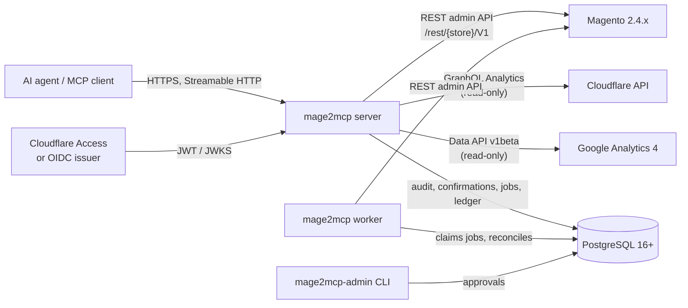

# Architecture

**Status:** as-built for v0.11.5 (working tree `v0.11.5-4`; post-tag changes are
limited to tool descriptions and tests). This document describes the code that
ships. Components that are designed but not implemented are marked **PLANNED**
and are not drawn as present.

**Verification boundary.** No live Magento, Cloudflare, or GA4 instance was
available. Magento behaviour is verified against the REST contract and
`httptest` fakes (`CONTRACT`); the end-to-end harness uses a fake Magento. There
is no live Magento integration test.

**Decision records:** [ADR-0001](adr/0001-modular-architecture.md),
[ADR-0002](adr/0002-mcp-transport.md),
[ADR-0010](adr/0010-error-model-and-tool-contract.md),
[ADR-0011](adr/0011-configuration-and-multi-instance.md),
[ADR-0012](adr/0012-observability-and-audit.md),
[ADR-0018](adr/0018-multi-instance-routing.md),
[ADR-0019](adr/0019-postgres-job-queue.md),
[ADR-0022](adr/0022-magento-rest-admin-scope.md).

## 1. Purpose

mage2mcp is a standalone Go service that exposes Magento 2, Cloudflare, and
Google Analytics 4 data and operations to AI agents through the Model Context
Protocol (MCP). It is a gateway, not a framework and not a plugin: it owns no
business system, installs nothing into Magento, and reads no vendor database
directly.

The shipped architecture satisfies five constraints:

1. **Standalone deployment.** A server and worker (plus a human-only admin CLI)
   that run anywhere Docker runs. Magento is reached over its official REST admin
   API only; there is no Magento GraphQL client and no database connection.
2. **Read-only by default.** Read tools are registered by default; write and
   destructive tools are registered only when `tools.writes: true`. Every write
   requires two-step human approval and is gated by the operation ledger.
3. **Module independence.** Magento, Cloudflare, and GA4 are separate packages
   with their own clients, services, DTOs, errors, and tests. No module imports
   another module's internals; cross-source work goes through `internal/unified`
   over narrow provider interfaces wired in `cmd/server`.
4. **Module-scoped registration.** Tools are registered for enabled modules.
   Capability metadata exists on the registry but is **not** consumed for gating
   (MCP-13); a module is enabled or disabled by configuration, not by a runtime
   health probe.
5. **Auditability.** Every tool call writes an intent and an outcome row with
   subject hash, tool, instance, decision, phase, state, error code, and request
   id. Writes are recorded with enough context to reconstruct the request.

## 2. System context



**Not present.** There is no R2 or ClickHouse component, no raw-log loader, and
no `cloudflare.logs.*` tool. `internal/logs/` is an empty directory; raw-log
analysis is **PLANNED**. The only GraphQL client in the tree is Cloudflare's
analytics client. Magento GraphQL is not used (ADR-0022).

Trust boundaries are analysed in the [threat model](security/threat-model.md).
The agent is untrusted: it can be manipulated by prompt injection, it can send
arbitrary parameters, and it must never reach a vendor API except through a
typed, permissioned tool.

## 3. Containers

| Container | Responsibility | State |
|---|---|---|
| `mage2mcp-server` | MCP endpoint, authentication, RBAC, confirmation, operation gate, synchronous tool execution, `/healthz`, `/readyz`, `/metrics` | Stateless except the SDK's MCP session; durable state is in PostgreSQL |
| `mage2mcp-worker` | Asynchronous Magento imports, operation reconciliation, import-batch retention | Durable state in PostgreSQL |
| `mage2mcp-admin` | Human-only approval surface for confirmations; reads the same PostgreSQL store | No state of its own |
| PostgreSQL 16+ | Instances, audit, confirmations, jobs, import batches, operation ledger | Durable |

The server does not perform long-running upstream work inline. Imports can be
executed synchronously (bounded) or queued for the worker; a queued import
returns a job id.

## 4. Packages

```text
cmd/server ── HTTP/MCP wiring, module registration, operation-gate adapters
cmd/worker ── job handlers: magento import, reconcile, retention
cmd/admin  ── confirmation approval CLI

internal/mcp        registry, MCP server, tool error envelope
internal/security   auth (assertion/bearer), jwt, rbac, confirm, audit
internal/core       config, errors, datasource contract (declared, unused)
internal/magento    REST client, products, configurable, inventory, orders, imports
internal/cloudflare GraphQL Analytics client and three read tools
internal/ga4        Data API client, reports, capability probe
internal/unified    Cloudflare-vs-GA4 traffic comparison
internal/jobs       job contract and worker loop
internal/storage    PostgreSQL store, migrations, audit, confirmations, jobs, ledger
internal/observability structured logging and Prometheus metrics
```

| Package | Owns | Notes |
|---|---|---|
| `internal/core/config` | YAML schema, `${VAR}` expansion, environment overrides, validation | See [configuration.md](configuration.md). |
| `internal/core/errors` | Closed error taxonomy | See [module-boundaries.md](module-boundaries.md) §4.2. |
| `internal/core/datasource` | `DataSource`/`Capability` contract | Declared but **not implemented by any module**; registration is module-enablement based. |
| `internal/mcp/registry` | Tool metadata validation (name, title, description, capability, permission, timeout, annotations) | Every tool is validated at registration. |
| `internal/mcp/server` | MCP server, middleware chain, `platform.info`, `write_safety` prompt, HTTP surface | The policy middleware is the single write choke point. |
| `internal/mcp/toolerr` | Typed tool registration, JSON Schema validation, `{code,message,details}` error envelope, structured content + text fallback | |
| `internal/security/auth` | Assertion-or-bearer credential extraction; assertion precedence; duplicate rejection | Does **not** enforce origin lockdown. |
| `internal/security/jwt` | JWT verification, JWKS cache, role claim parsing | RS256/ES256 allowlist; 8 KiB cap; 60 s skew. |
| `internal/security/rbac` | Default-deny policy, scope ladder, instance-scoped grants | The default policy is in code; the `roles`/`tool_permissions` tables are not read at runtime. |
| `internal/security/confirm` | Two-step confirmation: canonical hash, TTL, single use, tool+instance binding | Consumed atomically with the ledger for gated writes. |
| `internal/security/audit` | Audit event type and in-memory recorder | The PostgreSQL recorder lives in `internal/storage`. |
| `internal/security/secrets` | Empty directory | Secret handling is procedural `${VAR}` expansion in config; no secret-manager adapter ships. |
| `internal/storage` | Store, embedded migrations, audit/confirmation/job/batch/ledger repositories | The data plane. |
| `internal/jobs` | Task contract, worker loop, retry/lease handling | PostgreSQL queue; no Redis. |
| `internal/observability` | `slog` with redaction; Prometheus metrics | |
| `internal/logs` | Empty directory | Raw-log ingestion is **PLANNED**. |

`pkg/`, `internal/core/models`, and `internal/mcp/transport` do not exist or are
empty; the documentation no longer claims otherwise.

## 5. Request lifecycle (as built)

```mermaid
sequenceDiagram
    participant A as Agent
    participant H as HTTP + auth
    participant P as MCP policy middleware
    participant Z as RBAC
    participant C as Confirmation
    participant L as Operation ledger
    participant T as Tool handler
    participant U as Magento REST
    participant D as PostgreSQL

    A->>H: POST /mcp (tools/call)
    H->>H: exactly one credential; assertion wins over bearer
    H->>P: verified identity
    P->>D: audit intent row
    P->>Z: authorize(tool, instance, required scope)
    P->>C: create or validate confirmation (writes)
    P->>L: begin operation (writes; fence + idempotency key)
    P->>T: execute with the declared timeout
    T->>U: REST request (per-instance credential)
    U-->>T: typed response or typed error
    T-->>P: result / error
    P->>L: succeed / fail / unknown (guarded by fence)
    P->>D: audit outcome row (same transaction for gated writes)
    P-->>A: structured content + text fallback
```

Failure rules:

- Authentication failure returns `401` and never reaches the MCP layer.
- Authorization failure returns a tool error with `permission_denied`; the denial
  is audited with `decision=deny`.
- A missing confirmation returns `confirmation_required` with the parameter hash;
  nothing is executed.
- A write whose outcome is ambiguous returns `operation_unknown` and must be
  polled/reconciled, never retried.
- Upstream errors map to the closed taxonomy; upstream bodies are not echoed
  (bounded validation text may appear as `details.upstream_message`).
- Every tool call has the registry's declared timeout (30 s read, 60 s write,
  120 s bulk); long work is a job.

## 6. Tool registration and the write gate

`cmd/server.registerModules` builds one resolver per enabled module and registers
that module's tools. Reads are registered by default; writes only when
`tools.writes: true`; async import tools only when `database.url` is set; the
unified tool only when a valid `bindings` block exists. `platform.info` is
registered by `internal/mcp/server` as a first-class registry entry (the registry
validates it and `/readyz` counts it); a read-only start therefore reports
`tools:1`.

Rules that are enforced:

- Tool names are `module.domain.action`; the registry rejects a name, title,
  description, permission, timeout, or annotation that violates the contract.
- A tool is never registered without a permission, a timeout, and an input schema
  with `additionalProperties: false`.
- There is no `execute_api`, `execute_sql`, or raw GraphQL passthrough tool.
- Every write is gated: the middleware opens an `operations` row for the 47
  write tools that are not self-ledgered, plus the three async import write tools
  when the database is configured, while five money tools
  (`magento.invoice.create`, `invoice.capture`, `creditmemo.create`,
  `order.create`, `order.cancel`) drive the ledger themselves. A test asserts
  every write tool is gated or declared self-ledgered.
- `platform.info` reports the version, protocol versions, registry tool names,
  configured instances, and whether writes are enabled.

### Authorization and instance isolation

Authorization is default-deny and instance-scoped. With authentication enabled,
`cmd/server` builds `rbac.DefaultPolicy(configuredInstances(cfg))`: viewer/analyst
read, operator write, admin admin, each grant bound to a concrete instance. An
empty instance is rejected by `rbac.New`; the literal `"*"` is the only wildcard,
and `platform.info` alone is granted at `"*"` (gateway metadata, no store data).

The default policy binds **one instance per module**. A module with more than one
instance fails startup rather than silently granting every store:

```text
rbac: magento has 2 instances (demo, demo-alt); the default policy binds one instance per module. Grant per-instance policies explicitly, or call DefaultPolicyAllInstances() to treat them as one trust domain
```

`DefaultPolicyAllInstances()` is the explicit single-trust-domain opt-in; it
binds every grant to `"*"` and removes cross-instance isolation, so it is only
for deployments where all instances are one tenant. The policy is currently
constructed before the `auth.enabled` branch, so a multi-instance module also
fails with authentication disabled; that is a reported code issue, not a
supported development mode.

**Not implemented:** capability-driven registration, runtime module disable,
`notifications/tools/list_changed`, and a per-instance `/readyz` degraded state.
`/readyz` returns 200 when the process can serve MCP and, when a database is
configured, the durable-store `ReadyCheck` succeeds; it returns 503 with
`status: not ready` when that check fails.

## 7. Configuration and instances

Configuration is YAML with `${VAR}` expansion and environment overrides; unknown
keys are rejected. The full reference is [configuration.md](configuration.md);
the shipped examples are `configs/config.example.yaml` (development) and
`configs/config.production.template.yaml` (production). Two operational
requirements matter to the architecture:

- **A database is required for confirmations and imports.** Without
  `database.url`, confirmations and audit are in memory, the async import tools
  are not registered, and the five self-ledgered money tools fail closed because
  the ledger is not configured.
- **A write-enabled deployment needs `server.max_body_bytes` ≥ 12 MiB**
  (`MinMaxBodyBytesForImport`); the default is 16 MiB. A lower cap fails
  validation at startup instead of rejecting a maximum-size import at the
  transport with `413`.

Every instance has a stable `id`; tools require `instance` and the resolver
selects that instance's credential. Instance ids are globally unique across
modules. A module with several instances registers one tool per tool kind, not
one per instance. Unified bindings require exactly one Cloudflare and one GA4
instance; multi-instance bindings are **PLANNED** and rejected by validation.

## 8. Storage responsibilities

| Data | Store | Retention / notes |
|---|---|---|
| Runtime configuration | YAML + environment | Mounted read-only; not written back |
| Instance rows referenced by jobs/ledger | PostgreSQL `datasource_instances` | Upserted `(id, module)` when a job or operation is created |
| Roles, role assignments, tool permissions | PostgreSQL tables exist | **Not read at runtime**; RBAC uses the compiled default policy |
| Audit events | PostgreSQL `audit_events` | Append-only by convention; no retention job or hash chain (PLANNED) |
| Confirmations | PostgreSQL `confirmation_tokens` | TTL ≤ 15 min; consumed rows retained |
| Jobs | PostgreSQL `jobs` | Lease + fencing token; terminal rows retained |
| Idempotency keys | PostgreSQL `idempotency_keys` | Table exists but is **unused** by the code; the operation ledger is the replay guard |
| Import batches | PostgreSQL `import_batches`, `import_batch_failures` | Pruned by the worker after 30 days |
| Operation ledger | PostgreSQL `operations`, `operation_transitions` | Append-only transitions; the authority on business outcome |
| Raw HTTP request logs | none | R2/ClickHouse is **PLANNED**; PostgreSQL never stores raw logs |

The schema is documented in [database-design.md](database-design.md).

## 9. Operation ledger and reconciler

The ledger is the durable state machine for a business mutation. It exists
because a timeout, transport failure, or crash cannot distinguish "not applied"
from "applied". States: `pending`, `executing`, `succeeded`, `failed`, `unknown`,
`reconciling`. Every transition after `pending` is a conditional update guarded
by the current state and the fencing token issued when the row was claimed; a
stale writer gets `applied=false`.

An ambiguous outcome becomes `unknown`, never `failed`. The caller receives
`operation_unknown` and must poll. The worker enqueues a reconcile task every
minute, claims due `unknown` rows, reads the upstream (`ObserveOperation`), and
resolves them as succeeded/failed/unknown; an inconclusive read backs off, and
when the reconcile count exceeds eight the operation is escalated for manual
review.

The five money tools write their own ledger rows; the other write tools are
gated by the middleware. For gated writes the outcome audit row is committed in
the same transaction as the ledger transition. The five self-ledgered tools have
a known audit-outcome gap (REL-16-R): a crash after the tool commits but before
the middleware writes the audit row leaves the operation correct and the audit
row missing.

## 10. Concurrency and transport

- **Magento** uses a tuned `http.Transport`: 100 idle connections, 16 idle per
  host, 32 maximum per host, 90 s idle timeout, 10 s TLS handshake timeout,
  `ExpectContinueTimeout` 1 s. Redirects are refused. This is the only tuned
  transport; Cloudflare and GA4 use the standard client with per-request
  timeouts.
- **Magento enforces a per-instance outbound budget.** Each instance has a token
  bucket (default 50 requests/s, burst 100) and a concurrency cap (default 8),
  configured by `datasources.magento.instances[].limits`; an exhausted budget
  returns a retryable `rate_limited` without reaching Magento. Cloudflare and GA4
  do not honour `limits`; inbound rate limiting and their quota accounting are
  **PLANNED** (SEC-11).
- All upstream calls take `context.Context` and honour cancellation.
- The worker's concurrency is bounded by the job queue; a task holds a lease and
  a fencing token.
- Graceful shutdown stops accepting requests, drains for `server.shutdown_grace`,
  then closes the database pool.

## 11. Transport and protocol

- Streamable HTTP at `POST /mcp`, provided by the official MCP Go SDK. The SDK
  negotiates its full supported list, currently `2026-07-28` through
  `2024-11-05` (five versions); `platform.info` reports that list verbatim.
- Ingress accepts exactly one credential: `Cf-Access-Jwt-Assertion` is
  authoritative when present; `Authorization: Bearer` is used only when the
  assertion is absent; a duplicate header of either kind is rejected.
- The gateway does **not** verify that the request came from Cloudflare. Tunnel
  or authenticated origin pull is a deployment control.
- The caller's credential is never forwarded upstream; each module uses its
  per-instance vendor credential.
- `/healthz`, `/readyz`, and `/metrics` are served on the same listener.
  `/metrics` is put behind the auth middleware when the listener is not
  loopback (the production default); a loopback development listener may leave
  it open. Restrict it at the edge in either case.
- The MCP session is bound to the verified subject (SEC-15): a different subject
  presenting the id gets 404. There is still no `EventStore`, no resumability,
  no progress notification, and no `resource_link` path; those are **PLANNED**.

## 12. Observability

- Structured `slog` logs (JSON or text) with key-based redaction for
  token/secret/password/authorization/cookie/api_key/credential and bearer-shaped
  values.
- Prometheus metrics on `/metrics`:
  `mage2mcp_tool_calls_total{module,tool,outcome}`,
  `mage2mcp_tool_duration_seconds`, `mage2mcp_upstream_requests_total{module,status}`,
  `mage2mcp_upstream_duration_seconds`, `mage2mcp_auth_failures_total{reason}`,
  `mage2mcp_jobs_total{queue,state}`, and `mage2mcp_build_info`. There is no
  quota metric.
- `/healthz` reports process liveness. `/readyz` reports that the process can
  serve MCP, the registry tool count, and (when configured) that the durable
  store is reachable; an unreachable store yields 503. There is no `/livez`.
- Audit events are separate from logs and are not sampled.

## 13. Deployment topology

```text
Internet ── Cloudflare (Access + optional Tunnel) ── mage2mcp-server
                                                          │
                                       ┌──────────────────┼──────────────┐
                                       ▼                  ▼              ▼
                                  PostgreSQL          mage2mcp-worker  mage2mcp-admin
                                                                       (human host)
```

- The image is distroless, non-root, and bakes `configs/config.docker.yaml`.
  That baked config enables no data source; mount a real configuration over
  `/etc/mage2mcp/config.yaml` for a real deployment.
- The server, worker, and admin share PostgreSQL. The worker and admin are
  separate binaries (same image).
- Origin lockdown and metrics isolation are deployment controls; the gateway does
  not enforce them.
- Secrets come from the environment or a secret manager; configuration is
  mounted read-only.

## 14. Extension: adding a data source

A new data source is added without touching existing modules:

1. Create `internal/<source>` with a client, a service, DTOs, error mapping, and
   tests.
2. Add a resolver if the module supports several instances, and register tools
   with the registry contract (name, permission, timeout, schema, annotations).
3. Add a configuration module/instance schema and validation.
4. Wire the module in `cmd/server.registerModules`.
5. Add a module README and contract tests with an `httptest` fake.

The `internal/core/datasource` contract is declared but unused; a new module does
not have to implement it. Cross-source work defines a consumer-side interface in
`internal/unified` and receives an implementation at wiring time.

## 15. Planned components (not present)

| Component | Status |
|---|---|
| Raw Cloudflare log ingestion (R2/ClickHouse) and `cloudflare.logs.*` tools | PLANNED |
| Inbound rate limiting and Cloudflare/GA4 quota accounting | PLANNED |
| Multi-instance unified bindings | PLANNED (single CF + single GA4 only) |
| Audit hash chain, signed checkpoints, retention partitions | PLANNED |
| Progress notifications, cancellation propagation, `resource_link`, `tools/list_changed`, `/livez` | PLANNED |
| Secret-manager adapter and literal-secret rejection | PLANNED |
| Magento GraphQL verification | Not planned; REST admin only (ADR-0022) |

## 16. Verification

The package and behaviour claims above were checked against the tree. Tests that
prove the main flows are cited in
[security-review.md](security/security-review.md) and the threat model. The
schema is checked against the migrations by the command in
[database-design.md](database-design.md) §2. There is no live Magento test; all
Magento coverage is `CONTRACT`.
