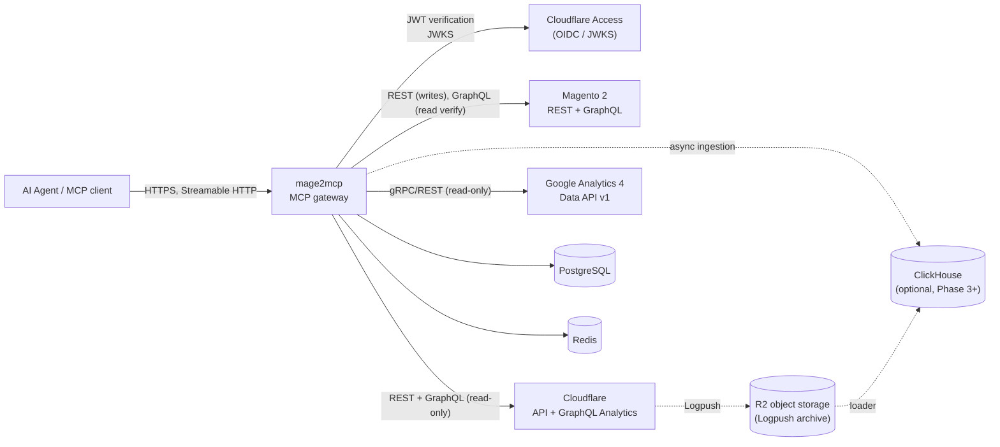
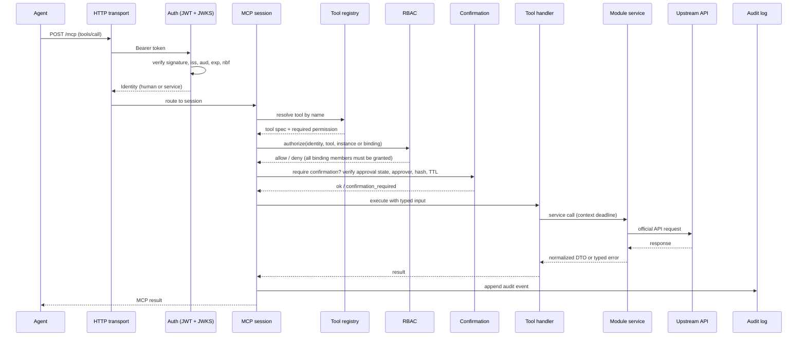

# Architecture

**Status:** Phase 0 design baseline — approved for implementation planning, not yet implemented.
**Decision records:** [ADR-0001](adr/0001-modular-architecture.md), [ADR-0002](adr/0002-mcp-transport.md), [ADR-0010](adr/0010-error-model-and-tool-contract.md), [ADR-0011](adr/0011-configuration-and-multi-instance.md), [ADR-0012](adr/0012-observability-and-audit.md).

## 1. Purpose

mage2mcp is a standalone Go service that exposes Magento 2, Cloudflare, and
Google Analytics 4 data and operations to AI agents through the Model Context
Protocol (MCP). It is a gateway, not a framework and not a plugin: it owns no
business system, installs nothing into Magento, and reads no vendor database
directly.

The architecture exists to satisfy five non-negotiable constraints:

1. **Standalone deployment.** A single Go binary (plus a worker) that can run
   anywhere Docker runs. Magento is reached over its official REST and GraphQL
   APIs only; no Magento module, no database connection.
2. **Read-only by default.** Every capability is read-only unless explicitly
   declared otherwise. Write capabilities require a separate permission, a
   separate configuration switch, and — for high-risk operations — a
   parameter-bound human confirmation.
3. **Module independence.** Magento, Cloudflare, and GA4 are separate modules
   with separate clients, services, DTOs, configuration, errors, and tests.
   No module imports another module's internals. Cross-source analysis goes
   through the Unified Analytics module and public service interfaces only.
4. **Capability-driven tool registration.** The gateway registers only the
   tools for modules that are enabled and healthy. A broken Cloudflare token
   must not prevent Magento tools from working.
5. **Auditability.** Every tool invocation is attributable to an identity, a
   tool, an instance, a permission decision, and a parameter hash. Writes are
   recorded with enough context to reconstruct what was requested.

## 2. System context



Trust boundaries are analyzed in the [threat model](security/threat-model.md).
The agent is untrusted: it can be manipulated by prompt injection, it can send
arbitrary parameters, and it must never be able to reach a vendor API except
through a typed, permissioned tool.

## 3. Containers

| Container | Responsibility | State |
|---|---|---|
| `mage2mcp-server` | MCP endpoint, authentication, RBAC, tool registry, synchronous tool execution | Stateless except MCP session state |
| `mage2mcp-worker` | Asynchronous jobs: imports, Logpush ingestion, long-running reports, retries | Durable job state in PostgreSQL/Redis |
| PostgreSQL | Instances, permissions, job state, audit log, SKU mappings, import batches | Durable |
| Redis | Asynq queues, rate limits, short-lived caches, idempotency keys | Ephemeral |
| ClickHouse (optional) | Raw/normalized HTTP request logs from Logpush | Durable, Phase 3+ |
| R2 (optional) | Logpush archive and replay source | Durable, Phase 3+ |

The server never performs long-running upstream work inline. Any operation that
can exceed the tool timeout budget is converted into a job and returns a job
handle. This keeps MCP responses bounded and makes retries and resumability
possible.

## 4. Component view

```text
cmd/server, cmd/worker
        │
        ▼
internal/mcp ── server, registry, transport, tools
        │
        ▼
internal/security ── auth (Cloudflare Access JWT), rbac, audit, secrets
        │
        ▼
internal/core ── config, errors, models, datasource, capabilities
        │
        ├──────────────┬──────────────┬──────────────┐
        ▼              ▼              ▼              ▼
internal/magento  internal/cloudflare  internal/ga4  internal/unified
        │              │              │              │
        ▼              ▼              ▼              │
   Magento API    Cloudflare API   GA4 Data API      │
                                                     ▼
                                          calls module service interfaces
```

| Package | Owns | May import |
|---|---|---|
| `internal/core` | Configuration schema, error taxonomy, shared value types, `DataSource` contract, capability model | Standard library, config/validation libraries |
| `internal/security` | JWT verification, JWKS cache, RBAC policy, audit writer, secret resolution | `core` |
| `internal/mcp` | MCP server construction, tool registry, transport, request pipeline, tool definitions | `core` (including the job-enqueue interface), `security`, module public interfaces |
| `internal/magento` | Magento REST/GraphQL client, product/EAV/configurable/inventory/import/order services, DTOs | `core` only |
| `internal/cloudflare` | Cloudflare API client, GraphQL query templates, security events, Logpush metadata | `core` only |
| `internal/ga4` | GA4 Data API client, report builder, compatibility validator, property capabilities | `core` only |
| `internal/unified` | Cross-source models, joins, metric semantics, SKU mapping | `core` + module **public service interfaces** |
| `internal/jobs` | Asynq task definitions, enqueue/dequeue, retry policy | `core`, module services (as task handlers) |
| `internal/logs` | R2/ClickHouse ingestion and request-level queries for Logpush data | `core`, object storage and ClickHouse drivers |
| `internal/admin` | Human-only approval surface for confirmations, read-only status | `core`, `security` |
| `internal/storage` | PostgreSQL repositories, migrations runner, Redis adapters | `core` |
| `internal/observability` | Structured logging, metrics, health, tracing | `core` |
| `pkg/` | Optional reusable primitives with no domain knowledge | Standard library only |

The import direction is enforced by review in Phase 0 and by an import-boundary
check in Phase 1. A module that needs data from another module defines a
consumer-side interface in `internal/unified` and receives an implementation at
wiring time; it never imports the other module's package.

## 5. Request lifecycle



Failure rules:

- Authentication failure returns `401` and never reaches the MCP layer.
- Authorization failure returns a tool error with code `permission_denied`; the
  audit event is still written.
- A confirmation failure returns `confirmation_required` with the parameters
  hash the client must re-submit; nothing is executed.
- Upstream errors are mapped to the gateway error taxonomy; upstream payloads
  are never passed through verbatim.
- Every request carries a deadline. The default tool timeout is 30 seconds;
  long operations are jobs.

## 6. Tool registration and capabilities

At startup each enabled module reports its capabilities. The registry maps
capabilities to tool specs and registers only tools whose capability is present
and whose permission model is configured.

```go
type Capability struct {
    ID          string // "magento.product.write"
    Version     string // capability contract version
    ReadOnly    bool
    Description string
}
```

Rules:

- Tool names are namespaced: `magento.product.*`, `magento.configurable.*`,
  `cloudflare.analytics.*`, `ga4.ecommerce.*`, `unified.traffic.*`.
- A module that fails its health check at startup is disabled with a structured
  warning; other modules start normally. `/readyz` reports degraded, not failed.
- `tools/list` reflects the live registry. If a module is disabled at runtime,
  its tools are removed and a `notifications/tools/list_changed` is emitted.
- A tool is never registered without a permission, a timeout, and an input
  schema with `additionalProperties: false`.
- There is no `execute_api`, `execute_sql`, or raw GraphQL passthrough tool.
- Long-running work is enqueued through the `core/jobs.Enqueuer` interface. A tool
  handler depends on that interface, never on `internal/jobs`, so the async design
  does not violate the dependency table. The concrete enqueuer is injected in
  `cmd/server`; job handlers are registered by the worker.
- Unified tools are authorized against a **binding**: every member instance must be
  granted. A binding is declared in configuration and persisted read-only in
  `instance_bindings`.

## 7. Configuration and instances

Configuration is YAML with environment-variable overrides. Secrets are
references, never literals in the file.

```yaml
server:
  listen: "0.0.0.0:8080"
  public_url: "https://mcp.example.com"
bindings:
  - id: "store-us-analytics"
    magento: "store-us"
    cloudflare: "zone-us"
    ga4: "giztop"
auth:
  issuer: "https://<team>.cloudflareaccess.com"
  audience: "<application-aud-claim>"
  jwks_url: "https://<team>.cloudflareaccess.com/cdn-cgi/access/certs"
datasources:
  magento:
    enabled: true
    instances:
      - id: "store-us"
        base_url: "https://shop.example.com"
        store_code: "default"
        auth:
          mode: "integration_token"
          token: "${MAGENTO_US_TOKEN}"
  cloudflare:
    enabled: true
    instances:
      - id: "zone-us"
        account_id: "${CLOUDFLARE_ACCOUNT_ID}"
        zone_id: "${CLOUDFLARE_ZONE_ID}"
        credential_profile: "analytics"
  ga4:
    enabled: true
    instances:
      - id: "giztop"
        property_id: "354542598"
        credentials: "${GA4_SERVICE_ACCOUNT_JSON}"
```

Rules:

- Every instance has a stable `id`; tools accept `instance` as a required
  parameter when more than one instance is configured.
- Configuration is validated at startup; an invalid instance is disabled with a
  precise error, and the process still starts if at least one module is usable.
- Unknown keys are rejected, not ignored.
- Secrets are resolved from the environment or a secret manager adapter; a
  missing secret disables only the dependent instance.

## 8. Storage responsibilities

| Data | Store | Retention |
|---|---|---|
| Instance projection of YAML config (non-secret, read-only from the server) | PostgreSQL | Until deleted |
| Credential references | PostgreSQL (reference only) / secret manager | Until rotated |
| Users, roles, tool permissions | PostgreSQL | Until deleted |
| Audit events | PostgreSQL, append-only | 365 days default, configurable |
| Jobs and job attempts | PostgreSQL + Redis queue | 30 days after completion |
| Idempotency reservations (Redis) and ledger (PostgreSQL) | Redis + PostgreSQL | Reservation 24 h; ledger 30 days |
| Import batches and item results | PostgreSQL | 90 days |
| SKU mappings | PostgreSQL | Until deleted |
| Short-lived response cache | Redis | 30 s – 15 min by report shape |
| Rate-limit counters | Redis | Window length |
| Raw HTTP request logs | ClickHouse / R2 | Per-zone policy, never PostgreSQL |

The database design is in [database-design.md](database-design.md). Raw
Cloudflare logs are explicitly excluded from PostgreSQL: at 1.5–3 kB per
request, a modest 1M requests/day produces 45–90 GB/month.

## 9. Concurrency model

- One `http.Client` per upstream instance with bounded connection pools and
  explicit timeouts; never the default client.
- Per-instance concurrency semaphores and token-bucket rate limiters, sized from
  configuration. Cloudflare GraphQL defaults to a 300-query/5-minute budget;
  GA4 uses the observed 10-concurrent-request quota.
- All upstream calls take `context.Context` and honor cancellation.
- Worker concurrency is bounded per queue; imports are serialized per instance
  and SKU range to avoid write races.
- No package-level mutable state. Dependencies are constructed in `main` and
  passed explicitly.
- Graceful shutdown: stop accepting new MCP requests, drain in-flight tools for
  up to the configured grace period, then close clients and the database pool.

## 10. Observability

- Structured logs with `slog`; one event per tool call with `tool`, `instance`,
  `identity_id`, `permission`, `outcome`, `duration_ms`, `param_hash`.
  Parameters are never logged verbatim.
- Prometheus metrics: `mage2mcp_tool_calls_total{module,tool,outcome}`,
  `mage2mcp_tool_duration_seconds`, `mage2mcp_upstream_requests_total{module,status}`,
  `mage2mcp_upstream_duration_seconds`, `mage2mcp_quota_remaining{module,instance}`,
  `mage2mcp_jobs_total{queue,state}`, `mage2mcp_auth_failures_total{reason}`.
- Health endpoints: `/healthz` (process alive), `/readyz` (at least one module
  ready, database reachable), `/livez` (no deadlock, optional deep check).
- Audit events are separate from logs and are never sampled.

## 11. Deployment topology

```text
Internet ── Cloudflare (Access + Tunnel) ── mage2mcp-server (private network)
                                                   │
                                    ┌──────────────┼──────────────┐
                                    ▼              ▼              ▼
                                PostgreSQL       Redis        worker
```

- The MCP endpoint is published through a Cloudflare Tunnel; no inbound port is
  opened on the host.
- The admin/metrics surface is bound to a private interface or protected by a
  separate Access application. It is never exposed anonymously.
- The server and worker share the database and Redis but have separate
  credentials and separate container images.
- Configuration is mounted read-only; secrets come from the environment or a
  secret manager, never from the image.

## 12. Extension: adding a data source

A new data source (Search Console, BigQuery, Shopify, WooCommerce, another
analytics platform) is added without touching existing modules:

1. Create `internal/<source>` with `client/`, `service/`, DTOs, errors, config,
   tests, and a module README.
2. Implement `core/datasource.DataSource` and declare capabilities.
3. Define typed service interfaces consumed by `internal/unified` where
   cross-source analysis is needed.
4. Register tools under the module's namespace with permissions, timeouts, and
   schemas.
5. Add configuration, health checks, metrics, and documentation.
6. Add contract tests with a fake implementation so other modules can be tested
   without the new source.

No change to Magento, Cloudflare, or GA4 code is required.

## 13. Open questions

| Question | Owner | Resolution point |
|---|---|---|
| ClickHouse deployment model (managed vs self-hosted) | Architect | Phase 3 planning |
| Whether to expose Prometheus metrics through Access or a private listener | Security | Phase 1 |
| Multi-tenant (multiple customers per deployment) vs single-tenant | Architect | Post-1.0; schema reserves `tenant_id` |

## 14. Verification status

This document is a design baseline. It contains no implementation claims. The
external facts it relies on are recorded in
[research-baseline.md](development/research-baseline.md) with verification tags.
