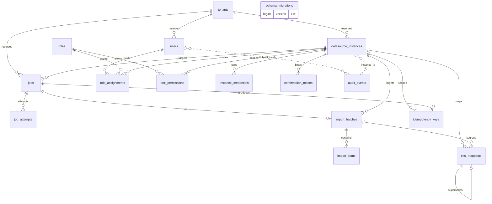

# Database design

**Status:** Phase 0 design baseline. Normative for Phase 1 migrations.
**Date:** 2026-11-18 · **Target:** PostgreSQL 16+ (pgx v5, golang-migrate), Redis 7+ (Asynq).
**Decisions:** [ADR-0009](adr/0009-data-stores.md), [ADR-0006](adr/0006-authentication.md),
[ADR-0011](adr/0011-configuration-and-multi-instance.md),
[ADR-0012](adr/0012-observability-and-audit.md).
**Related:** [Architecture](architecture.md) §8, [module boundaries](module-boundaries.md) §5,
[tool catalog](mcp-tools.md) §6, [threat model](security/threat-model.md) §5.4, §5.12, §5.13, §6.6.

The DDL in §4.2 is authoritative for columns, constraints, and indexes. Where prose and DDL
disagree, the DDL wins and the prose is a defect.

## 1. Purpose, scope, and non-goals

**Purpose.** Define the durable schema that answers, without ambiguity: who may call which
tool against which instance, what work is in flight, what an import did, how a GA4 `itemId`
relates to a Magento SKU, which high-risk write a human approved, and who did what and when.
Phase 1 writes migrations directly from §4.2.

**Scope.** Identity and authorization; instances and credential references; jobs; imports; SKU
mapping; confirmations and idempotency; audit; the reserved `tenants` table; the tool-managed
`schema_migrations`. Redis key design is in scope: the durable and ephemeral halves are one
design.

**Non-goals.** No raw Cloudflare request logs, parsed Logpush rows, or ClickHouse schema
(ADR-0004: R2 plus ClickHouse, never PostgreSQL). No secret material, only `secret://`
references. No agent conversation content or MCP message bodies. No upstream response bodies,
only hashes and status classes. No Magento catalog mirror: Magento is the source of truth and
Redis caches for seconds. No authentication tables: AuthN is Cloudflare Access (ADR-0006). No
star schema or materialized aggregates. Multi-tenancy is out of scope for v0.x; `tenant_id` is
reserved where cheap (§5.1, §13).

## 2. Storage principles

### 2.1 The durable/ephemeral test

One question decides the store: **if Redis were flushed now, would a past operation become
unknowable, or would a retry become unsafe?** If yes, PostgreSQL. If losing it costs only
latency, a recomputation, or one re-run job, Redis.

| Fact | Store | Reason |
|---|---|---|
| Instances, roles, permissions, mappings | PostgreSQL | Must survive restart and be auditable |
| Job state, attempts, results | PostgreSQL | Retries and evidence depend on it |
| Import batch and per-item outcome | PostgreSQL | "What did this import change" is a legal question |
| Confirmations, idempotency records | PostgreSQL ledger + Redis hot path | Replay safety survives a cache flush |
| Audit events | PostgreSQL, append-only | Evidence |
| Queue membership, rate limits, budgets, caches, sessions | Redis | Reconstructible, window-scoped, or recomputable |

### 2.2 The queue is not the record

Asynq task payloads contain only `{"job_id": "<uuid>"}`; parameters, attempts, and outcomes
live in `jobs`/`job_attempts`. A Redis loss loses delivery, not truth: the reaper (§5.3)
re-enqueues non-terminal jobs from PostgreSQL. That is what ADR-0009 means by "Redis loss
degrades queues and limits but does not corrupt durable state".

### 2.3 Why no raw logs

A Logpush `http_requests` record is 1.5–3 kB uncompressed (F14); 1M requests/day is 45–90
GB/month before indexes. PostgreSQL would spend its WAL, vacuum, and backup window on
append-only data queried by column — the shape ClickHouse exists for. PostgreSQL stores the
pointer only: `jobs` rows for ingestion, `audit_events` rows for who queried what.

### 2.4 Why no secrets

A secret in the database is a secret in every backup, replica, `pg_dump` handed to support, and
read-only analytics role. `instance_credentials` stores a `secret://` reference, a rotation
timestamp, and optionally a **keyed** HMAC fingerprint that detects when the resolved value
changed. A plain hash is also forbidden: offline-brute-forceable for low-entropy inputs.

### 2.5 Append-only audit

Runtime roles get `INSERT` on `audit_events` and lose `UPDATE`, `DELETE`, `TRUNCATE` (§12.1).
Deletion happens only by dropping a monthly partition, a DDL operation by the migration role.
`prev_hash`/`entry_hash` make a single-row edit or delete detectable by the hourly chain
verifier even if an attacker obtains DDL rights (T-03, T-30).

### 2.6 PII minimization

- Identity is `subject_hash = SHA-256(pepper || sub)`; the raw `sub` is never written and audit
  joins on the hash.
- `users.email` is the only Restricted column and is nullable; a deployment with no admin UI
  runs with it always `NULL`.
- `params_summary` holds allowlisted scalars (`sku`, `qty`, `page_size`, `state`), never
  free-form text or customer identifiers, capped at 2 KiB.
- No customer name, address, phone, order line, or IP address is stored. `client_ip_hash` is a
  keyed hash used only for correlation.

### 2.7 Type conventions

`timestamptz` only, never `timestamp`, UTC on write. `uuid` via `gen_random_uuid()` (built in
since PG 13, no `pgcrypto`); UUIDv7 for `audit_events.event_id`. `bigint identity` for
high-volume internal rows. Enumerations as `text` + `CHECK`, never native `ENUM` (a native enum
value cannot be added and used in the same transaction). Money `numeric(20,6)` with ISO-4217
`char(3)`; quantities `numeric(20,4)`; never floats. Hashes `bytea` with an exact-length
`CHECK`. Every free-text column has a length `CHECK`.

`jsonb` appears in exactly six columns, each with a size cap and an owning validator:
`datasource_instances.config` (16 KiB, config loader), `jobs.payload` (64 KiB, tool input
schema), `jobs.result` (8 KiB, tool output schema),
`confirmation_tokens.params_summary` (2 KiB, confirmation allowlist),
`idempotency_keys.response_body` (8 KiB, response redactor),
`audit_events.params_summary` (2 KiB, audit allowlist). A seventh requires an amendment here.

## 3. Entity-relationship diagram

Solid lines are enforced foreign keys. Dashed lines are logical references deliberately left
without a constraint: evidence must outlive the rows it describes.



## 4. Table specifications

### 4.1 Summary

| Table | Purpose | Growth | Retention | PII |
|---|---|---|---|---|
| `tenants` | Reserved tenant registry; one seed row in v0.x | static | until deleted | Internal |
| `users` | Known identities keyed by `subject_hash` | low | until suspended/deleted | Restricted (`email`) |
| `roles` | Four built-in roles | static | never deleted | Internal |
| `role_assignments` | User × role × optional instance grant | low | revoked rows 365 d | Internal |
| `tool_permissions` | Role × tool × instance policy | low (< 10k) | until changed | Internal |
| `datasource_instances` | Projection of configured instances | low | until removed from config | Internal |
| `instance_credentials` | `secret://` references and rotation state | low | 90 d after revocation | Confidential |
| `jobs` | Durable async work items | medium | 30 d after terminal | Confidential |
| `job_attempts` | One row per execution attempt | medium-high | cascades with `jobs` | Internal |
| `import_batches` | One import request and its counters | low | 90 d after terminal | Internal |
| `import_items` | Per-row import outcome | high | cascades with batch | Internal |
| `sku_mappings` | GA4 `itemId` ↔ Magento SKU | low-medium | until superseded | Internal |
| `confirmation_tokens` | High-risk write approvals | low | 30 d after expiry | Confidential |
| `idempotency_keys` | Replay ledger for writes | medium-high | 24 h after expiry | Confidential |
| `audit_events` | Append-only tool-call evidence | high | 365 d, configurable | Confidential |
| `schema_migrations` | golang-migrate version and dirty flag | static | never | Public |

### 4.2 DDL

#### 000001 — tenants, identities, authorization, instances

```sql
CREATE TABLE tenants (
    id         uuid        PRIMARY KEY DEFAULT gen_random_uuid(),
    slug       text        NOT NULL,
    name       text        NOT NULL,
    status     text        NOT NULL DEFAULT 'active' CHECK (status IN ('active','suspended')),
    created_at timestamptz NOT NULL DEFAULT now(),
    CONSTRAINT tenants_slug_key UNIQUE (slug),
    CONSTRAINT tenants_slug_fmt CHECK (slug ~ '^[a-z][a-z0-9-]{1,31}$')
);
-- v0.x seeds exactly one row; every tenant_id in this schema points at it.
INSERT INTO tenants (id, slug, name)
VALUES ('00000000-0000-0000-0000-000000000001', 'default', 'Default deployment')
ON CONFLICT (id) DO NOTHING;

CREATE TABLE users (
    id             uuid        PRIMARY KEY DEFAULT gen_random_uuid(),
    tenant_id      uuid        NULL REFERENCES tenants(id) ON DELETE RESTRICT,
    subject_hash   bytea       NOT NULL,   -- SHA-256(pepper || sub); never the raw sub
    email          text        NULL,       -- Restricted; nullable by design
    display_name   text        NULL,
    identity_class text        NOT NULL CHECK (identity_class IN ('human','service')),
    status         text        NOT NULL DEFAULT 'active' CHECK (status IN ('active','suspended')),
    last_seen_at   timestamptz NULL,
    created_at     timestamptz NOT NULL DEFAULT now(),
    updated_at     timestamptz NOT NULL DEFAULT now(),
    CONSTRAINT users_subject_hash_key UNIQUE (subject_hash),
    CONSTRAINT users_hash_len CHECK (octet_length(subject_hash) = 32),
    CONSTRAINT users_email_fmt CHECK (email IS NULL OR (email = lower(email)
        AND email ~ '^[^@[:space:]]+@[^@[:space:]]+\.[a-z]{2,}$')),
    CONSTRAINT users_service_email CHECK (identity_class = 'human' OR email IS NULL)
);
CREATE UNIQUE INDEX users_email_uq ON users (email) WHERE email IS NOT NULL;

CREATE TABLE roles (
    name        text        PRIMARY KEY,
    rank        smallint    NOT NULL,
    description text        NOT NULL,
    is_builtin  boolean     NOT NULL DEFAULT false,
    created_at  timestamptz NOT NULL DEFAULT now(),
    CONSTRAINT roles_name_fmt CHECK (name ~ '^[a-z][a-z0-9_]{2,31}$'),
    CONSTRAINT roles_rank_key UNIQUE (rank)
);
-- ranks: 10 viewer, 20 analyst, 30 operator, 40 admin; ordering is for UI only.

CREATE TABLE datasource_instances (
    id            text        PRIMARY KEY,
    tenant_id     uuid        NULL REFERENCES tenants(id) ON DELETE RESTRICT,
    module        text        NOT NULL CHECK (module IN ('magento','cloudflare','ga4')),
    display_name  text        NOT NULL,
    endpoint      text        NULL,        -- Magento base URL; NULL for Cloudflare and GA4
    external_id   text        NOT NULL,    -- store_code | zone/account id | property id
    config        jsonb       NOT NULL DEFAULT '{}'::jsonb,
    capabilities  text[]      NOT NULL DEFAULT '{}',
    write_profile boolean     NOT NULL DEFAULT false,
    source        text        NOT NULL DEFAULT 'yaml' CHECK (source IN ('yaml','db')),
    status        text        NOT NULL DEFAULT 'active' CHECK (status IN ('active','disabled','degraded')),
    health_checked_at timestamptz NULL,
    health_detail text        NULL,
    created_at    timestamptz NOT NULL DEFAULT now(),
    updated_at    timestamptz NOT NULL DEFAULT now(),
    CONSTRAINT datasource_instances_id_fmt CHECK (id ~ '^[a-z0-9][a-z0-9-]{0,63}$'),
    CONSTRAINT datasource_instances_identity_key UNIQUE NULLS NOT DISTINCT (module, endpoint, external_id),
    CONSTRAINT datasource_instances_magento_endpoint CHECK (module <> 'magento' OR endpoint IS NOT NULL),
    CONSTRAINT datasource_instances_config_size CHECK (octet_length(config::text) <= 16384),
    CONSTRAINT datasource_instances_health_len CHECK (health_detail IS NULL OR length(health_detail) <= 512)
);
CREATE INDEX datasource_instances_module_status_idx ON datasource_instances (module, status);

CREATE TABLE instance_credentials (
    id          uuid        PRIMARY KEY DEFAULT gen_random_uuid(),
    instance_id text        NOT NULL REFERENCES datasource_instances(id) ON DELETE CASCADE,
    kind        text        NOT NULL CHECK (kind IN ('magento_integration_token','adobe_ims_client',
                                'cloudflare_api_token','ga4_service_account')),
    secret_ref  text        NOT NULL,   -- secret://<name>; never material
    secret_fingerprint bytea NULL,      -- HMAC-SHA256(server key, resolved value)
    status      text        NOT NULL DEFAULT 'active' CHECK (status IN ('active','rotating','revoked')),
    created_at  timestamptz NOT NULL DEFAULT now(),
    rotated_at  timestamptz NULL,
    last_verified_at timestamptz NULL,
    CONSTRAINT instance_credentials_ref_fmt CHECK (secret_ref ~ '^secret://[A-Za-z0-9._/-]{1,128}$'),
    CONSTRAINT instance_credentials_fp_len CHECK (secret_fingerprint IS NULL OR octet_length(secret_fingerprint) = 32)
);
CREATE UNIQUE INDEX instance_credentials_active_uq
    ON instance_credentials (instance_id, kind) WHERE status <> 'revoked';

CREATE TABLE role_assignments (
    id          uuid        PRIMARY KEY DEFAULT gen_random_uuid(),
    tenant_id   uuid        NULL REFERENCES tenants(id) ON DELETE RESTRICT,
    user_id     uuid        NOT NULL REFERENCES users(id) ON DELETE CASCADE,
    role_name   text        NOT NULL REFERENCES roles(name) ON DELETE RESTRICT,
    instance_id text        NULL REFERENCES datasource_instances(id) ON DELETE CASCADE,
    source      text        NOT NULL DEFAULT 'manual' CHECK (source IN ('manual','idp_group','bootstrap')),
    granted_by  uuid        NULL REFERENCES users(id) ON DELETE SET NULL,
    granted_at  timestamptz NOT NULL DEFAULT now(),
    expires_at  timestamptz NULL,
    revoked_at  timestamptz NULL,
    CONSTRAINT role_assignments_expiry_chk CHECK (expires_at IS NULL OR expires_at > granted_at),
    CONSTRAINT role_assignments_self_grant_chk CHECK (granted_by IS NULL OR granted_by <> user_id)
);
CREATE UNIQUE INDEX role_assignments_active_uq
    ON role_assignments (user_id, role_name, instance_id) NULLS NOT DISTINCT WHERE revoked_at IS NULL;

CREATE TABLE tool_permissions (
    id          bigint      GENERATED ALWAYS AS IDENTITY PRIMARY KEY,
    role_name   text        NOT NULL REFERENCES roles(name) ON DELETE CASCADE,
    tool_pattern text       NOT NULL,
    scope_kind  text        NOT NULL CHECK (scope_kind IN ('tool','capability_prefix')),
    instance_id text        NULL REFERENCES datasource_instances(id) ON DELETE CASCADE,
    effect      text        NOT NULL DEFAULT 'allow' CHECK (effect IN ('allow','deny')),
    scope       text        NOT NULL CHECK (scope IN ('read','write','destructive','admin')),
    requires_confirmation boolean NOT NULL DEFAULT false,
    requires_pii_grant    boolean NOT NULL DEFAULT false,
    updated_at  timestamptz NOT NULL DEFAULT now(),
    CONSTRAINT tool_permissions_pattern_chk CHECK (
        (scope_kind = 'tool' AND tool_pattern ~ '^[a-z][a-z0-9_]*(\.[a-z][a-z0-9_]*){1,3}$')
     OR (scope_kind = 'capability_prefix' AND tool_pattern ~ '^[a-z][a-z0-9_]*(\.[a-z][a-z0-9_]*){0,2}$')),
    CONSTRAINT tool_permissions_no_wildcard CHECK (position('*' in tool_pattern) = 0),
    CONSTRAINT tool_permissions_confirm_chk CHECK (requires_confirmation = false OR scope IN ('write','destructive'))
);
CREATE UNIQUE INDEX tool_permissions_uq
    ON tool_permissions (role_name, tool_pattern, instance_id) NULLS NOT DISTINCT;
```

`NULLS NOT DISTINCT` (PG 15+) makes a global row (`instance_id IS NULL`) impossible to
duplicate. `tool_permissions.scope` mirrors the catalog's `permission` field (mcp-tools §6);
`audit_events` keeps the threat model's name, `risk_class`, for the same value.

#### 000002 — jobs and attempts

```sql
CREATE TABLE jobs (
    id             uuid        PRIMARY KEY DEFAULT gen_random_uuid(),
    tenant_id      uuid        NULL REFERENCES tenants(id) ON DELETE RESTRICT,
    instance_id    text        NOT NULL REFERENCES datasource_instances(id) ON DELETE RESTRICT,
    module         text        NOT NULL CHECK (module IN ('magento','cloudflare','ga4','unified','platform')),
    tool           text        NOT NULL,
    kind           text        NOT NULL CHECK (kind ~ '^[a-z][a-z0-9_]{2,63}$'),
    state          text        NOT NULL DEFAULT 'queued'
                               CHECK (state IN ('queued','running','cancelling','succeeded','failed','canceled')),
    queue          text        NOT NULL CHECK (queue IN ('critical','default','import','report','maintenance')),
    priority       smallint    NOT NULL DEFAULT 0,   -- higher runs sooner
    payload        jsonb       NOT NULL,             -- typed request; never a secret
    payload_sha256 bytea       NOT NULL,
    idempotency_key text       NULL,
    subject_hash   bytea       NOT NULL,
    request_id     text        NULL,
    attempt_count  smallint    NOT NULL DEFAULT 0,
    max_attempts   smallint    NOT NULL DEFAULT 3,
    last_error_code text       NULL,
    result         jsonb       NULL,
    result_sha256  bytea       NULL,
    scheduled_at   timestamptz NOT NULL DEFAULT now(),
    lease_expires_at timestamptz NULL,
    started_at     timestamptz NULL,
    finished_at    timestamptz NULL,
    cancel_requested_at timestamptz NULL,
    created_at     timestamptz NOT NULL DEFAULT now(),
    updated_at     timestamptz NOT NULL DEFAULT now(),
    CONSTRAINT jobs_payload_size CHECK (octet_length(payload::text) <= 65536),
    CONSTRAINT jobs_result_size CHECK (result IS NULL OR octet_length(result::text) <= 8192),
    CONSTRAINT jobs_hash_len CHECK (octet_length(payload_sha256) = 32
        AND (result_sha256 IS NULL OR octet_length(result_sha256) = 32)),
    CONSTRAINT jobs_attempt_bounds CHECK (max_attempts BETWEEN 1 AND 10
        AND attempt_count BETWEEN 0 AND max_attempts),
    CONSTRAINT jobs_terminal_finished CHECK (
        (state IN ('succeeded','failed','canceled')) = (finished_at IS NOT NULL)),
    CONSTRAINT jobs_running_lease CHECK (state <> 'running' OR lease_expires_at IS NOT NULL),
    CONSTRAINT jobs_idem_fmt CHECK (idempotency_key IS NULL
        OR idempotency_key ~ '^[A-Za-z0-9._:-]{8,128}$')
);
CREATE UNIQUE INDEX jobs_idempotency_uq ON jobs (instance_id, subject_hash, tool, idempotency_key)
    WHERE idempotency_key IS NOT NULL;
CREATE INDEX jobs_recovery_idx ON jobs (queue, priority DESC, scheduled_at) WHERE state = 'queued';
CREATE INDEX jobs_lease_idx ON jobs (lease_expires_at) WHERE state = 'running';
CREATE INDEX jobs_instance_created_idx ON jobs (instance_id, created_at DESC);
CREATE INDEX jobs_subject_created_idx ON jobs (subject_hash, created_at DESC);
CREATE INDEX jobs_purge_idx ON jobs (finished_at) WHERE state IN ('succeeded','failed','canceled');

CREATE TABLE job_attempts (
    id         bigint      GENERATED ALWAYS AS IDENTITY PRIMARY KEY,
    job_id     uuid        NOT NULL REFERENCES jobs(id) ON DELETE CASCADE,
    attempt_no smallint    NOT NULL CHECK (attempt_no >= 1),
    worker_id  text        NOT NULL,
    outcome    text        NOT NULL CHECK (outcome IN ('succeeded','failed','retried',
                               'timed_out','canceled','lease_expired')),
    error_code text        NULL,
    error_detail text      NULL,
    upstream_status_class text NULL
                           CHECK (upstream_status_class IN ('2xx','3xx','4xx','5xx','network','timeout')),
    duration_ms integer    NULL CHECK (duration_ms >= 0),
    started_at timestamptz NOT NULL,
    finished_at timestamptz NULL,
    CONSTRAINT job_attempts_uq UNIQUE (job_id, attempt_no),
    CONSTRAINT job_attempts_detail_len CHECK (error_detail IS NULL OR length(error_detail) <= 512)
);
CREATE INDEX job_attempts_failures_idx ON job_attempts (started_at DESC) WHERE outcome <> 'succeeded';
```

#### 000003 — imports

```sql
CREATE TABLE import_batches (
    id             uuid        PRIMARY KEY DEFAULT gen_random_uuid(),
    tenant_id      uuid        NULL REFERENCES tenants(id) ON DELETE RESTRICT,
    instance_id    text        NOT NULL REFERENCES datasource_instances(id) ON DELETE RESTRICT,
    job_id         uuid        NULL REFERENCES jobs(id) ON DELETE SET NULL,
    kind           text        NOT NULL CHECK (kind IN ('product','price','inventory','media','category')),
    format         text        NOT NULL CHECK (format IN ('csv','json')),
    strategy       text        NOT NULL DEFAULT 'skip_errors'
                               CHECK (strategy IN ('stop_on_errors','skip_errors')),
    allowed_error_count integer NOT NULL DEFAULT 0 CHECK (allowed_error_count >= 0),
    payload_sha256 bytea       NOT NULL,
    payload_bytes  integer     NOT NULL CHECK (payload_bytes > 0 AND payload_bytes <= 8388608),
    artifact_ref   text        NULL,   -- object key; payload bytes never enter PostgreSQL
    artifact_expires_at timestamptz NULL,
    declared_rows  integer     NOT NULL CHECK (declared_rows BETWEEN 0 AND 5000),
    processed_rows integer     NOT NULL DEFAULT 0,
    succeeded_rows integer     NOT NULL DEFAULT 0,
    failed_rows    integer     NOT NULL DEFAULT 0,
    skipped_rows   integer     NOT NULL DEFAULT 0,
    state          text        NOT NULL DEFAULT 'pending' CHECK (state IN ('pending','validating',
                               'running','paused','completed','completed_with_errors','failed','canceled')),
    last_error_code text       NULL,
    created_by     bytea       NOT NULL,   -- subject_hash of the requester
    created_at     timestamptz NOT NULL DEFAULT now(),
    started_at     timestamptz NULL,
    finished_at    timestamptz NULL,
    CONSTRAINT import_batches_hash_len CHECK (octet_length(payload_sha256) = 32),
    CONSTRAINT import_batches_counts CHECK (processed_rows >= 0 AND succeeded_rows >= 0
        AND failed_rows >= 0 AND skipped_rows >= 0 AND processed_rows <= declared_rows
        AND succeeded_rows + failed_rows + skipped_rows <= declared_rows),
    CONSTRAINT import_batches_terminal CHECK (
        (state IN ('completed','completed_with_errors','failed','canceled')) = (finished_at IS NOT NULL)),
    CONSTRAINT import_batches_artifact CHECK ((artifact_ref IS NULL) = (artifact_expires_at IS NULL))
);
CREATE INDEX import_batches_instance_created_idx ON import_batches (instance_id, created_at DESC);
CREATE INDEX import_batches_active_idx ON import_batches (instance_id, state) WHERE finished_at IS NULL;
CREATE INDEX import_batches_purge_idx ON import_batches (finished_at) WHERE finished_at IS NOT NULL;

CREATE TABLE import_items (
    id           bigint      GENERATED ALWAYS AS IDENTITY PRIMARY KEY,
    batch_id     uuid        NOT NULL REFERENCES import_batches(id) ON DELETE CASCADE,
    row_number   integer     NOT NULL CHECK (row_number >= 1),
    operation    text        NOT NULL CHECK (operation IN ('create','update','delete','noop')),
    sku          text        NOT NULL,
    status       text        NOT NULL DEFAULT 'pending'
                             CHECK (status IN ('pending','succeeded','failed','skipped')),
    error_code   text        NULL,
    error_message text       NULL,
    upstream_id  text        NULL,
    attempt_no   smallint    NOT NULL DEFAULT 0,
    duration_ms  integer     NULL CHECK (duration_ms >= 0),
    processed_at timestamptz NULL,
    CONSTRAINT import_items_uq UNIQUE (batch_id, row_number),
    CONSTRAINT import_items_sku_len CHECK (length(sku) BETWEEN 1 AND 64),
    CONSTRAINT import_items_msg_len CHECK (error_message IS NULL OR length(error_message) <= 512),
    CONSTRAINT import_items_status_time CHECK ((status = 'pending') = (processed_at IS NULL))
);
CREATE INDEX import_items_pending_idx ON import_items (batch_id, row_number) WHERE status = 'pending';
CREATE INDEX import_items_batch_status_idx ON import_items (batch_id, status, row_number);
```

#### 000004 — SKU mappings

```sql
CREATE TABLE sku_mappings (
    id                 uuid        PRIMARY KEY DEFAULT gen_random_uuid(),
    tenant_id          uuid        NULL REFERENCES tenants(id) ON DELETE RESTRICT,
    instance_id        text        NOT NULL REFERENCES datasource_instances(id) ON DELETE CASCADE,
    ga4_item_id        text        NOT NULL,   -- raw itemId exactly as reported
    normalized_item_id text        GENERATED ALWAYS AS (
                           lower(regexp_replace(btrim(ga4_item_id), '[[:space:]]+', ' ', 'g'))
                       ) STORED,
    magento_sku        text        NOT NULL,
    match_method       text        NOT NULL CHECK (match_method IN ('exact','normalized','manual','heuristic')),
    confidence         numeric(3,2) NOT NULL DEFAULT 1.00 CHECK (confidence >= 0 AND confidence <= 1),
    status             text        NOT NULL DEFAULT 'active' CHECK (status IN ('active','superseded','rejected')),
    superseded_by      uuid        NULL REFERENCES sku_mappings(id) ON DELETE SET NULL,
    source_batch_id    uuid        NULL REFERENCES import_batches(id) ON DELETE SET NULL,
    created_by         bytea       NULL,
    created_at         timestamptz NOT NULL DEFAULT now(),
    updated_at         timestamptz NOT NULL DEFAULT now(),
    CONSTRAINT sku_mappings_item_len CHECK (length(ga4_item_id) BETWEEN 1 AND 128),
    CONSTRAINT sku_mappings_sku_len CHECK (length(magento_sku) BETWEEN 1 AND 64),
    CONSTRAINT sku_mappings_exact_conf CHECK (match_method <> 'exact' OR confidence >= 0.95),
    CONSTRAINT sku_mappings_manual_conf CHECK (match_method <> 'manual' OR confidence = 1.00),
    CONSTRAINT sku_mappings_norm_conf CHECK (match_method <> 'normalized' OR confidence <= 0.90),
    CONSTRAINT sku_mappings_supersede_chk CHECK ((status = 'superseded') = (superseded_by IS NOT NULL))
);
CREATE UNIQUE INDEX sku_mappings_active_item_uq
    ON sku_mappings (instance_id, normalized_item_id) WHERE status = 'active';
CREATE INDEX sku_mappings_sku_idx ON sku_mappings (instance_id, magento_sku) WHERE status = 'active';
CREATE INDEX sku_mappings_review_idx ON sku_mappings (instance_id, created_at DESC)
    WHERE status = 'active' AND confidence < 0.95;
```

#### 000005 — confirmations and idempotency

```sql
CREATE TABLE confirmation_tokens (
    id             uuid        PRIMARY KEY DEFAULT gen_random_uuid(),
    token_hash     bytea       NOT NULL,  -- SHA-256 of the confirmation_id given to the client
    nonce_hash     bytea       NOT NULL,  -- SHA-256 of the nonce; the nonce is never stored
    tool           text        NOT NULL,
    instance_id    text        NOT NULL REFERENCES datasource_instances(id) ON DELETE CASCADE,
    params_hash    bytea       NOT NULL,  -- SHA-256 over RFC 8785 canonical JSON
    params_summary jsonb       NOT NULL DEFAULT '{}'::jsonb,
    requester_hash bytea       NOT NULL,
    approver_hash  bytea       NULL,
    scope          text        NOT NULL CHECK (scope IN ('write','destructive','admin')),
    state          text        NOT NULL DEFAULT 'pending'
                               CHECK (state IN ('pending','approved','consumed','expired','revoked')),
    expires_at     timestamptz NOT NULL,
    approved_at    timestamptz NULL,
    consumed_at    timestamptz NULL,
    created_at     timestamptz NOT NULL DEFAULT now(),
    CONSTRAINT confirmation_tokens_token_uq UNIQUE (token_hash),
    CONSTRAINT confirmation_tokens_nonce_uq UNIQUE (nonce_hash),
    CONSTRAINT confirmation_tokens_hash_len CHECK (octet_length(token_hash) = 32
        AND octet_length(nonce_hash) = 32 AND octet_length(params_hash) = 32
        AND octet_length(requester_hash) = 32
        AND (approver_hash IS NULL OR octet_length(approver_hash) = 32)),
    CONSTRAINT confirmation_tokens_ttl CHECK (expires_at > created_at
        AND expires_at <= created_at + interval '15 minutes'),
    CONSTRAINT confirmation_tokens_no_self_approval CHECK (approver_hash IS NULL OR approver_hash <> requester_hash),
    CONSTRAINT confirmation_tokens_state_times CHECK (
        (approver_hash IS NOT NULL) = (approved_at IS NOT NULL)
        AND (state = 'consumed') = (consumed_at IS NOT NULL)),
    CONSTRAINT confirmation_tokens_summary_size CHECK (octet_length(params_summary::text) <= 2048)
);
CREATE INDEX confirmation_tokens_pending_idx ON confirmation_tokens (instance_id, created_at DESC)
    WHERE state = 'pending';
CREATE INDEX confirmation_tokens_purge_idx ON confirmation_tokens (expires_at);

CREATE TABLE idempotency_keys (
    id              bigint      GENERATED ALWAYS AS IDENTITY PRIMARY KEY,
    instance_id     text        NOT NULL REFERENCES datasource_instances(id) ON DELETE CASCADE,
    subject_hash    bytea       NOT NULL,
    tool            text        NOT NULL,
    idem_key        text        NOT NULL,
    request_hash    bytea       NOT NULL,   -- SHA-256 of canonical arguments
    state           text        NOT NULL DEFAULT 'in_flight'
                                CHECK (state IN ('in_flight','completed','failed')),
    response_status text        NULL,
    response_body   jsonb       NULL,       -- stored result for replay
    job_id          uuid        NULL REFERENCES jobs(id) ON DELETE SET NULL,
    created_at      timestamptz NOT NULL DEFAULT now(),
    expires_at      timestamptz NOT NULL DEFAULT now() + interval '24 hours',
    CONSTRAINT idempotency_keys_uq UNIQUE (instance_id, subject_hash, tool, idem_key),
    CONSTRAINT idempotency_keys_hash_len CHECK (octet_length(subject_hash) = 32 AND octet_length(request_hash) = 32),
    CONSTRAINT idempotency_keys_key_fmt CHECK (idem_key ~ '^[A-Za-z0-9._:-]{8,128}$'),
    CONSTRAINT idempotency_keys_body_size CHECK (response_body IS NULL OR octet_length(response_body::text) <= 8192)
);
CREATE INDEX idempotency_keys_expiry_idx ON idempotency_keys (expires_at);
```

#### 000006 — audit events

```sql
CREATE SEQUENCE audit_events_seq AS bigint START WITH 1 INCREMENT BY 1 NO CYCLE;

CREATE TABLE audit_events (
    seq            bigint      NOT NULL DEFAULT nextval('audit_events_seq'),
    event_id       uuid        NOT NULL,   -- UUIDv7, generated by the application
    occurred_at    timestamptz NOT NULL DEFAULT now(),
    tenant_id      uuid        NULL,       -- reserved; no FK by design
    chain_id       text        NOT NULL,   -- writer shard, e.g. 'server-1'
    prev_hash      bytea       NOT NULL,   -- 32 zero bytes at the chain head
    entry_hash     bytea       NOT NULL,
    request_id     text        NULL,
    session_id     text        NULL,
    subject_hash   bytea       NULL,
    identity_class text        NULL CHECK (identity_class IN ('human','service','anonymous')),
    role_name      text        NULL,
    instance_id    text        NULL,       -- no FK: evidence outlives instances
    module         text        NULL,
    tool           text        NOT NULL,
    tool_schema_version text   NULL,
    params_hash    bytea       NULL,
    params_summary jsonb       NULL,
    decision       text        NOT NULL CHECK (decision IN ('allow','deny','confirmation_required','error')),
    rule_id        text        NULL,
    risk_class     text        NULL CHECK (risk_class IN ('read','write','destructive','admin')),
    confirmation_id uuid       NULL,
    upstream_status_class text NULL CHECK (upstream_status_class IN ('2xx','3xx','4xx','5xx','network','timeout','none')),
    response_bytes integer     NULL CHECK (response_bytes >= 0),
    response_hash  bytea       NULL,
    error_code     text        NULL,
    duration_ms    integer     NULL CHECK (duration_ms >= 0),
    client_ip_hash bytea       NULL,
    CONSTRAINT audit_events_pkey PRIMARY KEY (occurred_at, event_id),
    CONSTRAINT audit_events_hash_len CHECK (octet_length(prev_hash) = 32 AND octet_length(entry_hash) = 32),
    CONSTRAINT audit_events_uuid_v7 CHECK ((get_byte(uuid_send(event_id), 6) & 240) = 112),
    CONSTRAINT audit_events_summary_size CHECK (params_summary IS NULL OR octet_length(params_summary::text) <= 2048),
    CONSTRAINT audit_events_summary_object CHECK (params_summary IS NULL OR jsonb_typeof(params_summary) = 'object')
) PARTITION BY RANGE (occurred_at);

CREATE TABLE audit_events_2026_11 PARTITION OF audit_events
    FOR VALUES FROM ('2026-11-01 00:00:00+00') TO ('2026-12-01 00:00:00+00');
CREATE TABLE audit_events_2026_12 PARTITION OF audit_events
    FOR VALUES FROM ('2026-12-01 00:00:00+00') TO ('2027-01-01 00:00:00+00');

CREATE INDEX audit_events_subject_idx  ON audit_events (subject_hash, occurred_at DESC);
CREATE INDEX audit_events_tool_idx     ON audit_events (tool, occurred_at DESC);
CREATE INDEX audit_events_instance_idx ON audit_events (instance_id, occurred_at DESC);
CREATE INDEX audit_events_chain_idx    ON audit_events (chain_id, seq);
CREATE INDEX audit_events_request_idx  ON audit_events (request_id) WHERE request_id IS NOT NULL;
CREATE INDEX audit_events_confirmation_idx ON audit_events (confirmation_id) WHERE confirmation_id IS NOT NULL;
CREATE INDEX audit_events_deny_idx ON audit_events (occurred_at DESC) WHERE decision <> 'allow';
```

`seq` uses an explicit sequence because identity columns on partitioned tables are only
supported from PostgreSQL 17. There is no `DEFAULT` partition on purpose: a missing monthly
partition must fail the insert rather than collect rows that later block `ATTACH`. A
partitioned primary key must contain the partition key, so `event_id` uniqueness is per
`occurred_at`; global uniqueness comes from UUIDv7 generation, not from a constraint.

### 4.3 schema_migrations

Created by golang-migrate on first run, never by a project migration:
`version bigint PRIMARY KEY, dirty boolean NOT NULL`. The server and worker refuse to start
while `dirty = true`; clearing it requires a human who has read the failed migration and
reconciled the schema (§8.3).

## 5. Key design decisions

### 5.1 Identifiers: uuid, bigint, and one text slug

| Kind | Used for | Rationale |
|---|---|---|
| `uuid` v4 | entities referenced across the MCP boundary | Unguessable, so an agent cannot enumerate another instance's job by incrementing an integer |
| `uuid` v7 | `audit_events.event_id` | Time-ordered: inserts stay at the right edge of the B-tree and IDs sort by time for humans |
| `bigint` identity | `job_attempts`, `import_items`, `idempotency_keys`, `tool_permissions` | High-volume or internal-only: 8 bytes instead of 16, better locality, no external reference to protect |
| `text` slug | `datasource_instances.id`, `roles.name` | Operator-defined in YAML and present in every tool call, log line, and cache key; a UUID would make configuration and support unreadable |

`uuid` v4 is used by `users`, `jobs`, `import_batches`, `sku_mappings`, `confirmation_tokens`,
and `instance_credentials`. The slug pattern is `^[a-z0-9][a-z0-9-]{0,63}$`, the same pattern
the tool schema uses for `instance`, and it is immutable once referenced.

`tenant_id` is nullable on `users`, `datasource_instances`, `role_assignments`, `jobs`,
`import_batches`, `sku_mappings`, and `audit_events`, and no query reads it. Uniqueness is
deliberately not tenant-aware yet: adding it later is an index rebuild, but carrying a nullable
tenant through every unique index now would obscure the single-tenant invariant Phase 1 tests.

### 5.2 Audit partitioning, chain, and retention

- Monthly range partitions on `occurred_at`, named `audit_events_YYYY_MM`, created two months
  ahead by an idempotent `maintenance` job.
- Retention is detach-then-drop: `DETACH PARTITION ... CONCURRENTLY` then `DROP TABLE`, each as
  its own statement because `DETACH ... CONCURRENTLY` cannot run in a transaction block.
  Optional Parquet export to R2 first, recorded as a `maintenance` job, not an audit row.
- **Caveat:** partitioning is introduced when volume justifies it (§10), not on day one. A
  single table is simpler and faster for the first year of a small deployment; §8.4 rehearses
  the conversion.
- The chain is **per chain, not global**. `chain_id` names a writer (`server-1`); each writer
  takes a session advisory lock on `hashtext(chain_id)` at startup, reads the head
  (`ORDER BY seq DESC LIMIT 1`), and continues from it. Serializing one writer costs about one
  round trip per row and removes the bottleneck a single global chain would impose. Verification
  walks each chain independently; no total order across chains is claimed, and `occurred_at` is
  the only cross-chain ordering. One global chain is available by setting `chain_id = 'default'`
  and accepting the serialization.

### 5.3 Job state machine and retries

| From | To | Trigger | Guard |
|---|---|---|---|
| `queued` | `running` | Worker claims the Asynq task | `UPDATE ... WHERE id=$1 AND state='queued'` affects one row; sets `started_at`, `lease_expires_at`, `attempt_count+1` |
| `queued` | `canceled` | Client cancel | Sets `finished_at` |
| `running` | `succeeded` | Handler returns success | `result_sha256` written in the same statement |
| `running` | `failed` | Handler error, attempts exhausted | `last_error_code` and `finished_at` set |
| `running` | `queued` | Handler error, attempts remain | `scheduled_at = now() + backoff`; attempt `retried` |
| `running` | `queued` | Lease expired (reaper) | Attempt `lease_expired` |
| `running` | `cancelling` | Cancel requested | `cancel_requested_at` set; checked before each upstream call |
| `cancelling` | `canceled` | Worker observes the flag | `finished_at` set |

Any other transition is rejected by a compare-and-set `UPDATE` whose `WHERE` names the expected
source state; zero rows means `illegal_transition` plus an audit deny. A `BEFORE UPDATE` trigger
re-checking the pair is added in Phase 1 as defence in depth, but the CAS is primary: no stored
procedure, unit-testable.

Retries belong to the gateway, not Asynq: every task registers `MaxRetry: 0` and an explicit
`Timeout`. `attempt_count` is a denormalized counter, `job_attempts` is the truth
(`UNIQUE (job_id, attempt_no)`), and the reaper requeues `running` jobs whose lease expired. One
retry policy, in one place, surviving a Redis flush.

### 5.4 Idempotency keys

- Scope `(instance_id, subject_hash, tool)`: the same key on another tool or instance is a
  different operation, which blocks cross-tool replay. Shape 8–128 characters of
  `[A-Za-z0-9._:-]`, UUIDv4 recommended, validated at the tool boundary and again by `CHECK`.
  TTL 24 h via `expires_at`, enforced by a purge job and a read-time check.
- Redis holds only the in-flight reservation (`SET NX`, 24 h) so two concurrent requests with
  one key cannot both reach the upstream; the durable ledger is `idempotency_keys`.
- The index that makes replay safe is `UNIQUE (instance_id, subject_hash, tool, idem_key)`,
  mirrored by `jobs (instance_id, subject_hash, tool, idempotency_key) WHERE idempotency_key IS
  NOT NULL` for async work.
- Same key + same `request_hash` returns the stored response with `replayed: true`; same key +
  different hash is `422 idempotency_key_reuse` and is audited; a row still `in_flight` after the
  request timeout returns `conflict` and the caller polls the job.
- Two tiers because ADR-0009 puts idempotency keys in Redis while threat model §5.12 requires a
  PostgreSQL unique index with a 24-hour TTL: the reservation is fast and expendable, the record
  is durable (§13, Q1).

### 5.5 Import batch and item model

- One `import_batches` row per payload, identified by `payload_sha256`. Re-submitting identical
  bytes while a batch is non-terminal returns the existing batch.
- Payload bytes never enter PostgreSQL. `artifact_ref` points at the object store entry with a
  24-hour expiry; `payload_bytes` and `payload_sha256` are the integrity record. After expiry the
  batch moves to `paused` with `last_error_code = 'artifact_expired'` and the client re-submits.
- `import_items` is populated before execution (one `pending` row per parsed row), so resume is
  structural: the worker selects `WHERE batch_id=$1 AND status='pending' ORDER BY row_number`
  and updates each row as it completes.
- Partial success is normal: `completed_with_errors` plus per-row `error_code` is a successful
  batch with failures. Counters update in the same transaction as the item status, and
  `import_batches_counts` makes drift fail loudly.
- `strategy` and `allowed_error_count` mirror Magento's `validation-stop-on-errors` /
  `validation-skip-errors` and `allowedErrorCount` (F11); `declared_rows <= 5000` matches the
  import cap in the threat model (§5.10). Resume is `Start` with the same `payload_sha256`; the
  frozen `ImportService` has no resume method (§13, Q6).

### 5.6 SKU mapping

- Direction is GA4 `itemId` → Magento SKU. `itemSku` does not exist in the GA4 schema (F18), so
  only `itemId` is mapped; it is often the SKU but never assumed to be.
- Normalization is a stored generated column, not application code:
  `lower(regexp_replace(btrim(ga4_item_id), '[[:space:]]+', ' ', 'g'))`. Being generated, the
  index cannot drift from the function and there is no second implementation to test.
- Exact matching is the only path allowed to inform a Magento write. A normalized match is
  stored as `match_method='normalized'` with `confidence <= 0.90`, a heuristic match as
  `'heuristic'`. Case folding makes `ABC-1` and `abc-1` collide, and `sku_mappings_norm_conf`
  turns that collision into a visible low-confidence row rather than a silent exact match.
  Identifiers used for writes are never normalized (threat model §5.2); normalization only
  proposes a mapping.
- Uniqueness: `UNIQUE (instance_id, normalized_item_id) WHERE status='active'`. One GA4 item
  resolves to one active SKU; many item IDs may map to one SKU (variants, bundles), so there is
  no unique constraint on `magento_sku`.
- Conflicts: a second active mapping for the same item is rejected by that index. Resolution is
  a new manual row that supersedes the old one in one transaction (`UPDATE old SET
  status='superseded', superseded_by=new.id`), so both stay in the trail; an auto-generated row
  may not supersede a manual row. Manual overrides carry `confidence = 1.00`, require `operator`,
  and are audited. A rejected mapping stays `status='rejected'` so the same wrong guess is not
  regenerated. `source_batch_id` records the import that introduced a mapping.

### 5.7 Confirmation tokens

- Canonical parameter hash: RFC 8785 (JCS) canonical JSON of the arguments, then SHA-256, in
  `params_hash`. Any parameter change yields a different hash and the write fails with
  `confirmation_param_mismatch`.
- Binding: `tool`, `instance_id`, `params_hash`, `requester_hash`, `scope`, and expiry are
  covered by the HMAC that produces `confirmation_id`. The client receives the ID; the database
  stores only `token_hash = SHA-256(confirmation_id)`, so a database read yields no usable token.
- Nonce: random 128-bit, carried inside the signed token, stored only as `nonce_hash`. Redis
  holds `m2m:confirm:{nonce_hash}` with a 300-second TTL and `SET NX` for the fast path. The
  durable single-use gate is `UPDATE confirmation_tokens SET state='consumed', consumed_at=now()
  WHERE id=$1 AND state='approved' AND expires_at > now()`; zero rows means `confirmation_used`
  or `confirmation_expired`. Redis is an optimization: a flush must never enable a replay.
- TTL 300 s by default, hard-capped at 900 s, matching the `expires_in_seconds: 900` the tool
  catalog advertises. Self-approval is blocked twice: `approver_hash <> requester_hash` in the
  table, and the service check that the approver's role rank is at least `operator`. Service
  identities cannot mint confirmations for their own requests (AB-6).

### 5.8 Tool permissions

- Default deny. `rbac.Decide` allows only on a positive match; a tool with no row is denied, and
  a tool with no mapping at all fails the registry's startup self-test (T-19).
- Scope `(role_name, tool_pattern, instance_id)`; `instance_id IS NULL` means all instances. An
  instance-scoped row grants within the caller's instance scope, and the token audience
  intersection still applies, so a database grant can never widen the route-derived scope.
- Resolution order, first level with any row decides: (1) exact tool and instance, (2) exact tool
  and global, (3) capability prefix and instance, (4) capability prefix and global. Within a level
  `deny` beats `allow`. Deterministic, explainable in one sentence, testable as a 4 × N × 3
  matrix.
- Wildcards are `scope_kind='capability_prefix'` naming a real namespace (`magento.product`),
  never a `*` character: `tool_permissions_no_wildcard` forbids `*` anywhere. The seed writes
  explicit rows per tool from the compiled catalog, plus prefix rows only where a capability is
  homogeneous (for example `ga4.analytics.*` read tools). A CI test asserts every registered
  tool has a row for each of the four roles, so a wildcard can never be why a new tool is
  silently callable. The table is small (< 10k rows), loaded at startup, refreshed on `NOTIFY
  m2m_permissions_changed` with a 30-second polling fallback: no query per tool call.

## 6. Indexing and query patterns

| # | Query | Predicate | Serving index |
|---|---|---|---|
| 1 | Permission resolution | `role_name=$1 AND (instance_id IS NULL OR instance_id=$2)` | `tool_permissions_uq`; hot path is the in-memory policy cache, this is the reload |
| 2 | Audit by identity over time | `subject_hash=$1 AND occurred_at>=$2 ORDER BY occurred_at DESC LIMIT 100` | `audit_events_subject_idx` + partition pruning |
| 3 | Audit by tool over time | `tool=$1 AND occurred_at BETWEEN $2 AND $3` | `audit_events_tool_idx` |
| 4 | Audit denials in a window | `decision<>'allow' AND occurred_at>=$1` | `audit_events_deny_idx` (partial) |
| 5 | Chain verification | `chain_id=$1 AND seq>$2 ORDER BY seq LIMIT 1000` | `audit_events_chain_idx` |
| 6 | Job status poll (scoped) | `id=$1 AND instance_id=$2` | primary key `(id)`, instance checked on the row |
| 7 | Worker recovery sweep | `state='queued' AND scheduled_at<=now() ORDER BY priority DESC, scheduled_at` | `jobs_recovery_idx` (partial) |
| 8 | Stale lease reaper | `state='running' AND lease_expires_at<now()` | `jobs_lease_idx` (partial) |
| 9 | Import status and failures | `batch_id=$1 AND status='failed' ORDER BY row_number LIMIT 100` | `import_items_batch_status_idx`; resume uses `import_items_pending_idx` |
| 10 | SKU resolution for a report | `instance_id=$1 AND normalized_item_id=ANY($2) AND status='active'` | `sku_mappings_active_item_uq` (partial unique) |

Two operational lookups outside the top ten: replay (`instance_id, subject_hash, tool,
idem_key`) on `idempotency_keys_uq`, and confirmation verification (`token_hash`) on
`confirmation_tokens_token_uq`. Every hot query is a primary-key lookup or is served by a
partial index whose predicate matches the query, and no query filters on `jsonb` content: if a
query needs a `jsonb` field, that field becomes a column.

`audit_events` has seven indexes, so one insert touches eight B-trees (planning estimate
0.3–0.6 ms on local NVMe). Audit writes are one row per tool call, never per upstream request.

## 7. Retention and data lifecycle

| Table | Retention | Mechanism |
|---|---|---|
| `audit_events` | 365 d default (configurable 90–2555) | Monthly detach + drop; optional Parquet export first |
| `jobs` | 30 d after `finished_at` | Nightly batched `DELETE`, 10 batches of 5000 |
| `job_attempts` | Same as parent job | `ON DELETE CASCADE` |
| `import_batches` | 90 d after `finished_at` | Nightly batched delete |
| `import_items` | Same as parent batch | `ON DELETE CASCADE` |
| `idempotency_keys` | 24 h after `expires_at` | Hourly delete |
| `confirmation_tokens` | 30 d after `expires_at` | Daily delete |
| `instance_credentials` | 90 d after `status='revoked'` | Daily delete |
| `role_assignments` | Revoked rows 365 d | Monthly delete |
| `users` | Until suspension or erasure | Soft delete (`status='suspended'`) |
| `datasource_instances` | Until removed from configuration | Soft delete (`status='disabled'` + `health_detail`) |
| `sku_mappings` | Until superseded or rejected | Hard delete only through the erasure runbook |
| `roles`, `tool_permissions` | Until changed | Role deletion only when unreferenced |

Soft delete is the default for `users` and `datasource_instances`: both are referenced by
evidence and both can be restored. Hard delete is limited to `sku_mappings`, expired idempotency
and confirmation rows, and whole audit partitions. No table cascades into `audit_events`, which
has no incoming foreign keys at all.

**Erasure.** A subject access or erasure request removes `users.email` and `users.display_name`,
marks the row `suspended`, and keeps `subject_hash`. Audit rows remain: a keyed pseudonym, a tool
name, a parameter hash, and an outcome — no payload, nothing reversible without the pepper.
Individual audit rows are never deleted; a deletion breaks `entry_hash` and is detectable by
design. The response is pseudonymization (already the default) plus retention expiry, with an
`erasure` audit event recording who asked and what was removed. Legal hold overrides the
schedule: the drop job skips held partitions and logs the skip. A partition missing at insert
time fails the tool call, because an audit gap is worse than a failed request.

## 8. Migration strategy

### 8.1 Tooling and naming

`golang-migrate` v4 with the pgx driver; migrations embedded via `embed.FS` and also on disk.
`{6-digit}_{verb}_{object}.{up|down}.sql`, verb in `init|add|alter|drop|backfill|index|partition`,
one logical change per file, version strictly increasing. A schema change and its backfill are
two files, because the backfill may need to be paused. The application never migrates at startup:
a separate `migrate` step runs before the new version starts (init container or `make migrate`)
with `M2M_MIGRATE_DSN`.

### 8.2 Forward-only rule

`.down.sql` files exist so local development and CI can round-trip a schema; they are not a
production rollback mechanism. A production rollback is a **new forward migration** that restores
the previous shape. A `.down.sql` that loses data is a review defect even though it never runs in
production.

### 8.3 Destructive changes

- Expand/contract over at least two releases: add and dual-write (N), read new (N+1), drop old
  (N+2). A rename is add + backfill + drop, never one step.
- `DROP COLUMN` / `DROP TABLE` require no code reference in the current release, a verified
  backup, and a stated restore path. `ALTER COLUMN TYPE` above ~1M rows is destructive: new
  column, batched backfill, swap reads, drop.
- `CREATE INDEX CONCURRENTLY` and `DETACH PARTITION ... CONCURRENTLY` must each be the **only
  statement** in their migration file: the driver sends a file as one statement batch, and a
  concurrent build cannot run inside an implicit transaction.
- A failed migration leaves `schema_migrations.dirty = true`. Recovery is: read the file, inspect
  the actual schema, finish or revert by hand, then `migrate force <previous>`. An incident
  procedure with a named human, never an automated step.

### 8.4 Partition conversion (rehearsed, not improvised)

One maintenance window, `SET lock_timeout = '5s'`:

```sql
ALTER TABLE audit_events RENAME TO audit_events_legacy;
-- create audit_events exactly as in 000006: columns, CHECKs, PK, seven indexes
ALTER TABLE audit_events_legacy ADD CONSTRAINT audit_events_legacy_range
    CHECK (occurred_at >= '2026-01-01 00:00:00+00' AND occurred_at < '2026-11-01 00:00:00+00');
ALTER TABLE audit_events ATTACH PARTITION audit_events_legacy
    FOR VALUES FROM ('2026-01-01 00:00:00+00') TO ('2026-11-01 00:00:00+00');
```

The `CHECK` before `ATTACH` keeps the attach from scanning the legacy table under an
`ACCESS EXCLUSIVE` lock; the parent's partitioned indexes are built by the attach. The sequence
is exercised on a restored copy of production before the real window.

### 8.5 Zero-downtime expectations

A self-hosted deployment tolerates a rolling restart, not a rolling schema change. Online: new
table, nullable column, `CREATE INDEX CONCURRENTLY`, `CHECK ... NOT VALID` followed by `VALIDATE
CONSTRAINT` (both `SHARE UPDATE EXCLUSIVE`), and a `NOT NULL` column with a non-volatile default
(metadata-only on PG 16). Anything that rewrites a table, or needs `ACCESS EXCLUSIVE` for longer
than the 5-second `lock_timeout`, is a maintenance-window change. Every migration sets
`lock_timeout='5s'` and `statement_timeout='60s'` in its header so it fails fast instead of
queueing behind a long transaction and blocking the site.

### 8.6 Review checklist

1. Next version integer, filename matches the convention, both `.up.sql` and `.down.sql`.
2. New columns nullable or with a non-volatile default; no `NOT NULL` without a backfill.
3. Every new index names the query it serves; large-table indexes use `CONCURRENTLY` alone.
4. Constraints on existing tables use `NOT VALID` plus a separate `VALIDATE`.
5. `lock_timeout`/`statement_timeout` set and the lock level stated in the PR.
6. Destructive steps have a restore path and a backup confirmation.
7. The down migration is reviewed for data loss and labelled dev-only if it is.
8. Code in the same PR reads and writes only the new shape.
9. Retention, `GRANT`/`REVOKE`, and the `jsonb` inventory (§2.7) updated for new tables or grants.

## 9. Backup and restore

| Item | Backed up | Method |
|---|---|---|
| All tables | Yes | `pg_basebackup` weekly + continuous WAL archiving (PITR) |
| Audit partitions | Yes | Included in base + WAL; optional Parquet export to R2 at drop time |
| Redis | No | Rebuilt from PostgreSQL by the reaper |
| Secrets | No, by design | The secret manager's own backup |
| Migration files | Yes | Git plus `embed.FS` |

**RPO** 15 minutes with WAL archiving; 24 hours only if a deployment runs nightly logical dumps,
which is unacceptable once writes are enabled. **RTO** 1 hour for a single-node self-hosted
deployment (restore base, replay WAL, start server and worker); 4 hours is the documented worst
case for a cold environment. Redis loss is a non-event for truth: jobs are re-enqueued from
`jobs`, rate limits reset (brief over-admission), caches are cold, and in-flight idempotency
reservations vanish while the durable `idempotency_keys` row still blocks a duplicate write.

Restore verification, all of which must pass before the instance is declared healthy:

1. `SELECT dirty FROM schema_migrations` returns `false`.
2. Row counts for `audit_events`, `jobs`, `import_items` are within range for the backup timestamp.
3. The chain verifier recomputes every chain and reports zero divergence.
4. `SELECT count(*) FROM audit_events WHERE occurred_at >= now() - interval '1 day'` returns rows,
   proving the newest partition exists and is attached.
5. A synthetic tool call is audited and appears in the table (write path and grants work).
6. The worker claims and completes a synthetic job (queue, grants, state machine work).

A restore that fails step 3 is a security incident, not an operational one: the chain is the
evidence.

## 10. Capacity planning

Planning estimates, not measurements. "With indexes" is what disk planning should use.

| Table | Heap B/row | With indexes | Scenario | Annual growth |
|---|---|---|---|---|
| `audit_events` | 600–900 | 1.0–1.3 kB | 20k calls/day | 7–9 GB |
| `audit_events` | 600–900 | 1.0–1.3 kB | 200k calls/day | 70–95 GB |
| `jobs` | 1.5–2.5 kB | 2.5–4 kB | 2k jobs/day | 2–3 GB |
| `job_attempts` | 250 | 400 | 3k attempts/day | 0.4 GB |
| `import_items` | 250 | 400 | 20k rows/day | 2.5–3 GB |
| `idempotency_keys` | 500 | 700 | 5k writes/day | steady state ~1.5 MB (24 h TTL) |
| `confirmation_tokens` | 400 | 600 | 200/day | ~40 MB (30 d TTL) |
| `sku_mappings` | 350 | 550 | 50k SKUs | ~30 MB |

`audit_events` dominates: at 20k calls/day one table is fine for years, at 200k/day it is the
only table that matters.

- **Partition when** projected `audit_events` exceeds ~5M rows or ~5 GB within 12 months, or
  sustained insert rate exceeds ~20 rows/s. Below that, one table with the same indexes is
  simpler and faster to query.
- Vacuum matters more than disk: `jobs` and `idempotency_keys` are high-churn. Set
  `autovacuum_vacuum_scale_factor = 0.02` and `autovacuum_vacuum_insert_scale_factor = 0.05`
  per table and monitor `n_dead_tup`.
- **Move to ClickHouse when** raw request logs are enabled (immediately, per ADR-0004),
  analytical scans over `audit_events` exceed 50M rows, an audit investigation exceeds 5 s at
  p95, or the audit index set no longer fits in RAM. ClickHouse is a query layer for append-only
  event data, **not** a replacement for the audit table: the chain, the grants, and the partition
  drop stay in PostgreSQL, with Parquet export to R2 feeding the loader.
- Connection budget: server 20, worker 10, migration 2, read-only 5, against
  `max_connections = 100`. PgBouncer in transaction mode is supported; RLS context uses
  `SET LOCAL`, so pooling stays safe.

## 11. Redis key design

`m2m:{namespace}:{...}` for gateway keys, `asynq:{queue}:*` for Asynq internals. Every key
touching instance data embeds the instance, and the instance is a required field of the key
builder, not an optional prefix (T-27). Two logical databases: `db 0` gateway state, `db 1`
Asynq, with ACLs `~m2m:*` and `~asynq:*`.

| Key pattern | Type | TTL | Purpose | Invalidation |
|---|---|---|---|---|
| `m2m:cache:{instance}:{tool}:{sha256_jcs}:{schema_version}` | string (JSON) | 30 s – 15 min by class | Upstream response cache | TTL; schema version bump; prefix `SCAN` + `DEL` when an instance is disabled |
| `m2m:session:{session_id}` | hash | 30 min idle | MCP session → subject binding | Logout, subject mismatch, expiry |
| `m2m:ratelimit:{instance}:{subject_hash}:{class}` | string (Lua counter) | window (60 s / 600 s) | Sliding-window rate limit | TTL only |
| `m2m:budget:{instance}:{subject_hash}:{yyyymmdd}` | hash | 48 h | Daily token and query budget | TTL only |
| `m2m:idem:{instance}:{subject_hash}:{tool}:{key}` | string | 24 h | In-flight idempotency reservation | `DEL` on completion; PostgreSQL ledger remains |
| `m2m:confirm:{nonce_hash}` | string | 300 s | Single-use nonce fast path | `DEL` on use; the DB CAS is authoritative |
| `m2m:lock:{instance}:{entity_type}:{id}` | string (owner token) | 30 s | Advisory per-entity write serialization | `DEL` by owner token only |
| `m2m:token:{sha256_jwt}` | string | remaining `exp` | Access token replay cache | TTL only |
| `m2m:jwks:{sha256_issuer}` | string (JSON) | 10 min | JWKS cache | TTL; forced refresh at most once per 60 s on unknown `kid` |
| `m2m:job:{job_id}:status` | string (JSON) | 2 s | Coalesces job-status polling | TTL only |
| `m2m:dedupe:{session_id}:{tool}:{params_hash}` | string | 60 s | Identical-call loop suppression (AB-1) | TTL only |
| `m2m:permissions:version` | string | none (bounded singleton) | Policy cache invalidation marker | `INCR` + `NOTIFY m2m_permissions_changed` |
| `asynq:{queue}:pending` / `:active` / `:retry` / `:scheduled` | list / zset | Asynq-managed | Task delivery for `critical`, `default`, `import`, `report`, `maintenance` | Asynq |

Rules: every `m2m:*` key is TTL-bound or a bounded singleton counter; no secret, token, or PII
value is ever a key or a value (hashes only); `KEYS` is banned in application code and `SCAN`
with a prefix and a count is allowed only in the invalidation job; `maxmemory-policy` is
`allkeys-lru` for `db 0` and `noeviction` for `db 1`, so a full queue database blocks instead
of silently dropping tasks.

## 12. Security considerations

### 12.1 Database roles and grants

| Role | Used by | Privileges |
|---|---|---|
| `mage2mcp_migrate` | Migration job only | Owns the schema; DDL; never used at runtime |
| `mage2mcp_app` | `mage2mcp-server` | DML on business tables; `INSERT` only on `audit_events` |
| `mage2mcp_worker` | `mage2mcp-worker` | DML on jobs and imports; `INSERT` only on `audit_events` |
| `mage2mcp_audit_writer` | Optional audit pool | `INSERT` on `audit_events`, `USAGE` on `audit_events_seq` |
| `mage2mcp_readonly` | Operator dashboards | `SELECT` on all tables except `instance_credentials` |

```sql
REVOKE ALL ON SCHEMA public FROM PUBLIC;
GRANT USAGE ON SCHEMA public TO mage2mcp_app, mage2mcp_worker, mage2mcp_audit_writer, mage2mcp_readonly;
GRANT SELECT, INSERT, UPDATE, DELETE ON ALL TABLES IN SCHEMA public TO mage2mcp_app, mage2mcp_worker;
GRANT USAGE, SELECT ON ALL SEQUENCES IN SCHEMA public TO mage2mcp_app, mage2mcp_worker;
REVOKE UPDATE, DELETE, TRUNCATE ON audit_events FROM mage2mcp_app, mage2mcp_worker;
GRANT INSERT ON audit_events TO mage2mcp_app, mage2mcp_worker, mage2mcp_audit_writer;
GRANT USAGE ON SEQUENCE audit_events_seq TO mage2mcp_audit_writer;
GRANT SELECT ON ALL TABLES IN SCHEMA public TO mage2mcp_readonly;
REVOKE SELECT ON instance_credentials FROM mage2mcp_readonly;
-- New monthly audit partitions are new tables: without these, writes break next month.
ALTER DEFAULT PRIVILEGES FOR ROLE mage2mcp_migrate IN SCHEMA public
      GRANT SELECT, INSERT ON TABLES TO mage2mcp_app, mage2mcp_worker, mage2mcp_audit_writer;
ALTER DEFAULT PRIVILEGES FOR ROLE mage2mcp_migrate IN SCHEMA public
      GRANT SELECT ON TABLES TO mage2mcp_readonly;
```

Also required: `scram-sha-256`, `sslmode=verify-full` in every DSN, `pg_hba.conf` limited to the
application subnet, no superuser for any runtime role, and `REVOKE CREATE ON SCHEMA public` from
all runtime roles.

### 12.2 Row-level scoping by instance

1. **Repository layer (mandatory, v0.x):** the query builder refuses to emit a statement against
   a tenant-scoped table without an `instance_id` predicate. A unit test covers every repository
   method (threat model §5.4). This is the primary control.
2. **Row-level security (optional, Phase 6):** policies keyed on a per-transaction setting,
   fail-closed when the setting is absent.

```sql
ALTER TABLE jobs ENABLE ROW LEVEL SECURITY;
ALTER TABLE jobs FORCE ROW LEVEL SECURITY;
CREATE POLICY jobs_instance_scope ON jobs
    USING (instance_id = ANY (string_to_array(current_setting('m2m.instance_ids', true), ',')))
    WITH CHECK (instance_id = ANY (string_to_array(current_setting('m2m.instance_ids', true), ',')));
-- per transaction: SET LOCAL m2m.instance_ids = 'store-us,store-eu';
```

`current_setting(..., true)` returns `NULL` when unset and `= ANY (NULL)` is `NULL`, so an unset
context filters every row: deny, not allow. `FORCE` is needed because the owner would otherwise
bypass its own policies. RLS is off by default in v0.x because the admin and audit surfaces need
cross-instance reads and would require a `BYPASSRLS` role, reintroducing the risk it removes. It
is enabled per deployment when one operator serves several customers.

### 12.3 Encryption and PII

TLS to PostgreSQL (`verify-full`) and Redis, no plaintext listener. At rest, full-volume
encryption is the expectation (cloud block storage or LUKS); the schema does not implement column
encryption. `users.email` is the only Restricted column, so a deployment that cannot encrypt at
rest runs with `email` always `NULL` and loses only the admin convenience view. Backups inherit
the requirement: an unencrypted `pg_dump` on an object store is a finding. The subject pepper,
the confirmation HMAC key, and the audit checkpoint signing key live in the secret manager, never
in the database and never in the same backup as the data.

| Column | Class | Rule |
|---|---|---|
| `users.email` | Restricted | Never returned to a tool; admin surface only, masked `a***@d***.com` |
| `users.display_name` | Internal | Length-capped, neutralized as untrusted text |
| `audit_events.subject_hash` | Confidential | Not reversible without the pepper; never joined to an email in a tool response |
| `audit_events.params_summary`, `confirmation_tokens.params_summary` | Confidential | Allowlisted keys; Restricted values replaced with `"[redacted]"` at write time |
| `import_items.error_message` | Internal | Upstream message with credentials, URLs, and identifiers stripped; 512-byte cap |
| `jobs.payload`, `idempotency_keys.response_body` | Confidential | Written through the response redactor; a secret-pattern match aborts the write |
| `instance_credentials.secret_ref` | Confidential | A reference, never logged, excluded from the read-only role |

Redaction happens on the write path. A read-time filter is not a control: by then the value is
already in the backup.

## 13. Open questions and decision record

### 13.1 Open questions

| ID | Question | Owner | Resolution point |
|---|---|---|---|
| Q1 | ADR-0009 puts idempotency keys in Redis, threat model §5.12 requires a PostgreSQL unique index. This design splits reservation (Redis) from record (PostgreSQL); the ADR wording should be amended. | Architect | Phase 1 |
| Q2 | Is `datasource_instances` a projection of YAML or an editable store? ADR-0011 rejects database-stored configuration; ADR-0009 and architecture §8 put instances in PostgreSQL. This design treats the table as a read-only projection written by the config loader. | Architect | Phase 1 |
| Q3 | Does the IdP group → role mapping stay in configuration (threat model §5.3) or move into `role_assignments`? This design makes the table authoritative and `source='idp_group'` a synchronized cache. | Architect + Security | Phase 1 |
| Q4 | One global audit chain (serialized) or per-writer chains (this design)? | Architect | Phase 1, measured at target call rate |
| Q5 | Is single-use enforcement the PostgreSQL CAS (this design) or the Redis `SETNX` (threat model §6.3)? Both ship; the CAS is authoritative and the threat model wording should agree. | Security | Phase 1 |
| Q6 | Import resume: `Start` with the same `payload_sha256`, or a new `Resume` method on a frozen interface? | Architect | Phase 2 |
| Q7 | Which job identifier is public? `magento.import.status` needs one, and `ImportService.Status(instanceID, jobID)` does not say whether `jobID` is `jobs.id` or `import_batches.id`. | Architect | Phase 2 |
| Q8 | Artifact store for import payloads: local volume, R2, or "client re-submits"? | Architect | Phase 2 |
| Q9 | `tenant_id` becomes `NOT NULL` and enters every unique index in v1.x; confirm the cutover and whether RLS becomes default-on at the same time. | Architect | Post-1.0 |

### 13.2 Decision record

| Decision | Record | Status |
|---|---|---|
| PostgreSQL for durable state, Redis for queues, limits, caches; raw logs and secrets excluded | [ADR-0009](adr/0009-data-stores.md) | Accepted; §5.4 and Q1 amend the idempotency placement |
| Append-only audit, no UPDATE/DELETE for runtime roles, 365-day default | [ADR-0012](adr/0012-observability-and-audit.md) | Accepted |
| Identity classes, roles, default-deny authorization, parameter-bound confirmation | [ADR-0006](adr/0006-authentication.md) | Accepted |
| Stable operator-defined instance IDs; secrets by reference | [ADR-0011](adr/0011-configuration-and-multi-instance.md) | Accepted; Q2 reconciles it with ADR-0009 |
| Raw Cloudflare logs never in PostgreSQL | [ADR-0004](adr/0004-cloudflare-log-storage.md) | Accepted |
| UUID for externally referenced IDs, bigint identity for high-volume append | §5.1 | Proposed |
| Per-writer audit hash chains | §5.2 | Proposed, pending Q4 |
| Gateway-owned retries with Asynq `MaxRetry: 0` | §5.3 | Proposed, needs the jobs ADR |
| Import payload bytes outside PostgreSQL | §5.5 | Proposed, pending Q8 |

Changing an accepted ADR requires a new ADR that supersedes it; this document does not edit
decision records.
