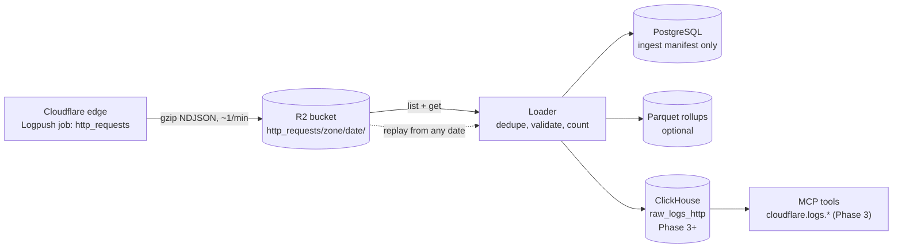

# Cloudflare integration

**Status:** Phase 0 design, read-only. **Baseline:** [research-baseline.md](../development/research-baseline.md) (2026-11-18). **Evidence:** [docs/evidence/cloudflare.md](../evidence/cloudflare.md). **Decision:** [ADR-0004](../adr/0004-cloudflare-log-storage.md).
**Module:** `internal/cloudflare`; tool names follow [mcp-tools §7.6](../mcp-tools.md).
**Tags:** `[V-live]` observed live, `[V-docs]` confirmed in vendor documentation, `[U]` unverified with the verification step stated.

This document defines what the module will and will not do, which planes it consumes, what
each plan permits, and how results are annotated so an agent cannot mistake an estimate for a
measurement.

## 1. Scope and non-goals

The module exposes Cloudflare traffic and security analytics to MCP tools. It is
**read-only by design**: the gateway observes a Cloudflare account, it never controls one.

### In scope

| Capability | Upstream surface | Tag |
|---|---|---|
| Zone and account traffic aggregates | GraphQL Analytics (`httpRequests1mGroups`, `httpRequests1hGroups`, `httpRequestsAdaptiveGroups`) | `[V-docs]` |
| Request-level aggregates for security analysis | GraphQL Analytics (`httpRequestsAdaptive`, `httpRequestsAdaptiveGroups`) | `[V-docs]` |
| WAF / bot / challenge event inspection | GraphQL Analytics (`firewallEventsAdaptive`, `firewallEventsAdaptiveGroups`) | `[V-docs]` |
| Plan, dataset and entitlement detection | `GET /zones`, `GET /zones/{zone_id}/subscription`, GraphQL `settings` node | `[V-docs]` |

### Non-goals — the gateway will never

| Never | Why |
|---|---|
| Send `POST`, `PUT`, `PATCH` or `DELETE` to a Cloudflare REST endpoint | The module has no write path at all (§7). |
| Create, update, disable or delete a Logpush job | Jobs are managed out of band (dashboard, Terraform, runbook). |
| Create or modify DNS records, WAF rules, rate-limit rules, cache rules or rulesets | A separate, audited write module would be required. |
| Purge cache, change zone settings, toggle Bot Fight Mode | Same as above. |
| Store visitor IPs, cookies or request headers in the gateway database | Data minimisation; see the redaction rules in the [evidence file](../evidence/cloudflare.md). |
| Act as a SIEM or a log search engine | Logpush ingestion is Phase 3+, opt-in and byte-budgeted (§10). |

One deliberate exception to "no POST" is described in §7: GraphQL is queried with HTTP
`POST` to a single fixed endpoint with a body rendered from a static template registry —
never caller-supplied text.

## 2. The four data planes

Cloudflare exposes traffic data through four mechanisms with different granularity, retention,
cost and plan floors; they are routinely confused, so the gateway keeps them in separate tools
with separate quality flags.

### (a) GraphQL Analytics API — aggregated, sampled, adaptive

One GraphQL endpoint (`https://api.cloudflare.com/client/v4/graphql`) over 70+ datasets
[V-docs](https://developers.cloudflare.com/analytics/graphql-api/limits/). The naming is
semantic: `Adaptive` means adaptive sampling, `Groups` means pre-aggregated rows
[V-docs](https://developers.cloudflare.com/analytics/graphql-api/features/data-sets/).
Values are estimates extrapolated from a sample
[V-docs](https://developers.cloudflare.com/analytics/graphql-api/sampling/).

**GraphQL Analytics is not a raw log API.** It returns aggregates and, on some adaptive
datasets, individual *sampled events* — never a complete, ordered, gap-free request stream.
Any tool description promising "all requests" from GraphQL is wrong and must not ship.

### (b) Security Events — event-level, sampled, 31-day retention

Backed by `firewallEventsAdaptive`
[V-docs](https://developers.cloudflare.com/waf/analytics/security-events/), it is
event-level: one request can produce several events when several features fire. It is
sampled, retention is 31 days on every plan, and the maximum window is 30 days on Free, Pro
and Business and 31 days on Enterprise [V-docs].

This plane answers "which rule fired on which request", not "how many requests did the zone
serve" — that is plane (a).

### (c) Logpush — raw HTTP request logs, usage-billed, no backfill

Logpush pushes batched raw log files to a destination with no minimum batch size,
potentially more than once per minute, on Free, Pro, Business and Enterprise
[V-docs](https://developers.cloudflare.com/logs/logpush/#availability). It is billed on
uncompressed bytes delivered with 25 GB/month included per account
[V-docs](https://developers.cloudflare.com/logs/logpush/pricing/).

It is the only plane that yields every request, and the only one that can lose data
permanently: there is no backfill, and logs produced while a job is disabled or failing are
lost [V-docs](https://developers.cloudflare.com/logs/logpush/).

### (d) Logpull and Instant Logs — gated, out of scope

| Plane | Availability | Why it is excluded | Tag |
|---|---|---|---|
| Logpull | Enterprise only | Legacy NDJSON pull, 3–7 days retention; Cloudflare recommends Logpush instead | [V-docs](https://developers.cloudflare.com/logs/logpull/) |
| Instant Logs | Business and Enterprise only | Live WebSocket tail; one session per zone, 60-minute maximum; session creation is a `POST` | [V-docs](https://developers.cloudflare.com/logs/instant-logs/) |

Logpull is unavailable on the target plan (Pro) and deprecated in favour of Logpush. Instant
Logs needs a `POST` to open a session, which conflicts with the read-only guarantee, and a
live tail is not a reproducible primitive for an agent.

In one line each: GraphQL is an **estimate**, Security Events are **sampled events**,
Logpush is **complete but unrecoverable**, and Logpull/Instant Logs are **gated and
excluded**.

## 3. Dataset map

Node names were read from Cloudflare documentation on 2026-11-18 and are not invented.
Unconfirmed fields or limits carry `[U]` and §13 names the probe. Every node must also be
confirmed per zone through the `settings` node at startup, because availability is
entitlement-dependent.

| Dataset / node | Grain | Key dimensions | Key metrics | Typical use | Sampling behaviour | Retention | Plan / entitlement constraints | Tag |
|---|---|---|---|---|---|---|---|---|
| `httpRequests1mGroups` | 1-minute buckets with 5-minute, hour and day roll-ups | `datetimeMinute`, `datetimeFiveMinutes`, `datetimeHour`, `date` | `sum.requests`, `sum.bytes`, `sum.cachedRequests`, `sum.threats`, `uniq.uniques` | Short-window traffic, cache ratio, bandwidth | Aggregated table, not adaptive | Per-plan, no fixed documented number `[U]` | Core dataset; bounds via `settings` | [V-docs](https://developers.cloudflare.com/analytics/graphql-api/migration-guides/zone-analytics/) |
| `httpRequests1hGroups` | Hourly buckets | `datetimeHour`, `date` | `sum.requests`, `sum.bytes`, `sum.cachedRequests`, `sum.threats` | Daily and weekly reporting | Aggregated table, not adaptive | Per-plan `[U]` | Core dataset; per-plan limits | [V-docs](https://developers.cloudflare.com/analytics/graphql-api/features/data-sets/) |
| `httpRequestsAdaptiveGroups` | Adaptive, grouped by requested dimensions | `datetime`, `datetimeHour`, `coloCode`, `clientCountryName`, `edgeResponseStatus`, `requestSource` | `count`, `sum.edgeResponseBytes`, `sum.visits`, `avg.sampleInterval` | Security Analytics, colo and status breakdowns | Adaptive; `avg.sampleInterval` exposes the rate | ≥ 31 days on every plan | All plans; 31 days (90 on Enterprise) | [V-docs](https://developers.cloudflare.com/waf/analytics/security-analytics/) |
| `httpRequestsAdaptive` | Individual sampled requests | `datetime`, request-level fields (`rayName` `[U]`) | Per-event fields; counts via groups | Request-level forensics inside a sample | Adaptive | 31 days (90 on Enterprise) | All plans | [V-docs](https://developers.cloudflare.com/waf/analytics/security-analytics/) |
| `firewallEventsAdaptive` | Individual security events | `datetime`, `action`, `source`, `clientIP`, `clientCountryName`, `clientAsn`, `clientRequestPath`, `userAgent` | Event rows | "Which rule fired on which request" | Adaptive | 31 days on all plans | All plans; window 30 days (31 Enterprise) | [V-docs](https://developers.cloudflare.com/analytics/graphql-api/tutorials/querying-firewall-events/) |
| `firewallEventsAdaptiveGroups` | Adaptive, grouped events | `datetime`, `datetimeHour`, `action`, `source`, `ruleId`, `clientCountryName` | `count`, `avg.sampleInterval`, `confidence(level)` | Event counts by action, rule, country | Adaptive | 31 days on all plans | All plans | [V-docs](https://developers.cloudflare.com/analytics/graphql-api/features/confidence-intervals/) |
| Bot fields in GraphQL (`botScore`, `botScoreSrc`, `botTags`, decisions) | Wherever Bot Analytics is exposed in the schema | Bot score, source, tags, decision | Counts by bot class | Bot traffic analysis | Inherits host dataset | Inherits host dataset | **Enterprise Bot Management only**; node and field names `[U]` | [V-docs](https://developers.cloudflare.com/bots/bot-analytics/) |
| `http_requests` (Logpush, not GraphQL) | One record per request, incl. Worker subrequests | `ClientRequestHost`, `ClientRequestPath`, `EdgeResponseStatus`, `RayID`, `SecurityActions` | Byte counts, timings | Full-fidelity request analytics | None (complete) | Destination-defined | All plans; bot fields need Bot Management | [V-docs](https://developers.cloudflare.com/logs/logpush/logpush-job/datasets/zone/http_requests/) |
| `firewall_events` (Logpush, not GraphQL) | One record per security event | `Action`, `Source`, `RuleID`, `RayID`, `Datetime` | Event counts | SIEM export of WAF events | None (complete) | Destination-defined | All plans | [V-docs](https://developers.cloudflare.com/logs/logpush/logpush-job/datasets/zone/firewall_events/) |

Design-relevant notes: `firewall_events` has **no** bot-score fields, so bot score in logs is
an `http_requests` feature only; fixed-rate samples (`firewallRulePreviewGroups` 1%, `ipFlows*`
0.012%) are never mixed with adaptive ones and Phase 1 does not expose them; the `*ByColoGroups`
nodes are deprecated in favour of `httpRequestsAdaptiveGroups`
[V-docs](https://developers.cloudflare.com/analytics/graphql-api/migration-guides/graphql-api-analytics/).

## 4. Plan capability matrix

The project targets **Pro**. This matrix shows exactly what degrades there. Bot Management
is a separate Enterprise add-on, not a plan tier.

| Capability | Free | Pro | Business | Enterprise | Tag |
|---|---|---|---|---|---|
| GraphQL Analytics API, core datasets | Yes | Yes | Yes | Yes | [V-docs](https://developers.cloudflare.com/analytics/graphql-api/features/discovery/settings/) |
| Security Events, zone level (`firewallEventsAdaptive`) | Yes | Yes | Yes | Yes | [V-docs](https://developers.cloudflare.com/waf/analytics/security-events/#availability) |
| `httpRequestsAdaptive` retention | 31 days | 31 days | 31 days | 90 days | [V-docs](https://developers.cloudflare.com/waf/analytics/security-analytics/#limits) |
| Security Events maximum query window | 30 days | 30 days | 30 days | 31 days | [V-docs](https://developers.cloudflare.com/waf/analytics/security-events/#limits) |
| Logpush (HTTP requests) | Yes | Yes | Yes | Yes | [V-docs](https://developers.cloudflare.com/logs/logpush/#availability) |
| Logpush bot fields (`BotScore`, `BotTags`, `JA3Hash`, `JA4Signals`) | No | No | No | Bot Management add-on only | [V-docs](https://developers.cloudflare.com/logs/logpush/logpush-job/datasets/zone/http_requests/) |
| Bot score, granular 1–99, in analytics and GraphQL | No | No | No | Bot Management add-on only | [V-docs](https://developers.cloudflare.com/bots/concepts/bot-score/) |
| Bot groupings in dashboard | No | Yes | Yes | Yes | [V-docs](https://developers.cloudflare.com/bots/concepts/bot-score/#bot-groupings) |
| Instant Logs | No | No | Yes | Yes | [V-docs](https://developers.cloudflare.com/logs/instant-logs/#availability) |
| Logpull | No | No | No | Yes | [V-docs](https://developers.cloudflare.com/logs/logpull/#availability) |
| WAF custom-rule `Log` (log-only / simulate) action | No | No | No | Yes | [V-docs](https://developers.cloudflare.com/waf/custom-rules/#availability) |

Consequences on Pro, stated plainly:

1. No granular bot score, bot tags or verified-bot classification; tools report `bot_score: unavailable`, never `0`.
2. No log-only rule action, so a rule cannot be validated without enforcing it; the gateway never advises "simulate this rule" on Pro.
3. Logpush works, but every gigabyte after 25 GB/month is billable and nothing can be replayed from Cloudflare if the job fails.
4. Instant Logs and Logpull are unavailable.

## 5. Quotas and limits

| Limit | Value | Tag |
|---|---|---|
| GraphQL queries per 5-minute window (default) | 300 | [V-docs](https://developers.cloudflare.com/analytics/graphql-api/limits/) |
| Zones per zone-scoped query / accounts per account-scoped query | 10 / 1 | [V-docs](https://developers.cloudflare.com/analytics/graphql-api/limits/) |
| Queries counted per HTTP request | scopes × nodes | [V-docs](https://developers.cloudflare.com/analytics/graphql-api/limits/) |
| Cloudflare REST API per user | 1,200 requests / 5 minutes | [V-docs](https://developers.cloudflare.com/fundamentals/api/reference/limits/) |
| GraphQL ceiling quoted by the general API limits page | 320 / 5 minutes | [V-docs](https://developers.cloudflare.com/fundamentals/api/reference/limits/) |
| Account-based rate limiting (opt-in header) | 1 rps per account and per zone (300 / 5 min); Enterprise 15 rps per account, 10 rps per zone | [V-docs](https://developers.cloudflare.com/analytics/graphql-api/account-based-rate-limiting/) |
| Pagination | `limit` + `orderBy` + filter cursors; no cursor tokens | [V-docs](https://developers.cloudflare.com/analytics/graphql-api/features/pagination/) |
| Page size and field ceiling | Per-node `maxPageSize` (documented example: 10,000) and `maxNumberOfFields` (example: 30) | [V-docs](https://developers.cloudflare.com/analytics/graphql-api/features/discovery/settings/) |

The 300/5 min and 320/5 min figures come from two different Cloudflare pages and are not
reconciled; the gateway budgets against the **lower** number and treats 320 as headroom, not
capacity. See OQ-1.

### Error formats

GraphQL returns HTTP 200 with an `errors` array for query-level failures, each carrying `message`, `path` and `extensions.timestamp` [V-docs](https://developers.cloudflare.com/analytics/graphql-api/errors/).

| Class | Example message | HTTP | Gateway behaviour |
|---|---|---|---|
| Retention exceeded | `cannot request data older than 2678400s` | 400 | Clamp to `notOlderThan`, retry once, flag `window_clamped` |
| Window too large | `query time range is too large...` | 400 | Split into sub-windows of at most `maxDuration`, or reject |
| Too many fields | `number of fields can't be more than...` | 400 | Reduce the template's field set; this is a template bug |
| Rate limited | `rate limiter budget depleted, try again after 5 minutes` | 429 | Honour the budget, back off, never tight-loop |
| Query too heavy | `query consumed excessive resources...` | 429 | Reduce dimensions or window; do not retry unchanged |
| Service unavailable | `unable to execute query, please try again later` | 503 | Bounded exponential backoff |
| Unauthorised | `Unauthorized` / `zones [...] are not authorized` | 401/403 | Fail as a configuration error, do not retry |

### Gateway-side mitigations

| Mechanism | Target | Default | Notes |
|---|---|---|---|
| Query budget (token bucket) | Stay under 300 queries / 5 min | 150 / 5 min | 50% headroom for retries and operator queries |
| Per-instance concurrency cap | Avoid `too many queries in progress` | 2 in flight | Configurable, never above 4 |
| Response cache | Cut duplicate agent queries | 60 s (1m grain), 300 s (1h), 900 s (events) | Key = template id + normalised variables |
| Pre-aggregation | Serve daily roll-ups from one wide query | Nightly job for the previous UTC day | Stored in the gateway's own store |
| Query cost estimate | Reject pathological queries before sending | ≤ 10,000 rows | `buckets × cardinality estimate`, §9 |
| Window clamping | Never exceed `maxDuration` | From `settings`, cached 24 h per zone | Also clamps `notOlderThan` |
| Retry and breaker | Survive transient 503/429 and degraded zones | 3 jittered attempts; breaker opens after 5 failures | 400-class errors are never retried unchanged |

## 6. Cost model for Logpush

Logpush is the only Cloudflare surface here with a variable bill. Verified rates
[V-docs](https://developers.cloudflare.com/logs/logpush/pricing/):

| Usage | Included per account per month | Rate |
|---|---|---|
| Logs exported to internal destinations (R2, Pipelines) | 25 GB | $0.03 / GB |
| Logs exported to external destinations (S3, GCS, Splunk, HTTP) | 25 GB | $0.10 / GB |
| Logs transformed | 1 GB | $0.04 / GB |

Usage is measured on **uncompressed bytes successfully delivered**; files arrive
gzip-compressed, so storage uses roughly a tenth of the billed volume, and destination
charges are separate [V-docs](https://developers.cloudflare.com/logs/logpush/). One HTTP
Requests record is about 1.5–3 kB uncompressed, one record per request including Worker
subrequests.

### Worked example

| Requests / day | Uncompressed / month at 1.5–3 kB | Billable GB after 25 GB | Cost to R2 @ $0.03/GB | Cost to external @ $0.10/GB |
|---|---|---|---|---|
| 1,000,000 | 45–90 GB | 20–65 GB | $0.60–$1.95 | $2.00–$6.50 |
| 10,000,000 | 450–900 GB | 425–875 GB | $12.75–$26.25 | $42.50–$87.50 |

At 10M requests/day an external destination costs roughly 6.5× an internal one, so R2 is the only sensible default.

### Fields that most inflate record size

| Field group | Why it is expensive | Tag |
|---|---|---|
| `RequestHeaders`, `ResponseHeaders`, `Cookies` | Only present with custom fields; unbounded size | [V-docs](https://developers.cloudflare.com/logs/logpush/logpush-job/datasets/zone/http_requests/) |
| `Subrequests` | Flattened array of subrequest objects, each with the full field set | [V-docs](https://developers.cloudflare.com/logs/logpush/logpush-job/datasets/zone/http_requests/) |
| `MatchedRules` | Array of objects with ruleset ids, versions and per-rule metadata | [V-docs](https://developers.cloudflare.com/logs/logpush/logpush-job/datasets/zone/http_requests/) |
| `ClientRequestURI`, `ClientRequestUserAgent`, `ClientRequestReferer` | Long, high-cardinality strings on every record | [V-docs](https://developers.cloudflare.com/logs/logpush/logpush-job/datasets/zone/http_requests/) |
| `WAFRequestSignatureCategories`, `WAFRequestSignatureRefs` | Arrays that grow with matched signatures | [V-docs](https://developers.cloudflare.com/logs/logpush/logpush-job/datasets/zone/http_requests/) |

### Recommendation

1. **Default OFF.** `cloudflare.logpush.enabled` defaults to `false`; no Logpush tool is registered when it is false.
2. **Opt-in per zone** with a hard monthly byte budget (`logpush.budget_gb_month`), enforced by stopping ingestion — never by touching the job.
3. **Minimal field set and volume control** via `output_options.field_names` (never headers or cookies) and `output_options.sample_rate`, with the configured rate recorded as a quality flag [V-docs](https://developers.cloudflare.com/logs/logpush/logpush-job/log-output-options/).
4. **Estimate before enabling:** daily request count from `httpRequestsAdaptiveGroups` × 1.5–3 kB; on Enterprise a one-hour Logpull sample gives a measured record size [V-docs](https://developers.cloudflare.com/logs/logpush/#estimating-log-volume).
5. **Budget alerts at 50/80/100%.** Exceeding the budget is an operator action; the gateway cannot and will not disable the job.

## 7. Read-only guarantee

Structural, not aspirational — eight independently testable layers:

| Layer | Enforcement | Test |
|---|---|---|
| L1 Transport allowlist | Fixed route table: `GET /zones`, `GET /zones/{id}/subscription`, `GET /user/tokens/verify`, `GET /accounts/{id}/r2/buckets`, `GET /{scope}/{id}/logpush/jobs`, `GET /{scope}/{id}/logpush/datasets/{dataset}/fields`, `POST /graphql` (query documents only). Anything else panics at init. | `TestClient_RouteTableIsClosed` |
| L2 Method never caller-controlled | Handlers pass a route id, never a method, path or body string. | `TestTools_DoNotAcceptMethodOrPath` |
| L3 Body from registry | The GraphQL body is rendered from an embedded template with typed variables; templates containing a mutation or subscription root field are rejected at build time. | `TestTemplates_ContainOnlyQueryRootFields` |
| L4 No mutation symbol | The generated GraphQL client exposes only `Query`; there is no `Mutate` method to call. | `TestGeneratedClient_HasNoMutationMethod` |
| L5 CI grep gate | CI fails on `http.MethodPost`/`Put`/`Patch`/`Delete` outside the single GraphQL transport file, and on `mutation` anywhere. | `make lint-readonly` |
| L6 Token scoping | The documented token manifest contains read permissions only (§8). | `TestTokenManifest_NoWritePermissions` |
| L7 Startup probes | Verify the token is `active`, detect the plan, confirm each declared dataset is `enabled`; failure degrades the tool set and never escalates. | `TestStartup_RefusesUnknownDataset` |
| L8 Audit log | Every upstream call logs route id, scope, variable hash, row count and duration — never the token, never a full response body. | `TestAuditLog_RedactsAuthorization` |

### Residual risk: Logpush job inspection needs a write-capable permission

Cloudflare documents that **all Logpush API operations require `Logs: Write`**, because job
configurations contain sensitive destination credentials
[V-docs](https://developers.cloudflare.com/logs/logpush/permissions/). Even
`GET /zones/{zone_id}/logpush/jobs` is documented with `Logs Write`
[V-docs](https://developers.cloudflare.com/logs/logpush/logpush-job/api-configuration/).

| Profile | Permissions | Capability |
|---|---|---|
| `analytics` (default) | `Analytics Read` / `Account Analytics Read`, `Zone Read` | GraphQL analytics and plan detection; no Logpush introspection |
| `analytics+logpush-observe` (opt-in) | The above plus `Logs Write` | Adds read-only Logpush job and field listing; never used to mutate |

The second profile is an explicit residual risk: the credential technically permits writes
although the code cannot issue them. It is off by default and needs a config flag plus an
operator acknowledgement in the runbook; an operator who will not accept it must treat
Logpush as externally managed and infer job health from R2 file arrival.

### Startup check for write scopes

Token verification returns `id`, `status` and `not_before`, not the permission policy
[V-docs](https://developers.cloudflare.com/fundamentals/api/troubleshooting/). Reading a
token's policies requires `GET /user/tokens/{token_id}` plus a `User API Tokens Read`
permission that the analytics profile does not hold `[U]`. Startup therefore does exactly
two things, and the README says so:

1. Refuse a token whose status is not `active`, and refuse to start when the deployment config declares a permission outside the read-only manifest (config lint, not API introspection).
2. Refuse to enable a tool whose dataset probe returns `enabled: false`.

It cannot detect a write scope the operator silently added. That limitation is documented
rather than papered over.

## 8. Token and permission model

### Minimal permissions

| Purpose | Scope | Permission | Endpoint | Tag |
|---|---|---|---|---|
| Token liveness | User | none beyond a valid token | `GET /user/tokens/verify` | [V-docs](https://developers.cloudflare.com/fundamentals/api/troubleshooting/) |
| List zones and plan labels | Zone | `Zone Read` | `GET /zones` | [V-docs](https://developers.cloudflare.com/fundamentals/api/reference/permissions/) |
| Authoritative plan id | Zone | `Zone Read`; a billing permission may also be required `[U]` | `GET /zones/{zone_id}/subscription` | [V-docs](https://developers.cloudflare.com/api/resources/zones/subresources/subscriptions/methods/get/) |
| Zone-scoped GraphQL analytics | Zone | `Analytics Read` | `POST /graphql` | [V-docs](https://developers.cloudflare.com/fundamentals/api/reference/permissions/) |
| Account-scoped GraphQL analytics | Account | `Account Analytics Read` | `POST /graphql` | [V-docs](https://developers.cloudflare.com/analytics/graphql-api/getting-started/authentication/api-token-auth/) |
| Logpush job and dataset field listing | Zone or Account | `Logs Write` (documented; see §7) | `GET .../logpush/jobs`, `GET .../logpush/datasets/{id}/fields` | [V-docs](https://developers.cloudflare.com/logs/logpush/permissions/) |
| R2 bucket inventory | Account | `Workers R2 Storage Read` | `GET /accounts/{account_id}/r2/buckets` | [V-docs](https://developers.cloudflare.com/fundamentals/api/reference/permissions/) |
| R2 object reads (Logpush destination) | R2 | R2 API token with read access (separate S3-compatible credential) | S3 `GetObject` / `ListObjectsV2` | [V-docs](https://developers.cloudflare.com/logs/logpush/logpush-job/enable-destinations/r2/) |

Zone-scoped datasets require a zone-scoped token and account-scoped datasets an
account-scoped one [V-docs](https://developers.cloudflare.com/logs/logpush/permissions/); a
single token cannot straddle both, which drives the configuration shape below.

### Multi-account and multi-zone configuration

Tokens are referenced by environment variable name, never inlined.

```yaml
cloudflare:
  read_only: true
  logpush: { enabled: false, budget_gb_month: 0 }
  accounts:
    - id_env: CLOUDFLARE_ACCOUNT_ID
      token_env: CLOUDFLARE_API_TOKEN
      zones: [{ id_env: CLOUDFLARE_ZONE_ID, label: storefront-primary,
                datasets: [httpRequests1hGroups, httpRequestsAdaptiveGroups, firewallEventsAdaptiveGroups] }]
```

- Each account block may hold its own token; a token is never shared across accounts.
- Zones are addressed by an opaque internal alias (never the raw zone id), and datasets are declared explicitly so a plan downgrade degrades one tool instead of failing the server.

### Storage, rotation, logging

| Concern | Rule | Tag |
|---|---|---|
| Storage | Environment variable or a `0600` file mounted by the orchestrator; never in the repo, config file or image layer | Project policy |
| Rotation and expiry | Token roll issues a new secret, invalidates the old one and keeps permissions; set a TTL and alert before it lapses (`not_before` is returned by verify) | [V-docs](https://developers.cloudflare.com/fundamentals/api/how-to/roll-token/) |
| IP restriction | Client IP filtering where the egress address is stable | [V-docs](https://developers.cloudflare.com/analytics/graphql-api/getting-started/authentication/api-token-auth/) |
| Never log tokens | A transport middleware redacts `Authorization`; error strings are scrubbed of bearer values before reaching a tool response | Project policy |
| Leak detection | Cloudflare tokens use a scannable format detectable by credential scanners | [V-docs](https://developers.cloudflare.com/fundamentals/api/how-to/roll-token/) |

## 9. Query construction

### Why raw GraphQL passthrough is forbidden

1. **Quota and read-only proof.** A caller-supplied document can span 10 zones × many nodes and consume the entire 300-query budget in one call [V-docs](https://developers.cloudflare.com/analytics/graphql-api/limits/), and "no mutation" is only testable when the set of documents is finite and known at build time (§7, L3).
2. **Injection.** An agent that copies text from a page or ticket into a query string is an injection surface, and there is no parser in the path to catch it.
3. **Auditability and drift.** A free-form query cannot be diffed, reviewed or reproduced, and schema changes hit every caller; a template id plus typed variables confines both.

### Template registry

```yaml
id: cf.http.hourly
dataset: httpRequests1hGroups
scope: zone
params: { zone_tag: string, since: time, until: time }   # all required and typed
bounds: { min_window: 1h, max_window: 168h, max_limit: 168 }   # below the 30-day ceiling
select:
  dimensions: [datetimeHour]
  metrics: [requests, bytes, cachedRequests, cachedBytes]
  order_by: datetimeHour_ASC
```

```graphql
query HttpHourly($zoneTag: string, $since: Time, $until: Time, $limit: uint64) {
  viewer { zones(filter: { zoneTag: $zoneTag }) {
    httpRequests1hGroups(limit: $limit, filter: { datetime_geq: $since, datetime_lt: $until },
                          orderBy: [datetimeHour_ASC]) {
      dimensions { datetimeHour }
      sum { requests bytes cachedRequests cachedBytes } } } }
}
```

| Rule | Implementation |
|---|---|
| Typed parameters only | Variables validated against the template's JSON Schema; unknown parameters are rejected, not ignored. |
| Bounded time range | RFC 3339 UTC only; `until - since` within `min_window`/`max_window`; `since` within the node's `notOlderThan`. |
| Enforced limit | Clamped to `min(template.max_limit, node.maxPageSize)`; a caller cannot raise it. |
| Deterministic field set | Dimensions and metrics come from the template; a new field set needs a new template and a review. |
| Cost estimate before execution | `buckets(window, grain) × cardinality_estimate(dimensions)`; above 10,000 rows the query is rejected with a narrowing suggestion. |
| One scope per query, effective query returned | Multi-zone fan-out is explicit and budgeted, never silent; every response carries the rendered document and its variables. |

### Response envelope

```json
{
  "data": [{ "datetimeHour": "2026-11-17T00:00:00Z", "requests": 48211 }],
  "meta": {
    "template": "cf.http.hourly", "query_hash": "sha256:1f0c…", "rows": 24, "plan": "pro",
    "effective_query": "query HttpHourly($zoneTag: string, ...) { ... }",
    "variables": { "zone_tag": "***", "since": "2026-11-17T00:00:00Z", "until": "2026-11-18T00:00:00Z" },
    "sampling": { "sampled": false, "sample_interval": 1 },
    "quality": { "complete_last_bucket": false, "window_clamped": false, "confidence": null } } }
```

The rendered query is returned for auditability: an operator can paste it into GraphiQL and reproduce the result, with zone identifiers replaced by the alias.

## 10. Logpush ingestion architecture (Phase 3+)

Logpush is opt-in. When enabled, the path is Cloudflare → R2 → loader → optional ClickHouse; PostgreSQL never sees a raw log record.



### Why raw logs never go to PostgreSQL

| Reason | Consequence |
|---|---|
| Volume | 1M requests/day is 30M rows/month of wide JSON; Postgres would need partitioning plus aggressive archival to stay responsive. |
| Write amplification | Row-store inserts, WAL, index maintenance, vacuum and bloat dominate ingest cost for append-only event data. |
| Query shape | Time-range scans over low-cardinality dimensions are columnar; a B-tree heap does poorly and TOAST-compressed JSONB is slower still. |
| Separation of concerns | Postgres holds configuration, audit events and ingest bookkeeping — small, transactional, backed up. |

### Failure modes

| Failure | Detection | Handling |
|---|---|---|
| Job disabled or deleted | No new R2 objects for > 2× the expected arrival interval; manifest gap | Alert; mark log tools degraded with `reason: no_recent_files`. The gap is permanent — never claim backfill. |
| Destination errors (R2 auth, permissions) | Logpush health notifications; empty prefixes | Alert immediately; the job otherwise fails silently. |
| Late or duplicate files | File timestamp older than the watermark; repeated object key | Accept and re-open the affected partition; the loader records `(bucket, key, etag)` in the manifest and skips seen objects, so replay is idempotent. |
| Duplicate records in a file | Repeated `RayID` | Dedupe on `(RayID, EdgeStartTimestamp, ZoneName)`; keep first, count the rest. |
| Schema drift or corrupt file | Field missing, retyped or new; gzip/JSON parse error | Validate against a pinned field contract (unknown fields to a side map, missing required fields fail the file); quarantine corrupt objects, retry once, then alert — never partially ingest a file. |
| Budget exceeded | Monthly uncompressed bytes ≥ budget | Stop ingesting, keep files in R2, surface a tool error; disabling the job is an operator action. |

Partitioning: one ClickHouse partition per UTC day, `ORDER BY (zone_alias, event_date, ray_id)`;
30 days hot by default, with R2 as the long-term store and replay source.

## 11. Security analytics semantics

| Action (API value) | Meaning | Terminating | Mitigated? | Tag |
|---|---|---|---|---|
| `block` | Request denied (403, or 429 for rate limiting) | Yes | Yes | [V-docs](https://developers.cloudflare.com/ruleset-engine/rules-language/actions/) |
| `managed_challenge` | Cloudflare chose an interactive or non-interactive challenge | Yes | Yes | [V-docs](https://developers.cloudflare.com/ruleset-engine/rules-language/actions/) |
| `challenge` / `js_challenge` | Interactive or non-interactive challenge | Yes | Yes | [V-docs](https://developers.cloudflare.com/ruleset-engine/rules-language/actions/) |
| `log` | Recorded only; request proceeds | No | No | [V-docs](https://developers.cloudflare.com/ruleset-engine/rules-language/actions/) |
| `skip` | Skips the listed security features | No | No | [V-docs](https://developers.cloudflare.com/ruleset-engine/rules-language/actions/) |
| `allow` | Legacy firewall-rules action; request proceeds | No | No | [V-docs](https://developers.cloudflare.com/waf/analytics/security-analytics/) |

Cloudflare's own definition: requests with *Log*, *Skip* or *Allow* actions are **not**
counted as mitigated [V-docs](https://developers.cloudflare.com/waf/analytics/security-analytics/).

**Mitigated versus simulated.** *Mitigated* means Cloudflare actually stopped or challenged
the request; *simulated* means the rule matched and was recorded but took no action — the
`log` action, historically called simulate. On Free, Pro and Business `log` is not available
for WAF custom rules; only Enterprise can run a rule in log-only mode
[V-docs](https://developers.cloudflare.com/waf/custom-rules/#availability). The gateway labels
`log` events `enforced: false` and never suggests simulate mode on Pro.

**Why event counts differ from request counts.** One request can trigger several security
features and produce several events; Security Events displays events, not requests
[V-docs](https://developers.cloudflare.com/waf/analytics/security-events/), and the
`firewall_events` Logpush dataset has one record per event
[V-docs](https://developers.cloudflare.com/logs/logpush/logpush-job/datasets/zone/firewall_events/).
So `firewallEventsAdaptiveGroups.count` is an event count, `httpRequestsAdaptiveGroups.count`
is a request count, and the two are never additive.

**Avoiding double counting:**

| Pitfall | Rule |
|---|---|
| Summing events across `action` values | Count per action separately; one request blocked by two rules yields two events. |
| Adding Security Events to traffic totals | Traffic totals come only from `httpRequests*` nodes, never from event rows. |
| Counting a challenge twice (issued and solved) | `SecurityActions` can contain both `managedChallenge` and `managedChallengeSolved`; count the request once via a request identifier. |
| Deduplicating by IP + timestamp | Wrong: distinct requests share both. Use a request identifier (`RayID` in logs; the equivalent `firewallEventsAdaptive` field is `[U]`, OQ-4). |
| Mixing sampled and complete sources | Never combine a Logpush count with a GraphQL estimate in one figure; report separate series. |

## 12. Time, sampling, and data-quality rules

### Time

| Rule | Detail | Tag |
|---|---|---|
| UTC only | All parameters and responses are UTC; local rendering is the caller's job. | Project policy |
| Half-open intervals | `datetime_geq since`, `datetime_lt until`; no double-counted boundary buckets. | [V-docs](https://developers.cloudflare.com/analytics/graphql-api/features/filtering/) |
| Bucket alignment and maximum window | Windows are aligned to the dataset grain; the ceiling comes from the `settings` node, never hard-coded. | [V-docs](https://developers.cloudflare.com/analytics/graphql-api/features/discovery/settings/) |
| Lookback | `notOlderThan` from `settings`; beyond it the request is clamped and flagged, never silently widened. | [V-docs](https://developers.cloudflare.com/analytics/graphql-api/errors/) |
| Data latency | No documented freshness SLA; the last bucket is treated as incomplete. `[U]` — probe at T+1, T+5 and T+15 minutes. | `[U]` |

### Sampling

Adaptive sampling is dynamic: the rate falls as volume rises and values are extrapolated from
the sample, chosen per query from 100%, 10% and 1% resolutions
[V-docs](https://developers.cloudflare.com/analytics/sampling/).

1. Always request `avg { sampleInterval }` with `count` on adaptive datasets — the only visibility into the applied rate.
2. Request `confidence(level: 0.95)` for `sum`/`count` when the number drives a decision [V-docs](https://developers.cloudflare.com/analytics/graphql-api/features/confidence-intervals/).
3. Never present a sampled estimate as exact; the envelope's `sampling` block is mandatory. Sampling cannot be disabled — raw data means Logpush, not a GraphQL flag.

### Minimum meaningful window

| Dataset | Minimum | Reason |
|---|---|---|
| `httpRequests1mGroups` / `httpRequests1hGroups` | 5 minutes / 1 hour | 1-minute buckets are noisy and the last bucket is partial; below one bucket there is nothing to compare. |
| `httpRequestsAdaptiveGroups` | 1 hour | Adaptive sampling at low volume yields wide intervals. |
| `firewallEventsAdaptive*` | 1 hour, or the full incident window | Narrower windows reduce sampling. |

### Comparison windows and quality flags

Comparison windows are equal length, grain-aligned, both UTC, and always labelled
(`previous_period`, `same_weekday_last_week`, `same_hour_yesterday`); one that crosses a
retention boundary is refused, not approximated, and one spanning a plan or ruleset change
carries `confounded: true`.

| Flag | Meaning |
|---|---|
| `sampled` / `sample_interval` | True for adaptive or fixed-rate sampled datasets; `avg.sampleInterval` from the response. |
| `confidence` | `{estimate, lower, upper, sampleSize}` when requested. |
| `window_clamped` | The requested window exceeded retention or `maxDuration` and was reduced. |
| `complete_last_bucket` | False when `until` falls in the current, still-filling bucket. |
| `estimated` / `partial_coverage` | The figure is extrapolated rather than counted, and/or part of the window predates retention. |
| `degraded` | True when a plan or entitlement removed a capability. |
| `bot_score_available` | False on Free, Pro and Business; tools return `null`, never `0`. |

An agent that receives `sampled: true` must phrase its answer as an estimate; tool descriptions state this rather than relying on the model to infer it.

## 13. Verification log, open questions, and decision record

### Verification log

| Checked | Environment | Date | Result |
|---|---|---|---|
| Logpush availability, pricing (25 GB included, $0.03/$0.10 per GB) and record size | developers.cloudflare.com | 2026-11-18 | Confirmed; matches baseline F13 and F14 |
| Bot fields require Bot Management (absent from `firewall_events`); GraphQL limits 300/5 min, 10 zones, 1 account | developers.cloudflare.com | 2026-11-18 | Confirmed; matches baseline F15 and F16 |
| Security Events backed by `firewallEventsAdaptive`, 31-day retention | developers.cloudflare.com | 2026-11-18 | Confirmed; matches baseline F17 |
| Instant Logs (Business+) and Logpull (Enterprise) availability | developers.cloudflare.com | 2026-11-18 | Confirmed |
| Logpush API requires `Logs: Write` for all operations; token verification returns id/status only | developers.cloudflare.com | 2026-11-18 | Confirmed; new constraint, §7 |
| Live API behaviour, dataset availability, plan name | Cloudflare account | not run | `[U]` — no credentials this session; see the [evidence file](../evidence/cloudflare.md) |

### Open questions

| ID | Question | Resolution |
|---|---|---|
| OQ-1 | Does the 300/5 min budget or the 320/5 min ceiling apply in practice? | Run 310 queries in a 5-minute window; observe 429 `rate limiter budget depleted` and `Ratelimit` headers. |
| OQ-2 | Real `notOlderThan` / `maxDuration` / `maxPageSize` for `httpRequests1mGroups` and `httpRequests1hGroups` on a Pro zone? | Live `settings` node query for both nodes. |
| OQ-3 | Which node and field names carry bot score, source, tags and decisions in GraphQL? | Introspection filtered for `botScore`/`botTags` on a Bot Management zone; unavailable on Pro. |
| OQ-4 | Does `firewallEventsAdaptive` expose a request identifier usable for deduplication (for example `rayName`)? | Introspect the node's field list. |
| OQ-5 | Is `GET /zones/{zone_id}/subscription` readable with `Zone Read` alone, and can a token read its own policies (`GET /user/tokens/{id}`) without an extra permission? | Probe both with the read-only token; record 200 vs 403. |
| OQ-6 | What is the real GraphQL freshness at minute and hour grain? | Compare bucket totals at T+1, T+5 and T+15 minutes. |
| OQ-7 | Is an account-scoped Logpush job for `http_requests` available on Pro? | Probe `GET /accounts/{id}/logpush/jobs`; job creation is an operator action, never the gateway's. |

### Decision record

Recorded in [ADR-0004](../adr/0004-cloudflare-log-storage.md): Cloudflare raw log storage and
analytics boundary.

| ID | Decision | Rationale |
|---|---|---|
| D1 | The module is read-only, with no mutation path in the client. | Safety and auditability; the gateway is an observer. |
| D2 | GraphQL Analytics is the primary plane; Logpush is Phase 3+ and opt-in. | Zero marginal cost, 31-day retention on all plans, no write-scoped credential needed. |
| D3 | Raw logs never enter PostgreSQL; ClickHouse is optional for Phase 3+. | Volume and query shape; Postgres stays transactional. |
| D4 | Raw GraphQL passthrough is forbidden; only reviewed templates execute. | Quota safety, injection resistance, reproducibility. |
| D5 | Logpush job inspection is a separate, opt-in credential profile. | Cloudflare requires `Logs: Write` even for reads; the residual risk must be explicit. |
| D6 | Bot score is `null`, never `0`, when unavailable. | A zero reads as "definitely human", which is wrong. |
| D7 | Logpush defaults to OFF with a hard monthly byte budget. | Cost is the only unbounded risk in this module. |
| D8 | Every response carries the effective query and quality flags. | An agent must be able to say how sure it is and how the number was produced. |
