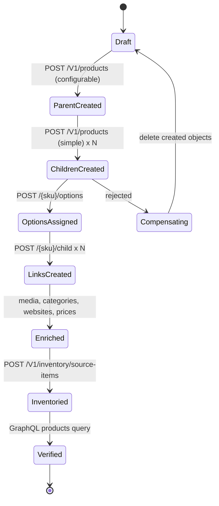

# Magento 2 integration

**Module:** `internal/magento` — **Primary target:** Magento 2.4.9 (Open Source and Adobe Commerce,
self-hosted or PaaS). **Status:** Phase 0 design, no code. No live Magento instance was reachable while this
document was written, so nothing here is tagged as verified against a running system; claims are `[V-docs]` (official
documentation or released source) or `[U]`.
**Baseline:** [research-baseline.md](../development/research-baseline.md) (F6–F12, correction 2).

## 1. Scope and non-goals

| Area | Scope | Tag |
|---|---|---|
| Product types | Simple, Configurable, Virtual, Downloadable, Bundle | `[V-docs]` |
| Lifecycle depth | Simple and Configurable: full create / update / query / delete | `[V-docs]` |
| Lifecycle depth | Virtual, Downloadable, Bundle: create / update / query of the type-specific payload, no dedicated lifecycle automation | `[V-docs]` |
| Catalog structure | Attribute sets, attributes, attribute options, attribute groups, categories | `[V-docs]` |
| Configurable | Parent, children, options, links, variant attributes, website and store scoping, media, categories, prices, MSI inventory, bulk import, validation, relationship sync, partial-failure recovery | `[V-docs]` |
| Inventory | MSI sources, stocks, source-items, bulk assign/unassign/transfer, salable quantity | `[V-docs]` |
| Sales | Read-only orders, invoices, shipments, credit memos, aggregate analytics | `[V-docs]` |
| Verification | GraphQL `products` read confirming the storefront would render the variants | `[V-docs]` |

**Non-goals.** Adobe Commerce as a Cloud Service (SaaS / IMS OAuth) is out of scope for v0.x: IMS
OAuth instead of admin or integration tokens, the `/async` segment moves after `V1`, and `POST /V1/import/csv` is unsupported `[V-docs]` ([auth](https://developer.adobe.com/commerce/webapi/rest/authentication/),
[async](https://developer.adobe.com/commerce/webapi/rest/use-rest/asynchronous-web-endpoints/), [import](https://developer.adobe.com/commerce/webapi/rest/modules/import/)); see section 13. GraphQL writes are out: product mutations cover reviews, compare lists, wishlist, and
stock/price alerts only `[V-docs]` (baseline F8). Also excluded: Magento plugins, modules, patches, direct database
access, checkout, carts, customers, payment, promotions, CMS, B2B, and per-variant price deltas (no REST
endpoint in 2.4.9 `[V-docs]`; see U4).

**Success definition.** HTTP 200 is not correctness. A configurable product is correct only when the
storefront query returns the parent with `configurable_options` matching the intended options, `variants` whose `attributes[].value_index` match them, the
expected `price_range`, and the expected `stock_status` `[V-docs]` ([configurable type](https://developer.adobe.com/commerce/webapi/graphql/schema/products/interfaces/types/configurable/)). Section 5 makes that the final lifecycle state.

## 2. Authentication and connection model

### 2.1 Credential types and gateway modes

| Deployment | Credential | Lifetime | Gateway mode | Notes | Tag |
|---|---|---|---|---|---|
| Self-hosted / PaaS | Admin token | 4 hours | `admin_token` | `credential: admin:<username>:<password>`; inherits the admin ACL role; prefer a dedicated API-only admin, never a human administrator | `[V-docs]` |
| Self-hosted / PaaS | Integration access token | Indefinite until revoked | `integration_bearer` | Bearer use disabled by default since 2.4.x; needs `oauth/consumer/enable_integration_as_bearer=1` | `[V-docs]` |
| Self-hosted / PaaS | Integration OAuth 1.0a (4 credentials) | n/a | `integration_oauth1` | HMAC-signed requests, no config toggle; **production default** | `[V-docs]` |
| Adobe Commerce as a Cloud Service | Adobe IMS OAuth | IMS-managed | none | Out of scope for v0.x | `[V-docs]` |

Source: [token-based authentication](https://developer.adobe.com/commerce/webapi/get-started/authentication/gs-authentication-token/). `POST /V1/integration/admin/token` exists in the 2.4.9 admin schema `[V-docs]`; with 2FA enabled the plain endpoint is insufficient and a
TFA provider route is required `[V-docs]` ([generate-local](https://developer.adobe.com/commerce/webapi/rest/quick-reference/generate-local/)). With the `admin:` credential form the gateway mints an admin token lazily on the first
request and again when Magento answers 401, caches it for 4 hours minus 5 minutes of skew, and never persists
the password, logs the token, or uses session cookies. The token request has a 15 s deadline, does not follow
redirects, and never echoes the upstream body.

**Admin credentials are more powerful than an integration token.** The token inherits the full ACL role of the
admin account, including sales, customer, and configuration access that no integration needs. Configure a
dedicated API-only admin (System > Permissions > All Users) with a least-privilege role for the manifest in
section 2.2, never a human administrator account; rotate the password when the gateway is decommissioned. When
the store requires 2FA, the plain token endpoint fails and `bearer:` or `oauth1:` remains the supported path.

### 2.2 Least privilege

**The tool surface is not the security boundary; the credential is.** A tool allowlist decides what the gateway
*calls*; it does not bound what the integration credential *can do* if the gateway, a dependency, or a leaked
secret is used outside the registry. The ACL is therefore part of the deployment contract and is verified at
startup.

Integration ACL is a tree chosen in **System > Extensions > Integrations > Available APIs** `[V-docs]` ([authentication](https://developer.adobe.com/commerce/webapi/get-started/authentication/)). Resource IDs below come from the 2.4.9 `acl.xml` files and from the `<resources>` element of the `webapi.xml` route that consumes them; `Magento\Framework\Acl` extends `Laminas\Permissions\Acl\Acl`, which inherits an allow from a parent resource to its children, so granting a parent grants every descendant `[V-docs]` ([Catalog acl.xml](https://github.com/magento/magento2/blob/2.4.9/app/code/Magento/Catalog/etc/acl.xml), [Backend acl.xml](https://github.com/magento/magento2/blob/2.4.9/app/code/Magento/Backend/etc/acl.xml), [Sales acl.xml](https://github.com/magento/magento2/blob/2.4.9/app/code/Magento/Sales/etc/acl.xml), [InventoryApi acl.xml](https://github.com/magento/inventory/blob/1.2.2/InventoryApi/etc/acl.xml)).

**Read-only manifest.** It contains only resources that no core 2.4.9 REST write route consumes. Catalog, source-item and
sales-document reads are absent because their resources also gate writes (see the write manifest), so those read
tools are unavailable in this mode; store codes are resolved from storefront GraphQL (`availableStores`,
`storeConfig`), which needs no admin ACL `[V-docs]`.

| Capability | Resource ID | Routes that consume it | Status |
|---|---|---|---|
| Orders, order items, order comments (read) | `Magento_Sales::actions_view` | `GET /V1/orders`, `/V1/orders/{id}`, `/V1/orders/items`, `/V1/orders/{id}/comments` | `[V-docs]` read-only |
| Transactions (read) | `Magento_Sales::transactions_fetch` | `GET /V1/transactions[/{id}]` | `[V-docs]` read-only |
| Stocks (read) | `Magento_InventoryApi::stock` | `GET /V1/inventory/stocks[/{stockId}]` | `[V-docs]` read-only |
| Salable quantity, resolver (read) | `Magento_InventorySalesApi::stock` | `GET /V1/inventory/get-product-salable-quantity/...`, `/is-product-salable/...`, `/stock-resolver/...` | `[V-docs]` read-only |
| Store codes and storefront verification | none (storefront GraphQL) | `availableStores`, `storeConfig`, `products` | `[V-docs]` |

**Write-enabled manifest.** Least privilege for the full tool set: every row is required by an enabled tool,
and resources for disabled tool groups are removed rather than left granted.

| Capability | Resource ID | Routes that consume it | Status |
|---|---|---|---|
| Products, websites, configurable options/children/variation, bulk MSI assign/transfer | `Magento_Catalog::products` | `POST/PUT/DELETE /V1/products...`, `/V1/products/{sku}/websites`, `/V1/configurable-products/...`, `/V1/inventory/bulk-product-source-*` | `[V-docs]` |
| Attributes and options | `Magento_Catalog::attributes_attributes` | `/V1/products/attributes...`, `/{code}/options...`, `GET /V1/products/media/types/{set}` | `[V-docs]` |
| Attribute sets, groups, membership | `Magento_Catalog::sets` | `/V1/products/attribute-sets...` | `[V-docs]` |
| Categories and category products | `Magento_Catalog::categories` | `/V1/categories...`, `/V1/categories/{id}/products...` | `[V-docs]` |
| Media, tier/base/special/cost prices, links, custom options | `Magento_Catalog::catalog` | `/V1/products/{sku}/media...`, `/V1/products/tier-prices*`, `/base-prices`, `/special-price`, `/cost`, `/{sku}/links`, `/V1/products/options` | `[V-docs]` |
| MSI sources and source items | `Magento_InventoryApi::source` | `GET /V1/inventory/sources`, `GET/POST /V1/inventory/source-items`, `/source-items-delete` | `[V-docs]` |
| Source create/update | `Magento_InventoryApi::source_edit` | `POST/PUT /V1/inventory/sources[/{code}]` | `[V-docs]` |
| Stock-source links | `Magento_InventoryApi::stock_source_link` | `GET/POST /V1/inventory/stock-source-links`, `/stock-source-links-delete` | `[V-docs]` |
| Stocks create/update/delete (only if stock tools are enabled) | `Magento_InventoryApi::stock_edit`, `Magento_InventoryApi::stock_delete` | `POST/PUT /V1/inventory/stocks`, `DELETE /V1/inventory/stocks/{id}` | `[V-docs]` |
| Salable quantity, resolver (read) | `Magento_InventorySalesApi::stock` | `GET /V1/inventory/get-product-salable-quantity/...`, `/is-product-salable/...`, `/stock-resolver/...` | `[V-docs]` |
| Order reads for verification | `Magento_Sales::actions_view` | `GET /V1/orders...` | `[V-docs]` |
| Store, website and group ids | `Magento_Backend::store` | `GET /V1/store/storeViews`, `/storeGroups`, `/websites`, `/storeConfigs` | `[V-docs]` (residual, below) |

`Magento_Catalog::catalog` is the parent of the four catalog children, so granting it also grants
`Magento_Catalog::products`, including `DELETE /V1/products/{sku}`. Media and price writes cannot be granted
without product delete, which is why write mode is inherently destructive and why every write is confirmation-gated
(section 14). The old `Magento_InventoryApi::source_items` id does not exist in 1.2.2: source-item reads and writes
are both `Magento_InventoryApi::source`.

Not granted in either manifest: `Magento_Config::config` and its section children (`Magento_Catalog::config_catalog`,
`Magento_Sales::config_sales`, …) — store configuration is out of scope and core 2.4.9 has no REST write route for
it; `Magento_Sales::sales_invoice`, `Magento_Sales::shipment`, `Magento_Sales::sales_creditmemo` — they gate
capture/refund/create as well as reads, so those read tools stay disabled unless the operator explicitly grants the
resources and accepts the extra write capability; `Magento_Catalog::catalog_inventory` — legacy stock path, only
with the legacy tools.

**Startup credential probe.** After the schema fetch and before any tool is advertised, the gateway probes the
credential once per instance (again after a 401 re-mint or credential rotation), with a 10 s budget and no retry on
5xx. A denial is HTTP 401 or 403 carrying `The consumer isn't authorized to access <resource>`: 2.4.9 maps the ACL
`AuthorizationException` to 401 in `Magento\Framework\Webapi\ErrorProcessor::getHttpCodeForLocalizedException`
`[V-docs]`, so the finding's 403 is the right semantics but not the literal status on every build; a proxy or
extension may surface 403. Both are accepted, and the message must name the probed resource.

A probe whose route is absent from the instance schema is skipped and recorded, never treated as a failure, because capability detection has already removed the tools that needed it. The probe is read-only in effect. ACL is checked in `Magento\Webapi\Controller\Rest\RequestValidator::validate()`
before the service and its input parameters are resolved `[V-docs]`, so a denied request never parses a body or
reaches a repository; every probe body is deliberately invalid (`type_id: __mage2mcp_probe__`, empty payloads) and
targets the reserved SKU `__mage2mcp_probe__`, which is read first — a denial already proves the catalog ACL is
absent, a 404 allows the write probe, and a 200 aborts as `probe_sku_conflict` rather than risk a write. Even a
wrongly authorized call therefore fails validation instead of creating, updating, or deleting anything.

| Mode | Probe | Pass | Fail |
|---|---|---|---|
| `read_only` | `PUT /V1/products/__mage2mcp_probe__` (needs `Magento_Catalog::products`) | denial naming that resource | any other status → instance disabled: `credential_scope_exceeded: read-only mode requires Magento_Catalog::products to be absent; probe was authorized (status 404)` |
| `read_only` | `POST /V1/inventory/source-items` with `{"sourceItems":[]}` (needs `Magento_InventoryApi::source`) | denial | any 2xx/4xx → `credential_scope_exceeded` for source-item writes |
| `write` | one invalid-body write route per required resource: `PUT /V1/products/__mage2mcp_probe__`, `POST /V1/products/attributes`, `POST /V1/products/attribute-sets`, `POST /V1/categories`, `POST /V1/products/__mage2mcp_probe__/media`, `POST /V1/inventory/source-items`, `POST /V1/inventory/sources`, `POST /V1/inventory/stock-source-links`, and `POST /V1/inventory/stocks` when stock tools are enabled | non-denial (400 or 404) | denial → instance disabled: `credential_scope_insufficient: Magento_Catalog::catalog missing (media probe denied)` |

Two resources are reported but cannot be probed. `Magento_Backend::store` has no REST write route in 2.4.9 (only
`GET /V1/store/*`), yet it is the `ADMIN_RESOURCE` of the admin store-view/website/group controllers, so a write
instance that resolves stores can also change them in the admin UI; `Magento_Config::config` has no core REST route
at all. Both are recorded as `acl_unverifiable` in the startup report and must be confirmed in the integration's
Available APIs tree (probe U10). `[U]`

### 2.3 Store code

REST base is `{base_url}/rest/{store_code}/V1/...`; `store_code` accepts `default`, `all`, or a store view code `[V-docs]`. Documented fallback `[V-docs]`: create without a
store code writes globally; update without one updates the default store only; `all` updates every store scope
lacking its own value; an explicit code updates only that view. `store_code` is therefore explicit configuration, never
inferred from a tool call, and `all` is allowed only for product and CMS operations.

### 2.4 Base URL and TLS

The base URL is operator-supplied, validated at config load and before each request: `https` only (plain `http` solely
for `localhost`/`127.0.0.1` in dev); no userinfo, query, or fragment; no path beyond a known subpath; resolve and reject
loopback, link-local, and RFC 1918 addresses outside a dev allowlist; do not follow redirects; no proxy from
environment. TLS verification is always on, minimum TLS 1.2, optional custom CA bundle, and `InsecureSkipVerify` is not exposed.

## 3. Endpoint map

Paths are relative to `{base_url}/rest/{store_code}`. "Idempotent" describes the HTTP method, not Magento internals. Risk: `low` read, `medium` additive write, `high` destructive or storefront-visible, `critical`
irreversible or cross-store. `[V-docs]` = path and method confirmed in the 2.4.9 admin OpenAPI schema
or released `webapi.xml`; `[U]` = unconfirmed, probe stated.

### 3.1 Products and prices

| Capability | Method | Path | Read/Write | Idempotent | Risk | Verification tag | Notes |
|---|---|---|---|---|---|---|---|
| Create product | POST | `/V1/products` | W | No | High | `[V-docs]` | `type_id` selects the product type |
| Update / get / delete product | PUT, GET, DELETE | `/V1/products/{sku}` | R/W | Yes | Critical (delete) | `[V-docs]` | PUT is a merge (5.3); delete cascades to links, media, stock |
| Search / list types | GET | `/V1/products`, `/V1/products/types` | R | Yes | Low | `[V-docs]` | `searchCriteria[...]`; always set `pageSize` |
| Websites | POST, DELETE | `/V1/products/{sku}/websites[/{websiteId}]` | W | Yes | Medium | `[V-docs]` | Body `{productWebsiteLink:{sku,website_id}}` |
| Related/upsell links | POST, PUT, GET, DELETE | `/V1/products/{sku}/links[/{type}[/{linkedSku}]]` | R/W | No (POST) | Medium | `[V-docs]` | `link_type` in body |
| Tier prices | POST, PUT | `/V1/products/tier-prices`, `/tier-prices-information`, `/tier-prices-delete` | R/W | No (POST) | High | `[V-docs]` | PUT replaces the whole set; POST used as read |
| Base / special / cost prices | POST | `/V1/products/base-prices`, `/special-price`, `/cost` | W | Yes | High | `[V-docs]` | Bulk by SKU |

### 3.2 Configurable products

| Capability | Method | Path | Read/Write | Idempotent | Risk | Verification tag | Notes |
|---|---|---|---|---|---|---|---|
| Options | POST, GET, PUT, DELETE | `/V1/configurable-products/{sku}/options`, `/options/all`, `/options/{id}` | R/W | No (POST) | High | `[V-docs]` | `{attribute_id, label, position, values[{value_index}]}` |
| Add / list child link | POST, GET | `/V1/configurable-products/{sku}/child`, `/children` | R/W | No (POST) | High | `[V-docs]` | `{childSku}`; returns boolean |
| **Delete child link** | DELETE | `/V1/configurable-products/{sku}/children/{childSku}` | W | Yes | High | `[V-docs]` | Unlinks; the child product survives |
| Generate variation | PUT | `/V1/configurable-products/variation` | W | No | High | `[V-docs]` | `{product, options[]}`; creates children and links |

Routes per [ConfigurableProduct webapi.xml](https://github.com/magento/magento2/blob/2.4.9/app/code/Magento/ConfigurableProduct/etc/webapi.xml).

### 3.3 EAV: sets, attributes, options, groups

| Capability | Method | Path | Read/Write | Idempotent | Risk | Verification tag | Notes |
|---|---|---|---|---|---|---|---|
| Attribute sets | GET | `/V1/eav/attribute-sets/list`, `/V1/products/attribute-sets/sets/list` | R | Yes | Low | `[V-docs]` | Both routes exist in 2.4.9 |
| Set CRUD, membership, assignment | GET, POST, PUT, DELETE | `/V1/products/attribute-sets[/{attributeSetId}[/attributes[/{attributeCode}]]]`, `/attribute-sets/attributes` | R/W | No (POST) | Medium | `[V-docs]` | Membership read drives dynamic mapping |
| Attribute groups | GET, POST, PUT, DELETE | `/V1/products/attribute-sets/groups[/{groupId}]` | R/W | No (POST) | Medium | `[V-docs]` | Delete fails while attributes remain |
| Attributes | GET, POST, PUT, DELETE | `/V1/products/attributes[/{attributeCode}]` | R/W | No (POST) | Critical (delete) | `[V-docs]` | Returns `frontend_input`, `scope`, `options`; delete drops the column |
| Attribute options | GET, POST, PUT, DELETE | `/V1/products/attributes/{attributeCode}/options[/{optionId}]` | R/W | No (POST) | High (delete) | `[V-docs]` | `value` + `label`; `store_labels[]` per store |

### 3.4 Categories and media

#### Authentication: bearer first

Magento 2.4.7 (and some hosted builds) reject OAuth 1.0a with
`Signature method HMAC-SHA1 is not supported`. Use a bearer token from
`POST /rest/{store_code}/V1/integration/admin/token` (admin credentials) or a
pre-issued integration token, and configure either `credential: admin:<username>:<password>`
or `credential: bearer:<token>`. The admin form mints the token on the first
request, refreshes it before the assumed 4-hour lifetime, and re-mints it once
when Magento answers 401; the password is never logged or persisted. The
`bearer:` form stays available for operators who do not want to store admin
credentials, and `oauth1:` is unchanged. The gateway surfaces Magento's message
in `details.upstream_message`; a token-endpoint rejection is reported as
`unauthenticated` without echoing the upstream body.

Admin credentials are strictly more powerful than an integration token: the
minted token inherits the whole admin ACL role. Use a dedicated API-only admin
with a least-privilege role (section 2.2), never a human administrator, and
treat the credential as production-grade secret material. With 2FA enabled on
the store the plain token endpoint is refused, so fall back to `bearer:` or
`oauth1:`.

#### Deployment variance

Endpoint availability differs between Magento builds and hosting setups. The
gateway keeps the tool contract stable and adapts the read path:

| Read | Primary route | Fallback |
|---|---|---|
| Tier prices | `GET /V1/products/tier-prices?skus=` | `GET /V1/products/{sku}` (`tier_prices`) |
| Product links | `GET /V1/products/{sku}/links?linkType=` | `GET /V1/products/{sku}` (`product_links`) |
| Order history | `GET /V1/orders/{id}/comments` | accepts the `items` envelope or a bare array |
| Invoice/shipment/credit-memo lists | collection endpoints with an `order_id` filter | — |

Verified against `www.giztop.com` on 2026-11-20; see
[production acceptance](../operations/production-acceptance.md).

#### Variant images

Magento has no configurable-product media association endpoint: the
`ConfigurableProduct` routes are children, options, and variations only
(verified against `app/code/Magento/ConfigurableProduct/etc/webapi.xml`). A
variant's image is the **child product's own gallery**, managed with the normal
product media tools against the child SKU:

1. `magento.product.media.upload` with the child SKU and base64 content;
2. `magento.product.media.update` to set `image`/`small_image`/`thumbnail` roles
   and the position;
3. optionally upload the same file to the parent for its gallery.

The gateway intentionally does not invent a parent-child media link: Magento's
storefront reads the selected child's gallery, so keeping the image on the child
is the supported path. `magento.product.media.get` reads one entry back.

| Capability | Method | Path | Read/Write | Idempotent | Risk | Verification tag | Notes |
|---|---|---|---|---|---|---|---|
| Category tree / list / get | GET | `/V1/categories`, `/V1/categories/list`, `/V1/categories/{categoryId}` | R | Yes | Low | `[V-docs]` | Tree is large; cache it |
| Category CRUD and move | POST, PUT, DELETE | `/V1/categories[/{categoryId}]`, `/{categoryId}/move` | W | No (POST) | High (delete) | `[V-docs]` | `custom_attributes[]` for SEO fields; move rewrites paths |
| Category products | GET, POST, PUT, DELETE | `/V1/categories/{categoryId}/products[/{sku}]` | R/W | Yes | Medium | `[V-docs]` | |
| Media types | GET | `/V1/products/media/types/{attributeSetName}` | R | Yes | Low | `[V-docs]` | Roles per set; never hardcode |
| Create / list / get media | POST, GET | `/V1/products/{sku}/media[/{entryId}]` | R/W | No (POST) | Medium | `[V-docs]` | Base64 content; returns `entryId` |
| Update / delete media | PUT, DELETE | `/V1/products/{sku}/media/{entryId}` | W | Yes | High (delete) | `[V-docs]` | Roles, label, position; delete removes the file |

### 3.5 MSI inventory and stock status

| Capability | Method | Path | Read/Write | Idempotent | Risk | Verification tag | Notes |
|---|---|---|---|---|---|---|---|
| Sources | GET, POST, PUT | `/V1/inventory/sources[/{sourceCode}]` | R/W | No (POST) | High | `[V-docs]` | |
| Stocks | GET, POST, PUT, DELETE | `/V1/inventory/stocks[/{stockId}]` | R/W | No (POST) | Critical (delete) | `[V-docs]` | Default stock cannot be deleted |
| Stock-source links | GET, POST | `/V1/inventory/stock-source-links`, `/stock-source-links-delete` | R/W | No | High | `[V-docs]` | POST-as-delete |
| Source items | GET | `/V1/inventory/source-items` | R | Yes | Low | `[V-docs]` | searchCriteria on `sku`, `source_code` |
| Upsert / delete source items | POST | `/V1/inventory/source-items`, `/source-items-delete` | W | Yes | High | `[V-docs]` | Quantity **replaces**, it does not add |
| Bulk assign / unassign / transfer | POST | `/V1/inventory/bulk-product-source-assign`, `/bulk-product-source-unassign`, `/bulk-product-source-transfer`, `/bulk-partial-source-transfer` | W | No | High | `[V-docs]` | `{skus[], sourceCodes[]}`; response is a count, not per-SKU |
| Salable quantity / resolver / legacy | GET | `/V1/inventory/get-product-salable-quantity/{sku}/{stockId}`, `/is-product-salable/{sku}/{stockId}`, `/stock-resolver/{type}/{code}`, `/V1/stockStatuses/{sku}` | R | Yes | Low | `[V-docs]` | Post-index truth; `stockStatuses` is the legacy CatalogInventory surface |

Routes per [Inventory Management](https://developer.adobe.com/commerce/webapi/rest/inventory/) and [magento/inventory](https://github.com/magento/inventory/tree/1.2.2) `webapi.xml` files.

### 3.6 Store configuration and sales (read-only)

| Capability | Method | Path | Read/Write | Idempotent | Risk | Verification tag | Notes |
|---|---|---|---|---|---|---|---|
| Store views / groups / websites / config | GET | `/V1/store/storeViews`, `/storeGroups`, `/websites`, `/storeConfigs` | R | Yes | Low | `[V-docs]` | Resolve codes and ids; never hardcode |
| Orders | GET | `/V1/orders`, `/V1/orders/{id}`, `/V1/orders/items` | R | Yes | Low | `[V-docs]` | Heavy payload, see 10 |
| Invoices / shipments / credit memos | GET | `/V1/invoices`, `/V1/shipments`, `/V1/creditmemos` (+ `/{id}`) | R | Yes | Low | `[V-docs]` | Read-only aggregates |

### 3.7 Async, bulk status, import, schema

| Capability | Method | Path | Read/Write | Idempotent | Risk | Verification tag | Notes |
|---|---|---|---|---|---|---|---|
| Async product create | POST | `/async/V1/products` | W | No | High | `[V-docs]` | Declared in `WebapiAsync/etc/webapi_async.xml` |
| Async bulk update | PUT | `/async/bulk/V1/products/bySku` | W | Conditional | High | `[V-docs]` | Declared in `Catalog/etc/webapi_async.xml` |
| Async update by SKU | PUT | `/async/V1/products/{sku}` | W | Conditional | High | `[V-docs]` | **Not registered** in 2.4.9 `webapi_async.xml` (F26); use `PUT /async/bulk/V1/products/bySku` |
| Bulk status | GET | `/V1/bulk/{bulkUuid}/status`, `/detailed-status`, `/operation-status/{status}`, `/V1/bulk` | R | Yes | Low | `[V-docs]` | Poll `bulk_uuid` |
| Import | POST | `/V1/import/csv`, `/V1/import/json` | W | No | Critical | `[V-docs]` | **Adobe Commerce only**; base64 CSV |
| Schema / async schema | GET | `/rest/{store}/schema?services=all`, `/rest/{store}/async/schema` | R | Yes | Low | `[V-docs]` | Source of truth for capabilities |

Async routes are declared per module in `webapi_async.xml`, consolidated by `Magento\WebapiAsync\Model\ServiceConfig` `[V-docs]` ([ServiceConfig.php](https://github.com/magento/magento2/blob/2.4.9/app/code/Magento/WebapiAsync/Model/ServiceConfig.php)). Core 2.4.9 declares the first two
routes only, so async is opt-in per operation with a synchronous fallback.

## 4. The Magento EAV model for integrators

Products are EAV rows: `catalog_product_entity` holds SKU and type, and attribute values live in typed tables scoped by store and
website.

**Scope.** `scope` is `global`, `website`, or `store` `[V-docs]` (`scope` on
`catalog-data-product-attribute-interface`). Only `global` attributes can drive a configurable product. A store-scoped value is an override; removing it
reverts to the default, which is why a store-scoped write can look like a reset. A product references exactly
one attribute set, which decides which attributes exist; the attribute group only decides admin form placement.
Two products in different sets therefore have different attribute surfaces, and a field's presence is never
transitive.

**`frontend_input` is the type system:** `text`, `textarea`, `select`, `multiselect`, `boolean`,
`price`, `date`, `media_image`, `gallery`, `swatch_visual`, `swatch_text` `[V-docs]`. There is **no
`is_configurable` flag** — the term appears nowhere in the 2.4.9 REST schema, and
`Catalog/etc/db_schema.xml` has no such column `[V-docs]`. Configurability is derived: the attribute
is in the product's set, has a select-like input, is global, and has options with `value_index` values.

**Option ids vs values.** Select options have a stable integer `option_id`, while the stored product
value is the option `value`, exposed as `value_index` in GraphQL and as `value` in REST `[V-docs]`. Configurable payloads use `values[].value_index`
(integer), never the label and never the option id. Labels are localizable per store through `store_labels[]` (`{store_id, label}`), so
matching variants by label is always wrong.

**Why dynamic mapping is mandatory.** Attribute codes, option ids, labels, sets, media roles, and
store codes are instance-specific. The gateway resolves them at runtime from `GET /V1/products/attribute-sets/sets/list`, `.../{setId}/attributes`, `GET /V1/products/attributes/{attributeCode}/options`, `GET /V1/products/media/types/{attributeSetName}`, and `GET /V1/store/storeViews`,
caching per instance with a TTL and invalidating on its own attribute writes. Tool inputs use logical names
(`color`) resolved to `attribute_id` + `value_index` at call time; an unresolved name yields `validation_failed` listing the valid options instead of a
Magento exception.

## 5. Configurable product lifecycle



The gateway persists each state (SKUs, attribute codes, resolved `value_index` values, created ids, last completed
transition), so a run resumes after a crash instead of restarting.

| Transition | Preconditions | API calls | Validation | Idempotency key | Compensation | Resumable |
|---|---|---|---|---|---|---|
| Draft → ParentCreated | Set resolved, SKU unused, website ids known | `POST /V1/products` (`type_id=configurable`, set, name, price, visibility 4, status 1, `website_ids`) | SKU probe returns 404; set exists | `product:{sku}` | Delete parent if this run created it | Yes: existence check first |
| ParentCreated → ChildrenCreated | Parent id known, matrix computed | `POST /V1/products` per child (`type_id=simple`, visibility 1) | Child carries every configurable value; SKU unique; websites superset of parent | `product:{childSku}` | Delete children created this run | Yes: skip matching existing children |
| ChildrenCreated → OptionsAssigned | Attribute select-like and global, in set; options exist | `POST /V1/configurable-products/{sku}/options` | `attribute_id` matches; every `value_index` belongs to that attribute | `option:{parentSku}:{attributeCode}` | `DELETE /{sku}/options/{id}` | Yes: read `options/all` first |
| OptionsAssigned → LinksCreated | Option ids known, children exist | `POST /V1/configurable-products/{sku}/child` | Child values form a complete combination; not already linked | `link:{parentSku}:{childSku}` | `DELETE /{sku}/children/{childSku}` | Yes: diff `children` |
| LinksCreated → Enriched | Parent id known | `POST /{sku}/media`, `POST /V1/categories/{id}/products`, website and price calls | MIME and roles, category exists, website assigned to store | `media:{sku}:{sha256}`, `category:{id}:{sku}` | Delete created media, unassign category | Yes |
| Enriched → Inventoried | Source and stock resolved | `POST /V1/inventory/source-items` per SKU | Quantity numeric, non-negative; source exists; SKU assigned | `stock:{sku}:{sourceCode}` | Re-post previous quantity | Yes |
| Inventoried → Verified | Indexers caught up | GraphQL `products` query | Variants present, values match, stock and price as expected | `verify:{parentSku}:{hash}` | Re-index request only | Yes (read-only) |

### 5.1 Multi-attribute example (color × storage)

Two colors × two storage sizes = four children. Parent and option payloads, using ids resolved from the
instance; children then carry the same `value_index` values as raw attribute values:

```json
{"product": {"sku": "PHONE-01", "name": "Phone 01", "type_id": "configurable",
  "attribute_set_id": 4, "price": 699, "status": 1, "visibility": 4,
  "extension_attributes": {"website_ids": [1]}}}

{"option": {"attribute_id": "93", "label": "Color", "position": 0,
  "values": [{"value_index": 12}, {"value_index": 13}]}}
```

```json
{"product": {"sku": "PHONE-01-BLK-128", "name": "Phone 01 Black 128", "type_id": "simple",
  "attribute_set_id": 4, "price": 699, "status": 1, "visibility": 1, "weight": 0.4,
  "custom_attributes": [{"attribute_code": "color", "value": "12"},
                        {"attribute_code": "storage", "value": "31"}],
  "extension_attributes": {"website_ids": [1]}}}
```

`attribute_id` is a string, `value_index` an integer, child attribute values are strings `[V-docs]` (`configurable-product-data-option-interface`, `configurable-product-data-option-value-interface`).

### 5.2 Validated before any write

| Check | Why | Failure mode if skipped |
|---|---|---|
| Attribute select-like, global, in the parent set | Magento rejects anything else | 400 with an opaque message mid-run |
| Every `value_index` belongs to the attribute | Wrong ids create dangling options | Option shown with no variant |
| Parent and child share websites | Variants invisible otherwise | Parent renders, variants missing |
| SKU unique catalog-wide | Magento enforces global uniqueness | Create fails after partial work |
| Parent visibility 4, children 1, both enabled | Children must not list standalone | Duplicate listings or a silently missing variant |
| Price defined on the parent | Displayed price comes from the parent | Price shows 0 or stale |
| Complete combination coverage | Missing combinations cannot be selected | Unbuyable option on the storefront |

### 5.3 Update semantics and partial failure

`PUT /V1/products/{sku}` is a **merge**: the repository loads the existing product, applies only the supplied keys, preserves `status`
when absent, and reuses existing extension attributes when none are supplied `[V-docs]` ([ProductRepository.php](https://github.com/magento/magento2/blob/2.4.9/app/code/Magento/Catalog/Model/ProductRepository.php)). The trap is that
supplying **any** extension attribute replaces the whole block, so `website_ids`, `category_links`, `stock_item`, and `configurable_product_links` must be sent together;
the update tool always sends the full block it read first. On a non-default store view of a multi-store product,
unchanged non-global attributes are written as `null` to drop the override, so store-scoped writes are separate
tools with an explicit "clear override" flag.

Partial failure has three modes: `rollback` (delete only what this run created), `resume` (keep and continue), `report` (stop and
describe). Rollback never touches pre-existing objects.

## 6. Validation rules table

| Rule | Why it matters | Enforcement point | Error surfaced to the agent |
|---|---|---|---|
| SKU `^[A-Za-z0-9][A-Za-z0-9._:-]{0,63}$`, unique | Global uniqueness; late failure wastes writes | Pre-flight before any write | `validation_failed: sku already exists (PHONE-01-BLK-128)` |
| Configurable attribute select-like and global | Options cannot be created otherwise | Schema cache | `validation_failed: 'color' is frontend_input 'text'` |
| Option value exists | Dangling values break the storefront | Schema cache | `validation_failed: value_index 99 not in 'color' (valid: 12, 13)` |
| Child covers every option | Incomplete combinations cannot be selected | Matrix expansion | `validation_failed: PHONE-01-BLK-128 missing 'storage'` |
| Parent and child share a website | Otherwise variants are invisible | Pre-flight on website ids | `validation_failed: child websites [1] not subset of parent [1,2]` |
| Parent visibility 4, child 1 | Prevents duplicate listings | Payload normalization | `validation_failed: configurable parent visibility must be 4` |
| `type_id` matches payload shape | Type-specific payloads are otherwise ignored | Tool input schema | `invalid_argument: type_id 'bundle' requires bundle_options` |
| Quantity non-negative; source exists | A bad value or code rejects the batch | Tool schema, `GET /V1/inventory/sources` | `not_found: source 'wh2' does not exist` |
| Store code valid | A typo writes to the wrong scope | `GET /V1/store/storeViews` | `invalid_argument: unknown store code 'en_us' (valid: default, en, de)` |
| Media MIME allowed and matching bytes | Magento validates both | Gateway pre-check | `validation_failed: image/webp not allowed (jpg, jpeg, gif, png)` |
| Import format on the allowlist and expansion within cap | A zip, XLSX, or gzip payload can expand past memory and skip the CSV validator | Format policy (section 9), caps applied after decompression | `unsupported_format: gzip_disabled`; `validation_failed: decompressed_size_exceeded (64 MiB)` |
| No macros or external links in a workbook | Macros sit outside the CSV/JSON validator | XLSX converter rejects macro parts, ignores external links | `validation_failed: macros_present` |
| Category exists | Assignment fails late otherwise | `GET /V1/categories/{id}` | `not_found: category 42 does not exist` |
| Destructive call confirmed | Deletes are irreversible | Tool layer | `confirmation_required` with an opaque `confirmation_id`; approval by a different human identity |
| Storefront verification passes | HTTP 200 is not correctness | Final lifecycle state | `validation_failed: variant PHONE-01-BLK-256 absent from storefront query` |

## 7. Media handling

Uploads use the base64 content contract, not multipart and not URL fetch:

```json
{"entry": {"media_type": "image", "label": "Phone 01 front", "position": 1, "disabled": false,
  "types": ["image", "small_image", "thumbnail"],
  "content": {"base64_encoded_data": "<base64>", "type": "image/jpeg",
              "name": "phone-01-front.jpg"}}}
```

`content` requires `base64_encoded_data`, `type`, and `name` `[V-docs]` (`framework-data-image-content-interface`); the endpoint returns the new `entryId` as an integer.

**MIME and size.** `ImageContentValidator` accepts `image/jpg`, `image/jpeg`, `image/gif`, and
`image/png`, requires the declared MIME to equal the MIME sniffed from the decoded bytes, and rejects names containing
`\ / ? * : " ; < > ( ) | { }` `[V-docs]` ([ImageContentValidator.php](https://github.com/magento/magento2/blob/2.4.9/lib/internal/Magento/Framework/Api/ImageContentValidator.php)). It performs **no size check**; the ceiling is PHP `post_max_size` and the web server body limit, which are
deployment-specific `[U]` (probe U2). Gateway defaults: 2 MiB per image, 10 MiB per request, 20 images per
product.

**Roles.** Valid roles come from `GET /V1/products/media/types/{attributeSetName}` `[V-docs]`; the
gateway never hardcodes them. Assigning `image` to a second entry silently moves the role, so the gateway clears the
role on the previous holder first.

**Deduplication and failure.** Decoded bytes are hashed (SHA-256) and tracked as
`sku → hash → entryId`; a repeat with the same hash and roles is skipped, a repeat with different roles updates the existing entry.
Magento creates entry and file together, so a failed upload leaves no partial entry, and a crash between create
and role assignment resumes from the recorded `entryId`.

**No external URL fetching.** It would turn a product write into an SSRF primitive and make the write
non-reproducible. Any future URL-import tool must reuse the section 2.4 host validation and stay disabled by
default.

## 8. MSI inventory model

MSI separates write from read (CQRS): `SourceItem` is the write entity, `StockItem` is read-only aggregated data produced by
reindexing, and `GET` should use aggregated data while `POST`/`PUT` use source items `[V-docs]` ([Inventory Management](https://developer.adobe.com/commerce/webapi/rest/inventory/)).

| Concept | Meaning | Endpoint |
|---|---|---|
| Source | A physical location holding stock | `/V1/inventory/sources` |
| Stock | A sales channel (currently websites) mapped to sources | `/V1/inventory/stocks` |
| Stock-source link | Priority-ordered membership of a source in a stock | `/V1/inventory/stock-source-links` |
| Source item | Quantity of one SKU at one source | `/V1/inventory/source-items` |
| Salable quantity | Aggregate sellable quantity minus reservations | `/V1/inventory/get-product-salable-quantity/{sku}/{stockId}` |

**Salable quantity is not the sum of source quantities.** Reservations from carts and checkout reduce
it and clear at shipment `[V-docs]`. A SKU with 10 units and 3 reservations reports 7. Every tool must state which
number it returns: source quantity (physical), salable quantity (sellable now), or storefront `stock_status` (binary).

**Assignment and bulk operations.** A SKU must be assigned to a source before a source item exists.
Bulk assignment takes `{skus[], sourceCodes[]}`; transfers move quantity between sources, partial transfers take a quantity per SKU.
These are non-idempotent batch calls whose response is a count, not a per-SKU outcome, so the gateway re-reads
source items for the affected SKUs and reports the delta.

**Eventual consistency.** Source-item writes are synchronous, but salable quantity and storefront
availability depend on indexers and, with a message queue, on consumers `[U]` for the delay (probe U7).
Verification is a bounded poll of (1) source items, (2) salable quantity, and (3) GraphQL `stock_status`, up to 30 seconds,
then `upstream_timeout` with the observed values rather than a success claim. If (1) and (2) disagree beyond reservations, the
indexer has not run and the tool says so.

## 9. Bulk import design

Pipeline: `normalize → validate → preview → confirm → execute → status → report`.

| Stage | Behaviour | Failure handling |
|---|---|---|
| Normalize | CSV, JSON, or XLSX (bounded converter, below) to the canonical row model; headers mapped to attribute codes via the schema cache, never positionally | Unmapped header → `validation_failed` naming it; `unsupported_format` before parsing |
| Validate | Section 6 plus cross-row checks: duplicate SKUs, parent/child references, option values, website and category ids | Report all errors, not the first |
| Preview | Diff of creates, updates, deletes, unchanged, and per-row warnings | Blocks execution until confirmed |
| Confirm | Confirmation token bound to the preview hash | Stale token → `conflict` |
| Execute | Chunked writes through the same tools as single operations, or `/V1/import/*` when eligible | Per-chunk checkpoint |
| Status | `/V1/bulk/{bulkUuid}/status`, `/detailed-status`, `/operation-status/{status}` | Unknown status → `upstream_unavailable` |
| Report | Row-level result: sku, action, status, error code, upstream message | Produced even on abort |

**Format policy.** One allowlist covers every upload path, including the base64 `csvData` of `/V1/import/csv`.
Limits are enforced **after** decompression, never before: the declared size, `Content-Length`, and the base64
length are not trusted, and each stage decodes through a streaming reader with a hard byte counter that aborts at
the cap instead of buffering. `[V-docs]` for the Magento contract, `[U]` for the converter bounds (probe U11).

| Input | Accepted | Bound (post-decompression) | Rejection |
|---|---|---|---|
| CSV, UTF-8 (`text/csv`) | yes | 8 MiB, 64 columns, 32 KiB per field, 5,000 rows | `validation_failed: payload_too_large`, `too_many_columns`, `too_many_rows` |
| JSON (`application/json`) | yes | 8 MiB, same row and field caps, validated against the REST payload schema | `validation_failed: ...`, `invalid_argument: ...` |
| XLSX (`.xlsx`, OOXML) | only through the bounded converter | 64 MiB decompressed across all zip entries, ≤10,000 entries, shared strings ≤1,000,000 entries and ≤32 MiB, macros rejected, external links ignored | `validation_failed: decompressed_size_exceeded (64 MiB)`, `zip_entry_limit`, `shared_strings_limit`, `macros_present` |
| `.xlsm`, `.xls`, any macro-enabled or OLE2 container | no | — | `unsupported_format: macros_present` or `unsupported_format` |
| gzip-compressed CSV | no by default; only when the operator sets `import.allow_gzip` | the same 8 MiB cap applied after inflate | `unsupported_format: gzip_disabled` (default) |
| zip, tar, or any other archive | no | — | `unsupported_format` |

The XLSX converter reads only `xl/workbook.xml`, `xl/sharedStrings.xml`, and `xl/worksheets/*.xml`; it never
resolves `externalLinks` relationships, rejects any part with a macro content type or a `vbaProject.bin`, and parses
XML with DTDs and external entities disabled, so entity-expansion bombs fail before the row reader runs. It emits
the same canonical row model as CSV, so every section 6 rule and every cross-row check applies unchanged. Outbound
`csvData` is sent uncompressed; the gateway never forwards a caller-supplied gzip stream.

The threat model's §5.8 wording ("bounded, not removed") now matches this policy; the earlier
entirely") overstates the position: XLSX stays behind the converter, so the correct claim is **bounded, not
claim that the surface was removed** is superseded (F-06). The cases are blocking in the T-23/§5.8 matrix:
`test/security/upload_test.go::TestXLSXZipBomb` (a 1 MiB workbook whose sheet XML expands past 64 MiB is rejected
at the cap with `decompressed_size_exceeded`), `TestXLSXMacroWorkbook` (an `.xlsm` carrying `vbaProject.bin` is
rejected with `macros_present`), and `TestGzipCSVBomb` (gzip disabled → `unsupported_format: gzip_disabled`;
enabled → the 8 MiB post-inflate cap holds).

**Import endpoints.** `POST /V1/import/csv` and `/V1/import/json` exist in the 2.4.9 admin schema, but
the Import API page carries the Adobe Commerce "exclusive feature" banner and Open Source's `ImportExport` module ships no
`webapi.xml` `[V-docs]` ([Import API](https://developer.adobe.com/commerce/webapi/rest/modules/import/), [ImportExport](https://github.com/magento/magento2/tree/2.4.9/app/code/Magento/ImportExport)). The gateway detects them from the schema and falls back to chunked REST writes when absent.

Contract `[V-docs]`: payload `{source:{entity, behavior, validationStrategy, allowedErrorCount, csvData}}`; `csvData` is base64 of UTF-8 CSV, optionally gzip-compressed first. `entity` ∈ `advanced_pricing`, `catalog_product`, `customer`,
`customer_address`, `customer_composite`, `customer_finance`, `stock_sources`; `behavior` ∈ `append`/`replace`/`delete` for product and pricing entities and `add_update`/`delete`/`custom` for customer
entities (the page's own sample uses `add_update` for `advanced_pricing`, contradicting its table, so the gateway validates against
the table); `validationStrategy` ∈ `validation-stop-on-errors` (halt at the first error and return the row number) or `validation-skip-errors` (import valid rows unless
errors exceed `allowedErrorCount`, in which case nothing is imported). Success returns `["Entities Processed: N"]`, failure `["Row N: <message>"]`; both are
unstructured strings, parsed defensively and treated as `upstream_unavailable` if unparsable.

**Async execution.** For large runs the gateway prefers `/async/bulk/V1/products/bySku`, which returns
a `bulk_uuid` and per-operation status `[V-docs]`:

- Async and bulk need a message queue (RabbitMQ by default) and a running `async.operations.all`
  consumer; without them requests are accepted and never processed `[V-docs]`
  ([bulk endpoints](https://developer.adobe.com/commerce/webapi/rest/use-rest/bulk-endpoints/)), so the
  gateway polls and fails with `upstream_unavailable` if nothing transitions. The `bulk_uuid` is
  persisted with the run, so a restart re-attaches instead of resubmitting.
- Operation status: 1 complete, 2 failed but retryable, 3 failed and requires a change, 4 open,
  5 rejected `[V-docs]`
  ([status endpoints](https://developer.adobe.com/commerce/webapi/rest/use-rest/operation-status-endpoints/)).
  Only status 2 is retried automatically, and only the failed subset is resubmitted with a new
  `bulk_uuid`; resubmitting the batch would re-run completed operations.
- Two rows for one SKU in a run is a hard validation error; an existing SKU is an update and the
  preview says so. Partial success is normal: the report distinguishes `created`, `updated`,
  `skipped`, `failed`, and `unknown` (accepted, no terminal status within the budget).

Human confirmation is mandatory for `delete`, `replace`, every write by default, and runs above the configured row threshold. It uses the confirmation protocol, not a boolean flag. Every run writes an
audit record (actor, tool, instance, store code, preview hash, row counts, `bulk_uuid`, final status); payload bodies
are not stored.

## 10. Orders and sales analytics

Sales data is read-only in v0.x and only through aggregates.

**Acceptable queries.** `GET /V1/orders` filtered on `created_at`, `status`, `store_id`,
`customer_group_id`, or `increment_id`, with an explicit `pageSize` and sort `[V-docs]` ([search](https://developer.adobe.com/commerce/webapi/rest/use-rest/performing-searches/)). Aggregation happens in the gateway over the smallest
field set that answers the question: `entity_id`, `increment_id`, `created_at`, `status`, `store_id`, `grand_total`, `base_grand_total`, `total_qty_ordered` (order grain) and `qty_ordered` (order-line grain), `customer_group_id`.

**Why not pull full order tables.** An order embeds addresses, payment data, item options, and
extension attributes; a month of orders is hundreds of megabytes and personal data the gateway has no reason to
hold. Responses are projected, and raw order payloads never reach the model. Item analysis uses `GET /V1/orders/items` with the
same discipline.

**Pagination and limits.** `pageSize` is always sent: core collections have no default page size, so
an unbounded search can materialize the whole collection `[V-docs]` ([Collection.php](https://github.com/magento/magento2/blob/2.4.9/lib/internal/Magento/Framework/Data/Collection.php)). Caps: 200 (sales) and 500 (catalog) per
page, 10,000 rows per tool call, with a truncation flag rather than silent infinite pagination. An out-of-range
`currentPage` returns an empty set, which must be distinguished from "no orders". `filter_groups` are ANDed, filters within a group
are ORed, and OR across groups is unsupported `[V-docs]`; only top-level attributes are searchable. Date filters use
`from`/`to` with `Y-m-d H:i:s` in the store time zone; the gateway converts UTC inputs and states the zone in the response
metadata.

**Outputs.** Revenue, order count, AOV, and units per period, plus per-store and per-status
breakdowns, each carrying the filters, store code, time zone, and truncation flag. No customer identifiers in
aggregates.

## 11. Error mapping

Magento returns `{code, message, parameters}`; `trace` appears only in developer mode `[V-docs]` ([response format](https://developer.adobe.com/commerce/webapi/get-started/gs-web-api-response/)). Statuses are coarse: 400 covers validation
and business rules, 404 covers both unknown routes and missing entities, 500 covers everything unexpected.

| Magento signal | HTTP | Representative message | Gateway code | Agent-facing message |
|---|---|---|---|---|
| `InputException`, `ValidatorException` | 400 | `Invalid product data: %1` | `validation_failed` | Field-level reason with the attribute |
| `CouldNotSaveException` | 400 | `The product couldn't be saved.` | `validation_failed` | Generic failure plus correlation id |
| Malformed JSON or wrong types | 400 | `Decoding error: ...` | `invalid_argument` | Names the parameter and expected type |
| `NoSuchEntityException` | 404 | `The product that was requested doesn't exist.` | `not_found` | Echoes the requested SKU |
| Unknown route | 404 | `Request does not match any route.` | `not_found` | Endpoint unsupported here; run capability check |
| Missing or expired token | 401 | `The consumer isn't authorized to access %resources.` | `permission_denied` | Re-authentication required |
| Insufficient ACL | 401 (403 via proxy) | `The consumer isn't authorized to access %resources.` | `permission_denied` | Same message as an expired token; the startup probe (2.2) records the denied resource server-side |
| `AlreadyExistsException` | 400/409 | `The product with the "%1" SKU already exists.` | `conflict` | SKU conflict with existing entity id |
| Duplicate URL key | 400 | `URL key for specified store already exists.` | `conflict` | Suggests a different `url_key` |
| Concurrent edit | 400 | `The order ... cannot be ...` | `conflict` | Refresh and retry |
| Throttling | 429 | (deployment-specific) | `rate_limited` | Retry-after hint |
| 5xx, reset, empty body | 500/502/503 | `Internal Error` | `upstream_unavailable` | Instance unhealthy; no payload echo |
| Client deadline | n/a | n/a | `upstream_timeout` | May have completed; verify before retry |

Translation rules: never forward raw messages (they embed class names, SQL fragments, and paths), `trace`, `parameters`, or
headers; distinguish entity 404 from route 404 by the message, because the recovery differs; map 400s mentioning
authorization or permission to `permission_denied`, since retrying with different data will not help; log endpoint, status,
duration, and a request hash, never the token, body, or customer data.

## 12. Rate limits, timeouts, retries, pagination

Magento publishes **no universal REST rate limit**. The only documented rate limiting is the optional carding
protection added in 2.4.7 for payment-information and order-placement endpoints, backed by Redis `[V-docs]` ([rate limiting](https://developer.adobe.com/commerce/webapi/get-started/rate-limiting/)). Real
limits come from PHP-FPM workers, nginx, the PaaS WAF, and database capacity.

| Control | Default | Rationale |
|---|---|---|
| Concurrency per instance | 4 | PHP-FPM pools are commonly 5–10 workers; the storefront must not starve |
| Sustained rate / burst | 5 req/s / 10 | Below typical single-node capacity; configurable |
| Connect timeout | 5 s | Fail fast on DNS or TLS problems |
| Read / write timeout | 30 s / 60 s | Large searches are slow; product saves with media are slower |
| Async submit timeout | 15 s | Returns a `bulk_uuid` quickly |
| Retries | 3 on 429, 502, 503, 504, network errors | Backoff 1 s, 2 s, 4 s with full jitter |
| Non-idempotent write retry | Never automatic | A timed-out POST may have succeeded |
| Page size / row caps | 200 sales, 500 catalog; 10,000 rows per call | Bound memory and response size |

On a write timeout the gateway does not retry: it reads back by natural identifier (SKU, source code, category
id) and reports `succeeded` or `upstream_timeout with unknown outcome`. `Retry-After` is honoured; five consecutive 5xx responses open a per-instance circuit for 30
seconds.

## 13. Compatibility and versioning

| Topic | Position | Tag |
|---|---|---|
| Primary target / range | 2.4.9 primary; 2.4.x supported; 2.4.4+ assumed for Swagger behaviour | `[V-docs]` (F6) |
| Schema as source of truth | `GET /rest/{store}/schema?services=all` returns the instance's own Swagger; diff at startup | `[V-docs]` |
| Async capability | `GET /rest/{store}/async/schema` lists async-enabled services | `[V-docs]` |
| Swagger UI | Disabled in production mode since 2.4.4; `/swagger` may be exposed by default | `[V-docs]` |
| GraphQL | Introspection enabled by default (`graphql.disable_introspection` to disable); prefer `attribute_id_v2` | `[V-docs]` |
| Import endpoints | Adobe Commerce only; absent in Magento Open Source | `[V-docs]` |
| Legacy stock APIs | `CatalogInventory` endpoints superseded by MSI but still present | `[V-docs]` |
| 2FA on admin users | Plain admin token endpoint insufficient; TFA route required | `[V-docs]` |
| SaaS / IMS OAuth | Out of scope: different auth, different async path, no CSV import | `[V-docs]` |

**Capability detection.** At startup and on an interval the gateway fetches the schema and derives
which paths, methods, and async services exist. A tool whose endpoint is absent is not advertised, and a call to
it returns `not_found` with `hint: capability_absent` instead of a raw 404. Missing capabilities are logged once per instance version.

**Behavioural differences, not just availability:** 2.4.4+ hides Swagger UI outside developer mode
(the schema endpoint is unaffected); MSI is the inventory authority from 2.3 onward, so writing `stock_item` through the
product payload is a compatibility path; async and bulk require a message queue; SaaS reorders the async path
and drops CSV import, so the gateway refuses to start against a SaaS base URL rather than failing at the first
write.

## 14. Security considerations

| Control | Requirement |
|---|---|
| Token storage | Memory or OS keyring; never in logs, errors, audit rows, or tool output; config references an env var or file path, never a committed literal |
| Least privilege | One integration per environment, restricted to the manifest for its mode (section 2.2). The credential, not the tool surface, is the boundary: the startup probe disables a read-only instance whose credential holds a write resource and a write instance missing a required one; `Magento_Backend::store` and `Magento_Config::config` are `acl_unverifiable` and must be checked in the integration's Available APIs |
| Read-only deployments | Read-only manifest only; catalog, source-item and sales-document reads require the write manifest because 2.4.9 grants no read-only resource for them, and an instance with those resources is never described as read-only |
| Store configuration | `Magento_Config::config` and its section children are never granted; core 2.4.9 has no REST write route for store config, and store-view administration remains the residual of `Magento_Backend::store` (section 2.2) |
| Import formats | CSV and JSON; XLSX only through the bounded converter (64 MiB decompressed, 10,000 entries, shared-strings cap, macros rejected, external links ignored); gzip CSV off unless enabled; every cap after decompression; the bomb and macro cases are blocking tests (section 9, T-23/§5.8) |
| Admin credentials | Opt-in through the `admin:<username>:<password>` credential form; the password stays in process memory, is never logged, persisted, or echoed in errors, and mints a token that is cached for 4 h − 5 min and re-minted once on 401. Admin ACL exceeds an integration's, so use a dedicated API-only admin with the least-privilege role, never a human administrator |
| Credential logging | Method, path, status, duration, body hash only; `Authorization`, cookies, `Set-Cookie` redacted at the transport layer |
| Write confirmation | `delete`, `replace`, and bulk deletes require the two-step confirmation protocol (ADR-0014): opaque `confirmation_id`, approval by a different human identity, parameter-hash binding, single use. No `confirm` boolean exists |
| Audit fields | Actor, tool, instance, store code, natural key, request hash, status, upstream correlation id; no bodies |
| Admin session abuse | No session cookies, no `/swagger`, no admin UI routes, no admin user creation |
| Response leakage | Messages translated (section 11); `trace` and `parameters` dropped |
| Replay / minimisation | Non-idempotent writes carry a persisted idempotency key; order tools project fields and aggregates exclude customer identifiers |

Threat-model detail belongs in `docs/security/`; this is the Magento-specific subset.

## 15. Verification log

| What | When | Against | Result | Tag |
|---|---|---|---|---|
| Endpoint paths and methods | 2026-11-18 | 2.4.9 admin OpenAPI schema (`admin-schema-2.4.9.yaml`, 493 paths) | Matches section 3 | `[V-docs]` |
| Configurable routes | 2026-11-18 | `ConfigurableProduct/etc/webapi.xml` @ 2.4.9 | 9 routes, including child DELETE | `[V-docs]` |
| MSI routes | 2026-11-18 | `magento/inventory` 1.2.2 `webapi.xml` files | Confirmed | `[V-docs]` |
| Import endpoints | 2026-11-18 | Import API page and Open Source `ImportExport` module | Commerce-only | `[V-docs]` |
| Auth and token lifetimes | 2026-11-18 | Token-based authentication page | Confirmed | `[V-docs]` |
| Async route registration | 2026-11-18 | `webapi_async.xml` @ 2.4.9 | Two core routes | `[V-docs]` |
| ACL manifests | 2026-11-19 | 2.4.9 `acl.xml` files and `webapi.xml` route resources | Matches section 2.2 | `[V-docs]` |
| ACL denial status and probe safety | 2026-11-19 | `RequestValidator.php`, `ErrorProcessor.php` @ 2.4.9 | Denial is 401 before body parsing; probe accepts 401/403 | `[V-docs]` |
| Format policy | 2026-11-19 | Threat model §5.8 and Import API page | Bounded converter, post-decompression caps; §5.8 wording to be reconciled | `[U]` |
| Live behaviour of any endpoint | — | No instance available | Not run | `[U]` |

The probe suite that closes the `[U]` items is in [docs/evidence/magento.md](../evidence/magento.md). No live verification was possible in this session because
no credentials were provided; every behavioural claim above is documentation-derived and must be re-confirmed
against a staging instance before the module is described as working.

## 16. Open questions and decision record

| ID | Question | Resolution | Blocking? |
|---|---|---|---|
| U1 | Does `POST /V1/products` accept `configurable_product_links` at create time, validated against existing children? | Create parent with links, then GraphQL | No |
| U2 | Real maximum media payload size (`post_max_size`, `client_max_body_size`) | Upload increasing sizes until 400/413 | No |
| U3 | Exact 404 payload for a missing product vs an unknown route | Two probes, compare `message` | No |
| U4 | No REST endpoint for per-variant price deltas in 2.4.9; confirm no supported write path | Schema search for `super`; CSV round-trip | Yes for price-differentiated variants |
| U5 | ~~Is `PUT /async/V1/products/{sku}` registered?~~ Resolved: not registered in 2.4.9 (F26) | `GET /rest/default/async/schema` for other installs | Closed |
| U6 | Default `pageSize` per endpoint when omitted | `GET /V1/products` without `pageSize` | No |
| U7 | Delay between source-item write and GraphQL `stock_status`, with and without consumers | Timed staging probe | Yes for the inventory budget |
| U8 | ~~Exact ACL resource ids for MSI source items and store config~~ Resolved: source items are `Magento_InventoryApi::source`; store config reads are `Magento_Backend::store` (section 2.2) | Integration ACL tree | Closed |
| U9 | Does 2.4.9 return 409 or 400 for a duplicate SKU? | Duplicate create probe | No |
| U10 | Can store-view write scope be detected over REST? | No REST write route is gated by `Magento_Backend::store`; compare the integration's Available APIs tree with section 2.2 at startup review | No (residual, reported as `acl_unverifiable`) |
| U11 | XLSX converter peak memory and shared-strings ratio on real workbooks | Generate workbooks up to the 64 MiB cap, measure RSS and abort behaviour | No |

**Decision record.** [ADR-0003](../adr/0003-magento-client-design.md) records: REST-only writes with GraphQL as
read verification; the configurable lifecycle as a persisted, resumable state machine with per-transition
idempotency keys; explicit store code configuration; async and CSV import as optional runtime-detected
capabilities; `integration_oauth1` as the production default credential mode; and SaaS/IMS OAuth rejected at configuration time
for v0.x.
