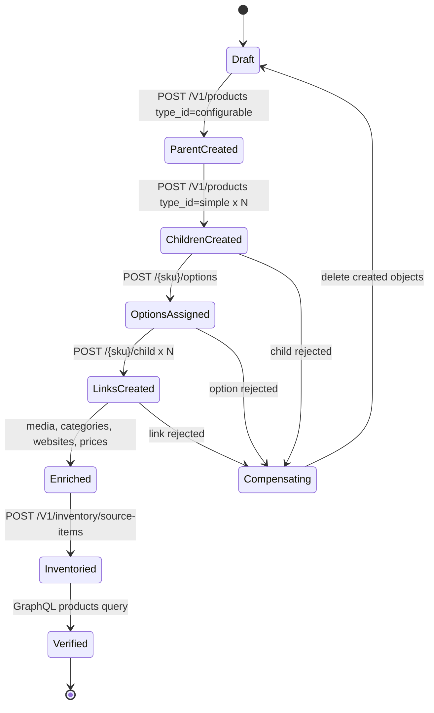

# Magento 2 integration

**Module:** `internal/magento`
**Primary target:** Magento 2.4.9 (Open Source and Adobe Commerce, self-hosted or PaaS)
**Status:** Phase 0 design. No code exists. No live Magento instance was reachable while this
document was written, so no `[V-live]` claim appears here; every Magento-specific claim is
`[V-docs]` (official documentation or released source) or `[U]`.
**Baseline:** [research-baseline.md](../development/research-baseline.md) (F6–F12, F8 correction).

---

## 1. Scope and non-goals

### In scope (v0.x)

| Area | Scope | Tag |
|---|---|---|
| Product types | Simple, Configurable, Virtual, Downloadable, Bundle | `[V-docs]` |
| Lifecycle depth | Simple and Configurable: full create / update / query / delete | `[V-docs]` |
| Lifecycle depth | Virtual, Downloadable, Bundle: create / update / query of the type-specific payload; no dedicated lifecycle automation | `[V-docs]` |
| Catalog structure | Attribute sets, attributes, attribute options, attribute groups, categories | `[V-docs]` |
| Configurable products | Parent, children, options, links, variant attribute management, website and store scoping, media, categories, prices, MSI inventory, bulk import, validation, relationship sync, partial-failure recovery | `[V-docs]` |
| Inventory | MSI sources, stocks, source-items, bulk assign/unassign/transfer, salable quantity | `[V-docs]` |
| Sales | Read-only orders, invoices, shipments, credit memos, aggregate analytics | `[V-docs]` |
| Verification | GraphQL storefront read of `products` to confirm variants render | `[V-docs]` |

### Non-goals

- **Adobe Commerce as a Cloud Service (SaaS / IMS OAuth).** Out of scope for v0.x. SaaS uses
  Adobe IMS OAuth, does not support traditional admin or integration token generation, moves the
  `/async` segment after `V1`, and does not support `POST /V1/import/csv`
  `[V-docs]` ([auth](https://developer.adobe.com/commerce/webapi/rest/authentication/),
  [async](https://developer.adobe.com/commerce/webapi/rest/use-rest/asynchronous-web-endpoints/),
  [import](https://developer.adobe.com/commerce/webapi/rest/modules/import/)). Listed as a known
  limitation in section 13.
- **Any write through GraphQL.** GraphQL has no product write mutations; product mutations cover
  reviews, compare lists, wishlist, and stock/price alerts only `[V-docs]` (baseline F8, correction 2).
- **Magento plugins, modules, or code patches.** The gateway is a standalone process.
- **Direct database access.** REST only for writes; GraphQL only for storefront read verification.
- **Checkout, carts, customer accounts, payment, promotions, CMS.** Not modeled in v0.x.
- **Adobe Commerce B2B company/quote objects.** Out of scope.
- **Per-variant price deltas** (the configurable "super attribute pricing" table). No REST endpoint
  is exposed in the 2.4.9 schema `[V-docs]`; see `[U]` item U4 in section 16.

### Success definition

A write is never "correct" because Magento returned HTTP 200. A configurable product is correct
only when the storefront query returns the parent with `configurable_options` whose values match the
intended attribute options, `variants` whose `attributes[].value_index` match those options, a
`price_range`, and the expected `stock_status` `[V-docs]`
([configurable GraphQL type](https://developer.adobe.com/commerce/webapi/graphql/schema/products/interfaces/types/configurable/)).
Section 5 makes this the final state of the lifecycle, not an optional check.

---

## 2. Authentication and connection model

### 2.1 Deployment divergence

| Deployment | Credential | Token lifetime | Notes | Tag |
|---|---|---|---|---|
| Self-hosted / PaaS | Admin token | 4 hours | Obtained with admin username + password; inherits the admin user's ACL role | `[V-docs]` |
| Self-hosted / PaaS | Integration access token | Indefinite until revoked | Bearer use is **disabled by default** since 2.4.x; requires `oauth/consumer/enable_integration_as_bearer=1` | `[V-docs]` |
| Self-hosted / PaaS | Integration OAuth 1.0a (4 credentials) | n/a | Signed requests; always available, no config toggle | `[V-docs]` |
| Adobe Commerce as a Cloud Service | Adobe IMS OAuth | IMS-managed | **Out of scope for v0.x** | `[V-docs]` |

Source: [Token-based authentication](https://developer.adobe.com/commerce/webapi/get-started/authentication/gs-authentication-token/).
The token-lifetime table (Integration: indefinite, Admin: 4 hours, Customer: 1 hour) and the
`enable_integration_as_bearer` restriction are both stated there `[V-docs]`.

### 2.2 Supported credential modes in the gateway

| Mode | Config keys | Behaviour | Recommended for |
|---|---|---|---|
| `admin_token` | `username`, `password` | `POST /V1/integration/admin/token` at startup and on 401; token cached in memory with a 4-hour TTL minus 5-minute skew | Development and short-lived environments only |
| `integration_bearer` | `access_token` | Static `Authorization: Bearer`; preflight `GET /V1/store/storeViews` validates it | Production when the merchant has enabled bearer integration tokens |
| `integration_oauth1` | `consumer_key`, `consumer_secret`, `access_token`, `access_token_secret` | HMAC-SHA256 request signing, no bearer header | Production default: works without any configuration change |

`POST /V1/integration/admin/token` is present in the 2.4.9 admin schema `[V-docs]`
([admin-schema-2.4.9.yaml](https://github.com/AdobeDocs/commerce-webapi/blob/main/src/openapi/admin-schema-2.4.9.yaml)).
When two-factor authentication is enabled for the admin user, the plain token endpoint is not
sufficient; a TFA provider endpoint such as `POST /V1/tfa/provider/google/authenticate` is required
`[V-docs]` ([generate-local](https://developer.adobe.com/commerce/webapi/rest/quick-reference/generate-local/)).
The gateway therefore refuses `admin_token` mode unless `MAGENTO_ALLOW_ADMIN_TOKEN=1` is set, and
never stores admin passwords.

### 2.3 Least-privilege role design

Integration ACL is a tree selected in **System > Extensions > Integrations > Available APIs**
`[V-docs]` ([authentication](https://developer.adobe.com/commerce/webapi/get-started/authentication/)).
The gateway's default role is the minimum that satisfies sections 5–10:

| ACL resource | Needed for | Tag |
|---|---|---|
| `Magento_Catalog::products` | Product CRUD, configurable options/children, media, websites, tier prices | `[V-docs]` |
| `Magento_Catalog::sets` | Attribute sets, attributes, options, groups | `[V-docs]` |
| `Magento_Catalog::categories` | Category tree, category-product assignment | `[V-docs]` |
| `Magento_InventoryApi::source` | Sources, stocks, stock-source links | `[V-docs]` |
| `Magento_InventoryApi::source_items` | Source-item read/write | `[U]` — resource id not confirmed in docs; verify in the integration ACL tree |
| `Magento_Sales::sales` | Order, invoice, shipment, credit memo read | `[V-docs]` |
| `Magento_Backend::store` | Store views, websites, store config read | `[U]` — confirm the exact resource on the target instance |

Read-only deployments use the same role with write resources removed; the gateway also enforces a
local capability allowlist so a permissive upstream role cannot be abused by a tool call.

### 2.4 Store code handling

REST base is `{base_url}/rest/{store_code}/V1/...` `[V-docs]`
([async endpoints](https://developer.adobe.com/commerce/webapi/rest/use-rest/asynchronous-web-endpoints/)).
`store_code` accepts `default`, `all`, or a store view code `[V-docs]`
([generate-local](https://developer.adobe.com/commerce/webapi/rest/quick-reference/generate-local/)).

Documented scope fallback rules `[V-docs]`:

- Create without a store code: values are written globally for each scope.
- Update without a store code: values are updated for the default store only.
- `all`: values are updated for every store scope that does not already have its own value.
- Explicit store code: only that store view is updated.

Consequence for the gateway: `store_code` is a required, explicit configuration value; it is never
inferred from the URL of a tool call. Store-scoped writes are separate tools from global writes
because the same payload means different things. `all` is permitted only for product and CMS
operations, matching the documented restriction `[V-docs]`.

### 2.5 Base URL validation and SSRF constraints

The base URL is operator-supplied, not agent-supplied. Validation at config load and again before
every request `[V-docs]` for the scheme rules, `[U]` for the private-range policy until tested:

| Rule | Enforcement |
|---|---|
| Scheme must be `https` (plain `http` allowed only for `localhost`/`127.0.0.1` in dev) | Reject at config load |
| No userinfo, query, or fragment in the URL | Reject |
| Path must be empty or a known subpath; the gateway appends `/rest/{store}/V1/...` | Reject otherwise |
| Hostname must not resolve to loopback, link-local, or RFC 1918 ranges outside the dev allowlist | Resolve, then check every address before dialing |
| Redirects are not followed | `CheckRedirect` returns an error |
| DNS is resolved per connection; no proxy from environment | Explicit transport configuration |

TLS requirements: certificate verification always on, minimum TLS 1.2, optional custom CA bundle for
private deployments, and `InsecureSkipVerify` is not exposed as a configuration option.

---

## 3. Endpoint map

All paths are relative to `{base_url}/rest/{store_code}`. "Idempotent" describes the HTTP method's
effect under identical repeated requests, not Magento's internal behaviour. Risk is the blast radius
if the call is wrong: `low` = read, `medium` = additive write, `high` = destructive or
storefront-visible, `critical` = irreversible data loss or cross-store impact.

Verification tags: `[V-docs]` = path and method confirmed in the 2.4.9 admin OpenAPI schema or in
released `webapi.xml`; `[U]` = not confirmed, probe stated.

### 3.1 Products

| Capability | Method | Path | R/W | Idempotent | Risk | Tag | Notes |
|---|---|---|---|---|---|---|---|
| Create product | POST | `/V1/products` | W | No | High | `[V-docs]` | `type_id` selects Simple/Configurable/Virtual/Downloadable/Bundle |
| Update product | PUT | `/V1/products/{sku}` | W | Yes (merge) | High | `[V-docs]` | Merge semantics; see 5.4 |
| Get product | GET | `/V1/products/{sku}` | R | Yes | Low | `[V-docs]` | |
| Search products | GET | `/V1/products` | R | Yes | Low | `[V-docs]` | `searchCriteria[...]`; always set `pageSize` |
| Delete product | DELETE | `/V1/products/{sku}` | W | Yes | Critical | `[V-docs]` | Cascades to links, media, stock; no soft delete |
| Product types | GET | `/V1/products/types` | R | Yes | Low | `[V-docs]` | Runtime capability probe |
| Product websites | POST | `/V1/products/{sku}/websites` | W | Yes | Medium | `[V-docs]` | Body `{productWebsiteLink:{sku,website_id}}` |
| Replace websites | PUT | `/V1/products/{sku}/websites` | W | Yes | High | `[V-docs]` | Replaces the set |
| Remove website | DELETE | `/V1/products/{sku}/websites/{websiteId}` | W | Yes | High | `[V-docs]` | |
| Related/upsell links | POST, PUT | `/V1/products/{sku}/links` | W | No | Medium | `[V-docs]` | `link_type` in body |
| Read links | GET | `/V1/products/{sku}/links/{type}` | R | Yes | Low | `[V-docs]` | |
| Delete link | DELETE | `/V1/products/{sku}/links/{type}/{linkedProductSku}` | W | Yes | Medium | `[V-docs]` | |

### 3.2 Configurable products

| Capability | Method | Path | R/W | Idempotent | Risk | Tag | Notes |
|---|---|---|---|---|---|---|---|
| Add configurable option | POST | `/V1/configurable-products/{sku}/options` | W | No | High | `[V-docs]` | Body `{attribute_id, label, position, values[{value_index}]}` |
| List options | GET | `/V1/configurable-products/{sku}/options/all` | R | Yes | Low | `[V-docs]` | |
| Get option | GET | `/V1/configurable-products/{sku}/options/{id}` | R | Yes | Low | `[V-docs]` | |
| Update option | PUT | `/V1/configurable-products/{sku}/options/{id}` | W | Yes | High | `[V-docs]` | Same service as create |
| Delete option | DELETE | `/V1/configurable-products/{sku}/options/{id}` | W | Yes | High | `[V-docs]` | Removes the option and its link rows |
| Add child link | POST | `/V1/configurable-products/{sku}/child` | W | No | High | `[V-docs]` | Body `{childSku}`; returns boolean |
| List children | GET | `/V1/configurable-products/{sku}/children` | R | Yes | Low | `[V-docs]` | |
| **Delete child link** | DELETE | `/V1/configurable-products/{sku}/children/{childSku}` | W | Yes | High | `[V-docs]` | Unlinks; child product survives |
| Generate variation | PUT | `/V1/configurable-products/variation` | W | No | High | `[V-docs]` | Body `{product, options[]}`; creates children and links in one call |

`[V-docs]` for 3.2:
[ConfigurableProduct webapi.xml](https://github.com/magento/magento2/blob/2.4.9/app/code/Magento/ConfigurableProduct/etc/webapi.xml).

### 3.3 EAV: attribute sets, attributes, options, groups

| Capability | Method | Path | R/W | Idempotent | Risk | Tag | Notes |
|---|---|---|---|---|---|---|---|
| List attribute sets | GET | `/V1/eav/attribute-sets/list` | R | Yes | Low | `[V-docs]` | Alias of the Catalog route below |
| List attribute sets | GET | `/V1/products/attribute-sets/sets/list` | R | Yes | Low | `[V-docs]` | Both routes exist in 2.4.9 |
| Get attribute set | GET | `/V1/products/attribute-sets/{attributeSetId}` | R | Yes | Low | `[V-docs]` | |
| Create attribute set | POST | `/V1/products/attribute-sets` | W | No | Medium | `[V-docs]` | |
| Set attributes | GET | `/V1/products/attribute-sets/{attributeSetId}/attributes` | R | Yes | Low | `[V-docs]` | Drives dynamic mapping |
| Assign attribute | POST | `/V1/products/attribute-sets/attributes` | W | Yes | Medium | `[V-docs]` | Body carries `attributeSetId`, `attributeCode`, `groupCode`, `sortOrder` |
| Unassign attribute | DELETE | `/V1/products/attribute-sets/{attributeSetId}/attributes/{attributeCode}` | W | Yes | Medium | `[V-docs]` | |
| List groups | GET | `/V1/products/attribute-sets/groups/list` | R | Yes | Low | `[V-docs]` | |
| Create group | POST | `/V1/products/attribute-sets/groups` | W | No | Low | `[V-docs]` | |
| Update group | PUT | `/V1/products/attribute-sets/{attributeSetId}/groups` | W | Yes | Low | `[V-docs]` | |
| Delete group | DELETE | `/V1/products/attribute-sets/groups/{groupId}` | W | Yes | Medium | `[V-docs]` | Fails if attributes remain |
| List attributes | GET | `/V1/products/attributes` | R | Yes | Low | `[V-docs]` | |
| Get attribute | GET | `/V1/products/attributes/{attributeCode}` | R | Yes | Low | `[V-docs]` | Returns `frontend_input`, `scope`, `options` |
| Create attribute | POST | `/V1/products/attributes` | W | No | Medium | `[V-docs]` | |
| Update attribute | PUT | `/V1/products/attributes/{attributeCode}` | W | Yes | Medium | `[V-docs]` | |
| Delete attribute | DELETE | `/V1/products/attributes/{attributeCode}` | W | Yes | Critical | `[V-docs]` | Drops column and all values |
| List attribute options | GET | `/V1/products/attributes/{attributeCode}/options` | R | Yes | Low | `[V-docs]` | Returns `value` + `label` |
| Add attribute option | POST | `/V1/products/attributes/{attributeCode}/options` | W | No | Medium | `[V-docs]` | Body `{attributeOption:{label, value?, sort_order}}` |
| Update attribute option | PUT | `/V1/products/attributes/{attributeCode}/options/{optionId}` | W | Yes | Medium | `[V-docs]` | Store-scoped labels via `store_labels` |
| Delete attribute option | DELETE | `/V1/products/attributes/{attributeCode}/options/{optionId}` | W | Yes | High | `[V-docs]` | Breaks products using the option |

### 3.4 Categories and media

| Capability | Method | Path | R/W | Idempotent | Risk | Tag | Notes |
|---|---|---|---|---|---|---|---|
| Category tree | GET | `/V1/categories` | R | Yes | Low | `[V-docs]` | Whole tree; cache it |
| Category list (paged) | GET | `/V1/categories/list` | R | Yes | Low | `[V-docs]` | searchCriteria |
| Get category | GET | `/V1/categories/{categoryId}` | R | Yes | Low | `[V-docs]` | |
| Create category | POST | `/V1/categories` | W | No | Medium | `[V-docs]` | `custom_attributes[]` for SEO fields |
| Update category | PUT | `/V1/categories/{id}` | W | Yes | Medium | `[V-docs]` | |
| Move category | PUT | `/V1/categories/{categoryId}/move` | W | Yes | High | `[V-docs]` | Rewrites paths |
| Delete category | DELETE | `/V1/categories/{categoryId}` | W | Yes | High | `[V-docs]` | Products are unassigned, not deleted |
| Category products | GET | `/V1/categories/{categoryId}/products` | R | Yes | Low | `[V-docs]` | |
| Assign products | POST, PUT | `/V1/categories/{categoryId}/products` | W | Yes | Medium | `[V-docs]` | `categoryLink` body |
| Unassign product | DELETE | `/V1/categories/{categoryId}/products/{sku}` | W | Yes | Medium | `[V-docs]` | |
| Media types | GET | `/V1/products/media/types/{attributeSetName}` | R | Yes | Low | `[V-docs]` | Discover `image`/`small_image`/`thumbnail`/`swatch_image` per set |
| Create media entry | POST | `/V1/products/{sku}/media` | W | No | Medium | `[V-docs]` | Base64 `content`; returns entry id |
| List media | GET | `/V1/products/{sku}/media` | R | Yes | Low | `[V-docs]` | |
| Get media entry | GET | `/V1/products/{sku}/media/{entryId}` | R | Yes | Low | `[V-docs]` | |
| Update media entry | PUT | `/V1/products/{sku}/media/{entryId}` | W | Yes | Medium | `[V-docs]` | Roles, label, position |
| Delete media entry | DELETE | `/V1/products/{sku}/media/{entryId}` | W | Yes | High | `[V-docs]` | Removes file and role assignment |

### 3.5 Inventory (MSI) and stock status

| Capability | Method | Path | R/W | Idempotent | Risk | Tag | Notes |
|---|---|---|---|---|---|---|---|
| List sources | GET | `/V1/inventory/sources` | R | Yes | Low | `[V-docs]` | |
| Get source | GET | `/V1/inventory/sources/{sourceCode}` | R | Yes | Low | `[V-docs]` | |
| Create/update source | POST, PUT | `/V1/inventory/sources` | W | Yes | High | `[V-docs]` | PUT variant exists at `/{sourceCode}` |
| List stocks | GET | `/V1/inventory/stocks` | R | Yes | Low | `[V-docs]` | |
| Create/update stock | POST, PUT | `/V1/inventory/stocks` | W | Yes | High | `[V-docs]` | |
| Delete stock | DELETE | `/V1/inventory/stocks/{stockId}` | W | Yes | Critical | `[V-docs]` | Cannot delete the default stock |
| Stock-source links | GET, POST | `/V1/inventory/stock-source-links` | R/W | No (POST) | High | `[V-docs]` | |
| Delete links | POST | `/V1/inventory/stock-source-links-delete` | W | Yes | High | `[V-docs]` | POST-as-delete |
| Source items | GET | `/V1/inventory/source-items` | R | Yes | Low | `[V-docs]` | searchCriteria on `sku`, `source_code` |
| Upsert source items | POST | `/V1/inventory/source-items` | W | Yes | High | `[V-docs]` | Body `{sourceItems:[...]}`; quantity **replaces** |
| Delete source items | POST | `/V1/inventory/source-items-delete` | W | Yes | High | `[V-docs]` | |
| Bulk assign | POST | `/V1/inventory/bulk-product-source-assign` | W | No | High | `[V-docs]` | `{skus[], sourceCodes[]}` |
| Bulk unassign | POST | `/V1/inventory/bulk-product-source-unassign` | W | No | High | `[V-docs]` | |
| Bulk transfer | POST | `/V1/inventory/bulk-product-source-transfer` | W | No | High | `[V-docs]` | Moves whole quantity |
| Partial transfer | POST | `/V1/inventory/bulk-partial-source-transfer` | W | No | High | `[V-docs]` | Quantity per SKU |
| Sources by priority | GET | `/V1/inventory/get-sources-assigned-to-stock-ordered-by-priority/{stockId}` | R | Yes | Low | `[V-docs]` | |
| Salable quantity | GET | `/V1/inventory/get-product-salable-quantity/{sku}/{stockId}` | R | Yes | Low | `[V-docs]` | Post-index truth |
| Is salable | GET | `/V1/inventory/is-product-salable/{sku}/{stockId}` | R | Yes | Low | `[V-docs]` | |
| Stock resolver | GET | `/V1/inventory/stock-resolver/{type}/{code}` | R | Yes | Low | `[V-docs]` | `type=website`, `code=<website code>` |
| Legacy stock status | GET | `/V1/stockStatuses/{productSku}` | R | Yes | Low | `[V-docs]` | CatalogInventory; superseded by MSI |
| Legacy stock item | GET | `/V1/stockItems/{productSku}` | R | Yes | Low | `[V-docs]` | Read-only compatibility surface |

`[V-docs]` for 3.5: [Inventory Management](https://developer.adobe.com/commerce/webapi/rest/inventory/),
`InventoryApi`/`InventoryCatalogApi`/`InventorySalesApi` `webapi.xml` in
[magento/inventory](https://github.com/magento/inventory/tree/1.2.2).

### 3.6 Prices

| Capability | Method | Path | R/W | Idempotent | Risk | Tag | Notes |
|---|---|---|---|---|---|---|---|
| Tier prices read | POST | `/V1/products/tier-prices-information` | R | Yes | Low | `[V-docs]` | POST used as a read |
| Tier prices add/update | POST | `/V1/products/tier-prices` | W | No | High | `[V-docs]` | `{prices:[{sku,price,price_type,website_id,customer_group,quantity}]}` |
| Tier prices replace | PUT | `/V1/products/tier-prices` | W | Yes | High | `[V-docs]` | Deletes omitted rows |
| Tier prices delete | POST | `/V1/products/tier-prices-delete` | W | Yes | High | `[V-docs]` | |
| Base prices | POST | `/V1/products/base-prices` | W | Yes | High | `[V-docs]` | Bulk price update by SKU |
| Special price | POST | `/V1/products/special-price` | W | Yes | High | `[V-docs]` | |
| Cost | POST | `/V1/products/cost` | W | Yes | Medium | `[V-docs]` | |

### 3.7 Store configuration and sales (read)

| Capability | Method | Path | R/W | Idempotent | Risk | Tag | Notes |
|---|---|---|---|---|---|---|---|
| Store views | GET | `/V1/store/storeViews` | R | Yes | Low | `[V-docs]` | Resolve store codes |
| Websites | GET | `/V1/store/websites` | R | Yes | Low | `[V-docs]` | Resolve website ids |
| Store groups | GET | `/V1/store/storeGroups` | R | Yes | Low | `[V-docs]` | |
| Store config | GET | `/V1/store/storeConfigs` | R | Yes | Low | `[V-docs]` | Currency, locale, base URLs |
| Orders | GET | `/V1/orders` | R | Yes | Low | `[V-docs]` | Heavy payload; see 10 |
| Order | GET | `/V1/orders/{id}` | R | Yes | Low | `[V-docs]` | |
| Order items | GET | `/V1/orders/items` | R | Yes | Low | `[V-docs]` | |
| Invoices | GET | `/V1/invoices` | R | Yes | Low | `[V-docs]` | |
| Invoice | GET | `/V1/invoices/{id}` | R | Yes | Low | `[V-docs]` | |
| Shipments | GET | `/V1/shipments` | R | Yes | Low | `[V-docs]` | |
| Shipment | GET | `/V1/shipment/{id}` | R | Yes | Low | `[V-docs]` | |
| Credit memos | GET | `/V1/creditmemos` | R | Yes | Low | `[V-docs]` | |
| Credit memo | GET | `/V1/creditmemo/{id}` | R | Yes | Low | `[V-docs]` | |

### 3.8 Async, bulk status, import, and schema

| Capability | Method | Path | R/W | Idempotent | Risk | Tag | Notes |
|---|---|---|---|---|---|---|---|
| Async product create | POST | `/async/V1/products` | W | No | High | `[V-docs]` | Declared in `WebapiAsync/etc/webapi_async.xml` |
| Async bulk product update | PUT | `/async/bulk/V1/products/bySku` | W | Conditional | High | `[V-docs]` | Declared in `Catalog/etc/webapi_async.xml`; alias `async/bulk/V1/products` |
| Bulk status | GET | `/V1/bulk/{bulkUuid}/status` | R | Yes | Low | `[V-docs]` | |
| Bulk detailed status | GET | `/V1/bulk/{bulkUuid}/detailed-status` | R | Yes | Low | `[V-docs]` | |
| Bulk operation counts | GET | `/V1/bulk/{bulkUuid}/operation-status/{status}` | R | Yes | Low | `[V-docs]` | |
| Bulk operation list | GET | `/V1/bulk` | R | Yes | Low | `[V-docs]` | |
| CSV import | POST | `/V1/import/csv` | W | No | Critical | `[V-docs]` | **Adobe Commerce only**; base64 CSV |
| JSON import | POST | `/V1/import/json` | W | No | Critical | `[V-docs]` | Commerce only; SaaS-supported variant |
| REST schema | GET | `/rest/{store}/schema?services=all` | R | Yes | Low | `[V-docs]` | Source of truth for capability detection |
| Async schema | GET | `/rest/{store}/async/schema` | R | Yes | Low | `[V-docs]` | Lists async-enabled routes |

`[V-docs]` for 3.8:
[async](https://developer.adobe.com/commerce/webapi/rest/use-rest/asynchronous-web-endpoints/),
[bulk](https://developer.adobe.com/commerce/webapi/rest/use-rest/bulk-endpoints/),
[status](https://developer.adobe.com/commerce/webapi/rest/use-rest/operation-status-endpoints/),
[schema](https://developer.adobe.com/commerce/webapi/rest/quick-reference/generate-local/).

Async routes are not generic: a route must be declared in a module's `webapi_async.xml`, which
`Magento\WebapiAsync\Model\ServiceConfig` consolidates `[V-docs]`
([ServiceConfig.php](https://github.com/magento/magento2/blob/2.4.9/app/code/Magento/WebapiAsync/Model/ServiceConfig.php)).
Core 2.4.9 declares the two routes above. The documentation also shows `PUT /async/V1/products/:sku`
as an example `[V-docs]`; whether that route is registered in a stock installation is `[U]` (probe
U5). The gateway therefore treats async as opt-in per operation and always falls back to the
synchronous route.

---

## 4. The Magento EAV model for integrators

Magento products are EAV rows: `catalog_product_entity` holds SKU and type, and each attribute value
lives in a typed table scoped by `store_id` and `website_id`. Three consequences dominate the design.

**Attribute scope.** `scope` is `global`, `website`, or `store` `[V-docs]` (field `scope` on
`catalog-data-product-attribute-interface`, admin schema 2.4.9). Only `global` attributes can drive
a configurable product. A store-scoped value is an override row; deleting the override reverts to
the default value, which is why a store-scoped write can look like a "reset" to the caller.

**`frontend_input` is the type system.** Values include `text`, `textarea`, `select`, `multiselect`,
`boolean`, `price`, `date`, `media_image`, `gallery`, `swatch_visual`, `swatch_text` `[V-docs]`.
There is **no `is_configurable` flag** in the REST schema, in `catalog_eav_attribute`, or in the
ConfigurableProduct tables `[V-docs]` — the term does not appear in the 2.4.9 admin schema, and
`Catalog/etc/db_schema.xml` has no such column. Configurability is derived: an attribute can be used
as a configurable option when it is in the product's attribute set, has a select-like
`frontend_input`, is `global` in scope, and has options with `value_index` values.

**Attribute sets and groups.** An attribute set is an ordered collection of attribute groups; a
product references exactly one set by `attribute_set_id`. The set determines which attributes exist
on the product, and the group determines the admin form placement. Two products in different sets
have different attribute surfaces, so a client cannot assume a field exists because another product
had it.

**Option IDs vs option values.** For a select attribute, `eav_attribute_option` rows carry a stable
integer `option_id`, while the stored product value is the option's `value` (exposed as
`value_index` in GraphQL and as `value` in the REST options list) `[V-docs]`. Configurable option
payloads use `values[].value_index` (integer), not the label and not the option id
`[V-docs]` (`configurable-product-data-option-value-interface`). Labels are localizable per store
view through `store_labels[]` (`{store_id, label}`), so the same option can read "Red" in one store
and "Rot" in another. Matching variants by label is therefore always wrong.

**Why dynamic mapping is mandatory.** Because attribute codes, option ids, labels, and sets are
store-specific, the gateway must resolve everything from the instance at runtime: attribute sets
from `GET /V1/products/attribute-sets/sets/list`, attributes from
`GET /V1/products/attribute-sets/{setId}/attributes`, options from
`GET /V1/products/attributes/{attributeCode}/options`, media roles from
`GET /V1/products/media/types/{attributeSetName}`, and store codes from `GET /V1/store/storeViews`.
Hardcoding `color`, `size`, `image`, or `default` works on the demo store and fails on real ones.

The gateway keeps a per-instance schema cache with a TTL and invalidates it on any attribute or
option write it performs. Tool inputs accept logical names (`color`) and resolve them to
`attribute_id` plus `value_index` at call time; unresolved names produce a `validation_failed` error
that lists the valid options rather than a Magento exception.

---

## 5. Configurable product lifecycle



Each state is persisted by the gateway (not by Magento) so a run can resume after a crash. The
persisted record holds SKUs, attribute codes, resolved `value_index` values, created entity ids, and
the last completed transition.

### 5.1 Transitions

| Transition | Preconditions | API calls | Validation | Idempotency key | Failure compensation | Resumable |
|---|---|---|---|---|---|---|
| Draft → ParentCreated | Attribute set resolved; SKU unused; website ids known | `POST /V1/products` with `type_id=configurable`, `attribute_set_id`, `name`, `price`, `visibility`, `status`, `extension_attributes.website_ids` | SKU uniqueness probe `GET /V1/products/{sku}` returns 404; set exists | `product:{sku}` | Delete parent if created in this run | Yes: re-run create is a no-op after existence check |
| ParentCreated → ChildrenCreated | Parent id known; variant matrix computed | `POST /V1/products` per child with `type_id=simple`, `visibility=1` | Each child carries every configurable attribute value; SKU unique; websites superset of parent | `product:{childSku}` | Delete children created in this run | Yes: skip children that already exist and match |
| ChildrenCreated → OptionsAssigned | Attribute is select-like, global, in set; options exist | `POST /V1/configurable-products/{sku}/options` | `attribute_id` matches the resolved attribute; every `value_index` belongs to that attribute; at least one value per attribute | `option:{parentSku}:{attributeCode}` | `DELETE /{sku}/options/{id}` | Yes: `GET /{sku}/options/all` first |
| OptionsAssigned → LinksCreated | Option ids known; children exist | `POST /V1/configurable-products/{sku}/child` per child | Child's option values form a complete combination; child not already linked | `link:{parentSku}:{childSku}` | `DELETE /{sku}/children/{childSku}` | Yes: `GET /{sku}/children` diff |
| LinksCreated → Enriched | Parent id known | `POST /{sku}/media`, `POST /V1/categories/{id}/products`, `POST /{sku}/websites`, price endpoints | Media MIME and roles; category exists; website assigned to store | `media:{sku}:{sha256}`, `category:{id}:{sku}` | Delete created media entries; unassign category | Yes |
| Enriched → Inventoried | Source codes and stock resolved | `POST /V1/inventory/source-items` per SKU | Quantity numeric and non-negative; source exists; SKU assigned to source | `stock:{sku}:{sourceCode}` | Re-post previous quantity | Yes |
| Inventoried → Verified | Indexers caught up | `POST /graphql` products query | Variants present, option values match, `stock_status` expected, `price_range` expected | `verify:{parentSku}:{hash}` | Re-index request; no data rollback | Yes, verification is read-only |

### 5.2 Multi-attribute example (color × storage)

Variant matrix for a phone: color ∈ {black, white} × storage ∈ {128, 256} = four children.

Parent create (abridged):

```json
{
  "product": {
    "sku": "PHONE-01",
    "name": "Phone 01",
    "type_id": "configurable",
    "attribute_set_id": 4,
    "price": 699,
    "status": 1,
    "visibility": 4,
    "extension_attributes": { "website_ids": [1] }
  }
}
```

Option assignment, one call per attribute, using ids resolved from the instance:

```json
{
  "option": {
    "attribute_id": "93",
    "label": "Color",
    "position": 0,
    "values": [{ "value_index": 12 }, { "value_index": 13 }]
  }
}
```

Children carry the raw attribute values that correspond to the same `value_index` entries:

```json
{
  "product": {
    "sku": "PHONE-01-BLK-128",
    "name": "Phone 01 Black 128",
    "type_id": "simple",
    "attribute_set_id": 4,
    "price": 699,
    "status": 1,
    "visibility": 1,
    "weight": 0.4,
    "custom_attributes": [
      { "attribute_code": "color", "value": "12" },
      { "attribute_code": "storage", "value": "31" }
    ],
    "extension_attributes": { "website_ids": [1] }
  }
}
```

`attribute_id` is a string in the REST payload, `value_index` an integer, and child attribute values
are sent as strings `[V-docs]` (admin schema 2.4.9 definitions
`configurable-product-data-option-interface`, `configurable-product-data-option-value-interface`).

### 5.3 What must be validated before any write

| Check | Why it matters | Failure mode if skipped |
|---|---|---|
| Attribute is select-like (`select`, `swatch_visual`, `swatch_text`) | Magento rejects non-select options | 400 with an opaque message mid-run |
| Attribute scope is `global` | Store-scoped attributes cannot define variants | Options silently unusable on other stores |
| Attribute belongs to the parent's attribute set | Options reference attributes the product does not have | Option save fails after parent exists |
| Every `value_index` belongs to that attribute | Wrong ids create dangling options | Storefront shows an option with no variant |
| Parent and child share website ids | Variants invisible on a website | Parent renders, variants missing |
| SKU unique across the catalog | Magento enforces global SKU uniqueness | Create fails, often after partial work |
| Visibility: parent 4, children 1 | Children must not appear as standalone products | Duplicate storefront listings |
| Status: parent 1, children 1 | Disabled child removes the variant | Variant missing with no error |
| Price defined on the parent | Displayed price comes from the parent | Price shows 0 or stale |
| Complete combination coverage | Missing combination leaves an unselectable option | Storefront shows an option that cannot be bought |

### 5.4 Update and partial-failure semantics

`PUT /V1/products/{sku}` is a **merge**, not a replace: `ProductRepository::save()` loads the
existing product, applies only the supplied keys, preserves `status` when it is absent, and reuses
the existing extension attributes when the request supplies none `[V-docs]`
([ProductRepository.php](https://github.com/magento/magento2/blob/2.4.9/app/code/Magento/Catalog/Model/ProductRepository.php)).

The extension-attribute behaviour is the trap: if a request supplies **any** extension attribute,
the whole extension-attribute set is taken from the request, so `website_ids`, `category_links`,
`stock_item`, and `configurable_product_links` must be sent together or they are dropped. The
gateway's update tool always sends the full extension-attribute block it read before the write.

Store-scoped updates have a second trap: when updating in a non-default store view on a
multi-store product, unchanged non-global attributes are written as `null` to remove the override
`[V-docs]` (same method). Store-scoped writes are therefore separate tools with an explicit
"clear override" flag, never an implicit side effect of a global update.

Partial failure policy: the gateway records each successful entity id as it goes. On failure it
offers three modes — `rollback` (delete what this run created), `resume` (keep and continue), and
`report` (stop and describe). Rollback never deletes objects that existed before the run.

---

## 6. Validation rules table

| Rule | Why it matters | Enforcement point | Error surfaced to the agent |
|---|---|---|---|
| SKU matches `[A-Za-z0-9._-]{1,64}` and is unique | Magento enforces global uniqueness; late failure wastes writes | Pre-flight before any write | `validation_failed: sku already exists (PHONE-01-BLK-128)` |
| Configurable attribute is select-like and global | Options cannot be created otherwise | Schema cache lookup | `validation_failed: attribute 'color' has frontend_input 'text'; configurable options require select or swatch` |
| Option value exists for the attribute | Dangling values break the storefront | Schema cache lookup | `validation_failed: value_index 99 not in options for 'color' (valid: 12, 13)` |
| Child covers every option of every configurable attribute | Incomplete combinations cannot be selected | Matrix expansion before create | `validation_failed: child PHONE-01-BLK-128 missing 'storage'` |
| Parent and child share at least one website | Otherwise variants are invisible | Pre-flight against website ids | `validation_failed: child website_ids [1] not subset of parent [1,2]` |
| Parent `visibility` = 4, child = 1 | Prevents duplicate listings | Payload normalization | `validation_failed: configurable parent visibility must be 4` |
| `type_id` matches the payload shape | A bundle payload on a simple product is silently ignored | Tool input schema | `invalid_argument: type_id 'bundle' requires bundle_options` |
| Quantity is a non-negative number | MSI accepts decimals; negative stock is a data error | Tool input schema + pre-flight | `invalid_argument: quantity must be >= 0` |
| Source codes exist before source-item write | Otherwise the whole batch is rejected | Pre-flight `GET /V1/inventory/sources` | `not_found: source 'wh2' does not exist` |
| Store code is one of the instance's codes | A typo silently writes to the wrong scope | Pre-flight `GET /V1/store/storeViews` | `invalid_argument: unknown store code 'en_us' (valid: default, en, de)` |
| Media MIME is in the allowlist and matches the bytes | Magento validates both | Gateway pre-check before upload | `validation_failed: content type image/webp not allowed (jpg, jpeg, gif, png)` |
| Category ids exist | Assignment fails late otherwise | Pre-flight `GET /V1/categories/{id}` | `not_found: category 42 does not exist` |
| Destructive calls carry a confirmation token | Deletes are irreversible | Tool layer | `permission_denied: delete requires confirm=true and reason` |
| GraphQL verification passes | HTTP 200 is not correctness | Final lifecycle state | `validation_failed: variant PHONE-01-BLK-256 absent from storefront query` |

---

## 7. Media handling

Uploads use the base64 content contract, not multipart and not URL fetch:

```json
{
  "entry": {
    "media_type": "image",
    "label": "Phone 01 front",
    "position": 1,
    "disabled": false,
    "types": ["image", "small_image", "thumbnail"],
    "content": {
      "base64_encoded_data": "<base64>",
      "type": "image/jpeg",
      "name": "phone-01-front.jpg"
    }
  }
}
```

`content` requires `base64_encoded_data`, `type`, and `name` `[V-docs]`
(`framework-data-image-content-interface`, admin schema 2.4.9). The endpoint returns the new
`entryId` as an integer.

**MIME and size.** `Magento\Framework\Api\ImageContentValidator` accepts `image/jpg`,
`image/jpeg`, `image/gif`, and `image/png`, requires the declared MIME to equal the MIME sniffed from
the decoded bytes, and rejects filenames containing any of `\ / ? * : " ; < > ( ) | { }` `[V-docs]`
([ImageContentValidator.php](https://github.com/magento/magento2/blob/2.4.9/lib/internal/Magento/Framework/Api/ImageContentValidator.php)).
The validator performs **no size check**; the effective ceiling is PHP `post_max_size` and the web
server body limit, which are deployment-specific `[U]` (probe U2). Gateway defaults: 2 MiB per image,
10 MiB per request, 20 images per product, enforced before the request is sent.

**Role assignment.** Roles are `image`, `small_image`, `thumbnail`, and `swatch_image`; the valid set
per attribute set comes from `GET /V1/products/media/types/{attributeSetName}` `[V-docs]`. The
gateway never hardcodes the list. One entry may carry several roles; assigning `image` to a second
entry silently moves the role, so the gateway first reads the current entries and clears the role on
the previous holder.

**Deduplication.** The gateway hashes decoded bytes (SHA-256) and stores `sku → hash → entryId`.
A repeat upload with the same hash and the same role set is skipped; a repeat with a different role
set updates the existing entry instead of creating a duplicate.

**Failure handling.** Upload is idempotent per (sku, hash). A failed upload leaves no partial entry,
because Magento creates the entry and the file together; a failure after the entry exists is
compensated by `DELETE /V1/products/{sku}/media/{entryId}`. Role assignment is a separate `PUT`, so
a crash between create and role assignment is resumable from the recorded `entryId`.

**No external URL fetch by default.** The gateway does not download images from arbitrary URLs: that
turns a product write into an SSRF primitive and makes the write non-reproducible. A future
`media_import_from_url` tool, if added, must run through the same host validation as section 2.5 and
be disabled by default.

---

## 8. MSI inventory model

MSI separates **write** and **read** models (CQRS): `SourceItem` is the write entity, `StockItem` is
read-only aggregated data produced by reindexing, and all `GET` requests should use aggregated data
while all `POST`/`PUT` use source items `[V-docs]`
([Inventory Management](https://developer.adobe.com/commerce/webapi/rest/inventory/)).

| Concept | Meaning | Endpoint |
|---|---|---|
| Source | A physical location that holds stock | `/V1/inventory/sources` |
| Stock | A sales channel (currently websites) mapped to sources | `/V1/inventory/stocks` |
| Stock-source link | Priority-ordered membership of a source in a stock | `/V1/inventory/stock-source-links` |
| Source item | Quantity of one SKU at one source | `/V1/inventory/source-items` |
| Salable quantity | Aggregate sellable quantity across a stock's sources, minus reservations | `/V1/inventory/get-product-salable-quantity/{sku}/{stockId}` |

**Salable quantity is not the sum of source quantities.** Reservations created at cart and checkout
reduce it, and they clear when an order ships `[V-docs]` (same page). A SKU with 10 units in a
source and 3 open reservations reports 7. Any tool that claims "stock" must state which number it
returns: source quantity (physical), salable quantity (sellable now), or storefront `stock_status`
(binary, threshold-based).

**Multi-source assignment.** A SKU must be assigned to a source before a source item exists for it;
bulk assignment is `POST /V1/inventory/bulk-product-source-assign` with `{skus[], sourceCodes[]}`
`[V-docs]`. Transfers move quantity between sources; partial transfer takes a quantity per SKU. Both
are non-idempotent batch operations with partial-failure behaviour: the response count tells how
many SKUs were processed, not which ones failed, so the gateway re-reads source items for the
affected SKUs and reports the delta.

**Eventual consistency.** Source-item writes update the source item synchronously, but salable
quantity and storefront availability depend on indexers and, on installations with a message queue,
on asynchronous consumers `[U]` for the exact delay (probe U7). The gateway therefore verifies with a
bounded poll: read `get-product-salable-quantity` and the GraphQL `stock_status` until they match the
expected value or a 30-second budget expires, then reports `upstream_timeout` with the observed
values rather than claiming success.

**Verification sequence for an inventory write:**

1. `GET /V1/inventory/source-items?searchCriteria[filter_groups][0][filters][0][field]=sku&...` —
   confirm the per-source quantity.
2. `GET /V1/inventory/get-product-salable-quantity/{sku}/{stockId}` — confirm the aggregate.
3. GraphQL `products(filter:{sku:{eq:"..."}}) { items { stock_status } }` — confirm what the
   storefront would show.
4. If 1 and 2 disagree beyond reservations, the indexer has not run; report the inconsistency.

---

## 9. Bulk import design

### 9.1 Pipeline

`normalize → validate → preview → confirm → execute → status → report`

| Stage | Behaviour | Failure handling |
|---|---|---|
| Normalize | CSV, JSON, or Excel input is converted to the canonical row model; column headers are mapped to attribute codes through the schema cache, never positionally | Unmapped header → `validation_failed` with the header name |
| Validate | Full local validation (section 6) plus cross-row checks: duplicate SKUs, parent/child references, option values, website ids, category ids | Report all errors, not the first |
| Preview | Human-readable diff: creates, updates, deletes, unchanged, and per-row warnings | Blocks execution until confirmed |
| Confirm | Explicit confirmation token bound to the preview hash | Stale token → `conflict` |
| Execute | Chunked writes through the same tools as single operations, or `/V1/import/*` when eligible | Per-chunk checkpoint |
| Status | `GET /V1/bulk/{bulkUuid}/status`, `/detailed-status`, `/operation-status/{status}` for async runs | Unknown status → `upstream_unavailable` |
| Report | Row-level result file: sku, action, status, error code, upstream message | Always produced, including on abort |

### 9.2 Import endpoints and their constraints

`POST /V1/import/csv` and `POST /V1/import/json` exist in the 2.4.9 admin schema, but the Import API
page carries the Adobe Commerce "exclusive feature" banner, and Magento Open Source's
`ImportExport` module ships no `webapi.xml` `[V-docs]`
([Import API](https://developer.adobe.com/commerce/webapi/rest/modules/import/),
[ImportExport module](https://github.com/magento/magento2/tree/2.4.9/app/code/Magento/ImportExport)).
The gateway therefore detects the endpoints at runtime from the schema and falls back to chunked REST
writes when they are absent.

Contract details `[V-docs]` (same page):

- Payload is `{source: {entity, behavior, validationStrategy, allowedErrorCount, csvData}}`; `csvData`
  is base64, optionally gzip-compressed **before** base64, UTF-8 before compression.
- `entity` ∈ `advanced_pricing`, `catalog_product`, `customer`, `customer_address`,
  `customer_composite`, `customer_finance`, `stock_sources` (plus `requisition_list` on SaaS).
- `behavior` ∈ `append`, `replace`, `delete` for product and pricing entities; customer entities use
  `add_update`, `delete`, `custom`. The page's own sample uses `add_update` for `advanced_pricing`,
  which contradicts its table `[V-docs]` — the gateway validates `behavior` against the table and
  surfaces a clear error rather than forwarding an ambiguous value.
- `validationStrategy` ∈ `validation-stop-on-errors` (halt at first error, return row number) or
  `validation-skip-errors` (import valid rows unless errors exceed `allowedErrorCount`, in which case
  nothing is imported).
- Success returns `["Entities Processed: N"]`; failure returns `["Row N: <message>"]`. Neither is
  machine-structured, so the gateway parses the string defensively and treats an unparsable response
  as `upstream_unavailable`.

### 9.3 Async execution and idempotency

For large runs the gateway prefers `/async/bulk/V1/products/bySku` over CSV import, because it
returns a `bulk_uuid` and per-operation status `[V-docs]`. Requirements and limits:

- Async and bulk routes need a configured message queue (RabbitMQ by default) and a running
  `async.operations.all` consumer; without them, requests are accepted and never processed
  `[V-docs]` ([bulk endpoints](https://developer.adobe.com/commerce/webapi/rest/use-rest/bulk-endpoints/)).
  The gateway probes consumer progress by polling status and fails the run with
  `upstream_unavailable` if no operation transitions within the budget.
- `bulk_uuid` is the idempotency handle for polling; it is persisted with the run so a restart
  re-attaches instead of resubmitting.
- Operation status codes: 1 complete, 2 failed but retryable, 3 failed and requires a change,
  4 open, 5 rejected `[V-docs]`
  ([status endpoints](https://developer.adobe.com/commerce/webapi/rest/use-rest/operation-status-endpoints/)).
  Only status 2 is retried automatically.
- Retry policy: per-operation retry with the same payload and a new `bulk_uuid` for the failed
  subset; never resubmit the whole batch, because completed operations would run twice.
- SKU conflicts: two rows for one SKU in one run are a hard validation error. A row whose SKU exists
  upstream is an update, and the preview must say so explicitly.
- Partial success is normal. The report distinguishes `created`, `updated`, `skipped`, `failed`,
  and `unknown` (accepted but no terminal status within the budget).

Human confirmation is mandatory for `delete`, `replace`, and any run above the configured row
threshold. Every run writes an audit record: actor, tool, instance, store code, preview hash, row
counts, `bulk_uuid`, and final status. Payload bodies are not stored, only hashes and row counts.

---

## 10. Orders and sales analytics

Sales data is read-only in v0.x, and only through aggregates.

**Acceptable queries.** `GET /V1/orders` with `searchCriteria` filtered on `created_at`, `status`,
`store_id`, `customer_group_id`, or `increment_id`, with an explicit `pageSize` and an explicit sort
`[V-docs]` ([search](https://developer.adobe.com/commerce/webapi/rest/use-rest/performing-searches/)).
Aggregation happens in the gateway over the smallest field set that answers the question:
`entity_id`, `increment_id`, `created_at`, `status`, `store_id`, `grand_total`,
`base_grand_total`, `total_qty_ordered`, `customer_group_id`.

**Why not pull full order tables.** An order object embeds billing and shipping addresses, payment
information, item options, and extension attributes; a month of orders at moderate volume is
hundreds of megabytes and contains personal data the gateway has no reason to hold. The gateway
projects fields server-side after retrieval and never returns raw order payloads to the model. Item
level analysis uses `GET /V1/orders/items` with the same discipline.

**Pagination and limits.** `pageSize` is always sent: core collections have no default page size, so
an unbounded search can materialize the whole collection `[V-docs]`
([Collection.php](https://github.com/magento/magento2/blob/2.4.9/lib/internal/Magento/Framework/Data/Collection.php)).
The gateway caps `pageSize` at 200 for orders and 500 for catalog reads, caps total rows per tool call
at 10,000, and returns a truncation flag rather than silently paginating forever. `currentPage`
beyond the last page returns an empty set, which must be distinguished from "no orders".

**Search semantics worth stating in tool descriptions.** `filter_groups` are ANDed, filters within a
group are ORed, and OR across groups is not supported `[V-docs]` (same page). Only top-level
attributes are searchable. Date filters use `from`/`to` with `Y-m-d H:i:s` values in the store's
configured time zone; the gateway converts UTC inputs and says so in the response metadata.

**Analytics outputs.** Revenue, order count, AOV, and units per period, plus per-store and
per-status breakdowns. Every response carries the filters used, the store code, the time zone, and
whether the result was truncated. No customer identifiers are returned by aggregate tools.

---

## 11. Error mapping

Magento returns `{code, message, parameters}` on failure; `trace` appears only in developer mode
`[V-docs]` ([response format](https://developer.adobe.com/commerce/webapi/get-started/gs-web-api-response/)).
Status codes are coarse: 400 for validation and business-rule failures, 401 for authentication,
403 for authorization, 404 for both unknown routes and missing entities, 405, 406, and 500 for
everything else `[V-docs]` (same page).

| Magento signal | HTTP | Representative message | Gateway code | Agent-facing message |
|---|---|---|---|---|
| `InputException`, `ValidatorException` | 400 | `Invalid product data: %1` | `validation_failed` | Field-level reason with the offending attribute |
| `CouldNotSaveException` | 400 | `The product couldn't be saved.` | `validation_failed` | Generic save failure; log correlation id only |
| Malformed JSON, wrong types | 400 | `Decoding error: ...` | `invalid_argument` | Names the parameter and expected type |
| `NoSuchEntityException` on product | 404 | `The product that was requested doesn't exist.` | `not_found` | Echoes the requested SKU |
| Unknown route | 404 | `Request does not match any route.` | `not_found` | Endpoint unsupported by this instance; suggests capability check |
| Missing or expired token | 401 | `The consumer isn't authorized to access %resources.` | `permission_denied` | Re-authentication required; never echoes the token |
| Insufficient ACL | 403 | `The consumer isn't authorized to access %resources.` | `permission_denied` | Names the missing ACL resource when known |
| `AlreadyExistsException` | 400/409 | `The product with the "%1" SKU already exists.` | `conflict` | SKU conflict with the existing entity id |
| Duplicate URL key | 400 | `URL key for specified store already exists.` | `conflict` | Suggests a different `url_key` |
| Optimistic-lock / concurrent edit | 400 | `The order ... cannot be ...` | `conflict` | Retry after refresh |
| Rate limiting or gateway 429 | 429 | (varies by deployment) | `rate_limited` | Retry-after hint |
| Upstream 5xx, connection reset | 500/502/503 | `Internal Error`, empty body | `upstream_unavailable` | Instance unhealthy; no payload echo |
| Client deadline exceeded | n/a | n/a | `upstream_timeout` | Operation may have completed; verify before retry |

Translation rules:

1. Never forward the raw `message` to the model. Magento messages embed class names, SQL fragments,
   and store paths.
2. Never forward `trace`, `parameters` verbatim, or response headers.
3. Distinguish `not_found` (entity) from `not_found` (endpoint) by whether the message mentions a
   route; the agent needs different recovery actions.
4. 404 for a missing product is Magento behaviour, not a route error; both map to `not_found` but
   carry different `hint` values `[U]` (probe U3 confirms the exact payload).
5. A 400 that mentions `authorization` or `permission` maps to `permission_denied`, not
   `validation_failed`, because retrying with different data will not help.
6. Log the correlation id, the endpoint, the status, and a hash of the request; never the token, the
   body, or customer data.

---

## 12. Rate limits, timeouts, retries, pagination

Magento publishes **no universal REST rate limit**. The only documented rate limiting is the
optional carding protection added in 2.4.7 for payment-information and order-placement endpoints,
backed by Redis `[V-docs]` ([rate limiting](https://developer.adobe.com/commerce/webapi/get-started/rate-limiting/)).
Real limits come from the deployment: PHP-FPM workers, nginx, the PaaS WAF, and database capacity.

Conservative defaults for the gateway:

| Control | Default | Rationale |
|---|---|---|
| Concurrency per instance | 4 | PHP-FPM pools are commonly 5–10 workers; the gateway must not starve the storefront |
| Request rate | 5 req/s sustained, burst 10 | Below typical single-node capacity; configurable |
| Connect timeout | 5 s | Fails fast on DNS or TLS problems |
| Response timeout (read) | 30 s | Catalog searches with large `pageSize` are slow |
| Response timeout (write) | 60 s | Product save with media and links is slower |
| Async submit timeout | 15 s | Async returns a `bulk_uuid` quickly |
| Retries | 3 for 429, 502, 503, 504, and network errors | Exponential backoff 1 s, 2 s, 4 s with full jitter |
| Retry of non-idempotent writes | Never automatic | A timed-out POST may have succeeded |
| Pagination | `pageSize` always set; caps 200 (sales) / 500 (catalog) | Avoid unbounded collection loads |
| Total rows per tool call | 10,000 | Bound memory and response size |

On timeout of a write, the gateway does not retry: it performs a read-back keyed on the natural
identifier (SKU, source code, category id) and reports either `succeeded` or
`upstream_timeout with unknown outcome`, so the agent can decide. `Retry-After` is honoured when
present. Circuit breaking is per instance: five consecutive 5xx responses open the circuit for
30 seconds and return `upstream_unavailable` immediately.

---

## 13. Compatibility and versioning

| Topic | Position | Tag |
|---|---|---|
| Primary target | 2.4.9 | `[V-docs]` (F6) |
| Supported range | 2.4.x; 2.4.4+ assumed for Swagger behaviour | `[V-docs]` |
| Schema as source of truth | `GET /rest/{store}/schema?services=all` returns the instance's own Swagger; diff it against the expected map at startup | `[V-docs]` |
| Async capability | `GET /rest/{store}/async/schema` lists async-enabled services | `[V-docs]` |
| Swagger UI | Disabled in production mode since 2.4.4; `/swagger` may be exposed by default | `[V-docs]` |
| GraphQL introspection | Enabled by default; can be disabled via `graphql.disable_introspection` | `[V-docs]` |
| GraphQL configurable fields | `attribute_id_v2` alongside `attribute_id`; prefer `attribute_id_v2` | `[V-docs]` |
| Import endpoints | Adobe Commerce only; absent in Magento Open Source | `[V-docs]` |
| Legacy stock APIs | `CatalogInventory` endpoints superseded by MSI but still present | `[V-docs]` |
| SaaS / IMS OAuth | Out of scope; different auth, different async path, no CSV import | `[V-docs]` |
| 2FA on admin users | Plain admin token endpoint insufficient; TFA endpoint required | `[V-docs]` |

**Runtime capability detection.** At startup, and on a configurable interval, the gateway fetches the
schema and derives a capability set: which paths exist, which methods exist, and which async services
are registered. A tool whose endpoint is absent is not advertised to the model, and a call to it
returns `not_found` with `hint: capability_absent` rather than a raw 404. Missing capabilities are
logged once per instance version, not per call.

**Version differences that change behaviour, not just availability:**

- 2.4.4+ hides Swagger UI outside developer mode; the schema endpoint is unaffected.
- MSI is the inventory authority from 2.3 onward; writing `stock_item` through the product payload
  is a compatibility path, not the supported one.
- Async and bulk require a message queue; a stock install without RabbitMQ accepts nothing useful.
- SaaS reorders the async path and drops CSV import; the gateway refuses to start against a SaaS base
  URL rather than failing at the first write.

---

## 14. Security considerations

| Control | Requirement |
|---|---|
| Token storage | In memory or an OS keyring; never in logs, error messages, audit rows, or tool output. Config may reference an environment variable or file path, never an inline literal in a committed file. |
| Least privilege | One integration per environment, role limited to section 2.3; separate read-only credential for analytics-only deployments. |
| Admin credentials | Disabled by default; when enabled, the password is used once to mint a token and never persisted. |
| Credential logging | Request logging records method, path, status, duration, and a body hash. `Authorization`, cookies, and `Set-Cookie` are redacted at the transport layer, not by convention. |
| Write confirmation | Destructive tools (`delete`, `replace`, bulk `delete`) require `confirm=true` plus a non-empty `reason`; the reason is written to the audit log. |
| Audit fields | Every write records actor, tool name, instance id, store code, natural key, request hash, status, and upstream correlation id. No payload bodies. |
| Admin session abuse | The gateway never uses session cookies, never calls `/swagger`, never calls admin UI routes, and never creates admin users. |
| Response leakage | Upstream messages are translated (section 11); `trace` and `parameters` are dropped. |
| SSRF | Section 2.5 applies to the base URL and to any future URL-fetching feature. |
| Data minimisation | Order tools project fields; customer identifiers are excluded from aggregates. |
| Replay | Non-idempotent writes carry a gateway-generated idempotency key persisted with the audit row, so a retried tool call is deduplicated before it reaches Magento. |

Threat-model detail belongs in `docs/security/`; this table is the Magento-specific subset.

---

## 15. Verification log

| What | When | Against | Result | Tag |
|---|---|---|---|---|
| Endpoint paths and methods | 2026-11-18 | 2.4.9 admin OpenAPI schema (`admin-schema-2.4.9.yaml`, 493 paths) | Matches section 3 | `[V-docs]` |
| Configurable routes | 2026-11-18 | `ConfigurableProduct/etc/webapi.xml` @ 2.4.9 | 9 routes confirmed, including child DELETE | `[V-docs]` |
| MSI routes | 2026-11-18 | `magento/inventory` 1.2.2 `webapi.xml` files | Confirmed | `[V-docs]` |
| Import endpoints | 2026-11-18 | Import API page + Open Source `ImportExport` module | Commerce-only | `[V-docs]` |
| Auth and token lifetimes | 2026-11-18 | Token-based authentication page | Confirmed | `[V-docs]` |
| Async route registration | 2026-11-18 | `webapi_async.xml` @ 2.4.9 | Two core routes | `[V-docs]` |
| Live behaviour of any endpoint | — | No instance available | Not run | `[U]` |

The probe suite that closes the `[U]` items is in [docs/evidence/magento.md](../evidence/magento.md).
No live verification was possible in this session because no credentials were provided; every
behavioural claim above is documentation-derived and must be re-confirmed against a staging instance
before the module is described as working.

---

## 16. Open questions and decision record

### Open questions

| ID | Question | What resolves it | Blocking? |
|---|---|---|---|
| U1 | Does `POST /V1/products` accept `extension_attributes.configurable_product_links` at create time, and are links validated against existing children? | Staging probe: create parent with links to existing children, then GraphQL | No |
| U2 | What is the real maximum media payload size on a typical deployment (PHP `post_max_size`, nginx `client_max_body_size`)? | Upload increasing sizes until 400/413 | No |
| U3 | Exact 404 payload for a missing product versus an unknown route | Two probes, compare `message` | No |
| U4 | Per-variant price deltas (super attribute pricing) have no REST endpoint in the 2.4.9 schema. Confirm no supported write path exists | Schema search for `super`; CSV import round-trip | Yes for price-differentiated variants |
| U5 | Is `PUT /async/V1/products/{sku}` registered in a stock 2.4.9 install? | `GET /rest/default/async/schema` | No |
| U6 | Default `pageSize` when omitted, per endpoint | Probe `GET /V1/products` without `pageSize` | No |
| U7 | Observed delay between source-item write and GraphQL `stock_status` change, with and without consumers running | Timed staging probe | Yes for inventory verification budget |
| U8 | Exact ACL resource ids for MSI source items and store config | Integration ACL tree on a staging instance | No |
| U9 | Does 2.4.9 return 409 for duplicate SKU, or 400? | Probe duplicate create | No |

### Decision record

- **ADR-0003 (to be written):** REST-only writes, GraphQL read verification, configurable lifecycle
  as a persisted state machine, and the credential mode matrix. Referenced here, not duplicated.

Decisions already implied by this document that ADR-0003 must ratify:

1. Writes go through REST; GraphQL is verification only (baseline F8).
2. The configurable lifecycle is a resumable state machine with per-transition idempotency keys.
3. Store code is explicit configuration, never inferred.
4. Async and CSV import are optional capabilities detected at runtime, never assumed.
5. `integration_oauth1` is the production default credential mode.
6. SaaS / IMS OAuth is out of scope for v0.x and rejected at configuration time.
