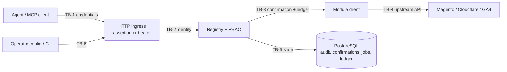

# mage2mcp threat model

| Field | Value |
|---|---|
| Document | Threat model for the mage2mcp MCP gateway |
| Version | 2.0 (as-built) |
| Date | 2026-11-20 |
| Owner | Security owner |
| Status | As-built for v0.11.5. Supersedes the Phase 0 design baseline (v1.1). |
| Baseline | `66786a5d10c1f78d00e08a5b42d01fcc2da37a3f` plus the remediation branch; [known limitations](../audit/known-limitations.md) is binding for the release verdict |
| Related | [SECURITY.md](../../SECURITY.md), [security review](security-review.md), [remediation plan](../audit/remediation-plan.md) |

> **Verification boundary.** No live Magento, Cloudflare, or GA4 instance was
> reachable during this audit. Magento behaviour is verified against the REST
> contract and `httptest` fakes only; the end-to-end harness runs against a fake
> Magento. **No control in this document is labelled `INTEGRATION_TESTED`**, and
> no claim here should be read as "verified against a real store". The honest
> label is `TESTED (CONTRACT)`, or `TESTED (PostgreSQL)` for the database-backed
> controls. See [known-limitations.md §1](../audit/known-limitations.md).

This document describes the system that ships, not the system that was designed.
Where a control is absent it is marked `PLANNED` and its residual risk is stated.
A claim without a real test is labelled `IMPLEMENTED (no direct test)` rather than
"verified".

## 1. Status vocabulary

| Label | Meaning |
|---|---|
| **TESTED (CONTRACT)** | A test in this repository exercises the control against a fake upstream or an in-process client. |
| **TESTED (PostgreSQL)** | A test exercises the control against a real PostgreSQL instance (gated by `MAGE2MCP_TEST_DATABASE_URL`). |
| **IMPLEMENTED (no direct test)** | The code path exists and was reviewed, but no test proves the behaviour. |
| **PLANNED** | Designed, not implemented; the residual risk is accepted and listed in [known-limitations.md](../audit/known-limitations.md). |
| **DEPLOYMENT CONTROL** | The gateway does not enforce it; the operator must (for example origin lockdown or metrics isolation). |
| **DEPRECATED** | Superseded; the old behaviour is no longer supported. |

`INTEGRATION_TESTED` is deliberately not used: it would require a real Magento
instance, and there is none.

### 1.1 What ships

| Capability | Status | Evidence |
|---|---|---|
| Cloudflare Access JWT / bearer verification | TESTED (CONTRACT) | `internal/security/jwt/jwt_test.go`, `internal/security/auth/auth_test.go` |
| Assertion-or-bearer ingress, assertion precedence, duplicate rejection | TESTED (CONTRACT) | `internal/security/auth/auth_test.go` |
| Default-deny RBAC with read/write/destructive/admin ladder | TESTED (CONTRACT) | `internal/security/rbac/rbac_test.go`, `internal/mcp/server/server_test.go` |
| Role provenance from the IdP claim; unknown role grants nothing | TESTED (CONTRACT) | `internal/security/jwt/jwt_test.go`, `internal/security/rbac/rbac_test.go` |
| Two-step confirmation bound to tool, instance and argument hash | TESTED (CONTRACT) | `internal/security/confirm/confirm_test.go`, `internal/mcp/server/server_test.go` |
| Operation ledger with fencing, UNKNOWN and idempotency keys | TESTED (PostgreSQL) | `internal/storage/operation_ledger_test.go`, `internal/storage/operation_gate_test.go` |
| Middleware gate for every non-self-ledgered write tool | TESTED (CONTRACT) | `internal/mcp/server/server_test.go`, `cmd/server/audit_decision_test.go` |
| Automatic reconciliation of UNKNOWN operations | TESTED (CONTRACT + PostgreSQL) | `cmd/worker/reconcile_test.go`, `internal/storage/operation_ledger_test.go` |
| Audit intent/outcome rows, atomic with the ledger for gated writes | TESTED (PostgreSQL) | `internal/storage/operation_gate_test.go`, `internal/storage/storage_test.go` |
| Input schema validation and typed error envelope | TESTED (CONTRACT) | `internal/mcp/toolerr/toolerr_test.go`, `internal/mcp/registry/registry_test.go` |
| Log redaction | TESTED (CONTRACT) | `internal/observability/logger_test.go` |
| Rate limiting / quota enforcement | IMPLEMENTED (Magento) | per-instance token bucket and concurrency cap; Cloudflare/GA4 not yet limited (SEC-11, PERF-05) |
| Session bound to caller identity | PLANNED | none (SEC-15, accepted) |
| Audit hash chain / signed checkpoints / retention partitions | PLANNED | none (SEC-06) |
| Egress IP allowlist / metadata-address guard | PLANNED | none (base URLs are validated, but no IP guard) |
| Duplicate-key JSON pre-parse scanner | PLANNED | none |
| Image decode / re-encode / EXIF strip | PLANNED | none |
| Raw Cloudflare log ingestion (R2 / ClickHouse) | PLANNED | `internal/logs/` is empty |
| Origin lockdown (Tunnel / authenticated origin pull) | DEPLOYMENT CONTROL | not enforced by the gateway |
| Metrics and health endpoint isolation | DEPLOYMENT CONTROL | `/metrics` is on the same listener |

## 2. Scope and non-goals

**In scope.** The gateway process: HTTP ingress and credential verification, the
tool registry and RBAC policy, the confirmation ceremony, the operation ledger and
reconciler, audit, the Magento/Cloudflare/GA4 clients, configuration loading, and
the build and release pipeline.

**Out of scope.** The security of Magento, Cloudflare, and Google themselves; the
operator's IdP; the agent runtime and the model; the operator's network and edge
configuration. Raw-log storage (R2/ClickHouse) is **not implemented** in this
release and is therefore out of scope rather than a hidden control.

**Ingress reality (SEC-08).** The gateway verifies either a
`Cf-Access-Jwt-Assertion` header or an `Authorization: Bearer` token. The
assertion is authoritative when present: its value is verified and the
`Authorization` header is not consulted, so a caller cannot downgrade by sending
a bad assertion. A duplicate header of either kind is rejected before
verification. Both sources use the same verifier (algorithm allowlist, signature,
issuer, audience, expiry, role parsing). The gateway does **not** check that the
request came from Cloudflare, and it does not enforce origin lockdown; a Tunnel
or authenticated origin pull is a deployment control. Without it, any client that
can reach the listener can present its own bearer token.
Evidence: `internal/security/auth/auth_test.go` (`TestMiddlewareAcceptsAssertionHeader`,
`TestMiddlewareAssertionTakesPrecedence`, `TestMiddlewareRejectsBadAssertionHeaders`,
`TestMiddlewareVerifiesAssertionThroughTheSameVerifier`).

**Role provenance (SEC-09).** Roles are the verified token's `roles` claim,
verbatim. The IdP is the role authority: an IdP that lets a user choose the
value of `roles` lets that user choose their roles. The gateway's policy decides
what each name grants, and a role name with no matching grant grants nothing
under default deny. Evidence: `internal/security/jwt/jwt_test.go`
(`TestVerifyRolesComeFromTheClaim`) and `internal/security/rbac/rbac_test.go`
(`TestUnknownRoleCannotWidenAccess`, `TestDefaultPolicyExpressesTheLadder`).

## 3. Assets and data classes

| Asset | Class | Where it lives | Impact if compromised |
|---|---|---|---|
| Cloudflare Access JWT / bearer token | Restricted | Request headers, process memory | Impersonation for the token lifetime |
| Magento credentials (bearer, OAuth 1.0a, admin), Cloudflare token, GA4 service account | Restricted | Process memory, operator config/secret store | Full access to the upstream account, bypassing RBAC |
| Customer and order data | Restricted | Upstream only; transit through the gateway | Privacy/regulatory exposure |
| Analytics aggregates | Confidential | Upstream; tool responses | Commercial intelligence loss |
| Write capability (products, MSI, orders, invoices, refunds) | Critical capability | Registry + upstream | Catalog corruption, duplicate charge/refund |
| Operation ledger (`operations`, `operation_transitions`) | Integrity-critical | PostgreSQL | Wrong replay/reconciliation decision |
| Confirmation records | Integrity-critical | PostgreSQL | Replay of an approved write |
| Audit trail | Integrity-critical | PostgreSQL (in memory without `database.url`) | Loss of non-repudiation |
| Tool schemas and descriptions | Public | Binary, `tools/list` | Model manipulation, capability discovery |

Data classes: Public, Internal, Confidential, Restricted. Customer and order
reads return PII-safe projections (no email, name, addresses, or payment data);
the gateway does not persist customer PII. Credentials are never returned in a
tool result.

## 4. Actors and trust boundaries

| Actor | Trust | Capability |
|---|---|---|
| Human operator | Authenticated | Writes, confirmations, configuration |
| Human analyst | Authenticated | Read tools, including restricted data |
| AI agent | Authenticated, no judgement | Whatever its role grants |
| Compromised agent | Authenticated, attacker-directed | Same grants as the benign agent |
| Malicious tenant | Authenticated on instance A | Reach instance B, escalate role, exhaust quota |
| Insider | Elevated | Config, database, audit |
| Upstream vendor | Semi-trusted | Returns attacker-shaped data |
| Network attacker | Unauthenticated | Interception, injection, flooding |
| Dependency attacker | Supply chain | Code in the binary |



| ID | Boundary | What crosses | Control |
|---|---|---|---|
| TB-1 | Client ↔ ingress | Assertion, bearer token, request body | One credential; duplicate rejected; same verifier; origin lockdown is deployment |
| TB-2 | Ingress ↔ registry/RBAC | Identity, role names, tool, instance | Verified claims, default-deny policy, scope from the registry |
| TB-3 | Request ↔ confirmation/ledger | Arguments, confirmation id, operation intent | Canonical hash, tool+instance binding, single use, ledger state machine |
| TB-4 | Module ↔ upstream | Vendor credential, query, response | Per-instance credentials, https base URLs, redirects refused, response caps |
| TB-5 | Gateway ↔ PostgreSQL | Audit, confirmations, jobs, ledger | Parameterised SQL, transactions, fencing tokens |
| TB-6 | Config/CI ↔ gateway | Secrets, build artifacts | Secret references, redaction, pinned dependencies, signed releases |

## 5. Request path (as-built)

1. **Ingress.** Exactly one credential is accepted: `Cf-Access-Jwt-Assertion`
   wins over `Authorization: Bearer`; duplicates are rejected. No Cloudflare
   source check.
2. **Verify.** The JWT is bounded to 8 KiB, checked against the RS256/ES256
   allowlist, keyed by `kid` from a cached JWKS, and validated for `iss`, `aud`,
   `exp` and `nbf` with at most 60 s skew. Roles come from the verified `roles`
   claim.
3. **Authorize.** The registry supplies the tool's declared permission; RBAC
   resolves `(roles, tool, instance, required scope)` with default deny. An
   unregistered tool is denied before the authorizer is consulted.
4. **Validate.** The SDK and `toolerr` validate the arguments against the tool's
   JSON Schema (`additionalProperties: false`). The request body cap is
   `server.max_body_bytes` (default 16 MiB, validated to admit a maximum import).
5. **Confirm.** A tool that requires confirmation creates or consumes a
   confirmation bound to the tool, the instance, and `sha256(canonical(args))`.
   The consume is atomic with the ledger row for gated writes.
6. **Ledger.** Every write tool is gated: the middleware opens an operation row
   (`pending → executing`) with a fencing token and an idempotency key; the five
   money tools drive the ledger themselves. A replay returns the recorded result;
   an ambiguous outcome becomes `unknown`, never `failed`.
7. **Execute.** The module client calls the upstream API with its own
   per-instance credential. Redirects are refused; responses are size-capped and
   decoded into typed structs.
8. **Finish.** The ledger transitions to `succeeded`, `failed` or `unknown` with
   the fence; for gated writes the audit outcome row is written in the same
   transaction. For the five self-ledgered money tools the audit row is written
   after the tool commits (REL-16-R, §8.12).
9. **Reconcile.** The worker runs a reconcile task every minute, claims due
   `unknown` rows, reads the upstream to decide applied/not-applied, and resolves
   them; inconclusive reads back off, and after eight attempts the operation is
   escalated for manual review.

## 6. Assumptions (as-built)

| ID | Assumption | Consequence if false |
|---|---|---|
| A1 | One deployment serves several instances; tenancy is the instance | Cross-instance checks are the isolation boundary |
| A2 | Origin lockdown (Tunnel or authenticated origin pull) is configured by the operator | **The gateway does not enforce it**; without it any reachable client can send a bearer token |
| A3 | The MCP session is not bound to the caller identity (SEC-15) | A stolen session id is usable for its lifetime; transport auth still gates each request |
| A4 | Magento access is REST only; there is no Magento GraphQL client | Storefront GraphQL verification is not available (ADR-0022) |
| A5 | **Orders and customers are mutable.** Fifteen order/customer-mutating tools ship (eighteen with address tools) | The operation ledger and confirmation binding are the replay controls; see §8.12 |
| A6 | Magento credentials are per-instance (bearer, OAuth 1.0a, or admin auto-token) | A shared credential would collapse the instance boundary |
| A7 | Upstream responses are JSON; HTML/XML bodies fail typed decoding and are never echoed | A protocol-confusion bug could return misleading data |
| A8 | The gateway does not persist customer PII; reads are projections | A projection bug could leak PII |
| A9 | Tools are statically registered; no runtime tool loading | A dynamic registration path would bypass review |
| A10 | The agent is untrusted and may be fully attacker-controlled | Prompt injection is a live threat |
| A11 | Ingress accepts a Cloudflare assertion or a bearer token; the IdP is the role authority | A permissive IdP role claim widens access |
| A12 | No live Magento instance was available; all Magento coverage is CONTRACT | Magento 2.4.9 compatibility is unverified |
| A13 | Raw-log ingestion (R2/ClickHouse) is not implemented | No log-analysis capability exists to protect |
| A14 | `/metrics` and `/healthz` are served on the same listener without authentication | The operator must restrict the listener at the edge |

## 7. STRIDE analysis

Each row names the as-built control and the test that proves it. A row whose
control is absent says so.

### TB-1 Client ↔ ingress

| ID | Threat | Scenario | Control | Evidence / status |
|---|---|---|---|---|
| T-01 | Spoofing | Stolen assertion or bearer token replayed | Bearer credential with IdP lifetime; no token binding. Session binding is PLANNED (SEC-15) | `internal/security/auth/auth_test.go`; residual R-2 |
| T-02 | Tampering | Duplicate assertion/authorization headers or smuggling | Exactly one header per kind; duplicate rejected before verification; assertion precedence | `TestMiddlewareRejectsBadAssertionHeaders`, `TestMiddlewareAssertionTakesPrecedence` |
| T-03 | Information disclosure | Error reflects a token or claim | Auth errors carry a stable reason only; token never logged | `TestMiddlewareNeverLeaksToken`, `TestMiddlewareNeverLeaksAssertion` |
| T-04 | Denial of service | Flood the listener | Per-instance outbound budget bounds load on Magento; the gateway listener itself has no inbound limiter, so the operator must still limit at the edge | residual R-3 |
| T-05 | Spoofing | Direct origin access bypassing Cloudflare | Not enforced by the gateway; deployment control | residual R-4 |

### TB-2 Ingress ↔ registry/RBAC

| ID | Threat | Scenario | Control | Evidence / status |
|---|---|---|---|---|
| T-06 | Elevation | Forged/`alg=none`/HMAC-confusion token | RS256/ES256 allowlist; `kid` lookup only; JWKS redirects refused; 8 KiB cap | `internal/security/jwt/jwt_test.go` (`TestVerifyAlgorithmRejections`, `TestVerifyKidRejections`, `TestVerifyJWKSRedirectRejected`) |
| T-07 | Elevation | Wrong issuer/audience or expired token | Exact `iss`, `aud`, `exp`, `nbf` with 60 s skew | `TestVerifyClaimRejections` |
| T-08 | Elevation | Caller claims an admin role | Roles are the verified IdP claim; unknown role grants nothing; policy grants the ladder explicitly | `TestUnknownRoleCannotWidenAccess`, `TestDefaultPolicyExpressesTheLadder` |
| T-09 | Elevation | Caller supplies `instance` for another tenant | RBAC receives the instance; a grant scoped to A does not authorize B | `internal/mcp/server/server_test.go` (`TestCrossInstanceAuthorizationIsEnforced`) |
| T-10 | Elevation | Call a tool with no declared permission | Registry rejects a tool without a permission; the authorizer denies an unregistered tool | `internal/mcp/registry/registry_test.go`, `TestAuthorizationFailsClosedForUnregisteredTool` |
| T-11 | Elevation | Read-only role calls a write tool | Required scope is read from the registry and enforced; the default policy gives viewer/analyst read only | `TestAuthorizationReceivesRequiredScope`, `internal/security/rbac/rbac_test.go` |

### TB-3 Request ↔ confirmation/ledger

| ID | Threat | Scenario | Control | Evidence / status |
|---|---|---|---|---|
| T-12 | Tampering | Change arguments after approval | Confirmation is bound to `sha256(canonical(args))`; a changed argument fails consumption | `TestConsumeRejectsChangedArguments`, `TestBeginCallRefusesMismatchedConfirmation` |
| T-13 | Elevation | Reuse an approval for another tool or instance | Confirmation is bound to tool and instance | `TestConsumeRejectsDifferentTool`, `TestConsumeRejectsDifferentInstance`, `TestConfirmationBoundToToolAndInstanceThroughHTTP` |
| T-14 | Repudiation | Approve one's own request | Self-approval rejected by the store and the service | `TestApproveRejectsSelfApproval` |
| T-15 | Replay | Submit the same confirmation twice | Single-use compare-and-set; concurrent consumption tested | `TestConsumeSingleUseUnderConcurrency` |
| T-16 | Tampering | Reuse an idempotency key with different arguments | Key is scoped to `(instance, operation, key)`; reuse with different args is rejected | `TestOperationKeyReuseWithDifferentArgs`, `TestLedgerIdempotencyKeyReuse` |
| T-17 | Replay | Retry after a timeout and duplicate a charge | Ambiguous outcome becomes `unknown`; a replay returns the recorded result; the reconciler resolves before any retry | §8.12; `TestCaptureInvoiceTimeoutIsUnknown`, `TestLedgerReplaySemantics` |

### TB-4 Module ↔ upstream

| ID | Threat | Scenario | Control | Evidence / status |
|---|---|---|---|---|
| T-18 | Spoofing | Lookalike Magento host / TLS interception | Base URLs must be https (http only for loopback); Go TLS verification; no `InsecureSkipVerify` | `internal/magento/client_test.go` (`TestNewClientValidation`), `internal/cloudflare/client_test.go`, `internal/ga4/client_test.go` |
| T-19 | Tampering | Upstream returns HTML, truncated JSON, or an oversized body | Typed decoding; 8 MiB response cap; HTML fails decoding; no body echoed | `TestResponseTooLargeIsExplicit`, `TestErrorMapping` |
| T-20 | Elevation | SSRF through a URL supplied by the agent | No tool accepts a URL; media upload takes bytes; base URLs are configuration, not arguments | `internal/magento/media_upload_test.go`; no URL tool exists |
| T-21 | Information disclosure | Upstream text becomes model instructions | Upstream text is untrusted data; writes are confirmation-gated; no provenance envelope exists | residual R-1 |
| T-22 | Denial of service | Expensive queries exhaust GA4/Cloudflare/Magento | Magento calls are bounded by the per-instance budget; GA4/Cloudflare rely on request caps and upstream quotas | residual R-3 |

### TB-5 Gateway ↔ PostgreSQL

| ID | Threat | Scenario | Control | Evidence / status |
|---|---|---|---|---|
| T-23 | Tampering | Stale worker writes an outcome | Every transition after `pending` is guarded by state and fence; a stale fence returns applied=false | `TestLedgerStaleFenceIsRejected`, `TestLedgerConcurrentExecuteSingleOwner` |
| T-24 | Repudiation | Delete or edit an audit row | No hash chain or WORM sink; the table is append-only by convention and DB grants | `internal/storage/storage_test.go`; residual R-5 |
| T-25 | Information disclosure | Read another tenant's job or batch | Import tools require `instance`; job/batch reads are scoped; cross-tenant test | `TestImportJobToolsRequireInstance`, `TestImportJobsCrossTenantIsolation` |
| T-26 | Denial of service | Job flood fills the queue | Job queue with leases and retry caps; no admission cap | `internal/jobs/jobs_test.go`; residual R-3 |

### TB-6 Config, secrets, supply chain

| ID | Threat | Scenario | Control | Evidence / status |
|---|---|---|---|---|
| T-27 | Information disclosure | Token in a log line | Key-fragment redaction for token/secret/password/authorization/cookie/api_key/credential and bearer shapes | `internal/observability/logger_test.go` |
| T-28 | Information disclosure | Literal secret committed in YAML | Not rejected by the loader; `${VAR}` is a convention, not enforcement | `internal/core/config/config_test.go`; residual R-6 |
| T-29 | Tampering | Dependency or workflow compromise | Pinned modules and SHAs, `go.sum`, govulncheck/gosec/gitleaks, SBOM, cosign | `.github/workflows/security.yml`, `.github/workflows/release.yml` |
| T-30 | Information disclosure | Panic/config dump prints a secret | Redaction covers `slog` attributes; no secret-carrying type with `String()` | residual R-6 |

## 8. Required analyses

### 8.1 Prompt injection

**Severity: High.** Upstream strings (product names, order comments, WAF fields,
GA4 dimension values) reach the model. There is no provenance envelope and no
adversarial injection suite in this repository.

**What exists.** Writes require a confirmation approved by a different identity,
so an injected write cannot execute silently; RBAC limits what the caller can
reach; the confirmation summary is built from validated arguments, not upstream
text. Reads can still be influenced.

**Upstream error text no longer reaches the model (SEC-10).** Magento's validation
message and Cloudflare's GraphQL error are kept in a server-only field and logged
with the tool and taxonomy code; they are not serialised into the tool result. GA4
already answered with gateway-authored text. The remaining exposure is upstream
*data* — a product name, an order comment, a WAF field — which is the content the
tools exist to return and cannot be withheld.

**Residual risk R-1.** A successful injection can influence a read-only answer or
persuade an operator to approve a write. No test proves otherwise; an injection
corpus is PLANNED.

Evidence: `internal/security/confirm/confirm_test.go` (confirmation ceremony),
`internal/mcp/server/server_test.go` (write gating). This is structural coverage,
not an injection test.

### 8.2 Tool parameter injection

**Severity: High.** The SDK and `toolerr` validate against the tool's JSON
Schema with `additionalProperties: false`; identifiers use patterns and length
caps; the body cap is 16 MiB by default and validated to admit a maximum import.
Go's `encoding/json` still accepts duplicate keys (last one wins), and there is no
pre-parse duplicate-key scanner — that control is PLANNED.

Evidence: `internal/mcp/toolerr/toolerr_test.go` (`TestInvalidArgumentsEnvelope`,
`TestStructuredErrorEnvelope`), `internal/magento/import_test.go`
(`TestImportLimitsAgreeAcrossPackages`), `internal/magento/client_test.go`
(`TestGetRejectsInvalidSKUWithoutRequest`).

### 8.3 Privilege escalation

Default-deny RBAC, scope from the registry, instance-scoped grants, explicit deny
wins, unknown role grants nothing. The default policy is `viewer`/`analyst` read,
`operator` write, `admin` admin. An unregistered tool is denied before the
authorizer is consulted.

Evidence: `internal/security/rbac/rbac_test.go` (`TestDefaultDeny`,
`TestScopeHierarchy`, `TestInstanceScoping`, `TestDenyOverridesAllow`,
`TestUnknownRoleCannotWidenAccess`, `TestDefaultPolicyExpressesTheLadder`);
`internal/mcp/server/server_test.go` (`TestAuthorizationReceivesRequiredScope`,
`TestAuthorizationFailsClosedForUnregisteredTool`).

### 8.4 Multi-tenant leakage

Per-instance resolvers select the credential; RBAC receives the instance; import
job tools require `instance`; job and batch reads are scoped; a cross-instance
test covers the tool path. Unified bindings are limited to one Cloudflare and one
GA4 instance (PLANNED multi-instance bindings; validation rejects other shapes).

Evidence: `internal/magento/resolver_test.go`,
`internal/mcp/server/server_test.go` (`TestCrossInstanceAuthorizationIsEnforced`),
`internal/magento/import_jobs_test.go` (`TestImportJobsCrossTenantIsolation`).

### 8.5 JWT forgery

Algorithm allowlist (RS256/ES256), `kid` lookup only inside the cached JWKS,
redirects refused, 8 KiB token cap, exact issuer/audience, bounded clock skew,
rate-limited JWKS refresh.

Evidence: `internal/security/jwt/jwt_test.go` (`TestVerifyAlgorithmRejections`,
`TestVerifyKidRejections`, `TestVerifyClaimRejections`,
`TestVerifyJWKSRedirectRejected`, `TestVerifyJWKSFailureIsRateLimited`,
`TestVerifyRejectsOversizedToken`).

### 8.6 Token leakage

The token is never logged or echoed; the auth middleware maps failures to stable
reasons; the logger redacts secret-shaped keys and bearer values.

Evidence: `internal/security/auth/auth_test.go`
(`TestMiddlewareNeverLeaksToken`, `TestMiddlewareNeverLeaksAssertion`),
`internal/observability/logger_test.go`.

### 8.7 SSRF

No tool accepts a URL. Magento, Cloudflare and GA4 base URLs are configuration,
validated as https (http only for loopback). Redirects are refused. There is no
IP allowlist or metadata-address guard (PLANNED), so an operator who configures a
malicious base URL is trusted to do so.

Evidence: `internal/magento/client_test.go` (`TestNewClientValidation`,
`TestNewClientInstallsTunedTransport`), `internal/cloudflare/client_test.go`
(`TestNewClientValidation`), `internal/ga4/client_test.go`
(`TestNewClientConfig`).

### 8.8 File upload and import

Imports accept CSV or JSON only, at most 8 MiB and 5 000 rows with 64 columns;
the encoded payload is size-checked before decode; XLSX and gzip are not
accepted. There is no export feature, so spreadsheet formula injection is not
applicable. Import jobs are bounded and report per-row failures.

Evidence: `internal/magento/import_test.go` (`TestValidateImportRejectsUnsupportedFormatAndOversize`,
`TestImportLimitsAgreeAcrossPackages`), `internal/magento/import_jobs_test.go`
(`TestImportStartRejectsBadPayload`).

### 8.9 Images

Media upload accepts base64 JPEG/PNG/WebP/GIF up to 5 MiB, validates the MIME
type, filename, label and position. It does **not** decode and re-encode the
image, so EXIF metadata and polyglot trailing bytes are not stripped; SVG is not
accepted. That gap is PLANNED.

Evidence: `internal/magento/media_upload_test.go`
(`TestUploadMediaRejectsOversizedPayload`, `TestUploadMediaValidation`,
`TestUploadMediaRejectsInvalidEntryID`).

### 8.10 API abuse

Each Magento instance has its own outbound budget: a token bucket
(`requests_per_second`, `burst`) and a concurrency cap (`max_concurrent`),
configured per instance under `limits:`. A request that cannot obtain budget
before its tool deadline returns a retryable `rate_limited` and never reaches
Magento. The default (50 rps, burst 100, 8 concurrent) is generous: it does not
throttle ordinary use but stops a retry storm.

What this does **not** cover: there is no inbound limiter on the gateway
listener, and Cloudflare and GA4 calls are not budgeted. Tool-level caps (page
size, row count, import size) still bound a single call, not a stream of calls.

Evidence: `internal/magento/limits_test.go` (`TestLimiterAllowsBurstThenPaces`,
`TestLimiterCapsConcurrency`, `TestLimiterWaitsAreBoundedByContext`,
`TestClientBudgetSurfacesRateLimited`). Residual R-3 applies to the inbound path.

### 8.11 Rate-limit bypass

PLANNED with §8.10: there is no limiter to bypass. When one is added, it must key
on the verified subject and instance, not on a client-supplied header or session
id.

### 8.12 Task duplication and replay (money-moving operations)

**Severity: Critical.** Magento has no native idempotency key. A timeout, a 5xx,
or a crash can leave the gateway unable to tell "not applied" from "applied". The
gateway now ships a durable operation ledger for this.

**What ships.** Fifteen order/customer-mutating tools (eighteen with address
tools):

| Tool | Ledger path |
|---|---|
| `magento.order.create` | self-ledgered (money) |
| `magento.invoice.create` | self-ledgered (money) |
| `magento.invoice.capture` | self-ledgered (money) |
| `magento.creditmemo.create` | self-ledgered (money) |
| `magento.order.cancel` | self-ledgered (money) |
| `magento.order.comment`, `.hold`, `.unhold`, `.email` | middleware gate |
| `magento.invoice.email`, `magento.shipment.create`, `magento.shipment.email`, `magento.creditmemo.email` | middleware gate |
| `magento.customer.create`, `.update`, `.addresses.create`, `.addresses.update`, `.addresses.delete` | middleware gate |

Every other write tool is gated by the same middleware; a test asserts that every
write tool is either gated or explicitly declared self-ledgered
(`cmd/server/audit_decision_test.go`).

**State machine.** `pending → executing → {succeeded, failed, unknown}`;
`unknown → reconciling → {succeeded, failed, unknown}`; `failed → pending` only
when a retry is proven safe. Every transition after `pending` is a conditional
update guarded by the current state and the fencing token issued when the row was
claimed. A stale writer gets `applied=false` and must not report success.

**UNKNOWN on ambiguity.** A transport failure after the request may have been
sent, a timeout, or a 5xx becomes `unknown`, never `failed`. The caller is told
`operation_unknown` and must poll; retrying is refused. A proven not-applied
failure becomes `failed` and may be retried.

**Idempotency keys.** Every operation has a key: caller-supplied or derived from
`sha256(subject || args_hash)`. The unique key is `(instance_id, operation,
idempotency_key)`. A repeat returns the recorded result with `replayed=true` and
does not call upstream. A repeated key with different arguments is
`idempotency_key_reuse`.

**Reconciler.** The worker enqueues a reconcile task every minute, claims due
`unknown` rows, reads the upstream (`ObserveOperation` per capability), and
resolves them as succeeded/failed/unknown. An inconclusive read backs off; after
eight attempts the operation is escalated for manual review.

**Confirmation binding.** The confirmation is bound to the tool, the instance,
and the canonical argument hash, and is consumed in the same transaction as the
ledger row. A confirmation for one tool or instance cannot be replayed against
another.

**Residual limits (stated, not hidden).**

- **REL-16-R:** the five self-ledgered money tools write their outcome audit row
  through the middleware *after* the tool commits. A crash in that window leaves
  the `operations` row correct but its `audit_events` row missing. The ledger is
  the authority on whether money moved; the audit trail has a gap. Closing it
  requires the five Magento write paths to write their audit row inside their own
  transaction.
- **MAG-04-R:** order-creation reconciliation matches customer + a 15-minute
  window + order total. A legitimate second order with the same total in that
  window can be read as the first. The safe direction is a replay report, but the
  caller may be told an order succeeded when a different one did.
- The ledger requires `database.url`. Without PostgreSQL the gate is disabled,
  the five money tools fail closed (`operation ledger is not configured`), and
  no replay protection exists. That is a development-only mode.

Evidence: `internal/storage/operation_ledger_test.go` (`TestLedgerReplaySemantics`,
`TestLedgerIdempotencyKeyReuse`, `TestLedgerUnknownThenReconcile`,
`TestLedgerStaleFenceIsRejected`, `TestLedgerTerminalStatesAreFinal`,
`TestLedgerAmbiguousFailureIsNotRetryable`); `internal/storage/operation_gate_test.go`
(`TestBeginCallConsumesConfirmationAtomically`,
`TestFinishCallWritesAuditInTheSameTransaction`,
`TestFinishCallRollsBackTransitionWhenAuditFails`); `internal/magento/operations_test.go`
(`TestOperationUnknownRefusesToExecute`, `TestOperationFailedIsNotRetriedAutomatically`,
`TestInvoiceCaptureToolReplays`); `internal/magento/invoice_capture_test.go`
(`TestCaptureInvoiceTimeoutIsUnknown`); `internal/magento/order_create_test.go`
(`TestCreateOrderReplaysSameKey`, `TestCreateOrderAmbiguousReconciles`,
`TestCreateOrderAmbiguousNoMatch`); `internal/magento/document_write_test.go`
(`TestCreateCreditmemoUnknownOnAmbiguousOutcome`); `cmd/worker/reconcile_test.go`
(`TestReconcileHandlerResolvesEachWay`, `TestReconcileHandlerDefersOnReadFailure`,
`TestReconcileHandlerEscalates`).

### 8.13 Task state tampering

Job state transitions are guarded; the job queue uses leases and a lease token, a
stale worker cannot complete or fail a row it no longer owns, and cancellation is
checked before work. The operation ledger uses the same pattern with a fence.

Evidence: `internal/jobs/jobs_test.go`, `internal/storage/storage_test.go`
(`TestJobQueueLifecycle`, `TestJobQueueRecoversExpiredLease`),
`internal/storage/operation_ledger_test.go` (`TestLedgerStaleFenceIsRejected`).

### 8.14 Untrusted upstream responses

Responses are size-capped (8 MiB), decoded into typed structs, and mapped to a
closed error taxonomy. Upstream validation text is control-character stripped and
bounded to 300 runes before it appears in `details.upstream_message` (SEC-10
accepted residual: an authorized caller can see bounded upstream text). HTML is
not echoed; it fails decoding.

Evidence: `internal/magento/client_test.go` (`TestResponseTooLargeIsExplicit`,
`TestErrorMapping`, `TestTimeoutMapping`), `internal/cloudflare/client_test.go`
(`TestDoResponseCap`, `TestDoMalformedAndEmpty`).

### 8.15 Dependency supply chain

Dependencies are pinned in `go.mod`/`go.sum`; the security workflow runs
`govulncheck`, `gosec`, `gitleaks` and Scorecard; the release workflow produces an
SPDX SBOM, checksums, cosign signatures and provenance attestations; Actions are
pinned to commit SHAs. CI is manual and release-time only, so a pull request does
not run these gates automatically; `scripts/local-ci.sh` is the day-to-day gate.

Evidence: `.github/workflows/security.yml`, `.github/workflows/release.yml`,
`.github/workflows/ci.yml`, `scripts/local-ci.sh`.

### 8.16 Raw Cloudflare logs (R2 / ClickHouse)

Not implemented. There is no loader, no query tool, and no credential for either
store in the code. Any document that describes this capability is a design
proposal, not a shipped control. `internal/logs/` is empty.

## 9. Control summary

### 9.1 Authentication

- Ingress: one credential; assertion precedence; duplicate rejection; same
  verifier for both sources; **no origin enforcement**.
- JWT: 8 KiB cap, RS256/ES256 allowlist, `kid`-only lookup, exact issuer and
  audience, `exp`/`nbf` with 60 s skew, cached JWKS with a refresh limiter,
  redirects refused.
- Roles: the verified `roles` claim; the IdP is the authority; an unknown role
  grants nothing.
- Identity classes: human and service are separate; a service identity never
  inherits a human role.

### 9.2 Authorization

Default deny. The shipped policy is:

| Role | Scope granted |
|---|---|
| `viewer` | read |
| `analyst` | read |
| `operator` | write (and read, by the ladder) |
| `admin` | admin (and every lower scope) |

A grant may be scoped to an instance; a grant on instance A never authorizes
instance B. An explicit deny beats every allow. An unregistered tool is denied.

### 9.3 Confirmation

Two-step, opaque id, different human, bound to tool + instance + canonical
argument hash, 300 s default / 900 s cap, single use, consumed atomically with
the ledger row for gated writes. The approval surface is the `mage2mcp-admin`
CLI; its `-as` identity is self-asserted (SEC-04, accepted) and requires database
access.

### 9.4 Audit

Every tool call writes an intent row and an outcome row with subject hash,
identity class, tool, instance, decision, phase, state, error code and request
id; the outcome row also carries the tool's scope. For gated writes the outcome
row is committed in the same transaction as the ledger transition. Denials are
recorded as `decision=deny`; failed and ambiguous outcomes as `error`.

**Gaps (PLANNED):** no hash chain, no signed checkpoint, no WORM sink, no
retention partitions, and the `params_hash` column is not populated (the
canonical hash lives in `confirmation_tokens` and `operations`). **REL-16-R**
leaves an audit gap for the five self-ledgered money tools; see §8.12.

### 9.5 Secrets

Credentials are `${VAR}` references by convention; the loader does not reject a
literal secret (PLANNED enforcement). The logger redacts secret-shaped keys and
bearer values. The admin credential form keeps the password in memory and never
logs it. The approval CLI trusts a self-asserted approver (SEC-04).

### 9.6 Egress

Only configured base URLs and fixed vendor endpoints are contacted. Base URLs
must be https (loopback http is allowed for development). Redirects are refused.
There is no IP allowlist, DNS pinning, or metadata-address guard (PLANNED).

### 9.7 Rate limiting and quotas

Implemented per Magento instance (SEC-11, PERF-05): a token bucket bounds the
sustained rate and burst, and a semaphore bounds in-flight requests. The budget is
per instance because two stores have independent capacity, and it is charged
against the caller's deadline so an exhausted budget fails as `rate_limited`
rather than stalling.

Not implemented: no per-subject limiter, no deployment-wide admission control, no
GA4 or Cloudflare quota accounting, and no inbound limiter on the listener — the
operator must still limit inbound traffic at the edge (residual R-3).

### 9.8 Capability registration

Tools are registered when a module is enabled; the `Capability` metadata exists
but is not consumed for gating (MCP-13). Unified tools require all three modules
and exactly one Cloudflare and one GA4 instance; multi-instance bindings are
PLANNED. There is no `notifications/tools/list_changed` because the registry is
static for the process lifetime.

## 10. Residual risks

| ID | Risk | Why it remains | Mitigation / review trigger |
|---|---|---|---|
| R-1 | Prompt injection can influence a model | MCP has no instruction/data boundary; no provenance envelope | Confirmation, least privilege, no instruction-bearing tool output; add a provenance envelope and an injection corpus |
| R-2 | A stolen token or session id is usable for its lifetime | Bearer credentials; session binding is PLANNED (SEC-15) | Short IdP lifetimes, Access policy, audit correlation; revisit with a session store |
| R-3 | No inbound rate limiting, and no GA4/Cloudflare outbound budget | Magento outbound limits landed (SEC-11, PERF-05); the inbound path and the other two modules did not | Limit inbound at the edge; upstream quotas bound the rest |
| R-4 | Origin lockdown is not enforced | Deployment control | Tunnel or authenticated origin pull; a public bind is the operator's choice |
| R-5 | Audit is not tamper-evident | No hash chain/checkpoint/WORM sink (SEC-06) | Restrict DB grants, export to an immutable sink; implement the chain before regulated use |
| R-6 | Literal secrets are not rejected | `${VAR}` is procedural, not enforced | Protect config files; use a secret manager |
| R-7 | Magento 2.4.9 compatibility is unverified | No live instance (A12) | Run `test/e2e` against a real sandbox; treat early use as verification |
| R-8 | Five money tools have an audit-outcome gap (REL-16-R) | Their audit row is written after the commit | The ledger is the authority; add in-transaction audit to those five paths |
| R-9 | Order reconciliation can misidentify a legitimate second order (MAG-04-R) | Customer + 15 min + total heuristic | Verify `reconciled: true` against Magento; improve the match key |
| R-10 | Metrics/health are unauthenticated on the listener | Same listener (SEC-12) | Restrict the listener/edge; a separate metrics listener is PLANNED |
| R-11 | Image EXIF/polyglot bytes are not stripped | No decode/re-encode | Treat uploaded images as untrusted; add re-encoding |
| R-12 | Duplicate JSON keys are accepted | No strict pre-parse scanner | Schema validation bounds the effect; add the scanner |
| R-13 | Multi-instance unified bindings are unsupported | One CF/one GA4 adapter | Configure one of each; multi-instance is PLANNED |
| R-14 | R2/ClickHouse log analysis is absent | Not implemented | Do not rely on raw-log tools; they do not exist |

## 11. Security test plan

Every row names a test that exists. The verification step in §12 scans every
cited path and must report zero missing.

| Control | Test file | Test name(s) | Status |
|---|---|---|---|
| Assertion/bearer ingress | `internal/security/auth/auth_test.go` | `TestMiddlewareAcceptsAssertionHeader`, `TestMiddlewareAssertionTakesPrecedence`, `TestMiddlewareRejectsBadAssertionHeaders`, `TestMiddlewareVerifiesAssertionThroughTheSameVerifier` | TESTED (CONTRACT) |
| JWT signature/claims/alg/kid | `internal/security/jwt/jwt_test.go` | `TestVerifyValidRS256`, `TestVerifyValidES256`, `TestVerifyClaimRejections`, `TestVerifyAlgorithmRejections`, `TestVerifyKidRejections`, `TestVerifyJWKSRedirectRejected`, `TestVerifyJWKSFailureIsRateLimited`, `TestVerifyRejectsOversizedToken` | TESTED (CONTRACT) |
| Role provenance | `internal/security/jwt/jwt_test.go`, `internal/security/rbac/rbac_test.go` | `TestVerifyRolesComeFromTheClaim`, `TestUnknownRoleCannotWidenAccess`, `TestDefaultPolicyExpressesTheLadder` | TESTED (CONTRACT) |
| RBAC default deny/scope/instance | `internal/security/rbac/rbac_test.go`, `internal/mcp/server/server_test.go` | `TestDefaultDeny`, `TestScopeHierarchy`, `TestInstanceScoping`, `TestDenyOverridesAllow`, `TestAuthorizationReceivesRequiredScope`, `TestCrossInstanceAuthorizationIsEnforced`, `TestAuthorizationFailsClosedForUnregisteredTool` | TESTED (CONTRACT) |
| Confirmation binding/single use/self-approval | `internal/security/confirm/confirm_test.go`, `internal/mcp/server/server_test.go` | `TestConsumeRejectsChangedArguments`, `TestConsumeRejectsDifferentTool`, `TestConsumeRejectsDifferentInstance`, `TestConsumeSingleUseUnderConcurrency`, `TestApproveRejectsSelfApproval`, `TestConfirmationBoundToToolAndInstanceThroughHTTP` | TESTED (CONTRACT) |
| Ledger fencing/UNKNOWN/replay/idempotency | `internal/storage/operation_ledger_test.go` | `TestLedgerStaleFenceIsRejected`, `TestLedgerConcurrentExecuteSingleOwner`, `TestLedgerReplaySemantics`, `TestLedgerIdempotencyKeyReuse`, `TestLedgerUnknownThenReconcile`, `TestLedgerTerminalStatesAreFinal`, `TestLedgerAmbiguousFailureIsNotRetryable` | TESTED (PostgreSQL) |
| Gate atomicity + audit | `internal/storage/operation_gate_test.go` | `TestBeginCallConsumesConfirmationAtomically`, `TestFinishCallWritesAuditInTheSameTransaction`, `TestFinishCallRollsBackTransitionWhenAuditFails`, `TestFinishCallRecordsUnknownWithAudit` | TESTED (PostgreSQL) |
| Every write gated | `cmd/server/audit_decision_test.go`, `internal/mcp/server/server_test.go` | `TestEveryWriteToolIsGatedOrDeclaredSelfLedgered`, `TestEveryWriteToolIsGated`, `TestSelfLedgeredToolsAreSkippedButEverythingElseIsGated` | TESTED (CONTRACT) |
| Money-tool replay/UNKNOWN | `internal/magento/operations_test.go`, `internal/magento/invoice_capture_test.go`, `internal/magento/order_create_test.go`, `internal/magento/document_write_test.go` | `TestOperationUnknownRefusesToExecute`, `TestOperationFailedIsNotRetriedAutomatically`, `TestInvoiceCaptureToolReplays`, `TestCaptureInvoiceTimeoutIsUnknown`, `TestCreateOrderReplaysSameKey`, `TestCreateOrderAmbiguousReconciles`, `TestCreateCreditmemoUnknownOnAmbiguousOutcome` | TESTED (CONTRACT) |
| Reconciler | `cmd/worker/reconcile_test.go` | `TestReconcileHandlerResolvesEachWay`, `TestReconcileHandlerDefersOnReadFailure`, `TestReconcileHandlerEscalates` | TESTED (CONTRACT + PostgreSQL) |
| Cross-tenant job access | `internal/magento/import_jobs_test.go` | `TestImportJobToolsRequireInstance`, `TestImportToolsThreadInstanceAndSubject`, `TestImportJobsCrossTenantIsolation` | TESTED (CONTRACT) |
| Input schema/errors | `internal/mcp/toolerr/toolerr_test.go`, `internal/mcp/registry/registry_test.go` | `TestInvalidArgumentsEnvelope`, `TestStructuredErrorEnvelope`, `TestRegisterRejectsInvalidTools` | TESTED (CONTRACT) |
| Import bounds | `internal/magento/import_test.go`, `internal/magento/import_jobs_test.go` | `TestImportLimitsAgreeAcrossPackages`, `TestImportStartRejectsBadPayload` | TESTED (CONTRACT) |
| Media bounds | `internal/magento/media_upload_test.go` | `TestUploadMediaRejectsOversizedPayload`, `TestUploadMediaValidation`, `TestUploadMediaRejectsInvalidEntryID` | TESTED (CONTRACT) |
| Upstream response caps/errors | `internal/magento/client_test.go`, `internal/cloudflare/client_test.go` | `TestResponseTooLargeIsExplicit`, `TestErrorMapping`, `TestDoResponseCap`, `TestDoMalformedAndEmpty` | TESTED (CONTRACT) |
| Base URL validation | `internal/magento/client_test.go`, `internal/cloudflare/client_test.go`, `internal/ga4/client_test.go` | `TestNewClientValidation`, `TestNewClientConfig` | TESTED (CONTRACT) |
| Log redaction | `internal/observability/logger_test.go` | `TestNewLoggerJSONRedactsSecrets`, `TestNewLoggerRedactsNestedGroups`, `TestNewLoggerRedactsBearerValues` | TESTED (CONTRACT) |
| Audit decision mapping | `cmd/server/audit_decision_test.go` | `TestAuditDecisionMapsPhaseAndState` | TESTED (CONTRACT) |
| End-to-end write/confirmation/import | `test/e2e/run.sh` | fake-Magento smoke test | TESTED (E2E, fake Magento) |
| Rate limiting (Magento outbound) | `internal/magento/limits_test.go` | `TestLimiterAllowsBurstThenPaces`, `TestLimiterCapsConcurrency`, `TestLimiterWaitsAreBoundedByContext`, `TestClientBudgetSurfacesRateLimited` | TESTED (CONTRACT) |
| Rate limiting (inbound, GA4, Cloudflare) | none | none | PLANNED |
| Session binding | none | none | PLANNED |
| Audit hash chain | none | none | PLANNED |
| Egress IP guard | none | none | PLANNED |
| Duplicate-key scan | none | none | PLANNED |
| Image re-encode | none | none | PLANNED |
| Prompt-injection corpus | none | none | PLANNED |

## 12. Verification

The path citations in this document were checked mechanically: every backticked
path ending in `.go`, `.sh`, `.yml` or `.md` was resolved on disk. The scan
reported **zero missing** (`cited=31 missing=0`). Reproduce it with:

```bash
python3 - <<'PY'
import os, re
text = open("docs/security/threat-model.md").read()
paths = set(re.findall(r'`([A-Za-z0-9_./-]+\.(?:go|sh|yml|yaml|md))`', text))
missing = [p for p in paths if not os.path.exists(p)]
print(f"cited={len(paths)} missing={len(missing)}")
PY
```

Every test name in the §11 table was also checked against the `func Test...`
declarations in the tree (`cited=84 missing=0`).

Test commands used for the status labels above (all green on the remediation
tree, with the PostgreSQL suite pointed at a local instance):

```bash
go test -count=1 ./internal/security/... ./internal/mcp/... ./cmd/server ./cmd/worker
MAGE2MCP_TEST_DATABASE_URL='postgres://...' go test -count=1 ./internal/storage/...
```

**Open questions.**

1. A live Magento 2.4.9 sandbox is still required to validate the contract
   assumptions; until then every Magento row is CONTRACT.
2. The five self-ledgered money tools should move onto the middleware gate (or
   write their audit row in-transaction) to close REL-16-R.
3. A rate limiter and a tamper-evident audit chain are the two largest missing
   controls for regulated deployments.
4. Origin lockdown and metrics isolation remain deployment controls; a future
   release could enforce a Tunnel-only bind.
